# Complete proof index

Every current problem manuscript and shared dependency is listed below. The [README](README.md) gives selected results and a compact problem index; this page provides the complete reading path without duplicate checkpoint copies.

## Subset Sum

### [Faster deterministic Subset Sum](problems/subset-sum-fast-deterministic/)

[Statement](problems/subset-sum-fast-deterministic/README.md) · [Main proof](problems/subset-sum-fast-deterministic/proof.md) · [Sources](problems/subset-sum-fast-deterministic/sources.md) · [Verification](problems/subset-sum-fast-deterministic/verify/README.md)

### [Low-space deterministic Subset Sum](problems/subset-sum-low-space-deterministic/)

[Statement](problems/subset-sum-low-space-deterministic/README.md) · [Main proof](problems/subset-sum-low-space-deterministic/proof.md) · [Sources](problems/subset-sum-low-space-deterministic/sources.md) · [Verification](problems/subset-sum-low-space-deterministic/verify/README.md)

- [Exact Boolean convolution with elementary bit arithmetic](problems/subset-sum-low-space-deterministic/convolution.md)
- [Two short normalized ranges at arbitrary lattice scales](problems/subset-sum-low-space-deterministic/range-branch.md)

## Algebraic complexity

### [Deterministic PIT for fixed-width affine ROABP orbits](problems/roabp-affine-pit/)

[Statement](problems/roabp-affine-pit/README.md) · [Main proof](problems/roabp-affine-pit/proof.md) · [Sources](problems/roabp-affine-pit/sources.md) · [Verification](problems/roabp-affine-pit/verify/README.md)

- [Exact support bounds for rank-stable matrix words](problems/roabp-affine-pit/manuscripts/palette-sharpness.md)
- [A quadratic leading-digit obstruction at the ordinary moment curve](problems/roabp-affine-pit/manuscripts/quadratic-hasse-obstruction.md)
- [Stronger bounds under distinct ROABP promises](problems/roabp-affine-pit/manuscripts/special-cases.md)

## Numeric targets and quota geometry

### [Numeric targets and support patterns](problems/numeric-target-frontier/)

[Statement](problems/numeric-target-frontier/README.md) · [Main proof](problems/numeric-target-frontier/proof.md) · [Sources](problems/numeric-target-frontier/sources.md) · [Verification](problems/numeric-target-frontier/verify/README.md)

- [Exact aligned nonlinear numeric targets under one global polymatroid](problems/numeric-target-frontier/manuscripts/aligned-nonlinear-mixed-numeric-targets.md)
- [Overlap-density bounds for aligned nonlinear numeric rows](problems/numeric-target-frontier/manuscripts/aligned-nonlinear-overlap-density-transfer.md)
- [Exact numeric-target schemes for global-resource fairness and scheduling](problems/numeric-target-frontier/manuscripts/block-global-exact-numeric-target-schemes.md)
- [A sharp column-support dichotomy for exact numeric targets](problems/numeric-target-frontier/manuscripts/column-support-numeric-target-dichotomy.md)
- [Component-sensitive exact numeric-target catalogues](problems/numeric-target-frontier/manuscripts/component-sensitive-numeric-target-catalogues.md)
- [Compressed nonlinear utility, cost, and load transfers under a global polymatroid](problems/numeric-target-frontier/manuscripts/compressed-nonlinear-marginal-band-transfers.md)
- [A total-target ETH lower bound for explicitly encoded rank matroids](problems/numeric-target-frontier/manuscripts/conditional-lower-bound-encoded-target-matroids.md)
- [An encoded ETH tradeoff across row-overlap densities](problems/numeric-target-frontier/manuscripts/encoded-overlap-density-eth-lower-bound.md)
- [Exact single-polymatroid optimization in square-root numeric-target time](problems/numeric-target-frontier/manuscripts/exact-numeric-target-single-matroid-scheme.md)
- [Fixed-dimensional numeric-target and accuracy lower bounds for encoded rank programs](problems/numeric-target-frontier/manuscripts/fixed-dimension-encoded-matroid-eth-lower.md)
- [Exact mixed numeric targets with a tight fixed-dimensional exponent](problems/numeric-target-frontier/manuscripts/fixed-dimensional-mixed-numeric-targets.md)
- [Profile schemes under one global integral polymatroid](problems/numeric-target-frontier/manuscripts/global-polymatroid-profile-transfers.md)
- [Robust profile schemes with global resources and one common selection](problems/numeric-target-frontier/manuscripts/global-robust-profile-composition.md)
- [Incremental primary-source checks for checkpoint S](problems/numeric-target-frontier/manuscripts/incremental-primary-baselines-S.md)
- [Mandatory-base fair allocation through a charged passive-coordinate lift](problems/numeric-target-frontier/manuscripts/mandatory-base-fair-allocation-passive-lift.md)
- [Covering-row chain compression for exact mixed numeric targets](problems/numeric-target-frontier/manuscripts/mixed-target-cover-chain-compression.md)
- [Primary-source comparisons for the numeric-target increments](problems/numeric-target-frontier/manuscripts/numeric-target-primary-baselines.md)
- [Singly exponential target lower bounds with one full support pattern](problems/numeric-target-frontier/manuscripts/one-support-pattern-target-lower-bounds.md)
- [Refined explicit accuracy constants for the seven single-matroid schemes](problems/numeric-target-frontier/manuscripts/refined-single-matroid-accuracy-constants.md)
- [Exact numeric targets controlled by row-overlap density](problems/numeric-target-frontier/manuscripts/row-overlap-density-numeric-target-refinement.md)
- [Single-exponential accuracy for all seven matroid linear-constraint variants](problems/numeric-target-frontier/manuscripts/seven-variant-single-matroid-profile-scheme.md)
- [Accuracy lower bounds for the seven single-matroid variants](problems/numeric-target-frontier/manuscripts/single-matroid-accuracy-lower-bound-audit.md)
- [Primary baselines for the single-matroid accuracy increment](problems/numeric-target-frontier/manuscripts/single-matroid-accuracy-primary-baselines.md)
- [A support-sensitive partition potential and a sharp connected-star family](problems/numeric-target-frontier/manuscripts/support-sensitive-partition-potential-and-star-targets.md)
- [Exact mixed numeric targets controlled by original support patterns](problems/numeric-target-frontier/manuscripts/unrestricted-support-pattern-numeric-targets.md)
- [A tight total-target classification for arbitrarily many mixed rows](problems/numeric-target-frontier/manuscripts/variable-dimension-total-target-classification.md)

### [Prefix, laminar and sparse quotas](problems/weighted-prefix-quota-frontier/)

[Statement](problems/weighted-prefix-quota-frontier/README.md) · [Main proof](problems/weighted-prefix-quota-frontier/proof.md) · [Sources](problems/weighted-prefix-quota-frontier/sources.md) · [Verification](problems/weighted-prefix-quota-frontier/verify/README.md)

- [Exact sparse numeric quotas with a root cap and arbitrary completion costs](problems/weighted-prefix-quota-frontier/manuscripts/bounded-frequency-root-cap-valuated-fpt.md)
- [Exact quotas on compatible cuts](problems/weighted-prefix-quota-frontier/manuscripts/compatible-cut-quota-extension.md)
- [Deterministic sunflower kernels for several coverable matroids](problems/weighted-prefix-quota-frontier/manuscripts/deterministic-coverable-matroid-sunflower-kernel.md)
- [Deterministic sparse packing kernels with an oracle matroid](problems/weighted-prefix-quota-frontier/manuscripts/deterministic-sparse-packing-oracle-kernel.md)
- [Deterministic kernels with explicitly represented transversal matroids](problems/weighted-prefix-quota-frontier/manuscripts/deterministic-transversal-matroid-kernel-transfer.md)
- [Sharp root-target lower bounds with disjoint weighted quota rows](problems/weighted-prefix-quota-frontier/manuscripts/disjoint-row-root-target-sharp-lower.md)
- [Exact weighted prefix quotas parameterized by the largest target](problems/weighted-prefix-quota-frontier/manuscripts/exact-weighted-prefix-quotas-max-target.md)
- [Exact prefix quotas with a bounded number of weight families](problems/weighted-prefix-quota-frontier/manuscripts/few-weight-families-prefix-target-scheme.md)
- [Joint lower bounds for prefix targets and weight-family count](problems/weighted-prefix-quota-frontier/manuscripts/few-weight-prefix-joint-lower-bounds.md)
- [New primary-source comparisons for checkpoint T](problems/weighted-prefix-quota-frontier/manuscripts/incremental-primary-baselines-T.md)
- [Primary baselines and method credits for increment U](problems/weighted-prefix-quota-frontier/manuscripts/incremental-primary-baselines-U.md)
- [Exact common-weight laminar quotas under a root cap](problems/weighted-prefix-quota-frontier/manuscripts/laminar-common-weight-root-cap-fpt.md)
- [Faster exact recovery for laminar quotas by fixing the uncommon weights](problems/weighted-prefix-quota-frontier/manuscripts/laminar-dominant-weight-recovery.md)
- [Exact laminar quotas with arbitrary zero-weight completion costs](problems/weighted-prefix-quota-frontier/manuscripts/laminar-valuated-zero-completion-fpt.md)
- [Row-dependent weights defeat the largest-prefix-target parameter](problems/weighted-prefix-quota-frontier/manuscripts/row-dependent-full-prefix-target-boundary.md)
- [Sharp deterministic restrictions for sparse packing with an oracle matroid](problems/weighted-prefix-quota-frontier/manuscripts/sharp-sparse-packing-fpt-restrictions.md)
- [A direct hash-and-profile algorithm for sparse exact root-bounded quotas](problems/weighted-prefix-quota-frontier/manuscripts/sparse-root-quota-hash-profile-algorithm.md)
- [Two weighted coordinate orders: a sharp largest-target classification](problems/weighted-prefix-quota-frontier/manuscripts/two-order-weighted-prefix-target-classification.md)
- [Two positive weights already force exponential laminar oracle complexity](problems/weighted-prefix-quota-frontier/manuscripts/two-positive-weight-laminar-boundary.md)
- [Uniform scalar coefficients on optional zero-weight coordinates](problems/weighted-prefix-quota-frontier/manuscripts/uniform-zero-scalar-laminar-extension.md)
- [Labeled sunflower kernels for sparse numeric quotas and valuated completion](problems/weighted-prefix-quota-frontier/manuscripts/valuated-sparse-quota-sunflower-kernel.md)
- [Sharp support-budget tradeoffs for one and two weighted-prefix orders](problems/weighted-prefix-quota-frontier/manuscripts/weighted-prefix-support-budget-tradeoffs.md)

## Graph algorithms

### [Deterministic general-graph maximum matching](problems/general-matching/)

[Statement](problems/general-matching/README.md) · [Main proof](problems/general-matching/proof.md) · [Sources](problems/general-matching/sources.md) · [Verification](problems/general-matching/verify/README.md)

- [Matching-number time bound for the implemented bipartite branch](problems/general-matching/reference/bipartite-proof.md)
- [A quadratic extraction of a matching optimality certificate](problems/general-matching/reference/certificate-proof.md)
- [Cubic reference matching in the component matching numbers](problems/general-matching/reference/cover-compression-proof.md)
- [Certified matching compression for mixed failures and arbitrary cover contexts](problems/general-matching/reference/fault-tolerant-cover-compression.md)

### [Degree-constrained subgraphs](problems/degree-constrained-subgraphs/)

[Statement](problems/degree-constrained-subgraphs/README.md) · [Main proof](problems/degree-constrained-subgraphs/proof.md) · [Sources](problems/degree-constrained-subgraphs/sources.md) · [Verification](problems/degree-constrained-subgraphs/verify/README.md)

- [A linear-size degree selector from a named expander construction](problems/degree-constrained-subgraphs/linear-selector.md)
- [Correctness and certificates for the executable degree solver](problems/degree-constrained-subgraphs/reference/correctness.md)

### [Static and threshold min-cost flow](problems/min-cost-flow/)

[Statement](problems/min-cost-flow/README.md) · [Main proof](problems/min-cost-flow/proof.md) · [Sources](problems/min-cost-flow/sources.md) · [Verification](problems/min-cost-flow/verify/README.md)

### [Incremental strongly connected components](problems/incremental-scc/)

[Statement](problems/incremental-scc/README.md) · [Main proof](problems/incremental-scc/proof.md) · [Sources](problems/incremental-scc/sources.md) · [Verification](problems/incremental-scc/verify/README.md)

### [Incremental directed SSSP](problems/incremental-sssp/)

[Statement](problems/incremental-sssp/README.md) · [Main proof](problems/incremental-sssp/proof.md) · [Sources](problems/incremental-sssp/sources.md) · [Verification](problems/incremental-sssp/verify/README.md)

### [Fully dynamic APSP](problems/apsp-frontier/)

[Statement](problems/apsp-frontier/README.md) · [Main proof](problems/apsp-frontier/proof.md) · [Sources](problems/apsp-frontier/sources.md) · [Verification](problems/apsp-frontier/verify/README.md)

### [Dynamic spanners](problems/dynamic-spanners/)

[Statement](problems/dynamic-spanners/README.md) · [Main proof](problems/dynamic-spanners/proof.md) · [Sources](problems/dynamic-spanners/sources.md) · [Verification](problems/dynamic-spanners/verify/README.md)

### [Dynamic minimum spanning forest](problems/dynamic-msf/)

[Statement](problems/dynamic-msf/README.md) · [Main proof](problems/dynamic-msf/proof.md) · [Sources](problems/dynamic-msf/sources.md) · [Verification](problems/dynamic-msf/verify/README.md)

### [Strong forests and Gomory–Hu trees](problems/decremental-strong-forest/)

[Statement](problems/decremental-strong-forest/README.md) · [Main proof](problems/decremental-strong-forest/proof.md) · [Sources](problems/decremental-strong-forest/sources.md) · [Verification](problems/decremental-strong-forest/verify/README.md)

## Exact failures, persistence and compilation

### [Single-failure optimum preservers](problems/exact-failure-preservers/)

[Statement](problems/exact-failure-preservers/README.md) · [Main proof](problems/exact-failure-preservers/proof.md) · [Sources](problems/exact-failure-preservers/sources.md) · [Verification](problems/exact-failure-preservers/verify/README.md)

- [Exact single-failure preservers and output-sensitive oracles for minimum-cost arborescences and two-matroid intersection](problems/exact-failure-preservers/manuscripts/exact-single-failure-arborescences-and-matroid-intersection.md)
- [A supplied-baseline realization of arborescence reporting](problems/exact-failure-preservers/manuscripts/reference-arborescence-reporting.md)
- [Initialized ordinary two-matroid failure reporting](problems/exact-failure-preservers/manuscripts/reference-ordinary-matroid-reporting.md)
- [Valuated matroid intersection: exact single-failure summaries and output-sensitive queries](problems/exact-failure-preservers/manuscripts/valuated-matroid-intersection.md)

### [Flow, matching and price sensitivity](problems/exact-flow-sensitivity/)

[Statement](problems/exact-flow-sensitivity/README.md) · [Main proof](problems/exact-flow-sensitivity/proof.md) · [Sources](problems/exact-flow-sensitivity/sources.md) · [Verification](problems/exact-flow-sensitivity/verify/README.md)

- [Compact reporting for one-element price changes in matroid intersection](problems/exact-flow-sensitivity/manuscripts/compact-one-element-price-sensitivity.md)
- [Exact one-failure minimum-cost flow preservers from a sparse acyclic support](problems/exact-flow-sensitivity/manuscripts/exact-min-cost-flow-and-vertex-disjoint-paths.md)
- [Independent certificates for unit-capacity flows and balance feasibility](problems/exact-flow-sensitivity/manuscripts/independent-flow-certificates.md)
- [Linear single-fault certificates for maximum matching in general graphs](problems/exact-flow-sensitivity/manuscripts/linear-single-fault-general-matching.md)
- [Linear exact single-deletion certificates for two arbitrary matroids](problems/exact-flow-sensitivity/manuscripts/linear-unweighted-two-matroid-certificate.md)
- [A self-contained compact unit-flow reporting realization](problems/exact-flow-sensitivity/manuscripts/reference-unit-flow-realization.md)
- [Native internally disjoint paths after one failure](problems/exact-flow-sensitivity/manuscripts/reference-vertex-path-realization.md)

### [Matroid and submodular failure summaries](problems/matroid-failure-summaries/)

[Statement](problems/matroid-failure-summaries/README.md) · [Main proof](problems/matroid-failure-summaries/proof.md) · [Sources](problems/matroid-failure-summaries/sources.md) · [Verification](problems/matroid-failure-summaries/verify/README.md)

- [Exact binomial fault summaries for arbitrary matroids](problems/matroid-failure-summaries/manuscripts/arbitrary-matroid-and-submodular-failure-summaries.md)
- [Optimal oracle construction of rank-two label-failure prefix summaries](problems/matroid-failure-summaries/manuscripts/optimal-rank-two-prefix-oracle-construction.md)
- [A fixed rank-loss contraction for ordered matroid failure summaries](problems/matroid-failure-summaries/manuscripts/rank-loss-contraction-for-prefix-summaries.md)
- [A sharp polynomial-time restriction for overlapping label failures in represented matroids](problems/matroid-failure-summaries/manuscripts/sharp-represented-matroid-failure-summaries.md)
- [Two-failure weighted prefix bounds for arbitrary matroids](problems/matroid-failure-summaries/manuscripts/two-failure-oracle-prefix-bounds.md)
- [Deterministic FPT construction of weighted oracle failure summaries](problems/matroid-failure-summaries/manuscripts/weighted-oracle-prefix-fpt-construction.md)
- [Weighted oracle summaries exceed the binomial bound from two failures onward](problems/matroid-failure-summaries/manuscripts/weighted-oracle-two-failure-obstruction.md)

### [Colored and vertex-failure graph certificates](problems/graph-color-failure-certificates/)

[Statement](problems/graph-color-failure-certificates/README.md) · [Main proof](problems/graph-color-failure-certificates/proof.md) · [Sources](problems/graph-color-failure-certificates/sources.md) · [Verification](problems/graph-color-failure-certificates/verify/README.md)

- [Exact minimum-spanning-forest certificates under correlated color failures](problems/graph-color-failure-certificates/manuscripts/colored-graph-and-vertex-failure-certificates.md)
- [Rational realization of the sharp vertex-color certificate](problems/graph-color-failure-certificates/manuscripts/reference-vertex-color-realization.md)

### [Resource-constrained packing summaries](problems/packing-matching-summaries/)

[Statement](problems/packing-matching-summaries/README.md) · [Main proof](problems/packing-matching-summaries/proof.md) · [Sources](problems/packing-matching-summaries/sources.md) · [Verification](problems/packing-matching-summaries/verify/README.md)

- [Exact rational realization of the packing product lift](problems/packing-matching-summaries/manuscripts/reference-product-realization.md)
- [Quadratic matching summaries and a packing transfer of the failure-projection lift](problems/packing-matching-summaries/manuscripts/represented-resource-packing-transfer.md)

### [Persistent-homology failure certificates](problems/persistence-failure-certificates/)

[Statement](problems/persistence-failure-certificates/README.md) · [Main proof](problems/persistence-failure-certificates/proof.md) · [Sources](problems/persistence-failure-certificates/sources.md) · [Verification](problems/persistence-failure-certificates/verify/README.md)

- [Exact persistent-homology certificates under correlated failures](problems/persistence-failure-certificates/manuscripts/correlated-fault-boundary-and-persistence-sparsifiers.md)
- [Constructing failure summaries from their actual feature rank](problems/persistence-failure-certificates/manuscripts/feature-rank-construction.md)

### [Boolean linear optimization compiler](problems/boolean-linear-compiler/)

[Statement](problems/boolean-linear-compiler/README.md) · [Main proof](problems/boolean-linear-compiler/proof.md) · [Sources](problems/boolean-linear-compiler/sources.md) · [Verification](problems/boolean-linear-compiler/verify/README.md)

- [A support-sensitive interval compiler for exact Boolean linear optimization](problems/boolean-linear-compiler/manuscripts/boolean-linear-optimization-compiler.md)
- [Cardinality and coefficient normalization for exact Boolean interval compilation](problems/boolean-linear-compiler/manuscripts/cardinality-and-modal-interval-compilation.md)

## Spectral, group and quantum sparsification

### [Self-concordant cone sparsification](problems/conic-barrier-sparsification/)

[Statement](problems/conic-barrier-sparsification/README.md) · [Main proof](problems/conic-barrier-sparsification/proof.md) · [Sources](problems/conic-barrier-sparsification/sources.md) · [Verification](problems/conic-barrier-sparsification/verify/README.md)

### [Correlated spectral, regression and seminorm summaries](problems/correlated-spectral-regression/)

[Statement](problems/correlated-spectral-regression/README.md) · [Main proof](problems/correlated-spectral-regression/proof.md) · [Sources](problems/correlated-spectral-regression/sources.md) · [Verification](problems/correlated-spectral-regression/verify/README.md)

- [Common-weight sparsifiers for seminorms under correlated failures](problems/correlated-spectral-regression/manuscripts/arbitrary-seminorms-under-correlated-failures.md)
- [Correlated-failure spectral sparsification and Lewis-weight summaries](problems/correlated-spectral-regression/manuscripts/correlated-failure-spectral-and-regression-summaries.md)
- [Simultaneous spectral sparsifiers for correlated vertex and edge failures](problems/correlated-spectral-regression/manuscripts/correlated-vertex-and-edge-failure-spectral-graphs.md)
- [A label-failure compiler for nonnegative sensitivity sampling](problems/correlated-spectral-regression/manuscripts/general-nonnegative-sensitivity-compiler.md)
- [Graded exterior incidence lifts: spectral sparsification under correlated vertex failures](problems/correlated-spectral-regression/manuscripts/graded-incidence-and-simplicial-spectral-sparsification.md)
- [Label-vector lifts for simultaneous correlated-failure spectral sparsification](problems/correlated-spectral-regression/manuscripts/label-vector-spectral-and-norm-lifts.md)
- [Certified rational importance and supplied-response ridge realization](problems/correlated-spectral-regression/manuscripts/reference-rational-importance-regression.md)
- [Correlated-failure coresets for convexly regularized least squares with linear inverse-accuracy dependence](problems/correlated-spectral-regression/manuscripts/weak-convex-regression-under-correlated-failures.md)

### [Label and whole-block cut sparsification](problems/label-block-cut/)

[Statement](problems/label-block-cut/README.md) · [Main proof](problems/label-block-cut/proof.md) · [Sources](problems/label-block-cut/sources.md) · [Verification](problems/label-block-cut/verify/README.md)

- [Adaptive resparsification removes the ambient ground-set logarithm](problems/label-block-cut/manuscripts/adaptive-quotient-resparsification.md)
- [Exact label annihilation for fault-tolerant cuts and matroid quotients](problems/label-block-cut/manuscripts/exact-label-cut-and-matroid-quotient-sparsification.md)
- [Exact correlated-failure summaries for whole linear blocks, hyperedges, and commuting stabilizer checks](problems/label-block-cut/manuscripts/exact-label-whole-blocks-and-hyperedges.md)
- [Rational whole-block decoder realization and quotient composition audit](problems/label-block-cut/manuscripts/reference-whole-block-decoder.md)

### [Finite groups, affine constraints and metrics](problems/group-metric-constraints/)

[Statement](problems/group-metric-constraints/README.md) · [Main proof](problems/group-metric-constraints/proof.md) · [Sources](problems/group-metric-constraints/sources.md) · [Verification](problems/group-metric-constraints/verify/README.md)

- [Optimal-support sparsification of affine constraints over arbitrary finite groups](problems/group-metric-constraints/manuscripts/affine-constraints-over-arbitrary-finite-groups.md)
- [Optimal support and compact sparsification for affine modular blocks](problems/group-metric-constraints/manuscripts/affine-modular-blocks-and-sharp-modulus-dependence.md)
- [Arbitrarily weighted Cayley sparsifiers with `O(log³ |G|)` generators](problems/group-metric-constraints/manuscripts/arbitrary-group-cayley-sparsification.md)
- [Sparsifying Hilbert metric sums under an action with few orbits](problems/group-metric-constraints/manuscripts/hilbert-metric-sums-with-few-orbits.md)
- [Optimal-support sparsification of whole subgroup constraints](problems/group-metric-constraints/manuscripts/optimal-whole-subgroup-constraints.md)
- [Rational quotient ranks from weak value oracles](problems/group-metric-constraints/manuscripts/rational-quotient-ranks-from-weak-oracles.md)
- [Exact realization of whole-coset compilation](problems/group-metric-constraints/manuscripts/reference-coset-compilation.md)
- [Sparsifying sums of transitive Hilbert metrics and finite-group alignment losses](problems/group-metric-constraints/manuscripts/transitive-metrics-and-group-alignment.md)

### [Pauli, qudit and stabilizer blocks](problems/quantum-stabilizer/)

[Statement](problems/quantum-stabilizer/README.md) · [Main proof](problems/quantum-stabilizer/proof.md) · [Sources](problems/quantum-stabilizer/sources.md) · [Verification](problems/quantum-stabilizer/verify/README.md)

- [Arbitrary-dimensional Weyl eigenvalue checks](problems/quantum-stabilizer/manuscripts/arbitrary-dimension-weyl-checks.md)
- [Whole stabilizer-block sparsification in arbitrary local dimensions](problems/quantum-stabilizer/manuscripts/arbitrary-dimension-whole-stabilizer-blocks.md)
- [Locality-independent sparsification of positive Pauli Hamiltonians](problems/quantum-stabilizer/manuscripts/arbitrary-locality-pauli-sparsification.md)
- [Arbitrary-locality prime-dimensional Weyl checks](problems/quantum-stabilizer/manuscripts/arbitrary-locality-prime-qudit-checks.md)
- [Compact and optimal-support sparsification of whole stabilizer-check blocks](problems/quantum-stabilizer/manuscripts/arbitrary-locality-stabilizer-block-sparsification.md)
- [A commuting surrogate and a constant-factor stabilizer witness for positive Pauli Hamiltonians](problems/quantum-stabilizer/manuscripts/commuting-surrogates-and-stabilizer-energy-witnesses.md)

### [Exact-separation and non-Fano boundaries](problems/obstruction-boundaries/)

[Statement](problems/obstruction-boundaries/README.md) · [Main proof](problems/obstruction-boundaries/proof.md) · [Sources](problems/obstruction-boundaries/sources.md) · [Verification](problems/obstruction-boundaries/verify/README.md)

- [Exact separation for compact binary-code partial coloring](problems/obstruction-boundaries/manuscripts/exact-separation-for-compact-codes.md)
- [A seven-element obstruction to an exact conditional-sign cone bound](problems/obstruction-boundaries/manuscripts/non-fano-obstruction-to-fixed-amplitude-bound.md)
- [Exact realization of the compact membership obstruction](problems/obstruction-boundaries/manuscripts/reference-compact-membership.md)

## Allocation and resource matroids

### [Arbitrary-value allocation scheme](problems/arbitrary-value-allocation-scheme/)

[Statement](problems/arbitrary-value-allocation-scheme/README.md) · [Main proof](problems/arbitrary-value-allocation-scheme/proof.md) · [Sources](problems/arbitrary-value-allocation-scheme/sources.md) · [Verification](problems/arbitrary-value-allocation-scheme/verify/README.md)

- [Native exact-budget profile realization](problems/arbitrary-value-allocation-scheme/reference-realization.md)

### [Recipient polymatroids](problems/recipient-polymatroid/)

[Statement](problems/recipient-polymatroid/README.md) · [Main proof](problems/recipient-polymatroid/proof.md) · [Sources](problems/recipient-polymatroid/sources.md) · [Verification](problems/recipient-polymatroid/verify/README.md)

- [Exact binary-count representation and comparator recovery](problems/recipient-polymatroid/reference-realization.md)
- [Binary representation and the integer-comparator lemma](problems/recipient-polymatroid/representation.md)

### [Recipient-matroid configuration](problems/recipient-matroid-configuration/)

[Statement](problems/recipient-matroid-configuration/README.md) · [Main proof](problems/recipient-matroid-configuration/proof.md) · [Sources](problems/recipient-matroid-configuration/sources.md) · [Verification](problems/recipient-matroid-configuration/verify/README.md)

- [Exact realization of ordered resource reservations](problems/recipient-matroid-configuration/resource-backend.md)

### [Explicit-item matroid union](problems/item-matroid-union/)

[Statement](problems/item-matroid-union/README.md) · [Main proof](problems/item-matroid-union/proof.md) · [Sources](problems/item-matroid-union/sources.md) · [Verification](problems/item-matroid-union/verify/README.md)

- [Configuration-LP comparison for the player-matroid union reduction](problems/item-matroid-union/configuration-comparator.md)

### [One-value allocation](problems/one-value-exact-two/)

[Statement](problems/one-value-exact-two/README.md) · [Main proof](problems/one-value-exact-two/proof.md) · [Sources](problems/one-value-exact-two/sources.md) · [Verification](problems/one-value-exact-two/verify/README.md)

- [A direct Boolean-cap and one-unit gate proof](problems/one-value-exact-two/one-unit-gate.md)
- [One-value optional allocation with a shared setup and assignment budget](problems/one-value-exact-two/setup-tradeoffs.md)

### [Intrinsic two-value allocation](problems/two-value-exact-two/)

[Statement](problems/two-value-exact-two/README.md) · [Main proof](problems/two-value-exact-two/proof.md) · [Sources](problems/two-value-exact-two/sources.md) · [Verification](problems/two-value-exact-two/verify/README.md)

### [Intrinsic values near factor two](problems/intrinsic-values-near-two/)

[Statement](problems/intrinsic-values-near-two/README.md) · [Main proof](problems/intrinsic-values-near-two/proof.md) · [Sources](problems/intrinsic-values-near-two/sources.md) · [Verification](problems/intrinsic-values-near-two/verify/README.md)

- [Exact factor two at the half-optimum derived corank](problems/intrinsic-values-near-two/exact-two-boundaries.md)
- [General-value near-two allocation with an arbitrary player matroid](problems/intrinsic-values-near-two/player-selection.md)
- [Original-table realization of the intrinsic derived-matroid transfer](problems/intrinsic-values-near-two/reference-realization.md)

### [Unrelated-value additive allocation](problems/unrelated-values-additive/)

[Statement](problems/unrelated-values-additive/README.md) · [Main proof](problems/unrelated-values-additive/proof.md) · [Sources](problems/unrelated-values-additive/sources.md) · [Verification](problems/unrelated-values-additive/verify/README.md)

### [Unrelated values with a joint role](problems/unrelated-values-joint-role/)

[Statement](problems/unrelated-values-joint-role/README.md) · [Main proof](problems/unrelated-values-joint-role/proof.md) · [Sources](problems/unrelated-values-joint-role/sources.md) · [Verification](problems/unrelated-values-joint-role/verify/README.md)

- [The exact-factor-two endpoint for arbitrary unrelated allocation](problems/unrelated-values-joint-role/exact-two.md)
- [Exact original-input realization of shared resource roles](problems/unrelated-values-joint-role/reference-realization.md)
- [Unrelated-value allocation with one shared setup and assignment budget](problems/unrelated-values-joint-role/setup-budget.md)
- [Integer-quota time tradeoffs for compulsory unrelated two-value allocation](problems/unrelated-values-joint-role/two-value-tradeoffs.md)

### [Whole-ground selection and transfers](problems/whole-ground-allocation/)

[Statement](problems/whole-ground-allocation/README.md) · [Main proof](problems/whole-ground-allocation/proof.md) · [Sources](problems/whole-ground-allocation/sources.md) · [Verification](problems/whole-ground-allocation/verify/README.md)

- [Corank omission with a changing residual budget](problems/whole-ground-allocation/adaptive-selection.md)
- [A polynomial-space conversion from corank gaps to global exponential time](problems/whole-ground-allocation/global-conversion.md)
- [Faster global time for coarser integer-quota approximation](problems/whole-ground-allocation/integer-quotas.md)
- [Rational comparator recovery without splitting the approximation error](problems/whole-ground-allocation/rational-optimization.md)
- [Realization of weighted prefix omission, streamed covers and rational recovery](problems/whole-ground-allocation/reference-realization.md)
- [Single-exponential corank time for weighted packing through first-violation prefixes](problems/whole-ground-allocation/selection.md)

## Selected flow and robust allocation

### [Selected concurrent flow](problems/selected-flow/)

[Statement](problems/selected-flow/README.md) · [Main proof](problems/selected-flow/proof.md) · [Sources](problems/selected-flow/sources.md) · [Verification](problems/selected-flow/verify/README.md)

- [Exact concurrent-flow primitives and their certificates](problems/selected-flow/reference-realization.md)

### [Flow with shared setup budget](problems/shared-setup-flow/)

[Statement](problems/shared-setup-flow/README.md) · [Main proof](problems/shared-setup-flow/proof.md) · [Sources](problems/shared-setup-flow/sources.md) · [Verification](problems/shared-setup-flow/verify/README.md)

### [Robust selected flow](problems/robust-scenario-flow/)

[Statement](problems/robust-scenario-flow/README.md) · [Main proof](problems/robust-scenario-flow/proof.md) · [Sources](problems/robust-scenario-flow/sources.md) · [Verification](problems/robust-scenario-flow/verify/README.md)

- [Exact realization and review of adaptive scenario flow](problems/robust-scenario-flow/reference-realization.md)

### [Robust unrelated allocation](problems/robust-unrelated-allocation/)

[Statement](problems/robust-unrelated-allocation/README.md) · [Main proof](problems/robust-unrelated-allocation/proof.md) · [Sources](problems/robust-unrelated-allocation/sources.md) · [Verification](problems/robust-unrelated-allocation/verify/README.md)

- [Exact common-basis reference for robust unrelated allocation](problems/robust-unrelated-allocation/reference-realization.md)

### [Robust bounded-width certificates](problems/robust-bounded-certificates/)

[Statement](problems/robust-bounded-certificates/README.md) · [Main proof](problems/robust-bounded-certificates/proof.md) · [Sources](problems/robust-bounded-certificates/sources.md) · [Verification](problems/robust-bounded-certificates/verify/README.md)

- [Certified weighted unit intersection and the guarded robust basis gate](problems/robust-bounded-certificates/reference-realization.md)

### [Width-two robust unit allocation](problems/robust-width-two-allocation/)

[Statement](problems/robust-width-two-allocation/README.md) · [Main proof](problems/robust-width-two-allocation/proof.md) · [Sources](problems/robust-width-two-allocation/sources.md) · [Verification](problems/robust-width-two-allocation/verify/README.md)

- [Realization and scoped review of the width-two unit gate](problems/robust-width-two-allocation/reference-realization.md)

### [Two-scenario hardness](problems/robust-two-scenario-hardness/)

[Statement](problems/robust-two-scenario-hardness/README.md) · [Main proof](problems/robust-two-scenario-hardness/proof.md) · [Sources](problems/robust-two-scenario-hardness/sources.md) · [Verification](problems/robust-two-scenario-hardness/verify/README.md)

## Scheduling

### [Arbitrary-processing scheme](problems/arbitrary-processing-scheduling/)

[Statement](problems/arbitrary-processing-scheduling/README.md) · [Main proof](problems/arbitrary-processing-scheduling/proof.md) · [Sources](problems/arbitrary-processing-scheduling/sources.md) · [Verification](problems/arbitrary-processing-scheduling/verify/README.md)

- [Exact occupied-profile and joint recovery realization](problems/arbitrary-processing-scheduling/reference-realization.md)
- [Compressed large-job slots and corank scheduling with arbitrary smaller sizes](problems/arbitrary-processing-scheduling/slot-surplus.md)

### [Activated-machine scheduling](problems/activated-machine-scheduling/)

[Statement](problems/activated-machine-scheduling/README.md) · [Main proof](problems/activated-machine-scheduling/proof.md) · [Sources](problems/activated-machine-scheduling/sources.md) · [Verification](problems/activated-machine-scheduling/verify/README.md)

- [Activation, binary feasibility and the exact six-profile realization](problems/activated-machine-scheduling/reference-realization.md)

### [Six-profile scheduling](problems/six-profile-three-halves/)

[Statement](problems/six-profile-three-halves/README.md) · [Main proof](problems/six-profile-three-halves/proof.md) · [Sources](problems/six-profile-three-halves/sources.md) · [Verification](problems/six-profile-three-halves/verify/README.md)

### [Processing-bucket tradeoff](problems/processing-bucket-tradeoff/)

[Statement](problems/processing-bucket-tradeoff/README.md) · [Main proof](problems/processing-bucket-tradeoff/proof.md) · [Sources](problems/processing-bucket-tradeoff/sources.md) · [Verification](problems/processing-bucket-tradeoff/verify/README.md)

- [Realization of the arbitrary-processing bucket client](problems/processing-bucket-tradeoff/reference-realization.md)

### [Two-size scheduling](problems/two-size-scheduling/)

[Statement](problems/two-size-scheduling/README.md) · [Main proof](problems/two-size-scheduling/proof.md) · [Sources](problems/two-size-scheduling/sources.md) · [Verification](problems/two-size-scheduling/verify/README.md)

- [Two-size polymatroid scheduling parameterized by the number of large units](problems/two-size-scheduling/rank-parameter.md)
- [Complete-table realization of the two-size corank construction](problems/two-size-scheduling/reference-realization.md)

### [Per-machine two-time scheduling](problems/two-time-scheduling/)

[Statement](problems/two-time-scheduling/README.md) · [Main proof](problems/two-time-scheduling/proof.md) · [Sources](problems/two-time-scheduling/sources.md) · [Verification](problems/two-time-scheduling/verify/README.md)

- [An exact complete-table realization of the heterogeneous scheduling interfaces](problems/two-time-scheduling/reference-realization.md)

### [Many-size workload scheduling](problems/many-size-scheduling/)

[Statement](problems/many-size-scheduling/README.md) · [Main proof](problems/many-size-scheduling/proof.md) · [Sources](problems/many-size-scheduling/sources.md) · [Verification](problems/many-size-scheduling/verify/README.md)

- [Native binary workload realization and its finite solver costs](problems/many-size-scheduling/reference-realization.md)

### [Commitment scheduling](problems/commitment-scheduling/)

[Statement](problems/commitment-scheduling/README.md) · [Main proof](problems/commitment-scheduling/proof.md) · [Sources](problems/commitment-scheduling/sources.md) · [Verification](problems/commitment-scheduling/verify/README.md)

- [Scheduling with local eligibility widths and collision thresholds](problems/commitment-scheduling/eligibility-padding.md)
- [Safe machine contraction and residual large-job rank](problems/commitment-scheduling/machine-contraction.md)
- [Native commitment, contraction and eligibility interfaces](problems/commitment-scheduling/reference-realization.md)

## Matching certificates and oracle barriers

### [Hypergraph matching and expander routing](problems/strong-haxell-matching/)

[Statement](problems/strong-haxell-matching/README.md) · [Main proof](problems/strong-haxell-matching/proof.md) · [Sources](problems/strong-haxell-matching/sources.md) · [Verification](problems/strong-haxell-matching/verify/README.md)

- [Edge-disjoint spanning expander packing: a direct routing corollary](problems/strong-haxell-matching/expander-packing.md)
- [Certified layers without superposition for disjoint-path routing](problems/strong-haxell-matching/routing.md)

### [Independent transversals](problems/independent-transversal/)

[Statement](problems/independent-transversal/README.md) · [Main proof](problems/independent-transversal/proof.md) · [Sources](problems/independent-transversal/sources.md) · [Verification](problems/independent-transversal/verify/README.md)

- [Constructive elementary transversal certificates](problems/independent-transversal/reference-realization.md)

### [Allocation and scheduling barriers](problems/allocation-lower-bounds/)

[Statement](problems/allocation-lower-bounds/README.md) · [Main proof](problems/allocation-lower-bounds/proof.md) · [Sources](problems/allocation-lower-bounds/sources.md) · [Verification](problems/allocation-lower-bounds/verify/README.md)

- [Two integrality gaps for recipient-polymatroid configuration relaxations](problems/allocation-lower-bounds/configuration-gaps.md)
- [The factor-two oracle obstruction persists at refined parameter zero](problems/allocation-lower-bounds/refined-parameter-barrier.md)

## Supporting results

These entries extend the problem families with additional algorithms, structural results, and scoped boundaries. Their linked manuscripts state the full models and assumptions.

### [Grouped choices under resource deletions](manuscripts/graph-backends/decremental-choice-recourse-lemma.md)

One live representative per group with bounded prefix recourse.

**Randomness.** Deterministic representative-maintenance rule, valid against an adaptive deletion order; the recourse bound does not assert near-linear total augmenting-path search time.

**Quantitative result.**

Representative changes:

<!-- math-display: 011752b29d3338d3d82c08b7
O((M\log R+Q)\log(M+2))
-->
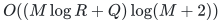

**Model and scope.** `M` groups, `R` resources and `Q` adaptive deletions; augmenting-path discovery work is separate.

### [Nonuniform sparse route rounding](manuscripts/graph-backends/nonuniform-fractional-path-selection.md)

Choose one supplied candidate per group while controlling every resource load.

**Randomness.** Deterministic sparse rounding by conditional averaging and guarded finite arithmetic. Candidate probabilities are mathematical weights; the implementation does not sample choices.

**Quantitative result.**

<!-- math-display: 556046b256c21a9948123fb2
\text{load at }x\le2\mu_x+B\log(8(\lvert X\rvert+1))
-->
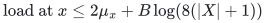

Bit work:

<!-- math-display: e7ae8d9ae5e92f8659d7c5ef
S\mathrm{poly}(\log S,b)
-->
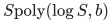

**Model and scope.** Explicit sparse occurrences, rational masses and weights; `B` bounds one weighted occurrence contribution.

### [Short path inventories from a shared DAG](manuscripts/graph-backends/compressed-fractional-path-extraction.md)

Retain at least half of the unit commodities on short candidate routes.

**Randomness.** Deterministic extraction from a supplied exact shared DAG and rational flow records. The upstream flow-oracle construction and its randomness are outside this lemma.

**Quantitative result.**

Arithmetic operations:

<!-- math-display: 69400fa7c405cb959132b53d
O(Z+P)
-->
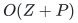

<!-- math-display: 65c2262e293638a9990c22fd
\text{route length}\le4H
-->

Fractional load at most doubled.

**Model and scope.** Supplied DAG and rational masses with total weighted length at most MH; explicit expansion is output-charged.

### [Bounded-width lazy path client](manuscripts/graph-backends/bounded-interface-witness-pattern-updates.md)

Complete static numerical client with implicit physical-path updates.

**Randomness.** Deterministic finite-interface numerical client with a supplied edge-partition/separator hierarchy; hierarchy-construction work is additional.

**Quantitative result.**

Time:

<!-- math-display: c1dcf4696a8e716b1902343e
(m+\nu)\exp(O(b^2))h\mathrm{polylog}S
-->
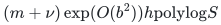

Space:

<!-- math-display: b00ac230a2032f178e0420ed
(m+\nu)\exp(O(b^2))
-->
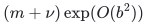

**Model and scope.** Supplied fixed edge-partition hierarchy of height `h` and boundary `b`; decomposition-input work is additional.

### [Forest-support numerical client](manuscripts/graph-backends/complete-unrestricted-forest-one-sided-client.md)

Complete threshold search with unrestricted receiving directions.

**Randomness.** Deterministic numerical client under the stated ambient-support forest and finite-word contracts, using exact directed tree dynamic programming and lazy path updates.

**Quantitative result.**

Total fixed-ledger work:

<!-- math-display: 01d316c8a717e09a8532c300
(m+\nu)\mathrm{polylog}S
-->
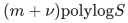

**Model and scope.** The entire ambient allocation support is a forest, with the stated polynomial-range guards.

### [Feedback-edge numerical client](manuscripts/graph-backends/feedback-edge-one-sided-client.md)

Complete threshold search with `k` nonforest incidences.

**Randomness.** Deterministic numerical client under the stated feedback-edge and finite-word contracts, using exact forest queries and a small Dijkstra computation.

**Quantitative result.**

Total work:

<!-- math-display: f6456f4c3fe91aa2c338e696
(m+\nu(k+1))\mathrm{polylog}S
-->
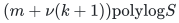

Work per query/update plus events:

<!-- math-display: ca78fa8f6cd59b815cefa4f5
(k+1)\mathrm{polylog}S
-->
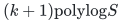

**Model and scope.** Fixed polynomial-range ledger; parameterized support theorem does not improve arbitrary-graph matching time.

### [Weak-Haxell certifying matching](manuscripts/matching-and-routing/weak-haxell-current-blocker-growth.md)

Left-perfect matching or an explicit violated hitting-set condition.

**Randomness.** Deterministic certifying augmenting search on the explicit hypergraph; it returns a matching or the stated hitting-set certificate.

**Quantitative result.**

<!-- math-display: b911979c9ca3a46edccf06ec
P(n+1)^{O((r/\epsilon)\log(2+r/\epsilon))}\mathrm{poly}(b_\epsilon+\log P)
-->
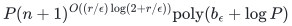

**Model and scope.** Whole-edge rank <code class="math">r\ge2</code>, <code class="math">0&lt;\epsilon&lt;1</code>; matching under <code class="math">\tau(E_S)&gt;(2r-3+\epsilon)(\lvert S\rvert-1)</code>.

### [Sparse-separator corank refinement](manuscripts/allocation-and-scheduling/attained-set-sparse-separator-gap.md)

Smaller extension and whole-ground bases when the returned separator is sparse.

**Randomness.** Deterministic certificate enumeration, relative to the paid exact separator, selection and recovery interfaces. Bernoulli probabilities are used only to count branches.

**Quantitative result.**

<!-- math-display: 3d4a2a8c0dc04f91cf2377ee
\beta(R,w)^c
-->
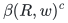

<!-- math-display: e496334d35e6e6465f560d09
\beta(2,3)=(1+\sqrt5)/2
-->
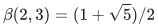

<!-- math-display: 7dbc7a982dcae1bf2e5e811e
\beta(3,4)=1+\sqrt2
-->
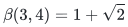

**Model and scope.** Actual separator width `w`; matching global bases <code class="math">(5-\sqrt5)/2</code> and <code class="math">3-\sqrt2</code> use the forced-omission wrapper.

### [Whole-ground robust allocation barrier](manuscripts/allocation-and-scheduling/robust-unit-allocation-whole-ground-oracle-barrier.md)

Every finite multiplicative guarantee requires near-exhaustive rank queries.

**Randomness.** Lower bounds: the self-contained `q`-scenario oracle proof concerns deterministic algorithms; the attributed two-scenario consequence also excludes bounded-error randomized algorithms.

**Quantitative result.**

Deterministic queries:

<!-- math-display: 48f0dbc9c4a021ee501ea5eb
\text{queries}\ge q^{-1}\binom qr-1
-->
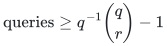

Balanced-rank deterministic queries:

<!-- math-display: 8d2b7df8bda79eb755f5e03c
\text{queries}\ge2^{q-O(\log q)}
-->
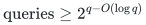

**Model and scope.** <code class="math">2\le r&lt;q</code>; `q` explicit scenarios, uniform player matroid and zero costs; separate attributed two-scenario implication.

### [Implicit minimal-bundle transversals](manuscripts/matching-and-routing/implicit-minimal-bundle-transversal-oracle.md)

Disjoint minimal bundles or an explicit domination/constellation certificate.

**Randomness.** Deterministic implicit construction using fixed-order resource scans and the stated exact bundle operations.

**Quantitative result.**

<!-- math-display: b6cd84595c8ae78c1421c61c
P(q+1)^{O(\epsilon^{-1}\log(2+q/\epsilon))}\mathrm{poly}(b+b_\epsilon+\log P)
-->
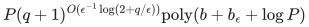

**Model and scope.** No configuration enumeration or arbitrary-neighbour oracle; certificate class sets retain their distinct meanings.

### [Global free pool at the critical quota](manuscripts/allocation-and-scheduling/critical-unit-quota-global-free-pool.md)

Globally resource-free owners cover the current player-rank deficit.

**Randomness.** Structural rank lemma and deterministic paid search acceleration with exact availability. No improved global running-time bound is asserted.

**Quantitative result.**

With full quota <code class="math">t=3b-2</code> and `b` units per current record, free-pool rank:

<!-- math-display: 85aad013254ae9dc0495e88f
r_M(F)\ge r-k
-->
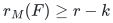

**Model and scope.** Fully normalized prefix invariant; eligible free owners admit a paid exchange; no faster critical-quota runtime follows.

### [Jointly independent layer owners](manuscripts/allocation-and-scheduling/joint-owner-sharp-quality-addendum.md)

Within-layer joint independence retains the sharp availability-dependent quality.

**Randomness.** Structural guarantee for deterministic current-blocker search, conditional on an availability oracle satisfying its certified factor on every call.

**Quantitative result.**

Factor with the original rank-exponential or relaxed rank-quasipolynomial time:

<!-- math-display: 1e97261769681dcde00d0440
\lambda^{-1}+3-3/r+\eta
-->
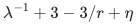

**Model and scope.** The stated current-blocker and paid availability model; joint independence alone does not supply a polynomial batching theorem.

### [Explicit laminar reservation interface](manuscripts/allocation-and-scheduling/laminar-resource-current-blocker-reservations.md)

Token reservations and antichain compact certificates for recipient constraints.

**Randomness.** Deterministic explicit-token reservations and fixed-order current-blocker search for the supplied laminar matroids.

**Quantitative result.**

No laminar-depth factor in the resource value certificate.

**Model and scope.** Includes the stated local-family interfaces; its older base-model approximation is subsumed by the main recipient-polymatroid theorem.

### [Persistent path-hitting certificates](manuscripts/graph-backends/fixed-hitting-certificates-under-graph-updates.md)

One shared update set preserves all historical path-hitting certificates.

**Randomness.** Deterministic structural certificate transfer from supplied historical hitting sets; it does not establish a complete fully dynamic matching or disjoint-path algorithm.

**Quantitative result.**

<code class="math">C\cup I</code> hits current short paths.

<!-- math-display: 1d22bd5d46a116c4c9ec7c2d
\text{size}\le\lvert C\rvert+\lvert I\rvert
-->

**Model and scope.** Deletions and length increases are safe; inserted/decreased edge lifetimes enter I; selected-path and layer repair are separate.

### [Fixed-potential tight-DAG repairs](manuscripts/graph-backends/fixed-potential-tight-dag-repair-lemma.md)

Maintain old-label shortest-path forests on tight-reachable vertices.

**Randomness.** Deterministic reachability and parent-repair algorithm within one supplied fixed-potential interval; no global bound across potential refreshes is established.

**Quantitative result.**

Total graph work and supplied forest edits per fixed-potential interval:

<!-- math-display: 97ab617779f2e9ff28df7051
O(m+\nu)
-->
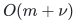

**Model and scope.** No ledger births or label changes inside the interval; potential-refresh work is outside the bound.

### [Slack-only directed matching reduction](manuscripts/graph-backends/slack-only-one-sided-matching-client.md)

Constant-ratio comparison and a finite-word static threshold oracle.

**Randomness.** Deterministic mathematical reduction and exact static threshold oracle. The required fast dynamic interface has not been constructed, so no complete faster dynamic algorithm is classified.

**Quantitative result.**

Directed nonnegative SSSP reduction with monotone prices and a charged repricing budget.

**Model and scope.** The dynamic path-reporting/update provider remains a separate unproved interface; no improved general-matching exponent.

### [Residual-capacity configuration comparator](manuscripts/allocation-and-scheduling/recipient-polymatroid-residual-configuration-relaxation.md)

Integral allocation with factor <code class="math">4-3/r</code> against the strengthened residual-capacity configuration LP.

**Randomness.** Deterministic current-blocker allocation relative to the stronger LP. A supplied factor-`lambda` availability oracle must meet its certified guarantee on every call.

**Quantitative result.**

<!-- math-display: f53c232e9b6631d4d9719b29
2^{O(r)}\mathrm{poly}(H)
-->

The stated rank-quasipolynomial alternative allows additive accuracy in the factor.

**Model and scope.** Arbitrary binary recipient polymatroids and exact local availability; certified factor-<code class="math">\lambda</code> availability changes the ratio to <code class="math">\lambda^{-1}+3-3/r</code>. The algorithm does not solve the LP.

### [Fractional optimization of residual configuration relaxations](manuscripts/allocation-and-scheduling/residual-configuration-bounded-support-xp-solver.md)

A feasible fractional configuration point at target at least <code class="math">(1-\epsilon)\mathrm{OPT}_{\mathrm{LP}}</code>.

**Randomness.** Deterministic rational ellipsoid optimization, exact-budget profit-scaling dynamic programming and finite primal LP extraction.

**Quantitative result.**

Full LP:

<!-- math-display: 9b1f9181c5250245606fcb32
2^{O(q)}\mathrm{poly}(H,\epsilon^{-1})
-->
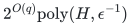

Support-`s` cuts:

<!-- math-display: 144209c67a147d305364932e
(q+1)^{O(s+1)}\mathrm{poly}(H,\epsilon^{-1})
-->
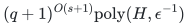

**Model and scope.** Coordinate-box local families and binary capacities; <code class="math">s=2(r-1)</code> gives an XP rank bound. This is optimization of the stated fractional comparator, with separate integer rounding.

### [Exact demand trimming without a flow oracle](manuscripts/graph-backends/exact-demand-flow-trimming.md)

Trim a supplied flow to exact positive nonsink demands without increasing any arc.

**Randomness.** Deterministic selected-forest construction, with named dynamic-tree operations and no maximum-flow computation.

**Quantitative result.**

Exact arithmetic operations:

<!-- math-display: 93981ab45e81d39a07edfcfa
O((n+m)\mathrm{polylog}(n+m+2))
-->
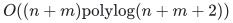

**Model and scope.** Physical arc records include loops, parallel and opposite arcs. No sink inflow target is required; integer input remains integral and bit costs are explicit.

### [Static selected-pair forests below twice the row total](manuscripts/graph-backends/static-transportation-support-balancing.md)

Choose two genuine neighbors per row and obtain a new row-covering injection with strictly bounded component weight.

**Randomness.** Deterministic transportation-cycle cancellation and combinatorial pair selection. This is a static theorem.

**Quantitative result.**

<!-- math-display: 026cd5f2c182562694c3bbe5
\text{weight of each component}<2L
-->
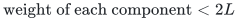

Exact arithmetic operations:

<!-- math-display: 46ae0859d9a85b87d4a2c20f
O((n+I)\mathrm{polylog}(n+I+2))
-->
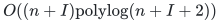

**Model and scope.** Arbitrary finite row rank, row total `L` and column load at most `L` minus the positive bin weight; `I` counts all physical incidences. The supplied old injection need not be preserved.

### [Near-linear confluent rounding and mass-sensitive tails](manuscripts/graph-backends/static-confluent-rounding-and-tail-bounds.md)

Round a supplied splittable flow to one outgoing route per nonsink, with a simultaneous budget covering completed sinks.

**Randomness.** Deterministic simulation of the named Conflt operations. Exponential potentials are analysis tools and are not evaluated by the algorithm.

**Quantitative result.**

Arithmetic work:

<!-- math-display: 93981ab45e81d39a07edfcfa
O((n+m)\mathrm{polylog}(n+m+2))
-->

<!-- math-display: 0bb6d4c425ecf1f00538b65e
C\sum_j(2^{W_j/C}-1)/(1+W_j/C)^3=O(W)
-->
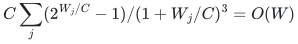

**Model and scope.** Positive nonsink demands, initial node congestion at most `C` and total actual demand `W`. Dynamic replenishment after reopening completed trees requires a separate argument.

### [Canonical odd crowns and exact matching-value preservation](manuscripts/graph-backends/low-state-odd-crown.md)

Compute the canonical contact envelope, a removable odd crown and its exact optimum offset.

**Randomness.** Deterministic matching, alternating reachability, integral cut certificates and physical witness recovery.

**Quantitative result.**

One outside bipartite matching plus linear graph work.

<!-- math-display: b93d02c47492b2e3a8b9d319
\text{residual gap}\le\lfloor(r+b)/2\rfloor
-->
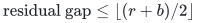

**Model and scope.** Supplied constructive factor-critical bins and a row-covering injection. LOW gives an explicit bound on contact rank `r`, not on the total retained vertex count; `b` counts unmatched blockers.

### [Exact interval-rank palette support bounds](problems/roabp-affine-pit/manuscripts/palette-sharpness.md)

Matching structural lower constructions for every interval-rank palette, with an original-field degree-two lift at the actual moment curve.

**Randomness.** Explicit deterministic algebraic constructions and exact symbolic identities. The finite verifier uses integer sparse-polynomial arithmetic, without sampling.

**Quantitative result.**

<!-- math-display: b8bb124871e11b97d3a3f6f7
h(P)=\prod_j(p_j-p_{j-1}+1)-2
-->
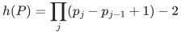

Full palette:

<!-- math-display: ebe41f48a4e3e07e21477607
h=2^W-2
-->
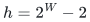

**Model and scope.** Every characteristic; physical matrix-interval ranks are preserved at the curve. The endpoint-augmented scalar interval is excluded. These examples survive one SV pair and give no hitting-set or PIT-query lower bound.

### [Quadratic local Hasse digit-degree obstruction](problems/roabp-affine-pit/manuscripts/quadratic-hasse-obstruction.md)

An original-field width-`w` word with invertible physical factors attains first-component digit degree `w^2-1` at the ordinary moment curve.

**Randomness.** Explicit deterministic matrix construction and symbolic determinant identity; finite checks use exact integer and prime-field arithmetic without sampling.

**Quantitative result.**

<!-- math-display: 082c7cadbc4b9b9ba230eb8f
N=w^2-1
-->

<code class="math">n=p</code>.

Scalar total degree:

<!-- math-display: dc05275ccbf90d43492e12a0
2p(w-1)
-->
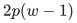

**Model and scope.** Every width `w>=2` in prime characteristic `p>w^2+w-2`; physical interval ranks survive the ordinary curve. This is a local proof-interface obstruction; one SV pair detects the examples, so no PIT lower bound is claimed.

## Shared manuscripts

These proofs and scoped interface analyses are used across problem records. An obstruction concerns the precise mechanism stated in its manuscript, rather than an unrestricted algorithmic lower bound.

### Allocation and scheduling

- [Forestifying allocations: one paid batch and the remaining pivot problem](manuscripts/allocation-and-scheduling/allocation-forestification-and-pivot-accounting.md)
- [Approximate available-bundle oracles in current-blocker allocation](manuscripts/allocation-and-scheduling/approximate-available-bundle-oracle-allocation.md)
- [Arbitrary-cost allocation near factor two with an adaptive residual budget](manuscripts/allocation-and-scheduling/arbitrary-cost-residual-budget-near-two-allocation.md)
- [Sparse separators improve the corank gap time base](manuscripts/allocation-and-scheduling/attained-set-sparse-separator-gap.md)
- [Current-blocker allocation with binary resource supplies](manuscripts/allocation-and-scheduling/binary-resource-capacities-compressed-current-blocker.md)
- [Minimum-cost common bases with degree capacities: a corank augmentation scheme](manuscripts/allocation-and-scheduling/corank-degree-bounded-common-bases.md)
- [Corank gap branching for selection oracles and set-packing capacities](manuscripts/allocation-and-scheduling/corank-packing-selection-oracle-extension.md)
- [A global free-pool lemma at the critical unit quota](manuscripts/allocation-and-scheduling/critical-unit-quota-global-free-pool.md)
- [Current public versions and the allocation/scheduling proof dependencies](manuscripts/allocation-and-scheduling/current-public-version-and-dependency-recheck.md)
- [A standalone dynamic integral-allocation theorem](manuscripts/allocation-and-scheduling/dynamic-integral-allocation-theorem.md)
- [Allocation parameterized by the deficit of a fat-resource cover](manuscripts/allocation-and-scheduling/fat-deficiency-parameter-allocation.md)
- [Arbitrary integral recipient polymatroids: a direct rank-dependent allocation algorithm](manuscripts/allocation-and-scheduling/general-recipient-polymatroid-integer-optimum-transfer.md)
- [General resource matroids with all remaining bundles as conservative blockers](manuscripts/allocation-and-scheduling/general-resource-all-remaining-blockers.md)
- [General resource matroids through all-subsets reservations](manuscripts/allocation-and-scheduling/general-resource-matroid-subset-reservations.md)
- [Relevant remaining blockers recover the sharper resource coefficient](manuscripts/allocation-and-scheduling/general-resource-relevant-blocker-addendum.md)
- [The exact corank-sensitive time curve of the block gap conversion](manuscripts/allocation-and-scheduling/global-gap-corank-profile-bound.md)
- [Player-local item constraints: independent audit and public comparison](manuscripts/allocation-and-scheduling/item-matroid-allocation-public-scope-audit.md)
- [Jointly independent layer owners: what it proves and what batching still needs](manuscripts/allocation-and-scheduling/joint-owner-layer-batching-gate.md)
- [Sharp quality survives jointly independent layer owners](manuscripts/allocation-and-scheduling/joint-owner-sharp-quality-addendum.md)
- [Laminar resource matroids through explicit capacity reservations](manuscripts/allocation-and-scheduling/laminar-resource-current-blocker-reservations.md)
- [Workload scheduling with private slack and an exact finite-rank coefficient](manuscripts/allocation-and-scheduling/many-small-sizes-private-slack-deficiency.md)
- [Current blocker growth for matroid max-min allocation](manuscripts/allocation-and-scheduling/matroid-allocation-current-blocker-quasipolynomial.md)
- [Matroid allocation: public comparison, version history, and a gated parameter optimization](manuscripts/allocation-and-scheduling/matroid-allocation-public-comparison-and-version-audit.md)
- [Sharper star charging and rank-sensitive quality for matroid allocation](manuscripts/allocation-and-scheduling/matroid-allocation-sharp-star-rank-quality.md)
- [Near-equal large job sizes with a bottleneck rank budget](manuscripts/allocation-and-scheduling/near-equal-large-sizes-bottleneck-makespan.md)
- [Player-local downward-closed allocation constraints](manuscripts/allocation-and-scheduling/player-local-downward-closed-allocation-extension.md)
- [Residual-capacity cuts restore a configuration comparator for general polymatroids](manuscripts/allocation-and-scheduling/recipient-polymatroid-residual-configuration-relaxation.md)
- [Residual configuration cuts reduce to subsets of players](manuscripts/allocation-and-scheduling/recipient-polymatroid-subset-cut-compression.md)
- [A weak optimizer for bounded-support residual configuration relaxations](manuscripts/allocation-and-scheduling/residual-configuration-bounded-support-xp-solver.md)
- [Computing the residual configuration relaxation for count-box players](manuscripts/allocation-and-scheduling/residual-configuration-box-pricing-and-weak-solver.md)
- [Robust unit allocation: an additive guarantee and a promised factor two](manuscripts/allocation-and-scheduling/robust-unit-allocation-additive-and-promised-two.md)
- [A whole-ground oracle barrier for robust positive integer allocation](manuscripts/allocation-and-scheduling/robust-unit-allocation-whole-ground-oracle-barrier.md)
- [Binary multiplicities of recipient matroids retain the configuration comparator](manuscripts/allocation-and-scheduling/scaled-recipient-matroids-binary-configuration-transfer.md)
- [Two-size scheduling with a private-slack rank deficit](manuscripts/allocation-and-scheduling/two-size-makespan-private-slack-deficiency.md)
- [Factor two for two-value polymatroid allocation in the large-cover parameter](manuscripts/allocation-and-scheduling/two-value-allocation-large-cover-two-transfer.md)
- [Binary supplies with type-symmetric local feasible families](manuscripts/allocation-and-scheduling/type-symmetric-downward-closed-binary-allocation.md)
- [Single-exponential corank time by branching on a required omission batch](manuscripts/allocation-and-scheduling/unit-quota-corank-batch-branching-improvement.md)
- [Unit-quota allocation by corank-bounded deficient-set branching](manuscripts/allocation-and-scheduling/unit-quota-corank-gap-branching.md)
- [Unit quotas, a factor-three transfer, and the discrete time boundary](manuscripts/allocation-and-scheduling/unit-quota-three-transfer-and-discrete-time-gate.md)
- [Unrelated two-size job scheduling with an exact assignment budget](manuscripts/allocation-and-scheduling/unrelated-two-size-costed-scheduling-tradeoff.md)

### Graph backends

- [The alias, geometric, and raw-circulation bridge](manuscripts/graph-backends/alias-geometric-raw-bridge.md)
- [Two limitations on substituting sparsification primitives](manuscripts/graph-backends/ambient-congestion-and-parameter-scope.md)
- [Amortized native-split feedback and a settled selected transcript](manuscripts/graph-backends/amortized-native-split-feedback.md)
- [A short-period distance sparsifier with amortized degree feedback](manuscripts/graph-backends/amortized-static-base-distance-sparsifier.md)
- [A finite-bit petal-tree adapter with polynomial aspect-bit overhead](manuscripts/graph-backends/an-weighted-finite-bit-adapter.md)
- [Independent audit of the any-source fixed-tree matching interface](manuscripts/graph-backends/any-source-fixed-tree-matching-independent-audit.md)
- [Any-source searches in a fixed matching threshold forest](manuscripts/graph-backends/any-source-fixed-tree-matching-interface.md)
- [Root audit of the any-source fixed-tree matching interface](manuscripts/graph-backends/any-source-fixed-tree-matching-root-audit.md)
- [Public APSP parameters, queries, and admissible comparisons](manuscripts/graph-backends/apsp-public-parameter-and-query-audit.md)
- [Parameter balance for the reconstructed backend](manuscripts/graph-backends/backend-exponent-balance.md)
- [A local pair oracle from a balanced row forest](manuscripts/graph-backends/balanced-forest-pair-oracle.md)
- [Bidirectional searches in a potential-compatible matching forest](manuscripts/graph-backends/bidirected-potential-compatible-forest-matching-interface.md)
- [Independent audit of the bidirectional matching forest interface](manuscripts/graph-backends/bidirected-potential-forest-independent-audit.md)
- [Root audit: bidirectional potential-compatible forest paths](manuscripts/graph-backends/bidirected-potential-forest-root-audit.md)
- [A binary ledger hierarchy independent of numerical accuracy](manuscripts/graph-backends/binary-ledger-hierarchy-and-decoupled-parameters.md)
- [Lazy path updates through a bounded witness interface](manuscripts/graph-backends/bounded-interface-witness-pattern-updates.md)
- [A combinatorial central-edge recourse bound under native splits](manuscripts/graph-backends/central-greedy-recoursing-under-splits.md)
- [Two explicit boundaries in the CHS routing reconstruction](manuscripts/graph-backends/chs-hierarchy-and-load-boundaries.md)
- [A classical independent optimality verifier for general matching](manuscripts/graph-backends/classical-matching-optimality-verifier.md)
- [Clipped walk reporting and a deterministic dynamic-spanner transfer](manuscripts/graph-backends/clipped-walk-queries-and-dynamic-spanner.md)
- [Coarse directed paths suffice for the slack-only matching comparison](manuscripts/graph-backends/coarse-directed-paths-for-slack-matching.md)
- [Root audit of the proposed colored core-forest pool lift](manuscripts/graph-backends/colored-core-pool-root-audit.md)
- [Independent audit: complete one-sided separation on an allocation forest](manuscripts/graph-backends/complete-unrestricted-forest-client-independent-audit.md)
- [Third audit of the unrestricted-receiver forest client](manuscripts/graph-backends/complete-unrestricted-forest-client-third-audit.md)
- [A complete unrestricted-receiver client on forest allocation graphs](manuscripts/graph-backends/complete-unrestricted-forest-one-sided-client.md)
- [Extracting short path inventories from a shared representation](manuscripts/graph-backends/compressed-fractional-path-extraction.md)
- [Independent audit of compressed cores and colored forest pools](manuscripts/graph-backends/compressed-steiner-pool-independent-audit.md)
- [A conditional sequential full router from a shuffler hierarchy](manuscripts/graph-backends/conditional-full-router-from-shufflers.md)
- [A `6/7` quantitative composition for deterministic general matching](manuscripts/graph-backends/conditional-matching-6-7-composition.md)
- [A constant-degree geometric bridge for the recursive cycle backend](manuscripts/graph-backends/constant-degree-steiner-bridge.md)
- [Constant-depth deterministic raw-length backend](manuscripts/graph-backends/constant-depth-deterministic-backend.md)
- [A conservative constant-depth distance-oracle backend](manuscripts/graph-backends/constant-depth-distance-oracle-backend.md)
- [A numerical client independent of the ledger radix](manuscripts/graph-backends/decoupled-numerical-client.md)
- [A deterministic low-recourse lemma for grouped choices under deletions](manuscripts/graph-backends/decremental-choice-recourse-lemma.md)
- [A simple-graph interface for degree-proportional token routing](manuscripts/graph-backends/degree-split-token-routing-interface.md)
- [Demand-route notifications and local correction work](manuscripts/graph-backends/demand-route-notifications-and-local-work.md)
- [Destructive path-support extraction from the APSP hierarchy](manuscripts/graph-backends/destructive-apsp-path-support-extractor.md)
- [A deterministic fixed-`k` guide-tree mincut adapter](manuscripts/graph-backends/deterministic-fixed-k-tree-mincut-adapter.md)
- [Deterministic local tight-set discovery from directed 1-edge-out search](manuscripts/graph-backends/deterministic-local-tight-discovery.md)
- [A deterministic near-linear final maximum-matching verifier](manuscripts/graph-backends/deterministic-maximum-matching-verifier.md)
- [Deterministic phase costs, reset accounting, and finite guards](manuscripts/graph-backends/deterministic-phase-cost-and-guards.md)
- [Deterministic symbolic ties for globally consistent shortest paths](manuscripts/graph-backends/deterministic-symbolic-shortest-path-ties.md)
- [Deterministic token routing by edge thresholds and expander pruning](manuscripts/graph-backends/deterministic-token-routing-by-thresholds.md)
- [Uniform deterministic optimization from independently checked branches](manuscripts/graph-backends/deterministic-uniformization-by-optimality-check.md)
- [Deterministic selection of one weighted path from each token family](manuscripts/graph-backends/deterministic-weighted-path-selection.md)
- [A disconnected-component wrapper for the distance cycle backend](manuscripts/graph-backends/disconnected-component-backend-wrapper.md)
- [Disconnected inputs in the routing, portal, and Steiner backend](manuscripts/graph-backends/disconnected-routing-components.md)
- [General maximum matching through a constant-depth distance backend](manuscripts/graph-backends/distance-backend-general-matching-integration.md)
- [A degree-three reset between distance-sparsifier levels](manuscripts/graph-backends/distance-degree-reset-candidate.md)
- [Raw-cycle quality through the 2026 distance-oracle hierarchy](manuscripts/graph-backends/distance-oracle-raw-lift.md)
- [Dynamic marked-forest compression and short-path unions](manuscripts/graph-backends/dynamic-marked-forest-short-path-union.md)
- [Formal pruning substitution in the public NSW MSF framework](manuscripts/graph-backends/dynamic-msf-formal-pruning-substitution-audit.md)
- [Deterministic dynamic spanners: current public baselines and admissible comparisons](manuscripts/graph-backends/dynamic-spanner-public-baseline-audit.md)
- [Exact demand trimming in a supplied directed flow](manuscripts/graph-backends/exact-demand-flow-trimming.md)
- [Exact acceptance and general-flow reductions](manuscripts/graph-backends/exact-flow-acceptance-and-reductions.md)
- [An explicit balance wrapper for virtual-expander success](manuscripts/graph-backends/explicit-virtual-cut-balance-wrapper.md)
- [Minimal tight contractions and explicit factor-critical witnesses](manuscripts/graph-backends/factor-critical-contractions.md)
- [Independent audit: the feedback-edge one-sided client](manuscripts/graph-backends/feedback-edge-client-independent-audit.md)
- [Independent audit of the feedback-edge one-sided client](manuscripts/graph-backends/feedback-edge-one-sided-client-independent-audit.md)
- [A complete one-sided client parameterized by feedback-edge count](manuscripts/graph-backends/feedback-edge-one-sided-client.md)
- [Finite arithmetic for the Steiner-packing client, and the Li skeleton dependency](manuscripts/graph-backends/finite-mwu-and-li-skeleton-independent-audit.md)
- [Fixed path-hitting certificates under insertions and deletions](manuscripts/graph-backends/fixed-hitting-certificates-under-graph-updates.md)
- [Independent audit of the global-max leaf repair](manuscripts/graph-backends/fixed-k-global-max-leaf-independent-audit.md)
- [The fixed-`k` guide-tree mincut interface: what has and has not closed](manuscripts/graph-backends/fixed-k-tree-mincut-source-interface-audit.md)
- [Decremental tight-arc repairs during one fixed-potential interval](manuscripts/graph-backends/fixed-potential-tight-dag-repair-lemma.md)
- [A strong two-incidence step can force long forestification motion](manuscripts/graph-backends/forced-forestification-motion-after-strong-step.md)
- [A distance-decrease detector with frozen auxiliary barriers](manuscripts/graph-backends/frozen-barrier-distance-detector.md)
- [Exact degree reduction and an optimum-gap driver for general matching](manuscripts/graph-backends/general-graph-gap-reduction.md)
- [Quantified outer Gomory--Hu factors and the fixed-`k` resolution](manuscripts/graph-backends/gomory-hu-external-factors-except-fixed-k.md)
- [A quantified Gomory--Hu transfer of the strong forest](manuscripts/graph-backends/gomory-hu-seven-eighths-dependency-audit.md)
- [Grouped choices inside a fixed-base router: a precise partial bridge](manuscripts/graph-backends/grouped-choice-router-bridge.md)
- [Growing-depth recurrence bounds with controlled numerical aspect](manuscripts/graph-backends/growing-depth-metric-recurrence.md)
- [Growing-parameter outer cost for deterministic general matching](manuscripts/graph-backends/growing-parameter-matching-cost.md)
- [Entropy progress for balanced cuts and half-matchings](manuscripts/graph-backends/half-matching-entropy-progress.md)
- [Shared path records for low-step flow emulators](manuscripts/graph-backends/hhl-shared-path-dag-and-conditional-tradeoff.md)
- [A master-controlled hierarchy with exponent `209/210`](manuscripts/graph-backends/hierarchy-parameter-balances.md)
- [Routing from covers with arbitrary original length range](manuscripts/graph-backends/hrg-routing-from-rounded-covers.md)
- [An elementary hypercube port adapter for the sequential router](manuscripts/graph-backends/hypercube-port-adapter.md)
- [An elementary balanced weighted witness from a hypercube](manuscripts/graph-backends/hypercube-weighted-witness.md)
- [What changes when all repairs use the initial route table](manuscripts/graph-backends/initial-route-projection-updates.md)
- [Ledger algebra, exact exchange and the structural phase budget](manuscripts/graph-backends/ledger-algebra-and-phase-budget.md)
- [A static subgraph sparsifier with length-free ambient congestion](manuscripts/graph-backends/length-free-ambient-static-sparsifier.md)
- [A normalized static sparsifier with linear parameter dependence](manuscripts/graph-backends/linear-parameter-static-sparsifier.md)
- [The `4/5` balance in the current linear-router backend model](manuscripts/graph-backends/linear-router-backend-balance.md)
- [Literal top-ledger serial routes and the semantic scope of the obstruction](manuscripts/graph-backends/literal-top-ledger-serial-routes-and-semantic-scope.md)
- [Local exact projection from a priced-step interface](manuscripts/graph-backends/local-exact-projection-from-priced-steps.md)
- [Preserving the master length aspect through the cycle recursion](manuscripts/graph-backends/local-length-aspect-preservation.md)
- [Local metric growth without a root-forest bootstrap](manuscripts/graph-backends/local-metric-growth-without-root-pools.md)
- [Contact-rank odd crowns and exact matching-value preservation](manuscripts/graph-backends/low-state-odd-crown.md)
- [Dynamic compression of marked subtrees: a local root audit](manuscripts/graph-backends/marked-steiner-compression-root-audit.md)
- [A matching algorithm from explicit backend contracts](manuscripts/graph-backends/matching-algorithm-specification.md)
- [Continuing the arbitrary-general-matching `4/5` route](manuscripts/graph-backends/matching-optimization.md)
- [Matching-specific numerical certificates and contact-reserve stability](manuscripts/graph-backends/matching-semantic-oracle-and-contact-reserve.md)
- [An exact matching-size kernel and the current time corollary](manuscripts/graph-backends/matching-size-kernel-corollary.md)
- [Multiple-resource choices: a monotone charge and a repair obstruction](manuscripts/graph-backends/multiresource-choice-majorant-and-cascade.md)
- [A source-rooted strengthening of the approximate-ball forest](manuscripts/graph-backends/multisource-rooted-approximate-ball-forest.md)
- [Exact flow and local projection by rounding near-feasible circulations](manuscripts/graph-backends/near-feasible-rounding-and-exact-projection.md)
- [Root audit: non-tight receivers and payable potential repairs](manuscripts/graph-backends/non-tight-receiver-and-batch-repairs-root-audit.md)
- [Zero-length edges in integer distance and spanner interfaces](manuscripts/graph-backends/nonnegative-integer-distance-adapters.md)
- [Sparse deterministic selection from nonuniform fractional routes](manuscripts/graph-backends/nonuniform-fractional-path-selection.md)
- [Nonuniform parameter budgets for the current hierarchy](manuscripts/graph-backends/nonuniform-parameter-budget-frontiers.md)
- [A payable batch criterion for matching-potential repairs](manuscripts/graph-backends/normalized-bin-potential-batch-repairs.md)
- [Normalized projected routes in the distance repair layers](manuscripts/graph-backends/normalized-projected-route-composition.md)
- [Normalized routes, cycle comparison, and exact raw lifting](manuscripts/graph-backends/normalized-route-cycle-comparison.md)
- [Two constructive numerical routes for the general-matching candidate](manuscripts/graph-backends/numerical-backend-choices.md)
- [Numerical lifetime discipline and a loop wrapper for flat cycle oracles](manuscripts/graph-backends/numerical-backend-lifetime-and-loops.md)
- [OpenAI baseline and exact imported interfaces](manuscripts/graph-backends/oai-baseline-and-imports.md)
- [Separating expander-path quality from construction time](manuscripts/graph-backends/parameterized-expander-path-and-degree-bands.md)
- [Persistent integral carrier forests and canonical assignments](manuscripts/graph-backends/persistent-integral-ledger-carrier.md)
- [Polynomial-bit root labels in the deterministic raw-cycle backend](manuscripts/graph-backends/polynomial-bit-raw-backend-extension.md)
- [Polynomial-bit low stretch inside stable core forests](manuscripts/graph-backends/polynomial-bit-stretch-stable-forest-integration.md)
- [A polynomial-work energy cut player](manuscripts/graph-backends/polynomial-energy-cut-player.md)
- [A legal-API reconstruction of the portal length-decrease layer](manuscripts/graph-backends/portal-alias-api-reconstruction.md)
- [Independent audit of the potential-compatible dynamic forest interface](manuscripts/graph-backends/potential-compatible-dynamic-forest-independent-audit.md)
- [Local forest repairs for the one-sided matching threshold](manuscripts/graph-backends/potential-compatible-dynamic-forest-matching-interface.md)
- [Root audit: compatible local forest repairs for matching](manuscripts/graph-backends/potential-compatible-dynamic-forest-root-audit.md)
- [Priced logarithmic steps from raw flat-cycle certificates](manuscripts/graph-backends/priced-logarithmic-steps-from-raw-cycles.md)
- [Joint retuning of the public deterministic APSP construction](manuscripts/graph-backends/public-apsp-joint-retuning-audit.md)
- [Public baseline audit: deterministic exact general-graph matching](manuscripts/graph-backends/public-baselines.md)
- [Reoptimizing the public dual tree-cut framework](manuscripts/graph-backends/public-dual-reoptimization.md)
- [Independent audit of the parameterized public dual-flow baseline](manuscripts/graph-backends/public-dual-uniform-wrapper-audit.md)
- [Direct vertex inventory in the public core-forest lift](manuscripts/graph-backends/public-forest-direct-vertex-inventory.md)
- [Joint public retuning for the strong forest: a conservative source audit](manuscripts/graph-backends/public-strong-forest-joint-retuning-audit.md)
- [Focused audit: public forest marks, rebuilds, and the forced anchor](manuscripts/graph-backends/public-strong-forest-marks-anchor-focused-audit.md)
- [A stronger public baseline for the strong forest and Gomory--Hu application](manuscripts/graph-backends/public-strong-forest-retuning-baseline.md)
- [Using the published flow bound on small recursive graphs](manuscripts/graph-backends/published-flow-capacity-scaling.md)
- [An explicit deterministic exact-flow bound for the growing-parameter construction](manuscripts/graph-backends/quantitative-exact-flow-dependency.md)
- [A conditional `14/15` quantitative bound for deterministic general matching](manuscripts/graph-backends/quantitative-matching-14-15-composition.md)
- [Quantitative deterministic general matching with preserved length aspect](manuscripts/graph-backends/quantitative-matching-167-168-composition.md)
- [Quantitative deterministic general matching from the `209/210` hierarchy](manuscripts/graph-backends/quantitative-matching-209-210-composition.md)
- [A `4/5` research composition from sequential expander routing](manuscripts/graph-backends/quantitative-matching-4-5-composition.md)
- [A `5/6` quantitative composition for deterministic general matching](manuscripts/graph-backends/quantitative-matching-5-6-composition.md)
- [From the raw-cycle backend to the frozen-barrier detector](manuscripts/graph-backends/raw-cycle-to-frozen-detector-bridge.md)
- [Repair-window depth and the cost of bypassing layers](manuscripts/graph-backends/repair-window-depth-tradeoff.md)
- [Root audit of the old-root-only epoch obstruction](manuscripts/graph-backends/root-only-sp-tree-epoch-root-audit.md)
- [A stronger public APSP comparison at exactly the same stretch scale](manuscripts/graph-backends/same-stretch-apsp-comparison-and-root-audit.md)
- [Separating metric stretch, forest congestion, and work](manuscripts/graph-backends/separated-metric-forest-and-strong-sssp.md)
- [Separating the output quality and construction work of deterministic sparsifiers](manuscripts/graph-backends/separated-static-sparsifier-parameters.md)
- [Sequential expander routing with linear parameter dependence](manuscripts/graph-backends/sequential-expander-routing-tradeoff.md)
- [Sequential fresh-cut matching without an initial-cut ambiguity](manuscripts/graph-backends/sequential-fresh-cut-matching-adapter.md)
- [Explicit sequential preprocessing for the leaf routing step](manuscripts/graph-backends/sequential-leaf-routing-and-chs-work.md)
- [Explicit sequential short-path packing for recursive expander construction](manuscripts/graph-backends/sequential-short-path-matching.md)
- [A sharp logarithmic factor from a uniform constant portfolio](manuscripts/graph-backends/sharp-log-parameter-portfolio.md)
- [A static base for short-period spanner batching](manuscripts/graph-backends/short-period-static-spanner-base.md)
- [Simple-path reporting from a logarithmic number of tree segments](manuscripts/graph-backends/simple-path-reporting-from-tree-segments.md)
- [A slack-only matching client and its directed path interface](manuscripts/graph-backends/slack-only-one-sided-matching-client.md)
- [A maintained potential certificate for the slack-only matching client](manuscripts/graph-backends/slack-potential-semantic-certificate.md)
- [An exact terminal solver for the cycle-ratio recursion](manuscripts/graph-backends/small-graph-ratio-solver.md)
- [A direct exact solver for small local detector instances](manuscripts/graph-backends/small-local-detector-exact-solver.md)
- [Reconstructing real-edge provenance from a cover's vertex map](manuscripts/graph-backends/snc-provenance-from-vertex-maps.md)
- [Deterministic confluent rounding: implementation, moments, and load tails](manuscripts/graph-backends/static-confluent-rounding-and-tail-bounds.md)
- [Deterministic Static Joint-Freeing by Triangular Forest Exchanges](manuscripts/graph-backends/static-pair-exchange.md)
- [A selected-pair forest of weight below twice the row total](manuscripts/graph-backends/static-transportation-support-balancing.md)
- [Compressed Steiner cores and colored full-forest pools](manuscripts/graph-backends/steiner-colored-pool-strong-forest-candidate.md)
- [Independent audit of the Steiner pool: metric, inventory, and recursion](manuscripts/graph-backends/steiner-pool-metric-inventory-focused-audit.md)
- [Which mechanisms improve the strong-forest exponent?](manuscripts/graph-backends/strong-forest-mechanism-comparison.md)
- [Tight blocks through witness-forest pruning](manuscripts/graph-backends/tight-blocks-via-forest-pruning.md)
- [Independent checks of tight-arc repairs and the directed-epoch obstruction](manuscripts/graph-backends/tight-dag-and-directed-epoch-independent-audit.md)
- [Topological ordering: a valid transpose reduction and its missing interface](manuscripts/graph-backends/topological-order-transpose-interface-gap.md)
- [Audit of the public-provider flat-forest spanner comparison](manuscripts/graph-backends/tracked-terminal-spanner-public-flat-comparator-audit.md)
- [Uniform source interfaces for the `4/5` composition](manuscripts/graph-backends/uniform-source-interfaces-for-4-5.md)
- [A virtual-expander hierarchy with explicit terminal sets](manuscripts/graph-backends/virtual-expander-hierarchy-reconstruction.md)

### Matching and routing

- [An implicit minimal-bundle oracle for the current-blocker transversal algorithm](manuscripts/matching-and-routing/implicit-minimal-bundle-transversal-oracle.md)
- [An elementary exponential fallback for the full transversal certificate](manuscripts/matching-and-routing/independent-transversal-elementary-exponential-fallback.md)
- [Input-linear scans for the independent-transversal layer primitives](manuscripts/matching-and-routing/independent-transversal-input-linear-iteration-implementation.md)
- [Public uniform baselines for the full independent-transversal certificate](manuscripts/matching-and-routing/independent-transversal-public-uniform-baseline-audit.md)
- [The same sharper rate for the existing BHHS explicit-hypergraph algorithm](manuscripts/matching-and-routing/public-hypergraph-algorithm-weighted-reanalysis.md)
- [Rank-sensitive counting for certified Haxell layers](manuscripts/matching-and-routing/rank-sensitive-layer-count.md)
- [Santa Claus: public baselines and the constellation transfer boundary](manuscripts/matching-and-routing/santa-claus-constellation-transfer-audit.md)
- [Current blocker growth and a rank-linear exponent for weak Haxell](manuscripts/matching-and-routing/weak-haxell-current-blocker-growth.md)
- [Public parameter comparison for the weak-Haxell reanalysis](manuscripts/matching-and-routing/weak-haxell-public-parameter-comparison.md)
- [A uniform parameter analysis of the public weak-Haxell algorithm](manuscripts/matching-and-routing/weak-haxell-uniform-lifetime-analysis.md)

### Mechanism boundaries

- [A normalized-image obstruction to bulk ambient deactivation](manuscripts/mechanism-boundaries/ambient-bulk-deactivation-obstruction.md)
- [A reachable obstruction for a directed any-source tree epoch](manuscripts/mechanism-boundaries/any-source-directed-tree-epoch-obstruction.md)
- [A balanced promotion hierarchy with at most two boundaries](manuscripts/mechanism-boundaries/balanced-two-boundary-hierarchy.md)
- [The Chuzhoy–Parter 2026 spanner interface and the ambient-route boundary](manuscripts/mechanism-boundaries/chuzhoy-parter-2026-interface-boundary.md)
- [Congested greedy support: a static lemma and its dynamic boundary](manuscripts/mechanism-boundaries/congested-greedy-support-and-dynamic-boundary.md)
- [Direct-spanner parameter budget and the next recourse obstacles](manuscripts/mechanism-boundaries/direct-spanner-budget-and-recourse-obstructions.md)
- [Exact selected flow with many routing budgets: a Hitting Set reduction](manuscripts/mechanism-boundaries/exact-multi-budget-flow-hitting-set-reduction.md)
- [Birth-time rank savings can disappear from the current resource cover](manuscripts/mechanism-boundaries/general-resource-birth-saving-current-cover-obstruction.md)
- [Constant heavy-allocation thresholds do not preserve a row matching](manuscripts/mechanism-boundaries/heavy-allocation-threshold-hall-obstruction.md)
- [A literal sequence lemma and the remaining quantitative spiral boundary](manuscripts/mechanism-boundaries/hht-literal-sequence-and-parameter-boundary.md)
- [Exact logarithmic client states can hide good cycles behind recursive routes](manuscripts/mechanism-boundaries/logarithmic-client-quality-obstruction.md)
- [Why arbitrary many exact assignment budgets cannot be added for free](manuscripts/mechanism-boundaries/multiple-exact-assignment-budgets-obstruction.md)
- [A matching comparison that needs a non-tight receiving arc](manuscripts/mechanism-boundaries/non-tight-receiver-matching-obstruction.md)
- [Optional active machine bases: an oracle obstruction before approximation](manuscripts/mechanism-boundaries/optional-active-machine-basis-oracle-obstruction.md)
- [Potential-gradient shortcuts and their limits in the actual matching clients](manuscripts/mechanism-boundaries/potential-bypass-limits-in-matching-clients.md)
- [Adversarial collapse audit of the prefix allocation core](manuscripts/mechanism-boundaries/prefix-core-adversarial-collapse-audit.md)
- [A congestion obstruction with literal first-touched central provenance](manuscripts/mechanism-boundaries/projected-central-provenance-congestion-obstruction.md)
- [A repeated-owner interface in the public matroid allocation algorithm](manuscripts/mechanism-boundaries/public-matroid-repeated-owner-interface-gap.md)
- [Recursive cycle quality: an exact budget and a product-loss obstruction](manuscripts/mechanism-boundaries/recursive-cycle-quality-obstruction.md)
- [Why physical current blockers do not directly become resource-matroid exchanges](manuscripts/mechanism-boundaries/resource-matroid-current-blocker-transfer-obstructions.md)
- [Robust integer unit allocation has a corank-parameter obstruction](manuscripts/mechanism-boundaries/robust-unit-allocation-corank-obstruction.md)
- [Two obstructions to lifting one-scenario roles into robust allocation](manuscripts/mechanism-boundaries/robust-unrelated-common-role-obstructions.md)
- [A reachable obstruction to linear progress per old-root tree epoch](manuscripts/mechanism-boundaries/root-only-sp-tree-epoch-counterexample.md)
- [The logarithmic claw factor in the current transversal analysis](manuscripts/mechanism-boundaries/transversal-log-rank-signature-boundary.md)
- [Concentrated boundary vertices can force a degree loss in a virtual merge](manuscripts/mechanism-boundaries/virtual-merge-expansion-obstruction.md)
- [Weighted distance spanners: a packing implication and its width boundary](manuscripts/mechanism-boundaries/weighted-spanner-packing-width-boundary.md)

## Evidence and provenance

- [Verification registry](reviews/README.md)
- [Import provenance and canonical paths](provenance/README.md)
- [Complexity and computational models](docs/COMPLEXITY.md)
- [Randomness contracts](docs/RANDOMNESS.md)
- [Maintenance and validation](CONTRIBUTING.md)
- [Change history](HISTORY.md)
