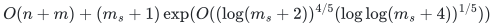
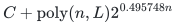
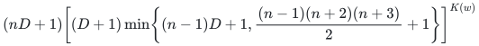
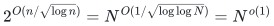

# Algorithm Frontier

Algorithms and proofs in combinatorial optimization, number theory, algebraic complexity, dynamic graphs, and sparsification. Each problem page gives the theorem, complexity, randomness, dependencies, and verification evidence.

[](https://github.com/icekylinx/algorithm-frontier/actions/workflows/curation.yml) [](LICENSE)

**58 problem families · 19 supporting results** · [Proof index](CONTENTS.md) · [Review and verification](reviews/README.md) · [Citation](CITATION.cff)

## Selected results

Selected deterministic algorithmic results, with conditional premises stated explicitly. The linked problem pages give the full statements, proof dependencies, executable coverage and review status.

### [Deterministic general-graph maximum matching](problems/general-matching/)

Deterministic exact maximum matching in general graphs.

<!-- math-display: 959b4822078bcdb0b44c8061
O(n+m)+(m_s+1)\exp(O((\log(m_s+2))^{4/5}(\log\log(m_s+4))^{1/5}))
-->


Here `m_s` counts distinct nonloop edge pairs. The proof supplies the uniform cycle-search construction and names its published prerequisites. A separate executable solver returns independently verifiable optimality certificates.

### [Faster deterministic Subset Sum](problems/subset-sum-fast-deterministic/)

Exact decision and indexed witness.

<!-- math-display: 45dc56e8c77bc161431d075b
C+\mathrm{poly}(n,L)2^{0.495748n}
-->


Exact rational exponent on the card.

For `n` integers of total bit length `L`, including an indexed witness. The finite startup constant `C` is input-independent. The complete compiler proof and exact continuous certificates support the improved third-lookup exponent.

### [Deterministic PIT for fixed-width affine ROABP orbits](problems/roabp-affine-pit/)

Deterministic black-box identity testing with unknown order and unknown invertible affine coordinates, in every characteristic.

<!-- math-display: 8b01d69bc2a007cf5102d878
(nD+1)\left[(D+1)\min\!\left\{(n-1)D+1,\frac{(n-1)(n+2)(n+3)}2+1\right\}\right]^{K(w)}
-->


Here <code class="math">K(w)=2^{O(w^2)}</code>, the full finite direction-grid minimum is displayed. Arbitrary local ranks and entry degrees; known scalar total degree `D` and extension-field oracle access when needed. Polynomial query count for each fixed width, with a width-dependent exponent. Complete internally reconstructed proof; external peer review and priority certification are not claimed.

### [Conditional deterministic integer factorization](problems/integer-factorization/)

Complete prime factorization of every positive binary integer, assuming the stated Boolean tensor-contraction theorem.

<!-- math-display: 7c1229e327a02a67a87a3706
2^{O(n/\sqrt{\log n})}=N^{O(1/\sqrt{\log\log N})}=N^{o(1)}
-->


`n=bit_length(N)`. The external succinct Boolean tensor-contraction theorem is an explicit accepted premise, checked against its literal ring and entry interface. Uniform deterministic bit operations and polynomial space; at most one contraction for complete recovery. Distinct precision/recovery tradeoffs are proved on the card. This is subexponential, rather than polynomial, in input bit length; no practical or priority claim.

## Results

Browse by problem. Each link opens its statement, proof and dependencies. [Computational models](docs/COMPLEXITY.md) and [randomness contracts](docs/RANDOMNESS.md) explain how to compare bounds.

### Subset Sum

- [Faster deterministic Subset Sum](problems/subset-sum-fast-deterministic/)
- [Low-space deterministic Subset Sum](problems/subset-sum-low-space-deterministic/)

### Algebraic complexity

- [Deterministic PIT for fixed-width affine ROABP orbits](problems/roabp-affine-pit/)
- [Integral ordered crossing circuits](problems/noncommutative-crossing/)
- [Uniform ordered subset contraction and rectangular permanent](problems/ordered-subset-contraction/)

### Number theory

- [Conditional deterministic integer factorization](problems/integer-factorization/)

### Numeric targets and quota geometry

- [Numeric targets and support patterns](problems/numeric-target-frontier/)
- [Prefix, laminar and sparse quotas](problems/weighted-prefix-quota-frontier/)

### Graph algorithms

- [Deterministic general-graph maximum matching](problems/general-matching/)
- [Degree-constrained subgraphs](problems/degree-constrained-subgraphs/)
- [Static and threshold min-cost flow](problems/min-cost-flow/)
- [Incremental strongly connected components](problems/incremental-scc/)
- [Incremental directed SSSP](problems/incremental-sssp/)
- [Fully dynamic APSP](problems/apsp-frontier/)
- [Dynamic spanners](problems/dynamic-spanners/)
- [Dynamic minimum spanning forest](problems/dynamic-msf/)
- [Strong forests and Gomory–Hu trees](problems/decremental-strong-forest/)

### Exact failures, persistence and compilation

- [Single-failure optimum preservers](problems/exact-failure-preservers/)
- [Flow, matching and price sensitivity](problems/exact-flow-sensitivity/)
- [Matroid and submodular failure summaries](problems/matroid-failure-summaries/)
- [Colored and vertex-failure graph certificates](problems/graph-color-failure-certificates/)
- [Resource-constrained packing summaries](problems/packing-matching-summaries/)
- [Persistent-homology failure certificates](problems/persistence-failure-certificates/)
- [Boolean linear optimization compiler](problems/boolean-linear-compiler/)

### Spectral, group and quantum sparsification

- [Self-concordant cone sparsification](problems/conic-barrier-sparsification/)
- [Correlated spectral, regression and seminorm summaries](problems/correlated-spectral-regression/)
- [Label and whole-block cut sparsification](problems/label-block-cut/)
- [Finite groups, affine constraints and metrics](problems/group-metric-constraints/)
- [Pauli, qudit and stabilizer blocks](problems/quantum-stabilizer/)
- [Exact-separation and non-Fano boundaries](problems/obstruction-boundaries/)

### Allocation and resource matroids

- [Arbitrary-value allocation scheme](problems/arbitrary-value-allocation-scheme/)
- [Recipient polymatroids](problems/recipient-polymatroid/)
- [Recipient-matroid configuration](problems/recipient-matroid-configuration/)
- [Explicit-item matroid union](problems/item-matroid-union/)
- [One-value allocation](problems/one-value-exact-two/)
- [Intrinsic two-value allocation](problems/two-value-exact-two/)
- [Intrinsic values near factor two](problems/intrinsic-values-near-two/)
- [Unrelated-value additive allocation](problems/unrelated-values-additive/)
- [Unrelated values with a joint role](problems/unrelated-values-joint-role/)
- [Whole-ground selection and transfers](problems/whole-ground-allocation/)

### Selected flow and robust allocation

- [Selected concurrent flow](problems/selected-flow/)
- [Flow with shared setup budget](problems/shared-setup-flow/)
- [Robust selected flow](problems/robust-scenario-flow/)
- [Robust unrelated allocation](problems/robust-unrelated-allocation/)
- [Robust bounded-width certificates](problems/robust-bounded-certificates/)
- [Width-two robust unit allocation](problems/robust-width-two-allocation/)
- [Two-scenario hardness](problems/robust-two-scenario-hardness/)

### Scheduling

- [Arbitrary-processing scheme](problems/arbitrary-processing-scheduling/)
- [Activated-machine scheduling](problems/activated-machine-scheduling/)
- [Six-profile scheduling](problems/six-profile-three-halves/)
- [Processing-bucket tradeoff](problems/processing-bucket-tradeoff/)
- [Two-size scheduling](problems/two-size-scheduling/)
- [Per-machine two-time scheduling](problems/two-time-scheduling/)
- [Many-size workload scheduling](problems/many-size-scheduling/)
- [Commitment scheduling](problems/commitment-scheduling/)

### Matching certificates and oracle barriers

- [Hypergraph matching and expander routing](problems/strong-haxell-matching/)
- [Independent transversals](problems/independent-transversal/)
- [Allocation and scheduling barriers](problems/allocation-lower-bounds/)

### Supporting results

The [complete index](CONTENTS.md#supporting-results) also lists 19 supporting algorithms, structural theorems, and scoped lower bounds. [Shared manuscripts](CONTENTS.md#shared-manuscripts) collect reusable proofs and backend interfaces.

## Reading and verification

Within each problem: `README.md` → `proof.md` → `sources.md` → `verify/README.md`. The [review registry](reviews/README.md) distinguishes manuscript review from executable checks and identifies their exact scope.

```sh
python3 tools/check_repository.py
```

See [Contributing](CONTRIBUTING.md) for the full verification mode and maintenance conventions. No external peer review or proof-assistant verification is claimed.

Yilin Liu and GPT-6 Astra Pro. *Algorithm Frontier* (2026). Cite the relevant problem path and commit; the [citation protocol](PROTOCOL.md) and [import provenance](provenance/README.md) retain the applicable licenses and notices.
