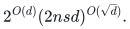

# Selected constructive counting results

The 2 November 2026 checkpoint was screened for completed, substantive
results in their declared input and coefficient models. Three algorithm
families and one structural supporting theorem survive that screening.
Supplied structural parameters are explicit input promises; they are not
silently removed when stating a useful subexponential regime.

## Selected algorithms

| Family | Strongest selected bound | Scope and substantive construction |
|---|---|---|
| [Triangular low-rank counting](../problems/triangular-low-rank-counting/) | <code class="math">\mathrm{poly}_q(n,r)2^{O_q(r\log(1+n/r))}</code> | Explicit colored endpoint sets, changing-order exterior signs and entropy-sized states for supplied dense triangular updates. Division-free over every commutative unital ring. Hamiltonian output is modular with its color/precision dependence charged. Independent of recent contraction/filtering inputs. |
| [Sparse low-rank exact counting](../problems/sparse-low-rank-counting/) | <code class="math">\mathrm{poly}(n,r,m)2^{O(m/\sqrt{\log(2+m)}+r\log(1+n/r))}</code> | Sparse matching networks contracted over explicit finite moment algebras; permanent, hafnian and exact integer/rational recovery. Uses the named quantitative contraction recursion plus the existing normalization-one integral primitive. Exact binomial and fixed-prime refinements are displayed on the card. |
| [Exact Subset Sum counting](../problems/subset-sum-exact-counting/) | <code class="math">\mathrm{poly}(n,L)2^{0.48986n}</code> bit operations | Polynomial-prime random phases, shifted-grid moment control, indexed alias subtraction, cyclotomic trace and CRT. Returns the exact indexed count with probability at least `2/3`; the time cap holds on every random history. The pinned filtering/alias source lemmas remain explicit mathematical inputs. |

The first two families apply to every input having the supplied
decomposition; they give no unrestricted dense permanent or exact-integer
Hamiltonian speedup. A growing recovery modulus is charged through the
triangular algorithm's color count. The sparse family's explicit finite
algebra representation and Boolean state wires are part of its cost proof.

The Subset Sum extension is a general-input exact-counting result, rather
than a new decision-exponent record or a deterministic counting claim.
Changing the phase distribution requires rechecking the source proof; it
does not follow by calling the original decision algorithm. The numerical
refinement is part of this construction and is not a separate catalogue
result. Existing deterministic decision-and-witness algorithms remain
incomparable in their output/randomness model.

## Structural supporting theorem

The [partial-transpose circuit theorem](../manuscripts/partial-transpose-circuits/)
supplies compact factors and factor-entry queries with envelope

<!-- math-display: 80b1f09eae906af6579c75cf
2^{O(d)}(2nsd)^{O(\sqrt d)}.
-->

It handles shared ordinary arithmetic circuits and lazy squarefree
projection in every characteristic. Supplied outer-product length is the
ring-uniform statement; PT-rank is stated over fields. Geometric border
closure uses an algebraic closure. This is structural support, not a fast
algorithm for evaluating arbitrary coefficients or succinct contractions.

## Exclusions and consolidation

| Material | Selection decision |
|---|---|
| Older factorial endpoint route | Omitted because the explicit exterior algorithm dominates it. No parallel weaker implementation or result dump is copied. |
| Classical determinant-color, Schur and alternant identities | Credited and proved where needed; not advertised as separate new results. |
| Direct sparse-counting corollaries, routine interval/activity reductions and numerical substitutions | Kept only when necessary inside a selected proof. No independent result entries. |
| Unused sampled-block alias strengthening | Omitted: the original all-sparse-support coverage proof still closes at the selected constants, with an exact entropy check. |
| Unrestricted characteristic-zero permanent/Hamiltonian target | Not added. A coefficient reduction is not a general evaluator. |
| Complexity-class separation targets and unrelated flattening obstructions | Not added to this algorithm-focused increment. No claim that these open targets have been achieved. |
| Historical reports, review archives and copied integral-primitive snapshot | Not copied. Canonical existing proofs are cited directly, and only current focused check outputs are retained. |

The [import manifest](../provenance/imports/tcs-research-20261102.json) records
all 161 original member identities, 25 selected source members and 26 adapted
targets. Current reader guides and wrappers are curation work. The original
ZIP and its duplicate extracted source tree are local inputs only and are
never committed or pushed. See [local input organization](LOCAL-INPUTS.md).

## Review and verification

Independent focused reviews cover the triangular sign/state invariant,
sparse moment/contraction and numeric interfaces, and the Subset Sum phase,
alias, trace and cap changes against six fetched pinned primary sections.
Named external mathematical results remain source dependencies; no full
formal verification or external peer review is claimed.

Ten changed algorithm suites check actual exterior DP outputs, exact sparse
moment reductions, shared circuit/projection/orientation identities, counting
reductions and an outward-rounded rational parameter certificate. Some small
complex trace controls use floating-point arithmetic and are labeled as such.
These checks do not implement the asymptotic contraction or checksum engines.
Only changed suites and affected metadata/presentation are validated; no
whole-repository algorithm regression or new PDF build is claimed.

**Attribution:** icekylinx and GPT-6 Astra Pro. Apache-2.0 under the repository
[license](../LICENSE); external sources retain their named attribution.
