# Approximate available-bundle oracles in current-blocker allocation

**25 October 2026. Oracle and value-time extension; internal root and
independent audits completed.**

This note relaxes the exact available-bundle oracle in
[player-local-downward-closed-allocation-extension.md](player-local-downward-closed-allocation-extension.md). It keeps
physical item ownership, common intrinsic values, the player-selection
matroid, and all current-blocker exchanges. The oracle may lose a
specified multiplicative factor. The loss enters the value certificate
explicitly; it does not require assuming that approximate oracle
outputs are monotone under deletion of available items.

The algorithmic imports are the audited current-blocker exchange and
integer-signature lemmas, the sharp star coefficient, and the
matroid-union fat-resource reduction. The new proof is the oracle
certificate and its parameter accounting.

## 1. Model and oracle contract

Let <code class="math">M</code> be a player-selection matroid of rank <code class="math">r</code> on the
explicit player set. Physical items have common nonnegative intrinsic
values <code class="math">v_e</code>. Each player <code class="math">p</code> has a nonempty downward-closed
family <code class="math">\mathcal F_p</code> of permitted bundles. Different selected
players must receive disjoint physical items. Rank zero is the empty
allocation; ratios below assume <code class="math">r\ge1</code>.

For every available set <code class="math">A</code>, a deterministic oracle returns a
feasible bundle <code class="math">W_p(A)\subseteq A</code>, with the guarantee

<!-- math-display: 3aaac9ccf1c07ef5736fdf40
v(W_p(A))\ge\lambda\,
 \max\{v(C):C\subseteq A,\ C\in\mathcal F_p\},
 \qquad 0<\lambda\le1.
 \tag{A1}
-->
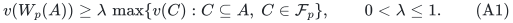

The factor <code class="math">\lambda</code> is common to the calls and known. An oracle
with different certified factors can use their minimum. Oracle work,
its numerical parameters and the bit length of <code class="math">\lambda</code> are
paid. This is a guarantee relative to (A1), not a claim that any
feasible bundle returned by a heuristic certifies an upper bound.

Use the same perspective relaxation <code class="math">L(T)</code> as the exact-oracle
note:

<!-- math-display: b64f33e32f34a1c3acb11461
\begin{split}
 &x\in P_{\mathcal B(M)},\qquad
 y_p\in x_p\mathrm{conv}
                  \{\mathbf1_C:C\in\mathcal F_p\},\\
 &\sum_p y_{pe}\le1,\qquad
 \sum_e v_e y_{pe}\ge T x_p.
 \end{split}
 \tag{A2}
-->
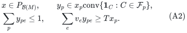

At <code class="math">x_p=0</code> the perspective variable is zero. No feasible point
or configuration LP is required as input.

## 2. Fresh scans replace exact maximality

At a search state with forbidden physical union <code class="math">F</code>, call (A1)
on <code class="math">E\setminus F</code> for each eligible player. If the returned
value is at least the chosen bundle threshold <code class="math">B&gt;0</code>, delete
items until the bundle is inclusion-minimal above <code class="math">B</code>, and run
the original blocked-insertion or free-cascade microstep.

A completed scan is a sequence of calls made at one unchanged state.
If every return has value below <code class="math">B</code>, then

<!-- math-display: 15bcfde59b3920ce427c00d0
\max\{v(C):C\subseteq E\setminus F,\ C\in\mathcal F_p\}
                          <B/\lambda
       \quad(p\text{ eligible}).
 \tag{A3}
-->
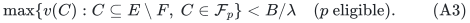

After a microstep the implementation may restart the scan. It does
not permanently cache a failed approximate call. A deterministic
approximation algorithm can return different-quality witnesses on
nested available sets, even when the actual optima are monotone.
Restarting costs at most one full player scan per charged state.

Previously completed lower layers retain their mathematical
inequalities (A3): the earliest-circuit exchange preserves both their
eligible player sets and their forbidden physical sets literally.
No relation between different approximate outputs is needed. The
last-layer refresh and immediate old-free-center cascades are unchanged.

## 3. The strict certificate and general quality condition

For an eligible player with <code class="math">x_p&gt;0</code>, decompose
<code class="math">y_p/x_p</code> into feasible-bundle indicators and restrict each
bundle to <code class="math">E\setminus F</code>. Downward closure and (A3) imply

<!-- math-display: 70b4327eb59eb5647c02c594
\sum_{e\notin F}v_e y_{pe}
                                  <(B/\lambda)x_p.
 \tag{A4}
-->
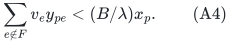

Let the current matching size be <code class="math">k&lt;r</code>, let
<code class="math">s=&#124;Y_{&lt;i}&#124;</code>, and put

<!-- math-display: 9ada7459616c9f64b9db71fd
J_0=I\setminus\mathrm{owners}(Y_{<i}),\qquad
 w=r-|J_0|=r-k+s\ge1.
-->
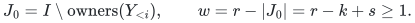

The eligible mass is at least <code class="math">w</code>. Provided <code class="math">B\le\lambda T</code>,
a feasible point of (A2) therefore requires

<!-- math-display: ac7f6871afa1b1444619cc4b
v(F)>(T-B/\lambda)w.
 \tag{A5}
-->
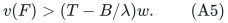

Strictness holds also at <code class="math">B=\lambda T</code>: positive eligible
mass exists and the available-value bound is strict for every positive
player coordinate.

Thus (A3), an independent <code class="math">J_0</code>, and

<!-- math-display: c004de93ad38f4d6c5ca7b7a
v(F)\le(T-B/\lambda)(r-|J_0|)
 \tag{A6}
-->
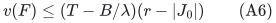

are a valid oracle-relative certificate of infeasibility. A verifier
can rerun a complete scan and check the returned values, in addition
to the matroid and resource counts. The soundness of that verification
uses the proved guarantee of the available-bundle algorithm (A1).

All stored bundles remain minimal above <code class="math">B</code>. Physical ownership
is unchanged, so the sharp star bound remains

<!-- math-display: 0ce6b328f5fd33827d02f8f7
v(F)\le C(B,u)|Y|,
 \qquad C(B,u)=\max\{u,\ 2B+\min(u,B)\},
 \quad u=\max_e v_e
 \tag{A7}
-->
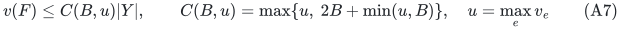

Here <code class="math">u=0</code> if the item set is empty.

Put <code class="math">\rho_r=(r-1)/r</code>. Since <code class="math">s/w\le\rho_r</code>, an
empty final blocker layer gives (A6) whenever

<!-- math-display: c989f661e98eafaea142d249
\boxed{\quad B/\lambda+\rho_r C(B,u)\le T.\quad}
 \tag{A8}
-->
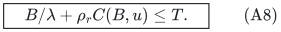

The exact-boundary search therefore terminates with a valid result in
<code class="math">2^{O(r)}</code> times a polynomial input and oracle multiplier. Each
successful layer has at least one distinct matching blocker, and the
same rank-bounded integer-composition count pays every microstep.

## 4. Positive slack and the general value curve

If

<!-- math-display: 5ea8d4d41ca05b094a997321
\Delta=T-B/\lambda-\rho_r C(B,u)>0,
       \qquad
       \gamma=\min\{1/2,\Delta/(2C(B,u))\},
 \tag{A9}
-->
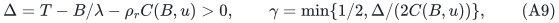

test a completed layer for <code class="math">&#124;Y_i&#124;&gt;\gamma w</code>. Failure implies

<!-- math-display: e92bd89f309718627cda069b
v(F)\le C(B,u)(\rho_r+\gamma)w
                 <(T-B/\lambda)w,
-->
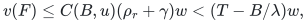

so it is certified infeasible. Passing layers have multiplicative
current growth, and their depth is
<code class="math">O(\gamma^{-1}\log(r+1))</code>. The number of charged states is

<!-- math-display: 6a222d22e2d72849170bd34d
\min\left\{2^{O(r)},
        (r+1)^{O(\gamma^{-1}\log(r+1))}\right\}.
 \tag{A10}
-->
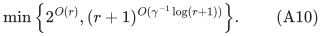

For completeness the equality solution of (A8) has an explicit form.
Write <code class="math">\tau=1/\lambda</code>, <code class="math">d=\tau+3\rho_r</code>. For
<code class="math">r\ge2</code>, a positive solution exists exactly when
<code class="math">u&lt;T/\rho_r</code>, and its largest value is

<!-- math-display: cc50a12c9591522120aba336
B^*_{r,\lambda}(T,u)=
 \begin{cases}
 (T-\rho_r u)/(\tau+2\rho_r),&u\le T/d,\\
 T/d,&T/d\le u\le3T/d,\\
 \lambda(T-\rho_r u),&3T/d\le u<T/\rho_r.
 \end{cases}
 \tag{A11}
-->
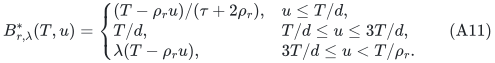

The formulas agree at the boundaries. For rank one use
<code class="math">B^*_{1,\lambda}=\lambda T</code> for arbitrary <code class="math">u</code>. This is
also obtained by choosing the best approximate bundle among nonloop
players; exact optimization is not being claimed for an inexact oracle.

## 5. Arbitrary item sizes and the matroid-union wrapper

Let

<!-- math-display: 8b1e2323389a434ad0fc9803
d_{r,\lambda}=\lambda^{-1}+3-3/r,
                 \qquad B_0=T/d_{r,\lambda}.
 \tag{A12}
-->
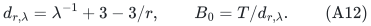

An item is fat when <code class="math">v_e\ge B_0</code>. Keep a player-fat incidence
only when <code class="math">\{e\}\in\mathcal F_p</code>. This singleton test is
implementable by (A1): for positive <code class="math">v_e</code>, an admissible singleton
has positive optimum on <code class="math">\{e\}</code>, and any <code class="math">\lambda&gt;0</code>
guarantee forces that singleton to be returned. An inadmissible
singleton cannot be returned by a feasible oracle.

Construct the fat transversal matroid <code class="math">N</code>, set
<code class="math">U=M^*\vee N</code>, and run the small-item algorithm on <code class="math">U^*</code>.
Its rank <code class="math">r'</code> is at most <code class="math">r</code>. The existing integral-optimum
and configuration-LP promises remain valid because they only use
feasible singletons, downward closure and convex combinations of
feasible all-small configurations. They do not use exact available
optimization.

For the exact target <code class="math">B=B_0</code>, small items have <code class="math">u&lt;B_0</code>,
and <code class="math">C(B,u)\le3B_0</code>. Since
<code class="math">\rho_{r'}\le\rho_r</code>, condition (A8) follows from

<!-- math-display: dfe87ef805d5973705700425
B_0/\lambda+3\rho_r B_0=T.
-->
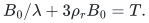

When <code class="math">r'=0</code>, no inner algorithm is needed. The existing union
decomposition and extension of its dual part return a basis of the
original matroid, each player supplied by either a small feasible
bundle or one fat feasible singleton. This proves ratio
<code class="math">d_{r,\lambda}</code> in rank-exponential time.

The comparison may be taken against the player-matroid configuration
LP with configurations in <code class="math">\mathcal F_p</code>. It is not a claim
against the original unrestricted-size perspective relaxation alone.
All polynomial union, dual and fat-matching oracle costs are paid as
in the established wrapper.

## 6. Uniform positive-error time: no additional inverse-lambda exponent

Fix <code class="math">\eta&gt;0</code>. Keep the fat threshold <code class="math">B_0=T/d</code>, where
<code class="math">d=d_{r,\lambda}</code>, and use the smaller inner bundle target

<!-- math-display: 17aa1cdfb1bd327f91a66de0
B=T/(d+\eta),\qquad
 \varepsilon=(B_0-B)/T=\frac{\eta}{d(d+\eta)}.
 \tag{A13}
-->
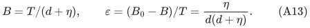

The coarse coefficient <code class="math">\overline C=2B+B_0</code> bounds the sharp
coefficient because <code class="math">u&lt;B_0</code>. It satisfies
<code class="math">\overline C\le3T/d</code>. Even using the original rank <code class="math">r</code>,
the gap is

<!-- math-display: 43f685909da87f9b9e4e974d
\begin{split}
 T-B/\lambda-\rho_r\overline C
  &=(\tau+2\rho_r)(B_0-B)\\
  &=(\tau+2\rho_r)\varepsilon T.
 \end{split}
 \tag{A14}
-->
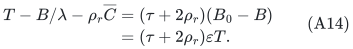

Here <code class="math">\tau\ge1\ge\rho_r</code>, so
<code class="math">\tau+2\rho_r\ge3d/4</code>. Hence the gap divided by
<code class="math">\overline C</code> is at least

<!-- math-display: ab4f9688ea668d42aa260ece
\frac{\eta(\tau+2\rho_r)}{3(d+\eta)}
       \ge\frac{\eta d}{4(d+\eta)}
       \ge\frac18\min\{\eta,1\}.
 \tag{A15}
-->
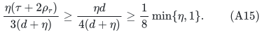

The last step uses <code class="math">d\ge1</code>, separately for <code class="math">\eta\le1</code>
and <code class="math">\eta\ge1</code>. Therefore the uniform choice

<!-- math-display: d9aa610f5ca50f56bbccba77
\gamma=\frac1{16}\min\{\eta,1\}
 \tag{A16}
-->
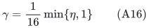

validates the same growth certificate. In particular ratio
<code class="math">d_{r,\lambda}+\eta</code> is obtained in

<!-- math-display: f2dbf486e50a85be0203e441
\mathrm{poly}(\text{input bits, oracle work})\,
 \min\left\{2^{O(r)},
       (r+1)^{O((1+\eta^{-1})\log(r+1))}\right\}.
 \tag{A17}
-->
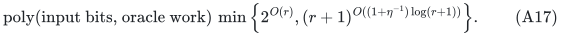

The hidden constant in the rank exponent does not grow with
<code class="math">\lambda^{-1}</code>. The oracle's own complexity and numerical bit
length may, and are explicitly outside that assertion. The allocation
wrapper uses polynomial space in the full explicit input, in addition
to the supplied oracle's workspace. The same common-grid,
nonmonotone-success target search
applies; use an upper target exceeding
<code class="math">(d+\eta)\sum_e v_e</code>, which has polynomial encoding length.

## 7. A self-contained knapsack oracle specialization

Suppose player <code class="math">p</code> has nonnegative item costs <code class="math">a_{pe}</code> and
budget <code class="math">b_p</code>, with
<code class="math">\mathcal F_p=\{C:\sum_{e\in C}a_{pe}\le b_p\}</code>.
Costs may depend on the player; the utility of item <code class="math">e</code> is still
the common intrinsic value <code class="math">v_e</code>. The family is downward closed.

A deterministic fully polynomial approximate available oracle is
enough; exact knapsack optimization is unnecessary. Here is a simple
implementation, included to make its numerical guarantee explicit.
Discard unavailable items and singleton-infeasible items. If their
maximum positive value is <code class="math">V_{\max}</code>, let
<code class="math">K=\kappa V_{\max}/m</code>, where <code class="math">m</code> is the number of retained
items, and round each profit down to <code class="math">\lfloor v_e/K\rfloor</code>.
Every rounded profit is at most <code class="math">m/\kappa</code>. A standard dynamic
program stores the minimum cost attaining each integer rounded
profit, and returns a maximum-profit state of cost at most <code class="math">b_p</code>.
If there is no positive feasible item, return the empty bundle.

The rounded profit range is <code class="math">O(m^2/\kappa)</code>, giving a
conservative <code class="math">O(m^3/\kappa)</code> arithmetic implementation. Every
optimal feasible bundle loses less than <code class="math">mK</code> under rounding.
Since <code class="math">V_{\max}\le\mathrm{OPT}_{\rm available}</code>, the returned
true value is at least
<code class="math">(1-\kappa)\mathrm{OPT}_{\rm available}</code>. Costs, comparisons
and reconstruction use polynomial-bit rationals. Thus (A1) holds with
<code class="math">\lambda=1-\kappa</code>, deterministically. This is the classical
profit-scaling FPTAS principle; see, for example, Lawler,
*Fast Approximation Algorithms for Knapsack Problems*,
[Mathematics of Operations Research 4(4), 1979](https://doi.org/10.1287/moor.4.4.339).
No claim of a new knapsack oracle or best FPTAS running time is made.

For a requested allocation ratio <code class="math">4-3/r+\zeta</code>, choose

<!-- math-display: 2efb1a9401223bfc2ad6a960
\kappa=\min\{1/2,\zeta/(2+\zeta)\},\qquad \eta=\zeta/2.
-->
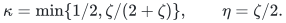

Then <code class="math">\lambda^{-1}-1=\kappa/(1-\kappa)\le\zeta/2</code>,
so (A17) gives the requested ratio. Oracle cost and workspace are polynomial in
input size and <code class="math">1+\zeta^{-1}</code>, and the rank-quasipolynomial
exponent uses <code class="math">1+\zeta^{-1}</code>. In particular rank-one exact
knapsack is not being solved: any guarantee approaching one here
uses a positive approximation error and the FPTAS cost. If <code class="math">\zeta</code>
is encoded by a very small rational, the FPTAS workspace is not being
claimed polynomial in its encoding length alone.

## 8. Comparison scope

This is an explicit oracle/value bridge for the present rank-sensitive
player-matroid method. It is not by itself a first-approximation claim
for budgeted allocation, an all-player result, or arbitrary
resource-side matroids. The all-player exact-oracle comparison already
has a public Polacek--Svensson extension, documented in
[item-matroid-allocation-public-scope-audit.md](item-matroid-allocation-public-scope-audit.md).

In particular, an all-player knapsack quasipolynomial factor
<code class="math">4+\zeta</code> also follows from that public exact-oracle framework.
At target <code class="math">T</code>, cap intrinsic item values at <code class="math">T</code>, then round
them down on the common grid <code class="math">K=\kappa T/m</code>, where <code class="math">m</code> is
the item count. Every original target configuration retains value at
least <code class="math">(1-\kappa)T</code>; the total integer profit is
<code class="math">O(m^2/\kappa)</code>, so each player's available knapsack optimum
can be computed exactly for these fixed rounded values. This supplies
the public algorithm's exact search interface. Taking its error
<code class="math">\zeta/2</code> and <code class="math">\kappa=\zeta/[2(4+\zeta)]</code> gives
<code class="math">(4+\zeta/2)/(1-\kappa)=4+\zeta</code>. Thus the knapsack example
is not an exclusive all-player consequence of the new oracle bridge.

That fixed common-rounding argument is specific to a discretizable
family such as knapsack. An arbitrary <code class="math">\lambda</code>-only oracle
does not automatically supply the exact nearest-layer search used in
the public algorithm. Any broader same-model record claim requires a
separate source comparison that preserves player selection, common
values, local feasibility, oracle access and the comparator.
