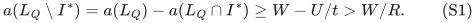
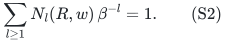
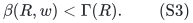
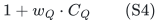
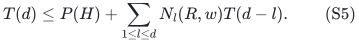
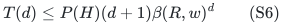
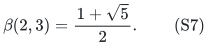
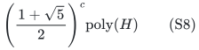

# Sparse separators improve the corank gap time base

**25 October 2026. New complete refinement; root and independent full review requested.**

This note refines the weighted prefix-free corank gap. It makes two
separate observations. A selected-set algorithm may often test its attained
candidate rather than requiring service on every remaining candidate.
Furthermore, when the violated row has few positive coefficients on the
tested set, an explicit finite branching polynomial gives a smaller
corank time base. This is not a smaller constant for unrestricted dense
separators.

## 1. A permitted tested set and the protected witness

Use the selected-set, completion, and service interfaces of
[selection.md](../../problems/whole-ground-allocation/selection.md) or
[adaptive-selection.md](../../problems/whole-ground-allocation/adaptive-selection.md). Fix full and relaxed targets
t>b>0 and put R=t/(t-b). At a node with allowed ground Q and remaining
omission budget d, suppose the algorithm constructs a tested set L_Q
contained in Q with these two properties:

1. Feasibility of b*1_(L_Q) in the current service region yields a valid
   relaxed solution by a paid polynomial recovery operation.
2. Along a path preserving a full witness I*, its full target t*1_(I*)
   belongs to the current region, and |Q\I*|<=d.

The current region must supply an exact nonnegative polynomial-bit
separator; emptiness checks and completion feasibility gates must already
be sound for the protected witness. Every such operation has uniform
polynomial bit complexity and space.

In the ordinary fixed-family theorem, L_Q can be the actual set returned
by the restriction selector. In the adaptive minimum-completion theorem,
it can be the light set of the pair attaining the current completion cost.
Both recover a legal solution directly when this set passes its test.

This replacement is not automatic in every application. For the joint-role
compulsory allocation algorithm, testing only an arbitrary subset of Q
would leave the other current light players unserved. Its valid tested set
remains all of Q unless a separate completion operation is proved.

## 2. A failed attained-set query still gives the omission certificate

Suppose a valid row a*z<=U, with a>=0 and U>=0, is violated by
b*1_(L_Q). Set W=a(L_Q)>0. The protected full witness satisfies
t*a(I*)<=U, so

<!-- math-display: 69244a08b65b2df68b701015
a(L_Q\setminus I^*)
 =a(L_Q)-a(L_Q\cap I^*)
 \ge W-U/t>W/R.
\tag{S1}
-->

Only coordinates of L_Q having positive row coefficients need be kept in
the prefix ordering. Let their number be w_Q. Sort them by decreasing
coefficient with a deterministic tie order. The layer-cake proof of the
original theorem, now on these w_Q coordinates, shows that
L_Q\I* has a first prefix with R times its omitted count greater than the
prefix length. This certificate contains only elements of Q\I* and has
at most d ones. Deleting it preserves the original full witness.

No common attained set is assumed across nodes. The new candidate may
change after each omission. Equation S1 is proved afresh from the same
protected full witness, which is sufficient for induction.

## 3. The finite certificate polynomial

For a fixed positive integer width w, let N_l(R,w) be the number of binary
words of length at most w which cross R times the number of ones greater
than the length for the first time at their last position, and which have
exactly l ones. Thus every proper prefix obeys Rk<=m. The last bit is one.

Define beta(R,w)>=1 by

<!-- math-display: d9dea415b3c826b1eb17cf3d
\sum_{l\ge1}N_l(R,w)\,\beta^{-l}=1.
\tag{S2}
-->

There is always the word `1`, so the sum at beta=1 is at least one.
If that is the only word, beta=1. Otherwise the sum is continuous and
strictly decreasing from a value greater than one to zero, giving a unique
root greater than one.

The coefficients are explicit integers of polynomial binary length. They
can be computed by a dynamic program over length m<=w and ones k<=m.
Start with one noncrossing empty prefix. Appending zero always remains
noncrossing. Appending one either remains noncrossing or contributes to
N_(k+1) if R(k+1)>m+1. A crossing word is never extended. There are O(w^2)
states and all comparisons with rational R are exact cross multiplications.

For every finite w,

<!-- math-display: 4b42fe4904cddfaa207ff1bb
\beta(R,w)<\Gamma(R).
\tag{S3}
-->

Indeed, a first-crossing word with l ones and z zeros has z<(R-1)l.
Under Bernoulli bits of success probability 1/R, its probability is
strictly greater than Gamma(R)^(-l). The finite prefix-free family has
total probability at most one. Therefore its sum in S2 at Gamma(R) is
strictly less than one, proving S3. This statement does not assert a
uniform gap below Gamma(R) when w is unbounded.

## 4. Polynomial work per enumerated child

The original rectangle enumerator had a Gamma(R)^d local-state bound.
That bound would be too weak to justify the smaller beta time. Instead,
prune every prefix that cannot reach a permitted first crossing.

At a node, precompute a Boolean reachability table on states (m,k), with
m<=w_Q and k<=min(d,m). A state that already crosses is a valid terminal.
A noncrossing state at maximum length is invalid. For every other
noncrossing state, reachability is the disjunction of its allowed zero and
one extensions, subject to k<=d. Compute this table backwards in m.

Perform depth-first enumeration, descending only into reachable states and
stopping at every crossing. It enumerates exactly the certificates of
length at most w_Q and at most d ones. Every explored prefix has an output
descendant. Consequently its search trie has at most

<!-- math-display: 33a4cf2b27b1bf20ced3eeba
1+w_Q\cdot C_Q
\tag{S4}
-->

nodes, where C_Q is the number of actual output certificates. The table
itself has polynomial size and computation time. Thus all local work is
polynomial preprocessing plus polynomial work per actual attempted child.
Dead branches of the unpruned rectangle no longer determine the base.

Different prefix words cannot produce the same omitted set on this fixed
ordering: the last one fixes the word length, and the earlier ones fix its
remaining bits. Duplicate elimination is therefore unnecessary. Even if
one charged duplicates, the stated polynomial recurrence would remain an
upper bound.

## 5. Complete all-input recurrence and polynomial space

Assume every failed query encountered by the algorithm has w_Q<=w. This
must hold also on unpromised inputs and after every forced omission. The
algorithm never needs to evaluate beta numerically.

Every certificate with l ones reduces d by l. The number of such children
is at most N_l(R,w); certificates of length at most a smaller w_Q form a
subfamily. Every attempted child, including a failed selector or completion
check, is charged. Absorb its construction work into a polynomial entry
charge for that child. With a uniform polynomial P(H), the resulting
recurrence can be written, after increasing the entry charge by a constant,
as

<!-- math-display: 3e17f043067a32f6ca39306e
T(d)\le P(H)+\sum_{1\le l\le d}N_l(R,w)T(d-l).
\tag{S5}
-->

A formal equivalent starts from
T(d)<=P+sum_l N_l(P+T(d-l)) and applies S5 to T+P with charge 2P.
The base d=0 has polynomial work and no children. By induction using S2,

<!-- math-display: b021d30064143b6644aa33f7
T(d)\le P(H)(d+1)\beta(R,w)^d
\tag{S6}
-->

after a harmless constant enlargement of P. In the induction step,
d-l+1<=d and the truncated coefficient sum is at most one. The formula
also covers beta=1, when the tree has at most one child per node.

This proof uses the full promise only for completeness, not for the time
bound. All input instances obey S6. Each paused enumerator stores one word
of length at most q and one polynomial table; recursive depth is at most
the original omission budget. The space is polynomial.

## 6. Concrete constants

At R=3 the first few certificate counts give:

| Width bound w | Nonzero coefficient counts | beta(3,w) |
| --- | --- | --- |
| 1 | N_1=1 | 1 |
| 2 or 3 | N_1=2 | 2 |
| 4 | N_1=2, N_2=1 | 1+sqrt(2) |
| 5 or 6 | N_1=2, N_2=3 | 3 |

For width four the words are `1`, `01`, and `0011`; their deletion sizes
are one, one, and two. At width five the new words are `00011` and `00101`.
No first crossing ends at length six. These finite languages prove the
displayed roots without a numerical calculation.

At R=2 and width three, the words are `1` and `011`. Hence

<!-- math-display: b661589d5e495d3c485720fb
\beta(2,3)=\frac{1+\sqrt5}{2}.
\tag{S7}
-->

If the problem supplies the required forced-omission interface, the
accepted global block wrapper also applies to any fixed beta bound
strictly greater than one. The beta=1 case is already polynomial directly
by S6 and does not invoke the wrapper's A>1 interface.
The quadratic constants above permit exact algebraic local comparisons.
Thus width-four R=3 has global base 3-sqrt(2), and width-three R=2 has
global base (5-sqrt(5))/2, with the usual explicit subexponential overhead
and polynomial space. These are fixed-width statements; no constant
improvement for unrestricted separators is claimed.

## 7. A concrete weighted side-packing consequence

Consider a common basis of two matroids on an explicit ground, one exact
linear selected-set cost threshold, and arbitrary nonnegative weighted
packing rows, each with at most three positive coordinates. A restriction
selector is minimum-cost weighted matroid intersection on the allowed
ground. Test the attained common basis against the packing rows.

For capacity inflation two, use the original capacity-inflation reduction
t=2, b=1, and scaled capacities 2u. Then R=2 and every returned explicit
row has tested width at most three. The algorithm returns an exact common
basis obeying all capacities inflated by at most two and the exact cost
threshold, or soundly rejects original uninflated feasibility, in

<!-- math-display: a469f1b789c37a071bd3d6f0
\left(\frac{1+\sqrt5}{2}\right)^c
                                      \mathrm{poly}(H)
\tag{S8}
-->

time and polynomial space. Its whole-ground counterpart has base
(5-sqrt(5))/2. The one-sided exact-cost optimization from the existing
common-bases note may also be applied without changing its cost guarantee.

This is a theorem composition for a precise sparse weighted model. No
publication-priority claim is made. In implicit projection applications,
originally sparse inequalities need not imply sparse projected separators;
the width condition must be proved for the actual returned row.

## 8. Relation to the unresolved three-to-two unit question

At integer quotas t=3 and b=2, R=3. The finite-width constants improve the
bound when a uniform width hypothesis is available. Attained-set testing
automatically bounds that width by the selected cardinality, and may
avoid failures caused only by requiring service on all remaining players.
Neither observation gives a fixed smaller exponential base when the
selected cardinality and projected row supports are unbounded. The
unrestricted 3-unit promise to 2-unit output question therefore remains
open within this line of analysis.
