# Current-blocker allocation with binary resource supplies

**25 October 2026. New compressed implementation; independent audit requested.**

This note removes dependence on the number of explicitly expanded copies
of an identical resource type. Supplies, and optional per-player type
quotas, may be encoded in binary. The current-blocker algorithm retains
its rank-sensitive number of steps. Each step is implemented using
integer counts, without enumerating the resource copies.

The mathematical imports are the audited current-blocker exchange and
signature proofs, the sharp rank-quality lemma, and the matroid-union
fat-resource wrapper. This note proves the additional finite
representation and available-value facts needed to apply them.

## 1. Input, output, and the two capacity interpretations

There are <code class="math">q</code> players with a player-selection matroid <code class="math">M</code> of
rank <code class="math">r</code>, and <code class="math">t</code> resource types. Type <code class="math">j</code> has a positive
intrinsic unit value <code class="math">v_j</code> and an integer supply <code class="math">c_j\ge0</code>.
Supply counts are binary integers. A liking incidence <code class="math">(p,j)</code>
may also have a binary quota <code class="math">a_{pj}</code>, meaning that player <code class="math">p</code>
may receive at most <code class="math">a_{pj}</code> copies of type <code class="math">j</code>. Replace
<code class="math">a_{pj}</code> by <code class="math">\min(a_{pj},c_j)</code>, and use zero for an absent
incidence. An omitted quota means <code class="math">a_{pj}=c_j</code>.

An allocation is represented by integer counts <code class="math">n_{pj}</code> with

<!-- math-display: c080fb40ddd8d88bfe935be6
0\le n_{pj}\le a_{pj},\qquad
    \sum_p n_{pj}\le c_j.
 \tag{C1}
-->
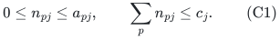

Only selected basis players require positive target value. Their value
is <code class="math">\sum_jv_jn_{pj}</code>. This is an output of polynomial bit length;
printing a separate record for every copy is not part of the model.

Two important cases must be distinguished:

* <code class="math">a_{pj}=c_j</code>: ordinary identical item copies, where one player
  may receive many units of one type;
* <code class="math">a_{pj}\in\{0,1\}</code>: a capacity-limited service that can be
  provided at most once to any player. This includes a uniform
  resource matroid on its eligible receiving players.

The second case does not silently count the same service repeatedly.
Neither case represents an arbitrary resource-specific matroid.

Let <code class="math">\mathcal P</code> be the number of players, types and explicit
liking/quota incidences, plus a constant. Let <code class="math">b</code> be the total
numeric bit length of all supplies, quotas, values and numerical
parameters.
The largest item parameter remains the largest **unit** value
<code class="math">u=\max_{j:c_j&gt;0}v_j</code>, or zero if no unit exists, not the value
<code class="math">c_jv_j</code> of an entire type. Rank zero is the trivial empty
allocation; approximation formulas containing <code class="math">1/r</code> assume
<code class="math">r\ge1</code>.

## 2. The aggregate compact relaxation is sufficient

The appropriate perspective relaxation is

<!-- math-display: 65f470eae89d58d1e3a31638
\begin{split}
 &x\in P_{\mathcal B(M)},\\
 &\sum_jv_jy_{pj}\ge T x_p,\\
 &0\le y_{pj}\le a_{pj}x_p,\\
 &\sum_p y_{pj}\le c_j.
 \end{split}
 \tag{C2}
-->
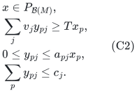

It is a relaxation of every integral allocation (C1). It can be
related to a conceptual universe of <code class="math">c_j</code> distinct copies of
each type. Given a feasible point of (C2), assign the same fractional
amount <code class="math">y_{pj}/c_j</code> to each conceptual copy, for <code class="math">c_j&gt;0</code>.
Each copy has total fractional usage at most one, and each player's
copy variable is at most <code class="math">x_p</code>, since <code class="math">a_{pj}\le c_j</code>.

This conceptual lift is used only in the proof. No copy variables or
copy vertices are constructed by the algorithm.

### Lemma 1: the available-value bound with type quotas

Let a physical forbidden set contain <code class="math">c_j-A_j</code> of the conceptual
copies of type <code class="math">j</code>. Player <code class="math">p</code>'s maximum available value is

<!-- math-display: 7998ab30131ca3f469cde8fd
V_p(A)=\sum_jv_j\min(a_{pj},A_j).
 \tag{C3}
-->
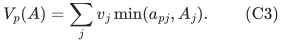

The uniform fractional lift gives it at most

<!-- math-display: 9eab253cfdcb27d81a39a539
\sum_jv_j\frac{A_jy_{pj}}{c_j}
 \le x_p\sum_jv_j\min(a_{pj},A_j)=x_pV_p(A)
 \tag{C4}
-->
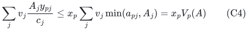

value outside the forbidden set. The inequality follows from both
<code class="math">A_j a_{pj}/c_j\le a_{pj}</code> and
<code class="math">A_j a_{pj}/c_j\le A_j</code>. Types with zero supply contribute zero.

Thus a completed scan with <code class="math">V_p(A)&lt;B</code> for every eligible player
gives the same strict fractional outside-value inequality as before.
The matroid rank-mass and current star-cover proofs remain valid.
The per-player quota does not obstruct deleting an item from a bundle,
so all inclusion-minimality estimates, including the sharper singleton
star bound, are unchanged.

## 3. The finite intersection-cell state

Maintain active labels for current matching bundles and selected
candidate bundles. A matching bundle has one player owner. Different
selected bundles may have the same player owner. During a phase there
are at most <code class="math">r</code> matching labels and at most <code class="math">r</code> selected labels,
including the conservative allowance for a temporary free cascade.

For each resource type <code class="math">j</code>, store integer cell counts

<!-- math-display: 410c08d9415fb8ed8736bd48
z_j[a,b],
 \tag{C5}
-->
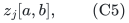

where <code class="math">a</code> is a matching-bundle label or zero, and <code class="math">b</code> is a
selected-bundle label or zero. The count is the number of copies that
belong to exactly that matching bundle and exactly that selected
bundle. Zero means that the copy has no owner of that kind. Since
matching bundles are pairwise disjoint and selected bundles are
pairwise disjoint, these cells partition all copies of type <code class="math">j</code>:

<!-- math-display: d5bf4113993fdc5e42587c35
z_j[a,b]\ge0,\qquad
                       \sum_{a,b}z_j[a,b]=c_j.
 \tag{C6}
-->
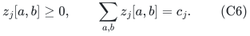

The full representation has <code class="math">O(t(r+1)^2)</code> cells. Each count uses
<code class="math">O(\log(c_j+1))</code> bits. It is initialized by putting <code class="math">c_j</code>
in the cell <code class="math">(0,0)</code>. Label slots are reused only after their old
bundle has been retired and all corresponding row or column counts
have been moved.

The matching layer flags identify which matching labels belong to
the current blocker prefix <code class="math">Y</code>. The copies outside the current
forbidden set <code class="math">R(X\cup Y)</code> are exactly

<!-- math-display: 0445bc97e8fc8dd30f2c242f
A_j=\sum_{a=0\text{ or }a\notin Y} z_j[a,0].
 \tag{C7}
-->
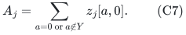

Undiscovered matching bundles are included in (C7). Excluding all
nonzero matching rows would wrongly prevent the construction of
blocked candidates.

## 4. Finding and pruning a candidate in batches

For an eligible player, compute (C3) by scanning its liking list.
If that value is at least <code class="math">B</code>, build a provisional candidate in
fixed type order. If its current value is <code class="math">V&lt;B</code>, take

<!-- math-display: 83772c513f396dcf724e40a7
\min\!\left\{a_{pj},A_j,
                       \left\lceil\frac{B-V}{v_j}\right\rceil\right\}
 \tag{C8}
-->
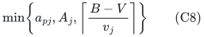

copies of the next type. Distribute that integer count across the
at most <code class="math">r+1</code> available cells of that type in a fixed matching-
label order. Store the provisional counts by type and old matching
row. There is no one-copy loop.

Once the target is reached, prune in one pass over the represented
types. If the candidate contains <code class="math">n_j</code> copies of type <code class="math">j</code>,
remove

<!-- math-display: 565e8afe4f3cb20a0b62e675
d_j=\min\!\left\{n_j,
                       \left\lfloor\frac{V-B}{v_j}\right\rfloor\right\}
 \tag{C9}
-->
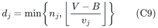

copies, updating <code class="math">V</code>, and remove those counts from the provisional
cells in a fixed order. If any copy of a processed type remains,
deleting one more would reduce the value below <code class="math">B</code>. Later pruning
only decreases the value, so that property persists. The final
candidate is inclusion-minimal above <code class="math">B</code>, respects all quotas,
and uses only available copies.

All ceilings and floors are exact rational operations on binary
integers. Products of input denominators have polynomial bit length;
large supplies increase count bit lengths, not the number of loop
iterations.

## 5. Blockers, exchanges and truncations are cell operations

The candidate's matching blockers are precisely the distinct nonzero
matching labels with positive provisional count. They are outside
the old <code class="math">Y</code>, by (C7). If any blocker exists, insert a new selected
column, splitting its chosen counts from the old zero-selected
column. Mark those matching rows as blockers of the new center.
The usual invariant ensures that a newly discovered matching bundle
does not intersect an older selected bundle; otherwise it would
already have been in <code class="math">Y</code>.

If no blocker exists, all provisional copies have matching label zero.
The free-candidate rule applies unchanged. Replacing matching bundle
<code class="math">a</code> first moves every cell <code class="math">(a,b)</code> to <code class="math">(0,b)</code>, and then
assigns the candidate's copies to the new matching label. For a stored
free candidate its selected column already identifies those copies;
for a fresh candidate the provisional cell counts do. The new
matching label has no retained blocker-layer flag.

For a stored free center, write its column into the new matching row
before retiring that selected column during truncation. Equivalently,
save its provisional cell counts first. This transaction order prevents
losing the candidate's unit identities when its old layer is discarded.

Only the selected owner of the deleted matching blocker can become
newly free. A blocker-label list and its selected-owner pointer track
this event without checking individual copies. Truncating a selected
layer moves each retired column <code class="math">(a,b)</code> into <code class="math">(a,0)</code>. Retiring
a blocker-layer flag does not delete its matching bundle; it makes
its remaining copies available again as prescribed by (C7).

All of these operations can conservatively scan the full cell table.
They therefore cost <code class="math">\mathcal P\mathrm{poly}(r)</code> integer
operations per charged microstate. No event is multiplied by a supply
count. Reusing a row or column slot is preceded by clearing its old
counts and owner metadata, so historical labels do not accumulate.

## 6. Why fixed resource identities and old maximality remain sound

The cell representation is an exact quotient of a conceptual finite
copy execution. At initialization choose a fixed universe of
<code class="math">c_j</code> copies for every type. Whenever a cell is split, choose any
subset of that cell's conceptual copies of the requested cardinality.
Moving a cell changes only its matching or selected owner tag; it
does not change the copies' values, liking sets or identity.

This inductively realizes every stored cell table by actual bundles
in one fixed conceptual universe. The implementation need not name
those units individually. In particular, it need not perform a global
permutation that could obscure the meaning of an earlier maximality
claim.

After an earliest-layer exchange, the selected sets and blocker sets
of each strictly lower retained layer remain the same conceptual
resource sets, exactly as in the uncompressed proof. Removing a
matching row outside such a lower blocker prefix does not remove a
resource from that lower forbidden set. The new matching bundle
avoids retained selected resources and is not placed in an earlier
blocker prefix. Hence lower availability and maximality are literally
preserved, not merely preserved up to a numerical total.

At output, only aggregate type counts per matching player are needed.
Their capacity constraints follow from (C6). If desired, each type's
copies can be assigned contiguous integer ID intervals to the output
players; listing the intervals still takes polynomial space.

## 7. Runtime, certificates and numerical input size

An eligibility scan uses the same player-matroid oracle tests as
before. Available values use (C3); blocker discovery and all updates
use cell counts. A completed failed growth test outputs the
independent player set, its closure predicate, and forbidden counts
<code class="math">c_j-A_j</code>. Verifying the available-value conditions and the cover
value

<!-- math-display: 70ea5bf30c70de2835885e52
v(F)=\sum_jv_j(c_j-A_j)
-->
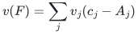

is polynomial in <code class="math">\mathcal P,r,b</code>. Lemma 1 proves that these
compressed facts certify infeasibility of (C2).

The original rank-only micro-signature count is independent of the
number of item copies. Consequently every proved positive-slack
sharp-rank guarantee is implementable in

<!-- math-display: 68c5619cf09e020422f2f4a7
\mathcal P\mathrm{poly}(r,b)\,
 \min\!\left\{2^{O(r)},
       (r+1)^{O(\varepsilon^{-1}\log(r+1))}\right\}
 \tag{C10}
-->
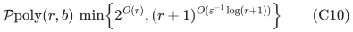

time and original-matroid oracle calls, with polynomial space. The
exact boundary uses the first exponential term. Polynomial factors
in <code class="math">r</code> may be absorbed into either displayed rank dependence.
The numerical encoding includes supplies and quotas; the claim is
not pseudopolynomial in <code class="math">\sum_jc_j</code>.

## 8. Fat matching without expanding capacities

For the arbitrary-size wrapper, a fat type has unit value at least
the chosen threshold. A player can receive a fat unit of type <code class="math">j</code>
only when <code class="math">a_{pj}\ge1</code>. The fat transversal matroid is implemented
by a bipartite capacitated matching graph: each player has capacity
one and each fat type has capacity <code class="math">c_j</code>. The latter may be
truncated to <code class="math">\min(c_j,q)</code> for this oracle, because at most
one fat unit per player is used. Ordinary deterministic integral flow
or bipartite matching implements its independence and rank queries
without creating <code class="math">c_j</code> vertices.

Every original optimum allocation supplies the same forward promise
as before by choosing one fat unit for each fat-supplied player.
The reverse union decomposition supplies either a compressed small
bundle respecting all quotas or one fat unit; those player sets are
disjoint. Deleting players during dual-basis extension preserves
capacities and quotas. Thus the exact <code class="math">4-3/r</code> and positive-error
<code class="math">4-3/r+\eta</code> integer-optimum guarantees also have a compressed
implementation, with a polynomial full-input multiplier for the
derived matroid oracles.

For a configuration-LP comparator, configurations are quota-feasible
count vectors. Their per-type capacity constraints are <code class="math">c_j</code>,
and the same fat fractional-capacitated-matching split supplies the
derived small relaxation. The number of conceptual configurations
need not be finite polynomial, nor need any of them be enumerated.

Finally, put <code class="math">V=\sum_jc_jv_j</code> and use the common value denominator.
If a successful target <code class="math">T</code> returns value at least <code class="math">aT</code>, choose
a grid upper target <code class="math">U_0&gt;V/a</code>; it must fail, since a positive-rank
allocation cannot give one player more than <code class="math">V</code>. The value <code class="math">V</code>
itself is not assumed to be a failed target. The upper target and grid
have polynomial bit length in the declared binary input. The
nonmonotone-success binary-search argument therefore requires only
polynomially many target trials, even when the total supply is
exponentially large.
