# General resource matroids with all remaining bundles as conservative blockers

**25 October 2026. Internal root, exchange and source audits completed.**

The all-subsets invariant in
general_resource_matroid_subset_reservations.md can be maintained
without enumerating subsets. For a newly found candidate, designate
every currently unmarked matching bundle as its blocker. Some of
these bundles may receive no resource in the candidate. They are
nevertheless valid conservative blockers by the simultaneous
reservation proof below, and their values are paid in the coarse
cover inequality.

For player-selection rank <code class="math">r\ge1</code>, the main guarantee is

<!-- math-display: d747db743789e5ba87a7ad38
\boxed{\begin{gathered}
 \text{factor }5-4/r\text{ in }2^{O(r)}\mathrm{poly}(H),\\
 \text{factor }5-4/r+\eta\text{ in }
 \mathrm{poly}(H)
 \min\{2^{O(r)},(r+1)^{O((1+\eta^{-1})\log(r+1))}\}.
 \end{gathered}}
 \tag{A1}
-->
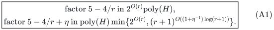

Here <code class="math">H</code> includes the full explicit input and numerical encoding,
and all oracle work is paid. The quasipolynomial branch has no
resource-rank or subset-enumeration factor. This is a new construction,
not a statement printed in a public source. Primary-source comparison
remains separate from mathematical validation.

## 1. Model and imported player-side operations

There is a player-selection matroid <code class="math">M</code> of rank <code class="math">r</code> on an
explicit set <code class="math">P</code>. Resource <code class="math">j</code> has common intrinsic nonnegative
rational value <code class="math">v_j</code> and an arbitrary recipient matroid <code class="math">R_j</code>
on <code class="math">P</code>. Its receiving-player set must be independent in <code class="math">R_j</code>.
For each pair (player, resource), at most one service is supplied. Loops encode
unacceptable recipients.

The output supplies players forming a basis of <code class="math">M</code>, each receiving
a set of resources with additive intrinsic utility. One resource may
serve several players when its recipient matroid permits it. Unused
capacity is allowed. In the compulsory-player model, receiving sets
may afterwards be extended to resource bases; nonnegative values only
increase. A requirement for a resource basis restricted to an
arbitrarily chosen player subset is not asserted.

Rank zero is the empty allocation. For rank one and exact
unrestricted availability, choose a nonloop player with maximum total
value of individually permitted resources; this is exact.

We import the audited player-side operations from
matroid_allocation_current_blocker_quasipolynomial.md and
matroid_allocation_current_blocker_second_audit.md: earliest
one-at-a-time fundamental-circuit exchanges, last-layer refresh,
immediate old-free-center cascades and the integer micro-signature.
The new resource invariants are proved here. They do not assume
physical item intersections.

For target <code class="math">T</code>, the small-resource relaxation is

<!-- math-display: be48b277e24aa860d740cced
\begin{split}
 &x\in P_{\mathcal B(M)},\qquad
   y_{\cdot j}\in P_{\mathcal I(R_j)}\quad(j\text{ a resource}),\\
 &0\le y_{pj}\le x_p,\qquad
   \sum_jv_jy_{pj}\ge Tx_p\quad(p\in P).
 \end{split}
 \tag{A2}
-->
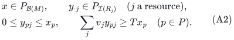

No feasible point is required as input.
The search below is for positive rational T and B. At target zero,
any player basis with empty bundles is feasible, by downward closure
and the empty independent receiving sets. This also initializes the
one-sided target search and handles a zero optimum.

## 2. State, availability, and all-remaining completion

In a phase, the current matching has independent owner set <code class="math">I</code>,
<code class="math">&#124;I&#124;=k&lt;r</code>. Each matching bundle has a current record ID and one
owner. All matching and selected bundles are minimal above a fixed
threshold <code class="math">B&gt;0</code>.

Each selected center <code class="math">c</code> has a designated group <code class="math">D(c)</code> of
current matching records. Groups are disjoint. Let <code class="math">X</code> be the
selected centers and <code class="math">Y</code> the union of their groups. Every stable
group is nonempty; an empty group is handled immediately. “Blocker”
and “free” refer to this reservation structure, not to actual physical
intersections.

For resource <code class="math">j</code>, write

<!-- math-display: eccea6f8856449fa7b4d2431
X_j=\{p(c):c\in X,\ j\in c\},\qquad
 Y_j=\{p(b):b\in Y,\ j\in b\},\qquad
 M_j=\{p(b):b\text{ currently matched},\ j\in b\}.
-->
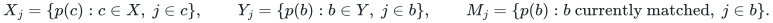

A last-layer scan treats <code class="math">j</code> as available to <code class="math">p</code> precisely when

<!-- math-display: fdede84609f402177508d8f3
p\notin\mathrm{cl}_{R_j}(X_j\cup Y_j).
 \tag{A3}
-->
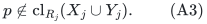

At layer <code class="math">i</code>, player eligibility is outside
<code class="math">\mathrm{cl}_M(I\setminus\mathrm{owners}(Y_{&lt;i}))</code>.
For an earlier layer use its own selected and blocker prefixes in
(A3). Each resource closure is determined by at most <code class="math">2r</code> names.

An eligible player with available total at least <code class="math">B</code> supplies a
minimal <code class="math">B</code>-bundle <code class="math">c</code>, by choosing available resources and
pruning. Define

<!-- math-display: 0a8998c9d997c9df2f1f9ddc
\boxed{\quad D=\{\text{all current matching records outside }Y\}.\quad}
 \tag{A4}
-->
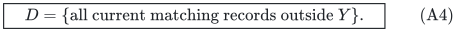

If <code class="math">D\ne\varnothing</code>, add <code class="math">c</code> to the last layer, assign
<code class="math">D(c)=D</code>, and mark those previously unmarked records with that
center. If <code class="math">D=\varnothing</code>, process <code class="math">c</code> as a fresh free
candidate. There are no subset tests or recipient-circuit searches
in this completion operation.

A designated blocker need not share a resource with its center.
Accordingly we use only the coarse coefficient <code class="math">2(B+u)</code>, proved
below. We do not import the preceding manuscript's sharper singleton
charge, which relied on shared resources.

## 3. An all-subsets invariant without subset enumeration

For <code class="math">Z\subseteq X</code>, let <code class="math">D(Z)</code> be the union of its designated
groups and <code class="math">X_j(Z)</code> its selected recipients at <code class="math">j</code>. Maintain

<!-- math-display: e3f0994f55bf7a70f97aec2a
Q_j(Z)=
 \bigl(M_j\setminus\mathrm{owners}(D(Z))\bigr)
       \mathbin{\dot\cup}X_j(Z)\in\mathcal I(R_j)
       \qquad\text{for every }Z,j.
 \tag{A5}
-->
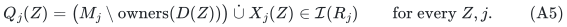

The dotted union means distinct receiving names. More explicitly,
selected centers using one resource have distinct owners and
<code class="math">X_j\cap M_j=\varnothing</code>. Services to the same player-resource
pair are never silently identified by a set union.

Initially <code class="math">X=\varnothing</code>, so the invariant is just actual matching
feasibility. It is a mathematical statement about all subsets; the
algorithm does not store or enumerate them.

### Lemma 1: completion establishes every new reservation

Let <code class="math">c</code> have owner <code class="math">p</code>, be selected using (A3), and let <code class="math">D</code>
be (A4). For every old <code class="math">Z</code> and each <code class="math">j\in c</code>, the prospective
reservation is

<!-- math-display: 18ed384cc78f48e5087a8835
\Bigl(M_j\setminus\mathrm{owners}(D(Z)\cup D)\Bigr)
       \mathbin{\dot\cup}X_j(Z)\mathbin{\dot\cup}\{p\}.
 \tag{A6}
-->
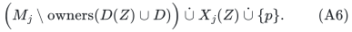

Its part before <code class="math">p</code> is independent, being a deletion from
<code class="math">Q_j(Z)</code>. Deleting all unmarked matching records leaves matching
names only in <code class="math">Y_j</code>. The whole part before <code class="math">p</code> is therefore
contained in <code class="math">X_j\cup Y_j</code>. By (A3), <code class="math">p</code> lies outside its
span, and adding it preserves independence. At resources outside
<code class="math">c</code>, the prospective reservation only deletes old elements.

For distinctness, (A3) excludes <code class="math">p</code> from <code class="math">X_j</code> and <code class="math">Y_j</code>.
If <code class="math">p\in I</code>, player eligibility implies that its own matching
bundle lies in the earlier blocker prefix. Every resource of that
old bundle is therefore unavailable to <code class="math">p</code>. Thus <code class="math">p\notin M_j</code>
for every newly chosen resource. All new reservations and the stronger
distinctness invariant follow; old subsets are unchanged. <code class="math">\square</code>

This proof is valid even if most of <code class="math">D</code> has no resource in <code class="math">c</code>.
Those records are removed in every new reservation and later charged
as complete matching bundles, not as fictional intersections.

## 4. Fresh and stored free candidates

When a fresh candidate has <code class="math">D=\varnothing</code>, Lemma 1 proves joint
feasibility with every old selected subset. The empty subset in
particular proves feasibility against the actual matching.

When a stored center <code class="math">c</code> loses its last designated blocker, (A5)
for <code class="math">Z\cup\{c\}</code> proves the same joint feasibility for every
subset <code class="math">Z</code> of the other centers. Thus an empty group certifies a
legal free center. The converse is unnecessary: a center that is
already feasible may continue to carry conservative blockers.

Use the accepted player-side rule. An owner outside
<code class="math">\mathrm{cl}_M(I)</code> augments and ends the phase. Otherwise
remove its own matching bundle if already matched; for a new spanned
owner remove a bundle in the earliest layer met by its fundamental
circuit. This is strictly earlier than the free center's search layer.
Truncate higher layers and remove the deleted record from its unique
designated group.

### Lemma 2: the exchange preserves retained reservations

For any retained <code class="math">Z</code>, its new reservation is a subset of the old
reservation together with the incoming center's service. Deleting
the old matching record either removes an element already present,
or removes a blocker that had already excluded that same element.
The incoming service is jointly independent by Lemma 1 or by the
old invariant for <code class="math">Z\cup\{c\}</code>. The new reservation is therefore
independent. The empty subset proves actual matching feasibility.

A fresh candidate excluded every retained occurrence of its owner
by (A3). A stored center already had a distinct owner from the other
centers using each of its resources. Its own old matching allocation,
if present, is removed. Consequently the matching remains disjoint
in player-resource pairs from retained selected centers. No receiving
names collapse in the dotted unions. <code class="math">\square</code>

Only the one group losing the deleted record can become empty.
Process its center immediately. Each cascade moves to an earlier
layer, and uses the same stored resource bundle; it does not replace
that bundle after discarding its record.

Truncation releases designated groups without deleting their matching
allocations. Those records become unmarked and enter (A4) at a later
completion. Removing unrelated selected records does not change the
reservation for any retained <code class="math">Z</code>.

## 5. Old maximality survives literally

Below the earliest exchange layer, selected bundles and designated
blocker bundles are the same record objects as before. None is the
deleted matching record, and the new matching record is not marked
in those lower layers. Their <code class="math">X_j,Y_j</code> sets and resource closures
(A3) remain identical.

The player-side earliest-circuit lemma preserves their eligibility
flats. Thus earlier completed availability inequalities remain true
on the identical domain and available lists. They do not depend on
current actual recipient circuits or on minimality of the designated
groups.

Only the last retained layer is refreshed. New blocked candidates are
adopted, free candidates are processed immediately, and each completed
growth test follows a full scan at an unchanged state. These are the
conditions used by the accepted signature analysis.

## 6. A coarse current-rank cover is sufficient

At a completed layer, let <code class="math">J_0</code> be the player independent set
after removing earlier blockers and <code class="math">w=r-&#124;J_0&#124;&gt;0</code>. Define

<!-- math-display: 64e508c7f5252b3d73141886
\Phi(X,Y)=\sum_jv_jr_{R_j}(X_j\cup Y_j).
 \tag{A7}
-->
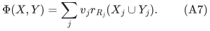

Every unavailable recipient of <code class="math">j</code> lies in that resource closure.
Its total fractional receiving mass is bounded by the rank in (A7).
A completed failed scan gives strictly less than <code class="math">Bx_p</code> fractional
available value for each positive eligible player coordinate. Hence,
for <code class="math">B\le T</code>, feasibility of (A2) requires

<!-- math-display: 27834bfec37c944e59dc7e33
\Phi(X,Y)>(T-B)w.
 \tag{A8}
-->
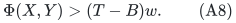

Conversely,

<!-- math-display: 989bd126f065cfceda80de91
\begin{split}
 \Phi(X,Y)&\le\sum_{c\in X}v(c)+\sum_{b\in Y}v(b)\\
          &\le2(B+u)|Y|.
 \end{split}
 \tag{A9}
-->
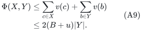

Rank is at most cardinality, every stored bundle has value below
<code class="math">B+u</code>, and nonempty disjoint designated groups give <code class="math">&#124;X&#124;\le&#124;Y&#124;</code>.
No common resource between a center and blocker is used.

For matching size <code class="math">k&lt;r</code>, earlier blocker count <code class="math">s</code> and current
blocker count <code class="math">y</code>, let <code class="math">w=r-k+s</code>. Then
<code class="math">s/w\le\rho_r=(r-1)/r</code>. An empty new layer produces a valid
infeasibility certificate whenever

<!-- math-display: fbb0e2900e1a8027006b09b4
B+2\rho_r(B+u)\le T.
 \tag{A10}
-->
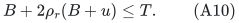

The certificate comprises the player flat, explicit selected and
designated bundles, their rank cover (A7), and the complete availability
scan. Its soundness uses strict (A8), so a weak upper cover inequality
is sufficient, including equality and rank one.

## 7. All actual operations have polynomial cost

The state stores only current matching bundles, selected bundles,
their group pointers, resource owner sets and layer data. There are
at most <code class="math">r-1</code> matching bundles during a phase, and at most <code class="math">r</code>
selected records including a transient free center. Every bundle is
an explicit subset of the input resources.

A complete scan uses polynomially many resource independence queries
on sets of <code class="math">O(r)</code> names and the usual player-matroid queries.
Pruning is a value scan. Rule (A4) marks at most <code class="math">r-1</code> records.
An exchange changes one matching record and one group membership,
then releases higher-layer groups. Even whole-state scans per action
cost only a polynomial in <code class="math">H,r</code> and oracle work.

No operation tests (A5) by enumeration. Lemmas 1--2 maintain it
inductively. The preceding explicit-subset algorithm remains a valid
alternative with different blocker choices, but its exponential
work is absent here.

A blocked insertion increases the last selected count. A free
exchange decreases the earliest retained blocker count before later
coordinates matter. Layer appends follow the accepted infinity-sentinel
convention. The same micro-signature therefore strictly decreases at
every charged action. This proof uses designated group ownership and
changes, not actual resource intersections or minimal blocker sets.

At the exact boundary every successful completed layer has a blocker.
The rank-bounded composition count gives <code class="math">2^{O(r)}</code> states per
phase. Under growth <code class="math">y&gt;\gamma w</code>, it also gives
<code class="math">(r+1)^{O(\gamma^{-1}\log(r+1))}</code> states. There are at most <code class="math">r</code>
phases. Wrapper storage is polynomial, plus oracle workspace.

## 8. Arbitrary sizes: factor <code class="math">5-4/r</code> and positive error

Set

<!-- math-display: c2053a24b54679e61e676d4f
\rho=(r-1)/r,\qquad d=1+4\rho=5-4/r,\qquad B_0=T/d.
 \tag{A11}
-->
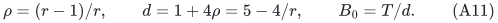

A resource is fat if <code class="math">v_j\ge B_0</code>. Let <code class="math">N</code> be the union of
the fat recipient matroids and <code class="math">U=M^*\vee N</code>. Matroid union and
decomposition are polynomial oracle operations. Independence in <code class="math">N</code>
means a partition among fat resources, each part recipient-independent,
so each player can receive one legal fat service.

The audited dual-union complement argument gives an all-small promise
for a <code class="math">U^*</code>-basis whenever the original target is feasible. Its
rank <code class="math">r'\le r</code>, and its largest small resource is <code class="math">u&lt;B_0</code>.
At <code class="math">B=B_0</code>,

<!-- math-display: eadf47d7697adbf71c7c0beb
B_0+2\rho_{r'}(B_0+u)
                          \le(1+4\rho)B_0=T.
-->
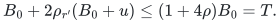

Thus the rank-exponential algorithm applies. If <code class="math">r'=0</code>, there
is no inner search. After success, decompose the complementary
<code class="math">U</code>-basis, allocate the fat part, extend the dual part to an
<code class="math">M^*</code>-basis, and discard allocations of the added players. The
remaining original basis retains legal small or fat allocations.
Deleting recipients preserves every resource's independence.

For <code class="math">\eta&gt;0</code>, keep fat threshold <code class="math">B_0</code> but use

<!-- math-display: f9ac3827cbcf5e95aec18d24
B=T/(d+\eta),\qquad
 \varepsilon=(B_0-B)/T=\frac{\eta}{d(d+\eta)}.
-->
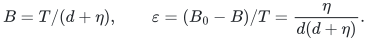

The coarse coefficient is at most
<code class="math">\overline C=2(B+B_0)\le4T/d</code>, and

<!-- math-display: 8f218280cf26169d88540c63
T-B-\rho\overline C
                          =(1+2\rho)(B_0-B).
 \tag{A12}
-->
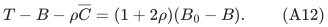

Since <code class="math">1+2\rho\ge d/2</code> and <code class="math">d\ge1</code>, the gap divided by
<code class="math">\overline C</code> is at least <code class="math">\min\{\eta,1\}/16</code>. Use
<code class="math">\gamma=\min\{\eta,1\}/64</code>. Failure of a completed growth test
yields the cover certificate; passing layers have multiplicative
growth. This proves (A1), with polynomial work per charged state and
no dependence on recipient rank in the quasipolynomial exponent.

## 9. Configuration comparator and target search

The configuration LP uses player-feasible resource subsets of value
at least <code class="math">T</code>, player masses in <code class="math">P_{\mathcal B(M)}</code>, and
recipient marginals in <code class="math">P_{\mathcal I(R_j)}</code>. Choose one fat
resource from each fat-containing configuration. Its fractional
recipient vector is coordinatewise bounded by the original resource
column and remains in that resource's independent-set polytope.
Their sum <code class="math">f\le x</code> belongs to the union polytope of <code class="math">N</code>.

As in the audited configuration addendum, <code class="math">1-x+f</code> lies in
<code class="math">P_{\mathcal I(U)}</code>, has a dominating base vector, and yields a
complementary derived base vector <code class="math">x'\le h=x-f</code>. Scale each
player's all-small marginals by <code class="math">x'_p/h_p</code>, taking zero when
<code class="math">h_p=0</code>. Resource columns only decrease, and target values become
at least <code class="math">Tx'_p</code>. This proves inner failure soundness against the
configuration LP without computing its variables.

All configuration values lie on the common rational value grid.
The total possible delivered utility is bounded by
<code class="math">V=\sum_jv_jr(R_j)</code>. Initialize a failed grid target above
<code class="math">(d+\eta)V</code>, or the exact-ratio counterpart. The established
one-sided binary search only uses that failure excludes that target
and larger feasible targets; success need not mean feasibility of the
full target. It returns the stated ratio against the optimal
configuration target with polynomially many trials.

## 10. Local families and approximate available oracles

For a player-local downward-closed resource family, invoke its oracle
on the resource list (A3). A factor-<code class="math">\lambda</code> feasible oracle,
<code class="math">0&lt;\lambda\le1</code>, and a complete failed scan at an unchanged state
give true available optimum below <code class="math">B/\lambda</code>. The row perspective
constraint and downward closure replace (A8) by

<!-- math-display: 8cf751617812424763700dcc
\Phi(X,Y)>(T-B/\lambda)w,\qquad B\le\lambda T.
 \tag{A13}
-->
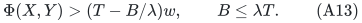

Minimality, conservative completion and the coarse cover are unchanged.
Use fresh scans; do not assume monotonicity of approximate witnesses.
The sufficient condition is <code class="math">B/\lambda+2\rho(B+u)\le T</code>.

Restrict each fat recipient matroid to players whose singleton service
is locally feasible. A positive-factor feasible oracle decides this
on a singleton input. The restriction is a matroid. The fat and
configuration proofs preserve the local perspective constraints.

With <code class="math">\tau=\lambda^{-1}</code>, replace (A11) by

<!-- math-display: 617994223768dbfe5a03cc49
d=\tau+4\rho.
 \tag{A14}
-->
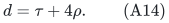

The exact factor is <code class="math">d</code>, and the positive-error factor is <code class="math">d+\eta</code>.
Formula (A12) has <code class="math">1+2\rho</code> replaced by <code class="math">\tau+2\rho\ge d/2</code>.
The same <code class="math">\gamma=\min\{\eta,1\}/64</code> works uniformly in <code class="math">\lambda</code>.
The rank exponent in (A1) is unchanged; oracle accuracy, work and
workspace are paid. Rank-one exact optimization is not claimed when
the available oracle is approximate.

## 11. Public comparison and limits

The named public Bamas--Lindermayr--Megow--Rohwedder--Schloeter
Theorem 4 gives polynomial <code class="math">8+\varepsilon</code> for general resource
matroids/polymatroids and <code class="math">4+\varepsilon</code> for two values; see
[arXiv:2307.08453v1](https://arxiv.org/abs/2307.08453v1).
Those polynomial times and the two-value special case must be retained
in comparisons. This construction changes the approximation/time
tradeoff and has a rank-dependent search bound. Same-model
primary-source comparisons are being audited before any priority claim.

The recipient objects proved here are matroids: one service is one
ground-set element. Integer polymatroids permit repeated units to
a player and require another availability and numerical-reservation
argument. They are not included silently.

Finally, the sharper compact-relaxation coefficient in the preceding
explicit-subset manuscript does not transfer automatically. It used
a shared resource between every center and blocker. Conservative
completion gives up that fact and uses the coarse inequality (A9).
That inequality is sufficient for the stated arbitrary-size factors
and for their general quasipolynomial branch.

