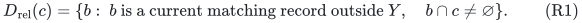
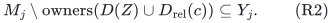
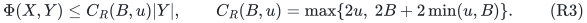
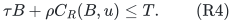
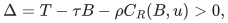
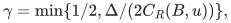
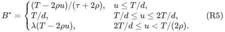

# Relevant remaining blockers recover the sharper resource coefficient

**25 October 2026. Addendum to the independently reviewed
general_resource_all_remaining_blockers.md.** The primary theorem and
its A1--A14 proof remain unchanged. This note gives a strictly more
selective completion rule with the same implicit reservation proof,
and recovers the sharp compact-relaxation coefficient without any
subset enumeration.

## 1. Select only unmarked matching bundles sharing a resource

For a newly found minimal candidate <code class="math">c</code>, replace completion A4 by

<!-- math-display: 575a1b28e7daf28ed430f674
D_{\rm rel}(c)=\{b:\ b\text{ is a current matching record outside }Y,
                              \quad b\cap c\ne\varnothing\}.
 \tag{R1}
-->

The intersection here is between resource-index sets, not between
physical units. Different players may legally receive the same
resource under its recipient matroid.

Scanning at most <code class="math">r-1</code> explicit matching bundles computes (R1)
in polynomial time. If the group is nonempty, assign it to <code class="math">c</code>.
If it is empty, process <code class="math">c</code> as a fresh free candidate. The groups
remain disjoint. Existing search, release and exchange rules are
unchanged.

## 2. The all-subsets induction remains valid

For any old selected subset <code class="math">Z</code> and resource <code class="math">j\in c</code>,
every unmarked matching recipient at <code class="math">j</code> belongs to a record in
(R1). Consequently

<!-- math-display: 905858ca42680ec4f472d3da
M_j\setminus\mathrm{owners}(D(Z)\cup D_{\rm rel}(c))
                           \subseteq Y_j.
 \tag{R2}
-->

The new reservation before adding the owner <code class="math">p(c)</code> is an
independent deletion from the old <code class="math">Q_j(Z)</code>, and is contained
in <code class="math">X_j\cup Y_j</code>. Availability places <code class="math">p(c)</code> outside that
span. Adding it preserves independence. At <code class="math">j\notin c</code>, there
is only a deletion from an old independent reservation.

Thus every new all-subsets reservation is established by exactly the
same induction as in the primary proof. The algorithm does not test
any of them. Distinct receiving names, fresh and stored free centers,
earliest exchanges, group retirement and earlier maximality inherit
their existing proofs verbatim.

In particular, an empty relevant group is sufficient even when
unrelated unmarked matching bundles remain. Such bundles receive
none of <code class="math">c</code>'s resources and hence cannot appear in the affected
resource reservations.

## 3. Every designated blocker now has a shared resource

Unlike the deliberately coarse primary completion, (R1) guarantees
that each blocker assigned to <code class="math">c</code> receives some resource in <code class="math">c</code>.
This is enough for the sharper value charge; physical unit identities
are still unnecessary.

Charge the current cover to each center and its designated blockers.
If the center is a singleton resource of value at least <code class="math">B</code>, every
assigned minimal blocker contains that same resource and is itself
a singleton. For <code class="math">t\ge1</code> blockers the total value of the star is
at most <code class="math">(t+1)u\le2tu</code>.

If the center is not a singleton, each of its resources is below
<code class="math">B</code>. Each blocker shares one such resource. A minimal blocker
containing that resource cannot also contain any resource worth at
least <code class="math">B</code>, so it too is nonsingleton. Each bundle in this star
has value below <code class="math">B+\min(u,B)</code>, and the number of bundles is
<code class="math">t+1\le2t</code>.

The rank cover is bounded by the sum of center and blocker service
values, as in A9 of the primary manuscript. Therefore

<!-- math-display: 883a466a9fc293af5dfafaa8
\Phi(X,Y)\le C_R(B,u)|Y|,
 \qquad C_R(B,u)=\max\{2u,\ 2B+2\min(u,B)\}.
 \tag{R3}
-->

The star partition is by assigned group records. It does not require
different stars to use disjoint resource indices. The same resource
may supply many distinct recipients.

## 4. Compact-relaxation guarantees and time

Let <code class="math">\rho=(r-1)/r</code>, and let <code class="math">\tau=\lambda^{-1}</code> for a
certified available-bundle oracle, with <code class="math">\tau=1</code> in the exact case.
The strict lower cover inequality from the primary proof gives the
sufficient condition

<!-- math-display: ed6ada002f52964ffafe8ef5
\tau B+\rho C_R(B,u)\le T.
 \tag{R4}
-->

An empty completed new blocker layer is then certified infeasible.
The rank-exponential composition count applies at equality. If

<!-- math-display: 4fd0e54a1c6a4e0379e6e67b
\Delta=T-\tau B-\rho C_R(B,u)>0,
-->

then growth <code class="math">&#124;Y_i&#124;&gt;\gamma(r-k+&#124;Y_{&lt;i}&#124;)</code>, with

<!-- math-display: 73856f2cd81d1ddaca74e16d
\gamma=\min\{1/2,\Delta/(2C_R(B,u))\},
-->

gives the usual rank-quasipolynomial count. Every actual operation
has polynomial cost. There is no <code class="math">2^{\kappa}</code> resource-rank factor
and no explicit <code class="math">2^{&#124;X&#124;}</code> subset cost.

For reference, put <code class="math">d=\tau+4\rho</code>. For <code class="math">r\ge2</code>, the largest
positive equality solution of (R4) is

<!-- math-display: 4a33466f663fedd80930a42d
B^*=
 \begin{cases}
 (T-2\rho u)/(\tau+2\rho), & u\le T/d,\\
 T/d, & T/d\le u\le2T/d,\\
 \lambda(T-2\rho u), & 2T/d\le u<T/(2\rho).
 \end{cases}
 \tag{R5}
-->

Adjacent formulas agree. For rank one use <code class="math">B^*=\lambda T</code>.
The positive domain here is that of this sufficient coefficient;
no matching LP lower bound or problem hardness is asserted at its
endpoint.

## 5. Arbitrary sizes and what this refinement changes

The fat threshold <code class="math">B_0=T/d</code> leaves <code class="math">u&lt;B_0</code>, so
<code class="math">C_R(B_0,u)\le4B_0</code>. Thus the arbitrary-size ratios remain
<code class="math">\lambda^{-1}+4-4/r</code> exactly in rank-exponential time and that
quantity plus <code class="math">\eta</code> in the primary rank-quasipolynomial time.
The original <code class="math">5-4/r</code> exact-oracle theorem is unchanged.

The improvement is the selective blocker group and the sharper
compact-relaxation curve, including its positive-gap time bound.
The common-resource hypothesis is restored explicitly by (R1);
it is not attributed retroactively to the primary all-remaining
completion.

