# The exact corank-sensitive time curve of the block gap conversion

**25 October 2026. Complete refinement of the accepted block proof; independent read requested.**

This note refines [global-conversion.md](../../problems/whole-ground-allocation/global-conversion.md). It uses the
same local covers, the same minimizing seed sizes, and the same streamed
algorithm. No additional approximation, separator, or search assumption is
introduced. The refinement records the running time at the actual corank,
instead of replacing it by the maximum over all coranks.

Let the explicit ground have size q, selected cardinality s=q-c>=1, and let
the forced-omission gap routine cost at most A^(c-|Z|) poly(H), with A>1.
Write

<!-- math-display: 3ce8bab177b46eb57c6acf65
E(q)=2^{O(q\log\log(q+2)/\log(q+2))}.
\tag{P1}
-->
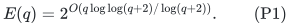

The block construction returns the same relaxed guarantee in time

<!-- math-display: fc7e415b6059ac9d03316f75
E(q)\,\Psi_A(q,c)\mathrm{poly}(H),
 \qquad
 \Psi_A(q,c)=\inf_{x\ge0}
       \left(\frac{A}{1+x}\right)^c
       \left(1+\frac{x}{A}\right)^q,
\tag{P2}
-->
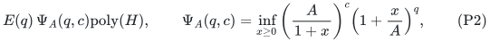

and polynomial space. In addition, the original corank routine can be run
directly. Thus one may retain the smaller of its A^c bound and P2; this
avoids paying the block overhead in the small-corank regime.

## 1. A one-parameter local averaging identity

For one block of size n and omitted count p, the accepted construction
chooses k minimizing

<!-- math-display: 81b04b55de735d2b143a19d9
T_{n,p}(k)=\frac{\binom nk}{\binom pk}A^{p-k},
                       \qquad 0\le k\le p.
\tag{P3}
-->
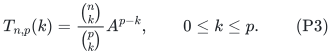

For any x>=0, define weights

<!-- math-display: 9c332422894ad95703874460
w_k(x)=\frac{\binom pk x^k}{(1+x)^p}.
\tag{P4}
-->
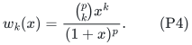

They sum to one. At x=0 the distribution is concentrated on k=0, so no
ambiguous zero power is needed. Cancellation gives

<!-- math-display: 4d820a0d7f1b966d69d41729
\begin{aligned}
 \sum_{k=0}^p w_k(x)T_{n,p}(k)
 &=\left(\frac{A}{1+x}\right)^p
       \sum_{k=0}^p\binom nk\left(\frac{x}{A}\right)^k\\
 &\le\left(\frac{A}{1+x}\right)^p
       \left(1+\frac{x}{A}\right)^n.
 \end{aligned}
\tag{P5}
-->
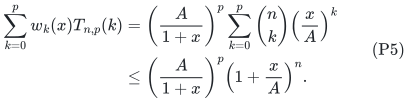

The minimum in P3 is at most this average for every x. In particular the
algorithm need not know, approximate, or use x when choosing its local k.
The earlier whole-ground identity is the choice x=A-1, which removes the
dependence on p and gives (2-1/A)^n.

## 2. Products depend only on the total corank

For any block-count profile (p_i), sum_i p_i=c and sum_i n_i=q. The local
greedy covers have size at most (n_i+2) binom(n_i,k_i)/binom(p_i,k_i).
Applying P5 to every block, with the same arbitrary x, shows that the total
cost of all Cartesian-product choices in this profile is at most

<!-- math-display: ff23e409a98133b102b8138f
(\ell+2)^m
 \left(\frac{A}{1+x}\right)^c
 \left(1+\frac{x}{A}\right)^q\mathrm{poly}(H).
\tag{P6}
-->
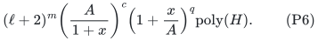

Multiplying by the at most (ell+1)^m profiles and minimizing over x proves
P2. This is a bound on the actual same algorithm: the selected local k_i
minimizes P3 and therefore satisfies P5 simultaneously for every analytical
choice of x. There is no exchange of an algorithmic minimum with an
unknown profile and no need for a balanced random partition.

All failed extension calls are already included in P6. The space proof is
unchanged because neither the local tables nor the iterators change.

## 3. Exact optimizer and closed form

For 0<=c<q, let

<!-- math-display: 8a89a7e6cbc0b7d154150e76
L(x)=c\log A-c\log(1+x)+q\log(1+x/A).
\tag{P7}
-->
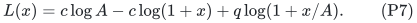

Its derivative has the sign of

<!-- math-display: a064b1cfe44f832ae42a0384
q(1+x)-c(A+x)=(q-Ac)+(q-c)x.
\tag{P8}
-->
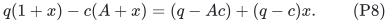

If Ac<=q, the objective is nondecreasing for x>=0 and the minimum is at
x=0. If Ac>q, it decreases up to and increases after

<!-- math-display: 319e55452923ad9d6fa60a49
x^*=\frac{Ac-q}{q-c}>0.
\tag{P9}
-->
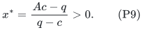

Consequently

<!-- math-display: f9403678fcf3047cb2abb103
\Psi_A(q,c)=
 \begin{cases}
 A^c,& Ac\le q,\\[3pt]
 \displaystyle
 \frac{q^q}{c^c(q-c)^{q-c}}
       \left(1-\frac1A\right)^{q-c},& Ac>q.
 \end{cases}
\tag{P10}
-->
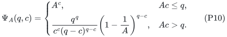

The two expressions coincide at Ac=q. For c=0 the first expression is one;
the unforced zero-deficit routine already gives polynomial time without a
block overhead. The theorem assumes c<q, so P9 never divides by zero.
Applications with an empty selected set handle that case separately.

For rational A, both the comparison Ac<=q and x* are exact rational
quantities with polynomial binary length. The powers in the rational
expression P10 have exponent at most q, so they also have polynomial
encoding. This observation is optional for implementation: x is used only
to analyze an algorithm that already makes the exact local comparisons P3.

## 4. Entropy notation and the maximum over all coranks

For rho=c/q, define binary entropy

<!-- math-display: 33acab32a91572433cc3282e
H_2(\rho)=-\rho\log_2\rho-(1-\rho)\log_2(1-\rho),
-->
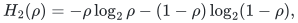

with the usual continuous endpoint convention. Equation P10 is exactly

<!-- math-display: 6ab460adae737e5863d80848
\Psi_A(q,c)=2^{qf_A(\rho)},\qquad
 f_A(\rho)=
 \begin{cases}
 \rho\log_2 A,&0\le\rho\le1/A,\\
 H_2(\rho)+(1-\rho)\log_2(1-1/A),&1/A\le\rho<1.
 \end{cases}
\tag{P11}
-->
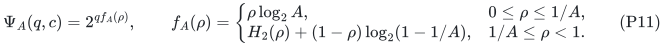

This entropy expression is a closed-form rewriting of an exact real
upper bound. It is not a replacement of an integer binomial coefficient by
an equality, nor does the algorithm evaluate irrational entropy values.

The function is linear up to 1/A and then concave. The two derivatives at
1/A agree and equal log_2 A. In the second interval the derivative vanishes
at

<!-- math-display: c2638f23b8a79f7c936fc290
\rho^*=\frac{A}{2A-1},
                 \qquad f_A(\rho^*)=\log_2(2-1/A).
\tag{P12}
-->
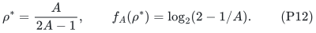

Thus the whole-ground bound is the maximum of the corank-sensitive curve,
as expected. For the exact-half quota constant A=27/4, the transition is at
rho=4/27, the worst point is rho=27/50, and the whole-ground base is 50/27.
For A=4 the corresponding points are 1/4 and 4/7, with base 7/4.

## 5. How to use and report the refinement

The available guarantees can be combined as

<!-- math-display: 78c27015bb105f905c8d0b8f
\min\left\{A^c,\ E(q)\Psi_A(q,c),\,
             \binom qc\right\}\mathrm{poly}(H),
\tag{P13}
-->
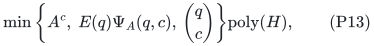

provided the last term is implemented by enumerating all c-element forced
omission sets and invoking the accepted zero-deficit gap routine. Every
candidate succeeds only with a valid relaxed witness, and a full witness
has one matching forced complement. Thus this enumeration uses exactly
the same extension interface, rather than assuming a stronger exact
optimization oracle for each selected set.

The polynomial overhead of switching or dovetailing these algorithms does
not alter the displayed asymptotic bounds. All three use polynomial space.
For fixed A the maximum curve gives (2-1/A)^(q+o(q)); for a varying A the
explicit E(q) form is the uniform statement.

This is a sharper accounting of the accepted monotone-local-search-style
conversion. It does not claim a new public base formula or an approximation
improvement. The full-target/relaxed-target distinction, original resource
data, and protected-witness forced-omission interface remain unchanged.
