# Jointly independent layer owners: what it proves and what batching still needs

**25 October 2026. Working proof and obstruction to a proposed progress
lemma. Independent review requested.** This note is separate from the
accepted current-blocker theorem. It proves that a joint-owner variant
retains the same current-blocker growth. It does not obtain a polynomial
running time. The examples below refute specific proposed batch
implications, not the possibility of a different polynomial algorithm.

The base construction is
[matroid-allocation-current-blocker-quasipolynomial.md](matroid-allocation-current-blocker-quasipolynomial.md). Its notation
is retained: the current matching has independent owner set <code class="math">I</code>,
<code class="math">k=&#124;I&#124;&lt;r</code>, and layer <code class="math">i</code> has selected bundles <code class="math">X_i</code>
and unique current blockers <code class="math">Y_i</code>. Let

<!-- math-display: 257a52d16b12fcfa22e7396f
J_i=I\setminus\mathrm{owners}(Y_{<i}),\qquad
 A_i=\mathrm{owners}(X_i).
 \tag{J1}
-->
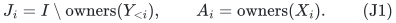

## 1. A valid stronger per-layer invariant

Require that selected owners in one layer are distinct and that

<!-- math-display: fde4ffc70ee7726760dd0345
J_i\mathbin{\dot\cup} A_i
               \text{ is independent.}
 \tag{J2}
-->
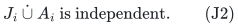

Owner names may still repeat between different layers. When extending
the last layer, accept a new owner only outside
<code class="math">\mathrm{cl}(J_i\cup A_i)</code>. Physical available-resource
tests, minimal bundles, blockers, and immediate one-at-a-time free
cascades are unchanged. An already stored free center is processed
using its individual eligibility, which follows from (J2); it need
not be tested for independence against its own occurrence in <code class="math">A_i</code>.

### 1.1 Earliest-circuit exchange preserves joint independence

Suppose a free center in layer <code class="math">i</code> has owner <code class="math">p\notin I</code>,
and its earliest exchangeable blocker lies in layer <code class="math">j&lt;i</code>.
The existing proof gives, for every retained layer <code class="math">h\le j</code>,

<!-- math-display: 5e3196275ff44228137d7838
\mathrm{cl}(J'_h)=\mathrm{cl}(J_h),
              \qquad |J'_h|=|J_h|.
 \tag{J3}
-->
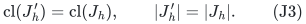

Independence of <code class="math">J_h\cup A_h</code> means that adjoining <code class="math">A_h</code>
increases rank by exactly <code class="math">&#124;A_h&#124;</code>. Rank increments depend only
on the flat <code class="math">\mathrm{cl}(J_h)</code>. Hence (J3) implies the
same rank increment for <code class="math">J'_h\cup A_h</code>, proving (J2) after
the exchange. In particular no retained candidate owner has secretly
become an element of <code class="math">J'_h</code>.

If <code class="math">p\in I</code>, its existing allocation is in the earlier blocker
prefix. Replacing that allocation does not change <code class="math">I</code>, and all
retained <code class="math">J_h</code> are literally unchanged. The conclusion follows
again. Each free-center cascade discards its own layer before doing
another such exchange, so the argument also applies throughout a
cascade.

### 1.2 Earlier maximality still survives

For <code class="math">h&lt;j</code>, the selected owner set <code class="math">A_h</code> and physical forbidden
set are unchanged. Equation (J3) also preserves
<code class="math">\mathrm{cl}(J_h\cup A_h)</code>. Therefore the earlier
statement that no jointly addable owner has an available bundle is
literally the same statement after the exchange. Layer <code class="math">j</code> is
refreshed before a growth test, as in the accepted construction.

No new player-side exchange rule is needed for these one-at-a-time
operations. In particular the repeated-owner difficulty of a more
general batch swap is not hidden inside this lemma.

## 2. Joint maximality still gives the original growth scale

Fix a completed, fully blocked layer <code class="math">i</code>, and write

<!-- math-display: ae5c18caa49f3088f36b21eb
s=|Y_{<i}|,\qquad y=|Y_i|,\qquad a=|A_i|,
 \qquad w=r-k+s.
 \tag{J4}
-->
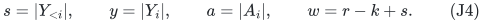

We have <code class="math">a=&#124;X_i&#124;\le y</code>, and <code class="math">w\ge s+1</code>. For any
fractional base vector <code class="math">x</code>, the mass outside the flat
<code class="math">\mathrm{cl}(J_i\cup A_i)</code> is at least

<!-- math-display: fe18a9812768b47d2884c6b2
r-(k-s+a)=w-a.
 \tag{J5}
-->
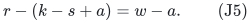

Whenever <code class="math">w-a&gt;0</code>, maximality and the same fractional cover
argument as in the accepted theorem therefore imply

<!-- math-display: f97659f33b82f300a8700e59
v\bigl(R(X_{\le i}\cup Y_{\le i})\bigr)
                   >(T-B)(w-a).
 \tag{J6}
-->
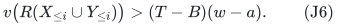

For ordinary liking sets this follows from their available total
value. For the player-local downward-closed extension, use the exact
available-weight oracle and its perspective-polytope inequality.

Let

<!-- math-display: 0a82b4266f035bdbf1235337
B=(T-u)/3-\varepsilon T>0,
 \qquad A=2B+u.
 \tag{J7}
-->
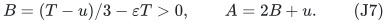

The physical star charge remains

<!-- math-display: b67d957beb372f1f381044b7
v\bigl(R(X_{\le i}\cup Y_{\le i})\bigr)
                    \le A(s+y).
 \tag{J8}
-->
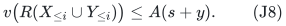

Suppose, for contradiction, that <code class="math">y\le\varepsilon w</code>. Since
<code class="math">0&lt;\varepsilon&lt;(1-u/T)/3&lt;1</code>, (J5) is positive and (J6)
applies. Using <code class="math">a\le y</code>, <code class="math">s\le w-1</code>, and
<code class="math">T-B=A+3\varepsilon T</code>, its lower bound exceeds the upper
bound in (J8) by at least

<!-- math-display: dc486ffb99a27eaff4d158a0
\begin{split}
 &(A+3\varepsilon T)(1-\varepsilon)w
                      -A((1+\varepsilon)w-1)\\
 &\qquad=
       \varepsilon\bigl(3T-(2A+3\varepsilon T)\bigr)w+A.
 \end{split}
 \tag{J9}
-->
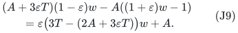

But <code class="math">2A+3\varepsilon T=T+B+u&lt;2T</code>, so (J9) is strictly
positive. Thus

<!-- math-display: 0fcebd3c289d1abdb832c1c7
|Y_i|>\varepsilon(r-k+|Y_{<i}|).
 \tag{J10}
-->
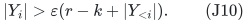

This is the same order of growth as in the individual-owner
construction. The joint requirement does not force an extra inverse
power of <code class="math">\varepsilon</code> in the depth bound. At an attempted failed
growth test the flat <code class="math">J_i\cup A_i</code>, together with the physical
cover and the availability tests, also gives a valid infeasibility
certificate through (J6).

The same integer signature <code class="math">(-&#124;X_i&#124;,&#124;Y_i&#124;)</code>, resource identities,
and one-at-a-time earliest exchanges therefore still give a rank
quasipolynomial bound. This observation alone does not improve that
bound: the progress coordinate may still decrease by one.

## 3. A jointly independent free family need not give a useful early batch

It is tempting to collect a large family of resource-free candidates,
use its joint independence to replace equally many blockers, and then
apply a fixed-fraction layer-collapse analysis. The following linear
matroid example isolates why that implication needs another premise.

Let the current independent set contain the vectors

<!-- math-display: c6445c5b7ef50039a1a0201d
I=\{e_1,\ldots,e_L,\ f_1,\ldots,f_L\}
 \tag{J11}
-->
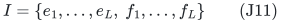

of a vector-space basis. The ambient matroid may have one additional
independent direction, so <code class="math">&#124;I&#124;&lt;r</code> as in a real augmentation phase.
Place <code class="math">e_1,\ldots,e_L</code> in an earlier blocker layer <code class="math">Y_1</code>
and <code class="math">f_1,\ldots,f_L</code> in a later layer <code class="math">Y_2</code>. Consider the
candidate player elements

<!-- math-display: 793f35fb9d3771e043a82e43
g_t=e_1+f_t\quad(1\le t\le L),
             \qquad F=\{g_1,\ldots,g_L\}.
 \tag{J12}
-->
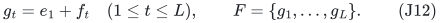

The family <code class="math">F</code> is independent over <code class="math">J_3=\varnothing</code>.
Each <code class="math">g_t</code> has fundamental circuit
<code class="math">\{g_t,e_1,f_t\}</code> in <code class="math">I\cup\{g_t\}</code>, so every
candidate's earliest circuit layer is <code class="math">Y_1</code>, and every such
circuit has the **same** earlier blocker <code class="math">e_1</code>.

A complete batch exchange is possible: replace all <code class="math">f_t</code> by
all <code class="math">g_t</code>, keeping all <code class="math">e_j</code>. This replaces <code class="math">L</code> matching
owners. But the flat required by the retained second layer changes
from

<!-- math-display: bfa293c6d99667571b44097a
\mathrm{span}\{f_t:1\le t\le L\}
          \quad\text{to}\quad
          \mathrm{span}\{e_1+f_t:1\le t\le L\}.
 \tag{J13}
-->
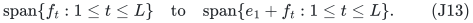

Thus this batch does not inherit the earlier-flat preservation lemma.
It can invalidate a retained candidate whose owner is, for example,
one of the <code class="math">g_t</code>.

Conversely, if the batch is required to remove blockers only from
the earliest layer <code class="math">Y_1</code>, keeping the later basis vectors, its
incoming elements have rank **one** modulo the span of the later
vectors. It can therefore replace at most one member of <code class="math">Y_1</code>.
That is only a <code class="math">1/L</code> fraction of the earliest layer even though
<code class="math">&#124;F&#124;=L</code>. The analogous batch wholly in <code class="math">Y_2</code> cannot preserve
the old <code class="math">J_2</code> flat, because no <code class="math">g_t</code> lies in that flat.

This example concerns the proposed matroid implication. It does not
assert that every such set configuration is reached by a particular
fixed-order allocation execution. It is enough to show that joint
independence and a large free-family cardinality, by themselves, do
not prove a geometric collapse while retaining the old flat
certificates.

## 4. Projected rank cannot be converted freely into actual candidates

Another proposed repair would count the rank of the portion of a free
family's span lying in a protected earlier flat, then select that many
free players from the flat. This is not a valid matroid implication.

Over a field of characteristic different from two, take

<!-- math-display: 39c370c20d401d532e53598a
F=\{e_1+e_2,e_1-e_2\},\qquad L=\mathrm{span}\{e_2\}.
 \tag{J14}
-->
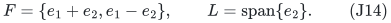

Here <code class="math">\mathrm{span}(F)\cap L=L</code> has dimension one,
but neither actual candidate element belongs to <code class="math">L</code>. The vector
<code class="math">e_2</code> is a linear combination of candidate elements; it is not
automatically a player with a resource-free bundle. In an independence-
oracle matroid there is not even a supplied vector representation from
which such a new player could be constructed.

Hence an argument based only on rank increments or intersections of
spans must still prove that the required **subset of actual candidate
players** exists. Virtual linear combinations do not implement an
allocation exchange.

## 5. The remaining substantive algorithmic gate

A polynomial analysis needs more than the growth in (J10). A useful
new lemma would have to supply one of the following explicit progress
contracts, or another contract with a comparably bounded potential.

1. Find a large simultaneous exchange that preserves eligibility and
   sufficient maximality information for **every retained layer**,
   while deleting a constant fraction of a suitable earlier blocker
   prefix.
2. Permit some retained flats to change, but charge the invalidated
   selected bundles and their certificates to a progress measure that
   decreases polynomially often. Simply discarding them does not
   preserve the current signature: a loss of an earlier <code class="math">X_i</code>
   can increase its first affected coordinate.
3. Keep a different representation of retained matroid information
   that survives a full rank batch, and prove that its fractional
   availability inequality still refers to the actual matched players
   and actual free resource bundles.

The less restrictive requirement that all stored <code class="math">A_h</code> remain
jointly independent, without preserving their whole underlying flats,
could allow more batches than (J3). However, it does not by itself
preserve earlier maximality: a changed eligibility flat can expose
new players. Refreshing all such layers would need a paid adoption
or certificate-repair argument. This is a concrete next direction,
not a completed polynomial-time bound.

The current verified gain is therefore the joint-layer variant and
its unchanged growth scale. The quasi-to-polynomial transfer remains
open at the batch-retention and progress interface.
