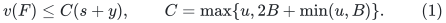
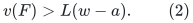
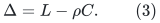
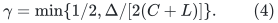
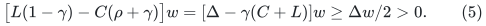
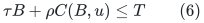
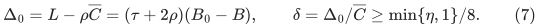
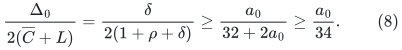
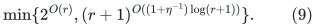

# Sharp quality survives jointly independent layer owners

This addendum combines the valid joint-owner layer variant in
[joint-owner-layer-batching-gate.md](joint-owner-layer-batching-gate.md) with the sharp resource-star and
approximate available-bundle bounds. It strengthens the positive
part of that variant. It does not close its polynomial-time batching
gate or remove either counterexample in the companion note.

## 1. The only additional loss is charged to the current layer

Let the current matching have k<r owners. For the last completed
layer set s=|Y_<i|, y=|Y_i|, a=|X_i|, and w=r-k+s.
The layer owners A_i are distinct and jointly independent over
J_i=I minus the earlier blocker owners. Every stored center is
blocked, so a<=y. Exact common-item ownership and minimal bundles
give

<!-- math-display: fc4acf1591213e6c46be81f3
v(F)\le C(s+y),\qquad
 C=\max\{u,2B+\min(u,B)\}.
 \tag{1}
-->

Suppose an available-bundle oracle has factor lambda, and every
eligible call at this unchanged completed state returns value below
B. Write tau=1/lambda and L=T-tau B>=0. The eligible players are
outside cl(J_i union A_i). Their fractional base mass is at least
w-a. Whenever w-a>0, the strict perspective argument gives

<!-- math-display: b4c72d7f2aaa35d86597653f
v(F)>L(w-a).
 \tag{2}
-->

The local-family, approximate-scan and compressed-capacity adapters
do not change this inequality when their respective available
oracles and physical ownership contracts are supplied. No joint
independence is asserted across different layers.

Since s<=k<r, one has s/w<=rho=(r-1)/r. Put

<!-- math-display: fb53426de4fd67fcc25f390e
\Delta=L-\rho C.
 \tag{3}
-->

If Delta>0, choose

<!-- math-display: 13c15c342844b6a931a72f7b
\gamma=\min\{1/2,\Delta/[2(C+L)]\}.
 \tag{4}
-->

At a proposed failed growth test y<=gamma w, a<=y gives w-a>0.
Comparing (2) with (1), their lower-minus-upper bounds are at least

<!-- math-display: b25c9614abe8e2089875795a
\bigl[L(1-\gamma)-C(\rho+\gamma)\bigr]w
       =[\Delta-\gamma(C+L)]w
       \ge\Delta w/2>0.
 \tag{5}
-->

Thus every feasible completed layer has y>gamma w. A failed test
is a valid infeasibility certificate with eligibility base
J_i union A_i. Its independent rank, failed oracle scans and
resource union are explicit, or use the declared oracle contract.

The earliest-circuit exchange preserves the retained lower flats
cl(J_h), hence also the rank increment from A_h and the full
eligibility flat cl(J_h union A_h). The companion note proves that
their physical forbidden sets and maximality statements survive.
Therefore the same integer signature and growth proof apply.

## 2. The exact boundary is unchanged

When Delta=0, a new layer with no blockers has y=a=0. Equations
(1)--(2), s/w<=rho and L=rho C contradict a feasible LP. Hence
every nonterminal stable layer contains at least one distinct matching
blocker. There are at most r-1 such blockers in a phase, and the
same finite rank-composition signature proves termination in
2^{O(r)} times the paid polynomial and oracle multiplier.

Consequently the entire exact sharp condition

<!-- math-display: 4174483d136423423302da2d
\tau B+\rho C(B,u)\le T
 \tag{6}
-->

survives the per-layer joint-owner restriction. The value curve is
the same one as in the approximate-oracle manuscript, including its
lambda=1 specialization. Rank zero is trivial. At rank one a free
eligible candidate either augments immediately or a complete scan
certifies the target; the value guarantee is lambda T.

## 3. Uniform positive-error factor after the fat wrapper

Let d=tau+3rho, B_0=T/d and B=T/(d+eta). Use the same fat
threshold B_0 and derived dual-union matroid. Its rank is at most
r. On its small items, Cbar=2B+B_0 bounds C, and

<!-- math-display: 2689959a3329ac92f65d16da
\Delta_0=L-\rho\overline C
          =(\tau+2\rho)(B_0-B),\qquad
 \delta=\Delta_0/\overline C
          \ge\min\{\eta,1\}/8.
 \tag{7}
-->

Set a_0=min{eta,1}. Since L=rho Cbar+Delta_0,

<!-- math-display: 16e7f46cf8b60e4f50eca4f8
\frac{\Delta_0}{2(\overline C+L)}
   =\frac{\delta}{2(1+\rho+\delta)}
   \ge\frac{a_0}{32+2a_0}
   \ge\frac{a_0}{34}.
 \tag{8}
-->

Thus gamma=a_0/64 is a safe uniform choice in (4), also when the
actual derived rank and actual star coefficient are smaller. No
extra lambda^-1 enters the rank exponent.

The joint-owner variant therefore gives factor

<!-- math-display: 1e97261769681dcde00d0440
\lambda^{-1}+3-3/r+\eta
-->

in a paid polynomial and oracle multiplier times

<!-- math-display: 59cb8d0765d7428ff6680d33
\min\{2^{O(r)},(r+1)^{O((1+\eta^{-1})\log(r+1))}\}.
 \tag{9}
-->

At eta=0 use the exact rank-exponential branch. The same
configuration-LP comparator and one-sided target search are inherited
from the fat wrapper. This is a choice of valid search invariant with
the same quality scale, not a better approximation factor than the
individual-owner version.

## 4. Remaining gate

Joint independence within a layer is now available without losing
the sharp quality guarantee. It still does not imply that a large
free family can delete a constant fraction of an early blocker layer
while preserving the other layers' flats or maximality. The explicit
linear-matroid examples in the companion note remain applicable.
Any claimed polynomial-time improvement must pay for a different
batch exchange and the resulting certificate repairs.
