# Laminar resource matroids through explicit capacity reservations

**Later development in this checkpoint:** the conservative-blocker
construction in [general-resource-all-remaining-blockers.md](general-resource-all-remaining-blockers.md) proves
the main factor-five guarantees for arbitrary recipient matroids.
The laminar token representation below remains a complete alternative
with its explicitly proved sharp compact certificate.

This note gives a joint reservation interface for an additional
resource-side class: resources whose receiving-player constraints are
given by explicit laminar matroids. It preserves the audited player-
matroid current-blocker search, but changes its representation and its
value certificate. The main guarantee is factor <code class="math">5-4/r</code> in
rank-exponential time, and <code class="math">5-4/r+\eta</code> in rank-quasipolynomial
time, for a player-selection matroid of rank <code class="math">r</code>.

Laminar and transversal matroids are different classes. Some laminar
matroids are not transversal; no containment of all transversal
matroids in the laminar class is asserted. The resource-matroid
obstructions in [resource-matroid-current-blocker-transfer-obstructions.md](../mechanism-boundaries/resource-matroid-current-blocker-transfer-obstructions.md)
explain why a joint reservation must be proved rather than inferred
from an individual circuit exchange.

## 1. Model, relaxation, and finite representation

Let <code class="math">M</code> be a player-selection matroid of rank <code class="math">r</code> on an
explicit player set <code class="math">P</code>. A solution supplies players forming a
basis of <code class="math">M</code>. Each resource <code class="math">j</code> has common intrinsic value
<code class="math">v_j&gt;0</code>, and may be supplied at most once to a player. Its
receiving-player set must be independent in a resource matroid
<code class="math">R_j</code>.

The input describes <code class="math">R_j</code> by a laminar family
<code class="math">\mathcal L_j</code> of player sets and nonnegative integer capacities
<code class="math">b_{j,S}</code>:

<!-- math-display: 804026d054dc32968e3fa319
Z\in\mathcal I(R_j)
 \quad\Longleftrightarrow\quad
 |Z\cap S|\le b_{j,S}\quad(S\in\mathcal L_j).
 \tag{L1}
-->
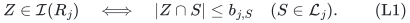

Unacceptable receiving players are loops or outside its declared
ground set. Add a root containing that ground set with capacity its
size, if absent, and a singleton leaf of capacity one for every
eligible player, if absent. Duplicate sets retain their minimum
capacity; empty sets are discarded. Truncate each capacity to
<code class="math">&#124;S&#124;</code>, which does not change the matroid. Zero-capacity nodes
are permitted and forbid every receiving player below them.

The resulting inclusion forest can be joined under the added root.
A player belongs precisely to its root-to-leaf chain. Its explicit
number of nodes and the total number
<code class="math">\sum_{j,S}b_{j,S}</code> are polynomial in the supplied input: every
capacity is at most the player count. No exponentially large binary
capacity is expanded in this matroid model.

A bundle for a player is a set of distinct resources, with value
<code class="math">v(C)=\sum_{j\in C}v_j</code>. The compact relaxation at target
<code class="math">T</code> is

<!-- math-display: 3bcddd5cd8fa2505cd3326d9
\begin{split}
 &x\in P_{\mathcal B(M)},\qquad 0\le y_{pj}\le x_p,\\
 &y_{\cdot j}\in P_{\mathcal I(R_j)}\quad\text{for every }j,\\
 &\sum_jv_jy_{pj}\ge T x_p\quad\text{for every }p.
 \end{split}
 \tag{L2}
-->
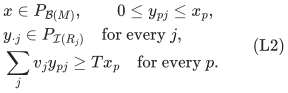

Rank zero is the empty allocation. Ratios involving <code class="math">1/r</code>
assume <code class="math">r\ge1</code>. Let <code class="math">u=\max_jv_j</code>, with value zero
when there is no resource.

The main model permits an independent receiving set at each resource.
For the compulsory-player resource-matroid model, an independent
receiving set may afterwards be extended to a basis of <code class="math">R_j</code>.
All players are present and values are nonnegative, so this only
improves values. A requirement to use a full resource basis restricted
to an arbitrarily selected player subset would be a different model.

## 2. Tokens are reservations, not multiple copies of utility

For each node <code class="math">S\in\mathcal L_j</code>, create a pool of
<code class="math">b_{j,S}</code> distinct tokens

<!-- math-display: f99967ebd2d77cb45b0af0be
(j,S,1),\ldots,(j,S,b_{j,S}).
-->
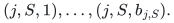

One service record <code class="math">(p,j)</code> reserves one token in every pool on
the root-to-<code class="math">p</code> path. The utility of that entire service record
is <code class="math">v_j</code>, once. Tokens have no additional utility. In particular,
the length of a root-to-leaf path does not multiply the player's
resource value.

A resource receiving set is independent if and only if such disjoint
token reservations exist. Necessity follows by counting its records
through each pool. Sufficiency follows by assigning distinct tokens
within each pool independently; (L1) supplies enough tokens. There
is no further constraint connecting the token labels at different
nodes of a path.

Every current matching bundle stores these service records and their
reserved token paths. Its records have distinct resource indices.
The current matching is token-disjoint. Every selected center also
stores a token bundle, and all selected centers are token-disjoint.
A current matching bundle that shares any token with the selected
family is assigned to the unique selected center that it blocks.

Uniqueness is maintained exactly as in the physical current-blocker
algorithm: a new candidate avoids the tokens of all earlier selected
centers and of all earlier matching blockers. Thus a newly discovered
matching blocker cannot already meet an older center.

## 3. Exact availability and a one-blocker witness per service

For a search state let <code class="math">F</code> be the union of token supports of
all current selected centers <code class="math">X</code> and all current matching
blockers <code class="math">Y</code>. Resource <code class="math">j</code> is available to player <code class="math">p</code>
exactly when every node of its path has a token outside <code class="math">F</code>.

The assertion is about a candidate reservation; it may meet current
matching bundles not yet in <code class="math">Y</code>. Different resources use disjoint
pools, so the maximum available bundle value for <code class="math">p</code> is simply
the sum of values of its available resources. Choose resources in a
fixed order until reaching threshold <code class="math">B</code>, then delete whole
service records while keeping value at least <code class="math">B</code>. This yields a
minimal <code class="math">B</code>-bundle without changing the utility interpretation.

The following stronger witness rule is useful and completely local.

### Lemma 1: one current blocker suffices for one available resource

For an available pair <code class="math">(p,j)</code>, its path can be reserved so that
it meets at most one current matching bundle.

**Proof.** Call a token matching-free if no current matching service
owns it. If every node of the path has a matching-free token outside
<code class="math">F</code>, choose those tokens and the service is free.

Otherwise let <code class="math">S</code> be the deepest path node with no matching-free
token outside <code class="math">F</code>. Choose any token outside <code class="math">F</code> in its pool.
It is owned by a current matching service, say player <code class="math">b</code>'s
service at resource <code class="math">j</code>. The whole matching bundle of <code class="math">b</code>
is not in <code class="math">Y</code>, since its chosen token is not forbidden.
Furthermore none of that bundle's tokens belongs to any selected
center: otherwise it would already be a recorded blocker in <code class="math">Y</code>.

Player <code class="math">b</code> lies in <code class="math">S</code>, so its service has a reserved token
at every ancestor of <code class="math">S</code>. Choose those same tokens on the
ancestor part of the new path, including <code class="math">S</code>. They are all
outside <code class="math">F</code>. At each deeper node on the <code class="math">p</code>-path choose
a matching-free token outside <code class="math">F</code>; such a token exists by the
definition of <code class="math">S</code>. The new service meets only the one matching
bundle of <code class="math">b</code>. <code class="math">\square</code>

This witness rule does not alter any old token assignment. It is
therefore a persistent reservation, unlike separately rerouting
old resource matchings to justify different candidate exchanges.
An implementation scans the path and pool owner lists; all lengths
and capacities in that scan are polynomial in the explicit input.

## 4. The player exchange and old-prefix invariants

Use the accepted current-blocker algorithm with service bundles,
their token supports, and the unchanged player matroid. A blocked
candidate is stored with all matching bundles meeting its tokens.
A free candidate is token-disjoint from the whole matching.

The one-at-a-time earliest player-circuit exchange removes one
matching bundle and inserts the free candidate. Token-disjointness
of the matching remains true. In particular each resource's new
receiving set is independent by Section 2. The new matching bundle
avoids all retained selected tokens, so it cannot create a new blocker
of a retained center. Only the selected owner of the removed blocker
can become newly free.

All lower retained player flats are unchanged by the imported
earliest-circuit lemma. All lower retained token forbidden sets are
literally unchanged, with their old identities. Availability is a
function only of those token sets, not of a fresh choice of resource
matching or of current fundamental circuits. Therefore lower
maximality survives. Last-layer refresh, immediate old-free-center
cascades and temporary tail layers apply as proved in the original
algorithm.

Every matching or selected bundle remains minimal above <code class="math">B</code>
in its service values. No step deletes individual tokens while
pretending to retain the service they supported.

When a stored free center is used and its layer is truncated, preserve
its existing token IDs in a temporary candidate record, then install
that same reservation in the matching. Do not release its record and
find different token paths afterwards. Token-forbidden counts use
separate selected-owner and blocker-owner references, so retiring one
reference does not erase the other's claim to a shared token.

## 5. Antichain cover: the value bound has no laminar-depth factor

A node is saturated by <code class="math">F</code> if all its tokens are forbidden.
For resource <code class="math">j</code>, choose the saturated nodes having no saturated
proper ancestor. Denote this antichain by <code class="math">\mathcal A_j(F)</code>.
Its player sets are pairwise disjoint. Within the declared resource
ground set, the unavailable receiving players are precisely their
union. Players outside that ground set are loops and have zero
resource-column marginal, so they add no value to the certificate.
A zero-capacity node is saturated
vacuously and contributes capacity zero.

Define the certificate cover value

<!-- math-display: 76eb8bc5fb2ba8e6a3f987f8
\Phi(F)=\sum_jv_j
                   \sum_{S\in\mathcal A_j(F)}b_{j,S}.
 \tag{L3}
-->
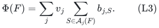

For any feasible fractional resource column in (L2), its value at
unavailable players is at most the corresponding term in (L3), by
the laminar capacity constraints and disjointness of the antichain.

Every saturated pool has exactly <code class="math">b_{j,S}</code> distinct forbidden
tokens. Each such token belongs to a service record in <code class="math">X\cup Y</code>,
possibly to one record of each kind. A service path meets the antichain
of its resource at most once. Counting token occurrences therefore
gives

<!-- math-display: 161dce67b398bee18ae81164
\Phi(F)\le
                    \sum_{C\in X}v(C)+\sum_{D\in Y}v(D).
 \tag{L4}
-->
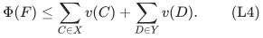

This is the central reservation-to-value inequality. It counts each
service value at most once regardless of the path's length. Assigning
the full resource value to every token and summing all path pools
would be a different, unnecessarily larger bound.

At a fully blocked prefix, unique current blocker ownership gives
<code class="math">&#124;X&#124;\le&#124;Y&#124;</code>. Since every minimal bundle has value below
<code class="math">B+u</code>,

<!-- math-display: fa33baad86eaf448d3578893
\Phi(F)\le2(B+u)|Y|.
 \tag{L5}
-->
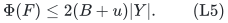

A sharper coefficient also holds:

<!-- math-display: 99bd8781f54c668ec04e8430
\Phi(F)\le C_{\rm lam}(B,u)|Y|,
 \qquad C_{\rm lam}(B,u)=
                \max\{2u,\ 2B+2\min(u,B)\}.
 \tag{L6}
-->
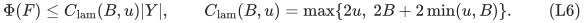

To see this, charge (L4) separately to each selected center and its
unique blockers. A singleton center uses a resource of value at least
<code class="math">B</code>. Every intersecting minimal blocker also contains that
resource, so it is a singleton of that same value; their total is at
most <code class="math">2u</code> times the number of blockers. A nonsingleton center
has only resources below <code class="math">B</code>. Every blocker containing one of
these resources is also nonsingleton: a minimal bundle containing
an item worth at least <code class="math">B</code> cannot contain another item. Thus
each bundle in that star has value below <code class="math">B+\min(u,B)</code>, and
there are at most twice as many bundles as blockers. These star
charges prove (L6). They do not assert that stars are disjoint in
resource indices; their token supports and blocker ownership are the
objects controlling the count.

## 6. The strict LP certificate and rank-dependent search

Let a completed maximal layer have current matching size <code class="math">k&lt;r</code>,
earlier blocker count <code class="math">s</code>, and current-layer blocker count <code class="math">y</code>.
Put

<!-- math-display: 9ada7459616c9f64b9db71fd
J_0=I\setminus\mathrm{owners}(Y_{<i}),\qquad
 w=r-|J_0|=r-k+s\ge1.
-->

Every player outside <code class="math">\mathrm{cl}_M(J_0)</code> has available
resource value strictly below <code class="math">B</code>. If (L2) were feasible, its
positive eligible player mass would have strictly less than
<code class="math">Bx_p</code> fractional value at available resources. All unavailable
resource value is bounded by (L3). Therefore, for <code class="math">B\le T</code>,

<!-- math-display: 496ca7957552d815a499c957
\Phi(F)>(T-B)w.
 \tag{L7}
-->
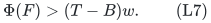

The inequality is strict even at <code class="math">B=T</code>. Consequently a weak
cover inequality <code class="math">\Phi(F)\le(T-B)w</code>, together with the
eligibility and complete availability scan, certifies infeasibility
of (L2). The certificate uses explicitly computable saturated
antichains and original-matroid queries.

Let <code class="math">\rho_r=(r-1)/r</code>. Since <code class="math">s/w\le\rho_r</code>, the
exact search with positive current growth <code class="math">y&gt;0</code> is correct under

<!-- math-display: 1e9673e40e2c6d022d21aa44
B+\rho_r C_{\rm lam}(B,u)\le T.
 \tag{L8}
-->
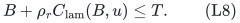

Every successful completed layer contains at least one distinct current
matching blocker. The accepted rank-only integer signature therefore
bounds all charged states by <code class="math">2^{O(r)}</code>. If a positive cover
gap permits growth <code class="math">y&gt;\gamma w</code>, the same proof also gives
<code class="math">(r+1)^{O(\gamma^{-1}\log(r+1))}</code> states. Representation and
availability scans use polynomial work in the explicit laminar input
and its numerical bit length. No depth factor enters (L8).

## 7. Fat resources and the factor <code class="math">5-4/r</code>

For a target <code class="math">T</code>, define

<!-- math-display: ea22c9825924fd4e55bfedce
d_r=1+4\rho_r=5-4/r,\qquad B_0=T/d_r.
 \tag{L9}
-->
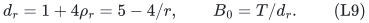

Classify resource <code class="math">j</code> as fat if <code class="math">v_j\ge B_0</code>. Let

<!-- math-display: ef5f2acbf9ebb795f4676cea
N=\bigvee_{j\text{ fat}}R_j,
                         \qquad U=M^*\vee N.
 \tag{L10}
-->
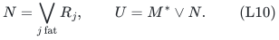

This is matroid union on the player ground set. Independence in
<code class="math">N</code> means that its players can be partitioned among fat resources,
each part independent in that resource matroid. Giving each player
its assigned one fat resource then supplies value at least <code class="math">B_0</code>.
Rank, independence and an explicit resource decomposition are
computable by polynomial matroid-union algorithms. No unproved
transversal representation of a laminar matroid is used.

The established fat-wrapper argument now applies with this <code class="math">N</code>:
from an optimal original basis allocation, keep one fat resource for
each fat-supplied player; its fat receiving sets remain independent.
Combine those players with the complementary <code class="math">M^*</code>-basis,
extend to a <code class="math">U</code>-basis, and complement to obtain an all-small
promise for a <code class="math">U^*</code>-basis. Its rank <code class="math">r'</code> is at most <code class="math">r</code>.

Apply the small-resource algorithm at <code class="math">B=B_0</code>. Since
<code class="math">u&lt;B_0</code> and <code class="math">\rho_{r'}\le\rho_r</code>,

<!-- math-display: 6726862b073ce67fdc8b5719
B_0+\rho_{r'}C_{\rm lam}(B_0,u)
                     \le (1+4\rho_r)B_0=T.
-->
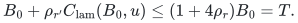

Rank zero of <code class="math">U^*</code> needs no inner search. After success, partition
the complementary <code class="math">U</code>-basis into an independent dual part and
an <code class="math">N</code>-part, allocate the latter its decomposed fat resources,
and extend the dual part to an <code class="math">M^*</code>-basis. Discard allocations
of any players used in that extension. Its complement is an original
<code class="math">M</code>-basis, and every retained player already has a legal fat or
small allocation. Deletion preserves each resource's independence.

Thus the factor <code class="math">d_r</code> is achieved in
<code class="math">\mathrm{poly}(\text{explicit input bits})2^{O(r)}</code>
time with paid original-matroid, dual and union oracles. Rank one has
factor one in this exact-availability model: with only one selected
player, all individually permitted resources can be supplied to it.

## 8. Positive error and the configuration-LP comparator

Keep the fat threshold <code class="math">B_0=T/d</code>, where <code class="math">d=d_r</code>, and
for <code class="math">\eta&gt;0</code> use

<!-- math-display: fab7d82cea9572603be92841
B=T/(d+\eta),\qquad
             \varepsilon=(B_0-B)/T=\frac{\eta}{d(d+\eta)}.
-->
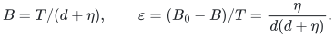

The coefficient in (L5) is at most
<code class="math">\overline C=2B+2B_0\le4T/d</code>. The gap obeys

<!-- math-display: 1e4fe216a3617cf75136ea46
T-B-\rho_r\overline C
                      =(1+2\rho_r)\varepsilon T.
 \tag{L11}
-->
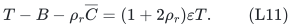

Since <code class="math">1+2\rho_r\ge d/2</code> and <code class="math">d\ge1</code>, the gap
divided by <code class="math">\overline C</code> is at least

<!-- math-display: bfede6a80ca10b69c110395f
\frac{\eta(1+2\rho_r)}{4(d+\eta)}
       \ge\frac{\eta d}{8(d+\eta)}
       \ge\frac1{16}\min\{\eta,1\}.
 \tag{L12}
-->
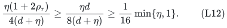

Use <code class="math">\gamma=\min\{\eta,1\}/32</code>. A failed current growth
test yields the strict contradiction to (L7), while a passing test
gives the established rank-quasipolynomial depth. Consequently ratio
<code class="math">5-4/r+\eta</code> is obtained in

<!-- math-display: 776b5cc4847fb8d7517d8074
\mathrm{poly}(\text{input bits})
 \min\left\{2^{O(r)},
          (r+1)^{O((1+\eta^{-1})\log(r+1))}\right\}
 \tag{L13}
-->
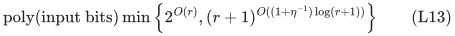

time, with polynomial wrapper space. The polynomial factor includes
all token pools, service paths, saturation scans and matroid-union
operations.

The stronger configuration comparator also transfers. Let target
configurations be sets of resources worth at least <code class="math">T</code>, player
configuration masses lie in the base polytope of <code class="math">M</code>, and the
resource-service marginals satisfy
<code class="math">y_{\cdot j}\in P_{\mathcal I(R_j)}</code>. From every fat-containing
configuration choose one fat resource. Its chosen fractional receiving
vector at resource <code class="math">j</code> is coordinatewise at most
<code class="math">y_{\cdot j}</code>, so it remains in that resource's independent-set
polytope. Their sum <code class="math">f\le x</code> belongs to the union polytope of
<code class="math">N</code>, by the matroid-union rank inequalities.

Then <code class="math">1-x+f</code> lies in the union polytope of <code class="math">U</code>, can be
increased to a base vector, and has a complementary derived base
vector <code class="math">x'\le h=x-f</code>. Scaling the all-small configuration
marginals of player <code class="math">p</code> by <code class="math">x'_p/h_p</code> preserves every
resource column coordinatewise and gives the target inequalities in
(L2). The zero-mass convention is unchanged. This proves failure
soundness relative to this resource-matroid configuration LP, without
solving it.

All configuration values lie on the common rational grid of the
input <code class="math">v_j</code>. A finite upper bound on total delivered value is
<code class="math">V=\sum_j v_j r(R_j)</code>. Use an initially failed grid target
larger than <code class="math">(d+\eta)V</code>, or the corresponding exact-ratio
bound. The established nonmonotone-success binary search then gives
the same comparison against the unknown optimum target, with
polynomially many trials.

## 9. The class includes nontransversal resource matroids

Take three disjoint parallel pairs of players. Give each pair capacity
one and their common root capacity two. This is a laminar matroid
of rank two.

It is not transversal. If a parallel pair of nonloops in a transversal
representation had at least two slots in the union of its two
neighborhoods, the two elements could be matched independently.
Thus each pair would have to share one unique slot. Different pairs
must use different slots, because elements from distinct pairs are
independent. Taking one element from each of the three pairs would
then give a matching of size three, contradicting rank two.

Thus this reservation construction is not merely the explicit
transversal-slot adapter in different notation. It also does not
provide a representation for arbitrary resource matroids: the
antichain cover and polynomial token representation use laminarity.

## 10. Optional local families and approximate availability

The same reservation interface permits a player-local downward-closed
family of subsets of resource indices. On the available resource list,
use a feasible-bundle oracle with value at least <code class="math">\lambda</code> times
its optimum. Pruning removes whole service records. Restricting a
convex combination of feasible configurations to the available
resource list gives the strict outside bound <code class="math">(B/\lambda)x_p</code>,
as proved in [approximate-available-bundle-oracle-allocation.md](approximate-available-bundle-oracle-allocation.md).

The relaxation now has both the row perspective constraint for that
local family and the resource columns in (L2). The antichain capacity
bound, physical reservation invariants and sharp star bound are
unchanged. The sufficient condition is

<!-- math-display: a415b956e776efc67c5544cf
B/\lambda+\rho_r C_{\rm lam}(B,u)\le T.
 \tag{L14}
-->
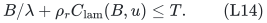

For the fat reduction, restrict <code class="math">R_j</code> to players for whom
<code class="math">\{j\}</code> is locally feasible. This restriction remains laminar.
Those feasible singleton tests are exact even from a positive-factor
availability oracle on one resource. Fat configuration splitting and
the conditional small perspective scaling preserve both sides of the
relaxation.

The resulting exact rank-exponential ratio is
<code class="math">d_{r,\lambda}=\lambda^{-1}+4-4/r</code>. Its positive-error
version has the same exponent in (L13) for ratio
<code class="math">d_{r,\lambda}+\eta</code>. Indeed (L11)--(L12) hold with
<code class="math">1</code> replaced by <code class="math">\tau=\lambda^{-1}</code>, since
<code class="math">\tau+2\rho_r\ge d_{r,\lambda}/2</code>. Oracle runtime,
workspace and numerical accuracy parameters are paid, as in the
separate approximate-oracle note. No exact rank-one optimization is
claimed when that oracle is approximate.

## 11. Public comparison and unresolved scope

The public Bamas--Lindermayr--Megow--Rohwedder--Schloeter result gives
polynomial <code class="math">8+\varepsilon</code> for general resource matroids and
polymatroids, and <code class="math">4+\varepsilon</code> for two values; see
[Theorem 4 of arXiv:2307.08453v1](https://arxiv.org/abs/2307.08453v1).
Those public problems and their time bounds must be kept distinct
from the rank-dependent search proved here. A separate primary-source
comparison is being performed for this precise laminar subclass.

In particular this manuscript does not yet label factor five a first
published or derived approximation for laminar resources. A new
reservation adapter followed by a public outer algorithm must be
named as that composite, rather than called an unchanged printed
public theorem. The present proof establishes the complete reservation,
certificate and rank-dependent construction; a same-model priority
claim is a separate question.
