# Sharper star charging and rank-sensitive quality for matroid allocation

**25 October 2026. New proof refinement; independent and root mathematical reviews completed.**

The root review is [Matroid union removes the largest-item penalty](../../problems/item-matroid-union/proof.md).

This note strengthens the guarantee of
[matroid-allocation-current-blocker-quasipolynomial.md](matroid-allocation-current-blocker-quasipolynomial.md). It preserves
the one-at-a-time earliest-circuit exchanges, last-layer refresh,
current blocker ownership and integer signatures audited in
[Current blocker growth for matroid max-min allocation](matroid-allocation-current-blocker-quasipolynomial.md). Only the value
accounting, the numerical growth test and the final certificate
inequality are changed.

The resulting guarantee is rank-sensitive, includes the exact
zero-slack boundary, and has a sharp domain of positive guarantees
against the compact relaxation. The lower-bound examples at the end
distinguish limitations of this certificate from actual LP gaps.

## 1. Notation and the improved coefficient

Let <code class="math">M</code> be a matroid of rank <code class="math">r\ge1</code> on <code class="math">q</code> players, given
by an independence oracle. Resources have intrinsic positive rational
values, explicit liking sets, and largest value <code class="math">u</code>. Let <code class="math">Q(T)</code>
be the compact relaxation with a base-polytope player vector <code class="math">x</code>,
resource capacities one, and <code class="math">0\le y_{pj}\le x_p</code>.

For a target integral bundle value <code class="math">B&gt;0</code>, define

<!-- math-display: a22e12f270ed22c248a469db
C(B,u)=\max\{u,\;2B+\min(u,B)\},\qquad
 \rho_r=\frac{r-1}{r}.
 \tag{Q1}
-->
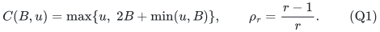

Every bundle stored in the matching or a selected layer is inclusion
minimal above <code class="math">B</code>. Every current matching blocker intersects a
unique selected center, and each stored selected center is blocked
outside the explicitly handled free cascade.

### Lemma 1: current star value

For a fully blocked prefix with current blocker set <code class="math">Y</code> and
forbidden resource union <code class="math">F=R(X\cup Y)</code>,

<!-- math-display: 55ad72bc2d9af2577eb060b4
v(F)\le C(B,u)|Y|.
 \tag{Q2}
-->
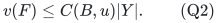

**Proof.** Assign each matching blocker to its unique selected center.
Consider one center <code class="math">A</code>.

If <code class="math">A</code> is a singleton <code class="math">\{e\}</code>, then <code class="math">v_e\ge B</code>.
Any inclusion-minimal <code class="math">B</code>-bundle containing <code class="math">e</code> must itself
equal <code class="math">\{e\}</code>: any other resource could be deleted while retaining
value at least <code class="math">B</code>. Since matching bundles are resource-disjoint,
this center has exactly one blocker. Its whole star has value
<code class="math">v_e\le u</code>.

If <code class="math">A</code> is not a singleton, every resource in <code class="math">A</code> has value
strictly less than <code class="math">B</code>. Removing any one of them leaves value below
<code class="math">B</code>, so

<!-- math-display: fc1cb2911ed5aa49db5f17f6
v(A)<B+\min(u,B).
-->
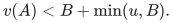

Each of its <code class="math">t_A\ge1</code> blockers has value less than <code class="math">B</code>
outside <code class="math">A</code>, because removing one resource of its intersection
with <code class="math">A</code> leaves a proper subset of a minimal bundle. Therefore

<!-- math-display: 0aa141893a5d0cba6ceb961b
\begin{aligned}
 v\bigl(A\cup R(Y_A)\bigr)
 &<B+\min(u,B)+Bt_A\\
 &\le [2B+\min(u,B)]t_A.
 \end{aligned}
-->
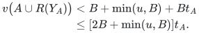

Stars are resource-disjoint: centers are disjoint, matching blockers
are disjoint, and a blocker cannot meet another center. Summing their
bounds proves (Q2). The weak inequality is intentional, since a
singleton star can have value exactly <code class="math">u</code>. No restriction on repeated
selected player names is used. <code class="math">\square</code>

When <code class="math">u\le B</code>, this recovers <code class="math">2B+u</code>. When <code class="math">u\ge B</code>, the
new coefficient is <code class="math">\max\{3B,u\}</code>, improving the former
<code class="math">2B+u</code> bound.

## 2. A strict fractional lower bound

During an augmentation phase, write <code class="math">k=&#124;I&#124;&lt;r</code>, and let a completed
last layer <code class="math">i</code> have earlier blocker count <code class="math">s=&#124;Y_{&lt;i}&#124;</code>. Define

<!-- math-display: 298cdfae614d1ecc9223372c
J_0=I\setminus\mathrm{owners}(Y_{<i}),\qquad
 U=P\setminus\mathrm{cl}(J_0),\qquad
 w=r-|J_0|=r-k+s.
 \tag{Q3}
-->
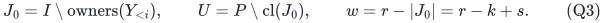

Thus <code class="math">1\le w\le r</code>. The current maximality test is exactly

<!-- math-display: 4398d314929d0a40010de803
v(L_p\setminus F_i)<B
                         \quad(p\in U).
 \tag{Q4}
-->
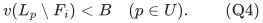

If <code class="math">(x,y)\in Q(T)</code>, then <code class="math">x(U)\ge w&gt;0</code>. For each
<code class="math">p\in U</code> with <code class="math">x_p&gt;0</code>, the individual inequalities
<code class="math">y_{pj}\le x_p</code> and (Q4) give strictly less than <code class="math">Bx_p</code>
fractional value outside <code class="math">F_i</code>. Therefore, for <code class="math">B\le T</code>,

<!-- math-display: 58e1793650cea551228e9f2b
v(F_i)>(T-B)x(U)\ge(T-B)w.
 \tag{Q5}
-->
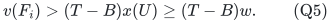

The first inequality is strict. There are finitely many players, and
their positive <code class="math">x_p</code> mass in <code class="math">U</code> is nonzero. This strictness
also holds when <code class="math">B=T</code>, in which case the right-hand side is zero.

Consequently the following is a valid oracle-checkable certificate of
infeasibility of <code class="math">Q(T)</code>: an independent <code class="math">J_0</code>, a resource set
<code class="math">F</code>, and

<!-- math-display: 85e32f531c3d2e5f77f97d4a
\begin{split}
 &v(L_p\setminus F)<B\quad
                         (p\notin\mathrm{cl}(J_0)),\\
 &v(F)\le(T-B)(r-|J_0|),\qquad r-|J_0|\ge1.
 \end{split}
 \tag{Q6}
-->
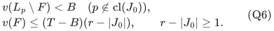

In contrast with the original sufficient certificate, the last
inequality is allowed to be an equality. Its validity is supplied by
the strict lower bound (Q5), rather than by a strict star upper bound.

## 3. The finite-rank factor

Since <code class="math">s\le k&lt;r</code>,

<!-- math-display: 8a75d08afc3586e5a2b16c94
\frac{s}{r-k+s}\le\frac{r-1}{r}=\rho_r.
 \tag{Q7}
-->
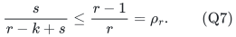

At a completed maximal layer with <code class="math">Y_i=\varnothing</code>, all its
prefix blockers are the <code class="math">s</code> earlier blockers. Lemma 1 and (Q7)
give

<!-- math-display: 7913ebda5f3d04419777674a
v(F_i)\le C(B,u)s
                             \le \rho_r C(B,u)w.
-->
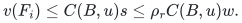

It follows that the local-search algorithm, with the growth test simply
<code class="math">&#124;Y_i&#124;&gt;0</code>, is valid whenever

<!-- math-display: 8e9ff94ab88ba721d0ee6731
\boxed{B+\rho_r C(B,u)\le T.}
 \tag{Q8}
-->
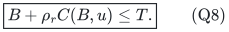

Indeed a failed test then produces (Q6), while every successful layer
has at least one distinct current matching blocker. All exchanges,
refreshes and the integer micro-signature are unchanged. The total work
is therefore

<!-- math-display: cf4403e732c44bd73e5554c9
\mathcal P\,2^{O(r)}
                       \mathrm{poly}(b+\log\mathcal P),
 \tag{Q9}
-->
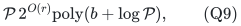

with polynomial space. The original player count <code class="math">q</code> occurs in the
explicit-input factor <code class="math">\mathcal P</code>; it does not replace <code class="math">r</code>
in the exponential factor. The complete per-microstate implementation
accounting is in Section 7.3 of the second independent audit.

## 4. Explicit optimal target for this coefficient

For <code class="math">r\ge2</code>, the function <code class="math">B+\rho_r C(B,u)</code> is continuous
and strictly increasing in <code class="math">B</code>. It has a positive solution to
(Q8) exactly when

<!-- math-display: b5c4e066d4dfcf56108db88d
0\le u<\frac{T}{\rho_r}.
 \tag{Q10}
-->
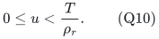

Let <code class="math">B_r^*(T,u)</code> be its unique equality solution. Put
<code class="math">a_r=1+3\rho_r=4-3/r</code>. Then

<!-- math-display: 2b376edf6833038544680495
B_r^*(T,u)=
 \begin{cases}
 \displaystyle\frac{T-\rho_r u}{1+2\rho_r},
       &u\le T/a_r,\\[6pt]
 \displaystyle T/a_r,
       &T/a_r\le u\le3T/a_r,\\[6pt]
 \displaystyle T-\rho_r u,
       &u\ge3T/a_r.
 \end{cases}
 \tag{Q11}
-->
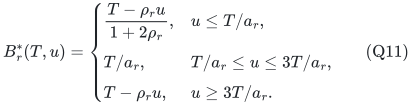

Only the positive portion of the last line is included. Adjacent
formulas agree at their common endpoints. The first line is

<!-- math-display: c51d64c4df058c5b1554e38f
\frac{rT-(r-1)u}{3r-2}.
 \tag{Q12}
-->
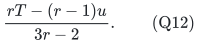

For <code class="math">r=1</code>, simply take <code class="math">B_1^*(T,u)=T</code>, with no restriction
on <code class="math">u</code>. Rank one can also be solved directly: select a nonloop
player with maximum total liked-resource value. The one-layer
certificate above gives the same conclusion. Rank zero is vacuous.

As <code class="math">r</code> grows, the guarantee tends to

<!-- math-display: 0196760a5815bc5c73529fbf
B_\infty^*(T,u)=
 \begin{cases}
 (T-u)/3,&u\le T/4,\\
 T/4,&T/4\le u\le3T/4,\\
 T-u,&3T/4\le u<T.
 \end{cases}
 \tag{Q13}
-->
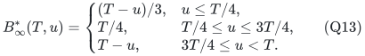

The middle and last branches improve the earlier additive bound for
moderate or large resources. The finite-rank first branch also improves
its leading constant: for negligible <code class="math">u</code>, it is
<code class="math">T/(3-2/r)</code>. These are guarantees against the same compact
relaxation, not against a stronger configuration LP.

## 5. Positive slack and quasipolynomial time

Let <code class="math">r\ge2</code>, assume (Q10), and choose a rational
<code class="math">0&lt;\varepsilon&lt;B_r^*(T,u)/T</code>. Set

<!-- math-display: 5e399178dc90c9bbe0f171e0
B=B_r^*(T,u)-\varepsilon T,
             \qquad \eta=\varepsilon/4.
 \tag{Q14}
-->
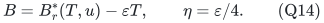

Use the same greedy operations but test current growth by

<!-- math-display: 4b91130eb33b3c36f5d58511
|Y_i|>\eta\,(r-k+|Y_{<i}|).
 \tag{Q15}
-->
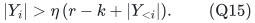

The change from <code class="math">1+&#124;Y_{&lt;i}&#124;</code> to <code class="math">r-k+&#124;Y_{&lt;i}&#124;</code> is only a
stronger numerical use of the same eligibility flat. Within a phase
<code class="math">k</code> is fixed. Earlier retained blocker sets remain unchanged by
the earliest-circuit exchange, so completed earlier growth statements
remain true exactly as before.

Monotonicity of <code class="math">C</code> gives

<!-- math-display: 36d8f5ae94b28a0a0934e584
B+\rho_r C(B,u)\le T-\varepsilon T.
 \tag{Q16}
-->
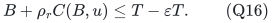

Also <code class="math">B\le T</code>, <code class="math">u&lt;T/\rho_r\le2T</code>, and hence
<code class="math">C(B,u)\le3T</code>. If (Q15) fails at a maximal layer, Lemma 1 yields

<!-- math-display: e405983b696670fe2c704696
\begin{aligned}
 v(F_i)&\le C(B,u)(s+|Y_i|)\\
       &\le C(B,u)(\rho_r+\eta)w\\
       &\le (T-B-\varepsilon T+3\varepsilon T/4)w\\
       &<(T-B)w.
 \end{aligned}
 \tag{Q17}
-->
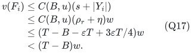

This is an infeasibility certificate. In a feasible instance every
completed layer satisfies (Q15), so the quantity
<code class="math">r-k+&#124;Y_{\le i}&#124;</code> grows by a factor greater than <code class="math">1+\eta</code>
per completed layer and never exceeds <code class="math">r</code>. The depth is
<code class="math">O(\varepsilon^{-1}\log(r+1))</code>. The unchanged micro-signature
therefore gives

<!-- math-display: 9d78c73148de4246eb337a71
\boxed{\quad
 \mathcal P\,
 \min\!\left\{2^{O(r)},
       (r+1)^{O(\varepsilon^{-1}\log(r+1))}\right\}
       \mathrm{poly}(b+\log\mathcal P).
 \quad}
 \tag{Q18}
-->
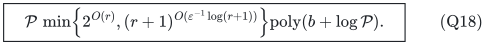

Rank one is handled by its direct scan, so no separate approximation
parameter is needed there. At <code class="math">\varepsilon=0</code>, use (Q9) rather
than the logarithmic-depth estimate.

## 6. The positive domain is sharp for this relaxation

For any <code class="math">r\ge2</code>, take the free matroid of rank <code class="math">r</code> on exactly
<code class="math">r</code> players. Give them <code class="math">r-1</code> resources, all liked by every
player, each with value

<!-- math-display: ff6bd5c214a359024f8b1e90
u_0=\frac{rT}{r-1}=\frac T{\rho_r}.
-->
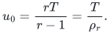

The compact LP is feasible: set every player variable to one and
give each player fraction <code class="math">1/r</code> of each resource. Each receives
fractional value exactly <code class="math">T</code>. Integrally, at least one of the
<code class="math">r</code> players receives no resource at all. Thus no positive
allocation guarantee against <code class="math">Q(T)</code> is possible at this endpoint.
Increasing the common resource value gives the same obstruction above
the endpoint.

This is an actual LP-gap example. It explains why a theorem against
integer optimum, such as the separate fat-resource reduction, has a
different scope from rounding an arbitrary feasible <code class="math">Q(T)</code>.

## 7. What the star mechanism cannot improve by itself

The improved coefficient is not uniformly reducible merely by invoking
minimality, current unique blocker ownership, or repeated player names.

### 7.1 Small resources: the additive item term can be approached

Let <code class="math">h\ge2</code>, take all resources in one star to have value <code class="math">a</code>,
and choose

<!-- math-display: 30c19349e5ab9eb2698327c4
B=(h-1+\tau)a,\qquad0<\tau<1.
-->
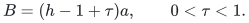

A center of <code class="math">h</code> resources and a matching blocker of <code class="math">h</code>
resources, sharing exactly one resource, are both inclusion-minimal
above <code class="math">B</code>. The center has one blocker and the star union has value

<!-- math-display: 23007808e0c78b7702256fe4
(2h-1)a=2B+a-2\tau a.
 \tag{Q19}
-->
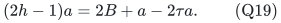

Here <code class="math">u=a\le B</code>, and the right side approaches <code class="math">2B+u</code>
as <code class="math">\tau</code> tends to zero. Taking <code class="math">h</code> large makes <code class="math">u/B</code>
arbitrarily small. Thus a uniform replacement of the additive <code class="math">u</code>
by <code class="math">o(u)</code> does not follow from these local star hypotheses.

### 7.2 The other branches

If <code class="math">B\le u\le3B</code>, use a center and blocker with two resources
each, sharing one, all three resources of value <code class="math">B-\zeta</code>.
For sufficiently small positive <code class="math">\zeta</code>, both bundles are minimal
above <code class="math">B</code>, and the union approaches <code class="math">3B</code>. A separate singleton
star can realize an exact larger global item maximum without weakening
the asymptotic average over many such two-resource stars. If
<code class="math">u\ge3B</code>, a center and blocker equal to the same singleton of
value <code class="math">u</code> attain the coefficient <code class="math">u</code> exactly.

### 7.3 A maximal state can realize the same obstruction

Replicate the star of Section 7.1 <code class="math">t</code> times, using disjoint
resources. Use the free matroid on <code class="math">t+1</code> players. The current
matching gives one blocker bundle to each of <code class="math">t</code> players; the
remaining player owns all <code class="math">t</code> selected centers. Repeated selected
owners are allowed by the actual current-blocker interface.

Let every player like all star resources, and give each player its own
additional resources of total value <code class="math">a_0&lt;B</code>, each individual value
at most <code class="math">a</code>. The first layer consisting of those <code class="math">t</code> centers
and blockers is fully blocked. The next eligible set is the whole
ground set. Its available liked resources outside the forbidden union
are exactly a player's private set, of value below <code class="math">B</code>; hence the
next layer is maximal and empty.

Nevertheless the compact LP is feasible at

<!-- math-display: 749545b4f310d52289d9603d
T=a_0+\frac{t}{t+1}(2h-1)a,
 \tag{Q20}
-->
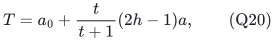

by allocating each private set to its owner and splitting every star
resource equally among the <code class="math">t+1</code> players. As
<code class="math">a_0\uparrow B</code>, <code class="math">\tau\downarrow0</code>, and <code class="math">t/h\to\infty</code>,
this value approaches <code class="math">3B+u</code> to within <code class="math">o(u)</code>.

This is a valid current-state and resource-certificate obstruction.
It is not a proof that the prescribed scan order from an empty matching
must reach that state. Nor is it an integrality-gap barrier at factor
three: distribute the star resources as evenly as possible and keep
the private assignments. This gives every player at least

<!-- math-display: 53892d7876c306b3171ea98f
a_0+a\left\lfloor
                            \frac{t(2h-1)}{t+1}\right\rfloor,
-->
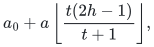

which differs from (Q20) by less than one resource value. A method
using the same final star certificate cannot simply erase its additive
item loss; a stronger algorithm or a different certificate may do so.

## 8. Consequence for the separately audited fat-resource reduction

The separate matroid-union reduction uses an original player matroid
of rank <code class="math">r</code>, classifies resources of value at least <code class="math">\theta T</code>
as fat, and calls the small-resource solver on a derived player matroid
of rank at most <code class="math">r</code>. Its proof is independent of this note.

Take

<!-- math-display: 052791ae5adc77f4e7befe5e
\theta=\frac1{4-3/r}.
 \tag{Q21}
-->
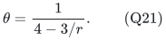

For the small instance, <code class="math">u&lt;\theta T</code>. With <code class="math">B=\theta T</code>,
its coefficient is strictly less than <code class="math">3B</code>, and its rank factor
is at most <code class="math">\rho_r</code>. Therefore

<!-- math-display: f4556ce2d341ce2f2e369155
B+\rho_{r'}C(B,u)\le B+3\rho_rB=T.
-->
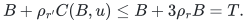

Consequently the exact rank-exponential solver supplies all selected
small players with value at least <code class="math">\theta T</code>; retained fat players
also receive at least <code class="math">\theta T</code>. The separately audited reduction
therefore gives factor <code class="math">4-3/r</code> against integer optimum in
<code class="math">2^{O(r)}\mathrm{poly}(\mathcal P,b)</code> time. Rank one is
exact. This factor tends to four as rank grows and is not a uniform
constant-below-four result for unrestricted rank. Matroid-union oracle
overhead is polynomial in the full input and is not asserted to be
linear in <code class="math">\mathcal P</code>.
