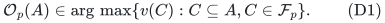
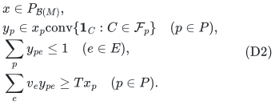
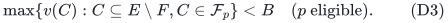
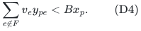
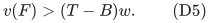
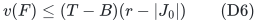
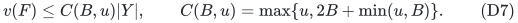
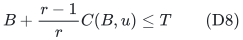
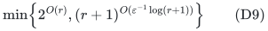
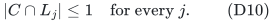

# Player-local downward-closed allocation constraints

**25 October 2026. New exact-oracle extension; independent resource-side
audit completed.** See [item-matroid-allocation-public-scope-audit.md](item-matroid-allocation-public-scope-audit.md).

This note extends the audited current-blocker method to constraints on
each player's own bundle. The resource values remain common intrinsic
values. It does not extend the result to arbitrary player-specific
values or automatically to an arbitrary matroid constraining the
receiving players of each resource.

The algorithmic imports are
[matroid-allocation-current-blocker-quasipolynomial.md](matroid-allocation-current-blocker-quasipolynomial.md),
[matroid-allocation-sharp-star-rank-quality.md](matroid-allocation-sharp-star-rank-quality.md), and
[item matroid union proof](../../problems/item-matroid-union/proof.md). Their operations are kept;
the available-bundle search and its fractional certificate are changed
as specified below.

## 1. Model and the required oracle

There is a player matroid <code class="math">M</code> of rank <code class="math">r</code> on a set <code class="math">P</code> of
<code class="math">q</code> players, a finite explicit resource set <code class="math">E</code>, and common
nonnegative intrinsic values <code class="math">v_e</code>. Write <code class="math">u=\max_e v_e</code>,
with <code class="math">u=0</code> when the resource set is empty.
Player <code class="math">p</code> may receive any bundle in a nonempty downward-closed
family <code class="math">\mathcal F_p\subseteq2^E</code>. Resources are still indivisible
and may be allocated to at most one selected player. The selected
players must form a basis of <code class="math">M</code>.

Rank zero is the trivial empty allocation. All formulas containing
<code class="math">1/r</code> below assume <code class="math">r\ge1</code>.

For a currently available resource set <code class="math">A\subseteq E</code>, assume
access to an oracle returning a bundle

<!-- math-display: 63f4189088a0aae9fb1e2445
\mathcal O_p(A)\in\mathrm{arg}\,\max\{v(C): C\subseteq A,
                                      C\in\mathcal F_p\}.
 \tag{D1}
-->

Only the fixed common intrinsic objective and available-set
restrictions are needed. The theorem counts these oracle calls and
does not assume that an arbitrary downward-closed family has a
polynomial-time implementation of (D1).

The main explicit specialization is a separate item matroid <code class="math">N_p</code>
for each player, with <code class="math">\mathcal F_p=\mathcal I(N_p)</code>. Restricting
that matroid to <code class="math">A</code> and running weighted greedy implements (D1)
using <code class="math">O(&#124;E&#124;)</code> independence queries. Different players may have
different item matroids. Loops encode unacceptable resources.

## 2. The perspective relaxation

Use the following relaxation, denoted <code class="math">L(T)</code>:

<!-- math-display: 26bb7162c90f74d1afe3173d
\begin{split}
 &x\in P_{\mathcal B(M)},\\
 &y_p\in x_p\mathrm{conv}
          \{\mathbf1_C:C\in\mathcal F_p\}\quad(p\in P),\\
 &\sum_p y_{pe}\le1\quad(e\in E),\\
 &\sum_e v_e y_{pe}\ge T x_p\quad(p\in P).
 \end{split}
 \tag{D2}
-->

At <code class="math">x_p=0</code>, the second line means <code class="math">y_p=0</code>. The matroid
specialization uses a scaled matroid independence polytope. It implies
the individual bounds <code class="math">0\le y_{pe}\le x_p</code>, but retains the
additional constraints needed for player-local bundle feasibility.

No feasible point of (D2) is needed as an input to the algorithm.

## 3. Candidate construction and maximality

The current matching, selected layers, blockers and player eligibility
are exactly as in the audited current-blocker algorithm. To search a
last layer with forbidden physical resource set <code class="math">F</code>, run (D1) on
<code class="math">E\setminus F</code> for each eligible player.

If an oracle returns value at least <code class="math">B</code>, remove resources while
the remaining value stays at least <code class="math">B</code>. Every deletion preserves
membership in <code class="math">\mathcal F_p</code>. A single deletion scan suffices,
because the remaining value only decreases. The resulting bundle is
inclusion-minimal above <code class="math">B</code> and is a legal bundle for this player.
If no eligible player succeeds, maximality means exactly

<!-- math-display: e2a0f84b395b0528dba8eeee
\max\{v(C):C\subseteq E\setminus F,
                  C\in\mathcal F_p\}<B
                     \quad(p\text{ eligible}).
 \tag{D3}
-->

All matching and selected bundles remain individually feasible for
their owners. Repeated selected player names are permitted, just as
before; these are candidate alternatives, not simultaneous allocations
to one player.

## 4. The strict fractional outside-value bound

Fix a feasible point of (D2) and an eligible player with <code class="math">x_p&gt;0</code>.
Express <code class="math">y_p/x_p</code> as a convex combination of indicators of
feasible bundles. Intersect each bundle with <code class="math">E\setminus F</code>.
By downward closure the intersection remains feasible for <code class="math">p</code>.
Thus (D3) implies

<!-- math-display: 530a0c1037a8874fe253e3ac
\sum_{e\notin F}v_e y_{pe}<Bx_p.
 \tag{D4}
-->

Assume <code class="math">B\le T</code>, as in all guarantees below. The eligible
player mass is at least
<code class="math">w=r-&#124;I\setminus\mathrm{owners}(Y_{&lt;i})&#124;&gt;0</code>.
Summing (D4), using the target constraints and physical resource
capacities, gives the same strict lower bound

<!-- math-display: 7d6d1ad5bf9e1180c4c23e94
v(F)>(T-B)w.
 \tag{D5}
-->

Consequently an independent <code class="math">J_0</code>, a physical resource set <code class="math">F</code>,
oracle-verified inequalities (D3) outside <code class="math">\mathrm{cl}(J_0)</code>,
and

<!-- math-display: a35a3f1828bfda85938c58dd
v(F)\le(T-B)(r-|J_0|)
 \tag{D6}
-->

certify infeasibility of (D2). Verification of the available-bundle
claims is relative to the stated exact oracle. For an item matroid,
weighted greedy supplies an explicit polynomial verification.

## 5. All exchange and star arguments survive

The earliest-circuit exchange only uses the player matroid <code class="math">M</code>,
current physical disjointness and the feasibility of the one candidate
being inserted. The latter now follows from (D1) and downward closure.
It introduces no new blocker of a retained selected bundle, because
the candidate still avoids the same forbidden physical resource set.
The earlier player eligibility flats and lower forbidden sets remain
literally unchanged. Last-layer-only refresh and old-free-center
cascades therefore apply without modification.

Minimality supplies the same star estimates. Deleting a resource is
always legal, so a selected bundle has value below <code class="math">B+u</code>, and a
blocker's value outside its unique selected center is below <code class="math">B</code>.
The sharper singleton/non-singleton argument also remains valid:

<!-- math-display: a77a0c889f7c658d2d5f5bc4
v(F)\le C(B,u)|Y|,
 \qquad C(B,u)=\max\{u,2B+\min(u,B)\}.
 \tag{D7}
-->

A singleton center with value at least <code class="math">B</code> has an identical
singleton matching blocker. The common intrinsic value is essential
here: the same physical resource has the same value in both bundles.
With unrelated player-specific values the resource-union and star
equalities used by this proof need not hold.

Therefore every guarantee in the sharp rank-quality note holds with
<code class="math">Q(T)</code> replaced by (D2). In particular

<!-- math-display: 61ae6d98cd99bb61158e22b5
B+\frac{r-1}{r}C(B,u)\le T
 \tag{D8}
-->

is sufficient for the exact rank-exponential algorithm. Positive
slack gives the same rank-quasipolynomial alternative.

## 6. Work and identity accounting

An available-bundle scan uses at most <code class="math">q</code> calls to (D1), in
addition to the player-matroid independence queries. Returned bundles
are explicit subsets of <code class="math">E</code>, and pruning needs only a linear
value scan. Resource-owner tables, current blockers, selected-owner
pointers, phase resets and the finite integer signature are unchanged.

All ordinary work per charged microstate is polynomial in
<code class="math">q,&#124;E&#124;,r</code> and the rational input bit length. At most polynomially
many maximum-bundle oracle calls are used per state. The count of
charged states is

<!-- math-display: 2df14fa98cb863c7b2fc74c3
\min\!\left\{2^{O(r)},
       (r+1)^{O(\varepsilon^{-1}\log(r+1))}\right\}
 \tag{D9}
-->

for positive slack, and <code class="math">2^{O(r)}</code> on the exact boundary. This
is a polynomial full-input multiplier, not an assertion that querying
<code class="math">q</code> unrelated item-matroid oracles is free or linear in a smaller
implicit description. The allocation wrapper uses polynomial space,
in addition to the workspace of its supplied or implemented oracles.

## 7. Arbitrary item sizes via the same matroid-union wrapper

Classify resources of value at least <code class="math">\theta T</code> as fat. Keep the
bipartite player-fat edge <code class="math">(p,e)</code> only if
<code class="math">\{e\}\in\mathcal F_p</code>. This singleton condition follows
automatically from any feasible bundle containing <code class="math">e</code>, but must
be enforced when constructing the fat transversal matroid <code class="math">N</code>.
It can be tested by (D1) on <code class="math">\{e\}</code>, or by an item-matroid
singleton query. Let <code class="math">U=M^*\vee N</code>.

The forward optimum promise is unchanged: each fat-supplied optimum
player can keep one permitted fat singleton, and all other surviving
players keep their feasible all-small bundles. Complementing an
extended <code class="math">U</code>-basis gives a feasible all-small allocation for a
<code class="math">U^*</code>-basis. The derived rank is at most <code class="math">r</code>.

The reverse construction returns either a small bundle in
<code class="math">\mathcal F_p</code> or a permitted fat singleton. Extending the dual
part may discard some supplied players. Downward closure and deleting
whole allocations preserve validity for every retained player.

With <code class="math">\theta=1/(4-3/r)</code>, the special-case inner proof from the
fat-resource note uses only (D5), the star estimate and
<code class="math">u&lt;\theta T</code>. It therefore gives an exact factor
<code class="math">4-3/r</code> in rank-exponential time and factor
<code class="math">4-3/r+\eta</code> in rank-quasipolynomial time with the same dependence
on <code class="math">\eta</code>. The target-grid binary search and all union/dual
oracle costs are paid as in that note. This is a guarantee relative
to integer optimum with arbitrary item sizes.

### 7.1 Configuration-LP comparison

The stronger comparator also extends. Let a configuration LP use
variables <code class="math">z_{pC}</code> for <code class="math">C\in\mathcal F_p</code> with
<code class="math">v(C)\ge T</code>, physical item capacities, and player masses
<code class="math">x_p=\sum_Cz_{pC}</code> in the base polytope of <code class="math">M</code>.
Choose one fat item from each fat-containing configuration. Their
fractional mass <code class="math">f</code> belongs to the valid-fat transversal matroid
polytope. The vector <code class="math">1-x+f\le1</code> belongs to the union polytope
and can be increased to a union-base vector. Complementing gives a
derived base vector <code class="math">x'\le h=x-f</code>.

The marginals of all-small configurations, divided by <code class="math">h_p</code> when
positive, are a convex combination of feasible small bundles for
<code class="math">p</code>. Multiplying those marginals by <code class="math">x'_p/h_p</code> preserves
physical capacities and gives exactly a point of (D2) for <code class="math">U^*</code>.
When <code class="math">h_p=0</code>, also <code class="math">x'_p=0</code>, and the new marginal is zero.
Thus the fat wrapper can be compared to this configuration LP as
well, without receiving a feasible LP solution as input.

This does not extend the wrapper to an arbitrary feasible point of
the original unrestricted-size perspective relaxation (D2); the
configuration split uses configurations individually worth at least
<code class="math">T</code>.

## 8. A concrete resource-side consequence: explicit transversal resources

Suppose resource <code class="math">j</code> has intrinsic value <code class="math">v_j</code> and may be
assigned once to each of a set of players independent in a resource-
specific transversal matroid <code class="math">R_j</code>. Assume that <code class="math">R_j</code> is
given by an explicit bipartite representation: a slot set <code class="math">L_j</code>
and edges from players to permitted slots. Different resources have
disjoint slot sets.

Replace every slot <code class="math">s\in L_j</code> by a physical item of value
<code class="math">v_j</code>. For player <code class="math">p</code>, allow only adjacent slots and impose
the partition-matroid condition

<!-- math-display: 4efd1ebe1b8c8057a25bef41
|C\cap L_j|\le1\quad\text{for every }j.
 \tag{D10}
-->

This is an item matroid of the type already covered above. Any slot
allocation produces, for each <code class="math">j</code>, a matching between its
receiving players and distinct slots, so the receiving set is
independent in <code class="math">R_j</code>. Conversely every independent receiving set
has such a matching and hence an equivalent slot allocation. Values
are preserved exactly. The per-player condition (D10) is necessary:
omitting it would allow a player to count the same service repeatedly.

For the ordinary resource-matroid Santa Claus model, all players must
be supplied, so take the player-selection matroid to be free. If the
model requires each resource to be assigned to a full basis rather
than an independent receiving set, extend its receiving set to a basis
afterwards. All values are nonnegative and resource constraints are
independent across resources, so this only increases player values.

The result is a factor approaching four in quasipolynomial time for
arbitrary intrinsic values in this explicitly represented transversal-
resource subclass. Binary uniform capacities and partition-resource
matroids are special cases; the separate compressed-capacity note
avoids expansion when the ordinary copy multiplicities are very large.

For comparison, Bamas--Lindermayr--Megow--Rohwedder--Schl\"oter,
*Santa Claus meets Makespan and Matroids*, arXiv:2307.08453v1,
Theorem 4, states polynomial-time <code class="math">8+\varepsilon</code> for arbitrary
resource matroids/polymatroids and <code class="math">4+\varepsilon</code> for two values:
<https://arxiv.org/abs/2307.08453>.
The same-model comparison is recorded in
[item-matroid-allocation-public-scope-audit.md](item-matroid-allocation-public-scope-audit.md). In particular, the
all-player quasipolynomial factor approaching four also follows by
extending the public Polacek--Svensson algorithm
([arXiv:1205.1373v2](https://arxiv.org/abs/1205.1373v2)) to
downward-closed local families with the same available-set oracle.
Consequently the all-player slot consequence above is not an exclusive
improvement of the present method. The additional scope established
here is arbitrary player-selection matroids and the stated rank-only
search bound. No priority claim or improvement for arbitrary resource
matroids is inferred merely from this reduction.

## 9. The boundary of the extension

The local item-matroid constraints here act on one player's bundle.
General resource-matroid constraints act on the set of players receiving
one resource. These are different directions of coupling. Explicit
transversal slots convert the latter into physical item ownership plus
local partition constraints, but an arbitrary resource-matroid oracle
does not supply such slots.

In particular, a resource fundamental circuit is not an automatically
unique physical blocker. Its chosen exchanges may interact across
pending candidates and may create dependencies at a resource that was
previously free for a retained candidate. Extending the result to that
model requires an additional resource-span or reservation invariant,
not just the player-matroid earliest-span argument already proved here.
