# Residual configuration cuts reduce to subsets of players

**25 October 2026. Compression theorem with independent and root mathematical reviews.**

The residual-capacity configuration relaxation initially indexes a cut
by every feasible integral reserved count vector z. Binary capacities
make that family look numerically enormous. In fact the entire family
is equivalent to a cut for each **subset of players**, with no count
enumeration. The same reduction preserves the bounded-support version
needed by the allocation algorithm.

This is a refinement of
[recipient-polymatroid-residual-configuration-relaxation.md](recipient-polymatroid-residual-configuration-relaxation.md). It does
not change the algorithm or its factor-four guarantee. It gives a more
explicit LP and a capacity-independent enumeration bound for checking
an explicitly represented configuration point.

The subsequent [residual-configuration-bounded-support-xp-solver.md](residual-configuration-bounded-support-xp-solver.md)
supplies the additional signed-pricing and implicit-aggregate argument
for actually computing these fractional comparators when local families
are coordinate boxes. Its runtime is polynomial in the number of
retained subset cuts. General local downward-closed oracles are not
included in that solver extension.

## 1. The subset-marginal inequality

Fix one integral recipient polymatroid f on player set P. For a subset
S, write

<!-- math-display: db0dd3c4f023ea4f9a2509d1
m_p(S)=f(S\cup\{p\})-f(S),
 \tag{C1}
-->
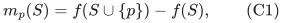

which is zero for p in S. For the configuration variables mu_pn of
the original relaxation, its subset cut is

<!-- math-display: 9ed91628970daccefa620a52
\boxed{
 \sum_p\sum_n\mu_{pn}\bigl(n_j-m_p(S)\bigr)_+\le f(S)
                  \quad(S\subseteq P).
 }
 \tag{C2}
-->
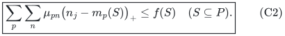

There is one such family for each resource j, using that resource's
rank f_j and the corresponding configuration coordinate n_j.

## 2. A direct proof of validity

Let n be any feasible integral recipient vector. Put
A={p:n_p>m_p(S)}. Polymatroid feasibility, monotonicity and diminishing
returns give

<!-- math-display: 8fe9f99993c43b273ad779f3
n(A)\le f(A)\le f(S\cup A)
                 \le f(S)+\sum_{p\in A}m_p(S).
-->
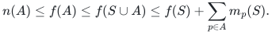

Subtract the last sum to obtain

<!-- math-display: 27c48738ffaa79229f202c4f
\sum_p(n_p-m_p(S))_+\le f(S).
 \tag{C3}
-->
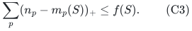

An integer allocation on a selected player basis satisfies (C2) by
putting mass one on its selected configurations and zero on other
players. Hence every subset cut is a valid inequality for the desired
configuration relaxation. This proof does not use the natural-matroid
representation or any approximation algorithm.

## 3. Convexity of violation as a function of reserved counts

For an arbitrary real feasible vector z in P(f), define

<!-- math-display: a479173dc7011aa2c9b9ac3b
a_p(z)=\min_{T\ni p}\{f(T)-z(T)\},\qquad
 F(z)=\sum_{p,n}\mu_{pn}(n_j-a_p(z))_+-z(P).
 \tag{C4}
-->
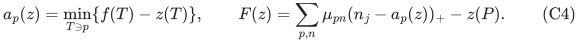

For integer z, F(z)<=0 is the preceding note's residual-capacity cut.
For the equivalence proof we may evaluate the same formula on the
whole real polymatroid. Every summand is convex, since

<!-- math-display: b57d7d828fe0773a727d42dd
(n_j-a_p(z))_+
 =\max\left\{0,\max_{T\ni p}\bigl(n_j-f(T)+z(T)\bigr)\right\}
 \tag{C5}
-->
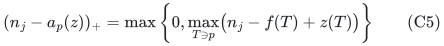

is a maximum of affine functions of z. All mu coefficients are
nonnegative, and subtracting z(P) is affine. Therefore F is convex.

For every z expressed as a convex combination of polymatroid vertices
v^ell, convexity gives F(z)<=sum_ell alpha_ell F(v^ell). Consequently,
if all vertex cuts hold, every residual cut holds. This step does not
assume any integrality or capacity expansion of the configuration point.

## 4. Every vertex cut is already a subset cut

Polymatroid vertices are obtained by the greedy construction on an
ordered subset A=(p_1,...,p_s): with A_i={p_1,...,p_i}, set

<!-- math-display: 6e2384371e0de892cc5de606
z_{p_i}=f(A_i)-f(A_{i-1}),\qquad z_p=0\ (p\notin A).
 \tag{C6}
-->
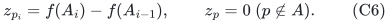

The resulting vector is integral, feasible and has sum f(A). These
greedy vectors contain every vertex: maximizing any linear objective
over a polymatroid sorts its positive weights and uses the displayed
successive rank differences, with nonpositive-weight coordinates zero.
Thus their convex hull has the same support function as P(f).

In the natural matroid, a vector (C6) is a basis of the union E_A of
all player-copy blocks in A. It therefore spans E_A. Its residual
individual capacities depend only on A, not on its greedy order:

<!-- math-display: a21fea253180fc8a1bdfe73a
a_p(z)=r(E_A\cup E_p)-r(E_A)
                    =f(A\cup\{p\})-f(A)=m_p(A).
 \tag{C7}
-->
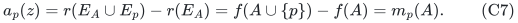

Its right side z(P) is f(A). The residual inequality for this vertex
is exactly the subset cut (C2) indexed by A.

It follows from Section 3 that all subset cuts imply every feasible-z
residual cut. Conversely, for any subset S, choose a greedy basis on
S. Its integral feasible-z cut is (C2), so the full residual family
implies every subset cut. The two families are exactly equivalent.

No claim that arbitrary integral polymatroids decompose into matroid
rank functions is used. A basis of a single natural-matroid block union
is enough.

## 5. The bounded-support equivalence is exact too

Fix an integer support budget s. A feasible z with support contained
in J, |J|<=s, lies in the restriction of P(f) to coordinates J. Its
vertices are greedy vectors on subsets A of J. The preceding convexity
argument therefore uses only subset cuts with |A|<=s.

Conversely, the greedy basis for a subset A of size at most s has
at most s nonzero coordinates. Its residual cut belongs to that
bounded-support family. Thus

<!-- math-display: 702aaf92a6e107452c7a2d8b
\boxed{\begin{array}{c}
 \text{all feasible reserved-count cuts with support at most }s\\
 \Longleftrightarrow\\
 \text{all subset cuts (C2) with }|S|\le s.
 \end{array}}
 \tag{C8}
-->
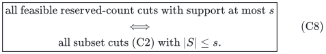

The algorithm requires only s=2(r-1) at completed normalized states.
There are consequently at most

<!-- math-display: 80b5d422cf9839dbc11269a3
\sum_{i=0}^{\min\{q,2r-2\}}\binom qi
 \tag{C9}
-->
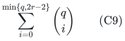

cuts per resource in this sufficient relaxation. The earlier
factor-four and positive-error rank-quasipolynomial guarantees apply
to exactly this subset-indexed LP. The fat reduction preserves all
its nonnegative cut coefficients by discarding and downscaling
configuration masses, as already proved.

For a fat-deficit budget k>=1, if all inner searches are restricted to
derived rank at most k, the same proof needs only subsets of size
2(k-1). This observation gives the corresponding stronger comparator
on the capped target domain; it does not remove the deficit cap.

## 6. What can now be separated and at what cost

For a fixed subset S, all its marginal coefficients need only the
q+1 oracle values f(S) and f(S union {p}). There is no submodular
minimization or numerical count enumeration to evaluate this cut.
Given an explicit finite list of configuration variables and their
rational masses, its left side is then a polynomial-size sum.

Enumerating all subsets gives exact separation of the full residual
cut family in 2^q times polynomial explicit-support work. Enumerating
only subsets of size at most s separates the bounded-support family
in

<!-- math-display: f0c33218dc47ab1bd53a461d
\left(\sum_{i=0}^{\min(q,s)}\binom qi\right)
       \mathrm{poly}(H,\text{explicit configuration support}).
 \tag{C10}
-->
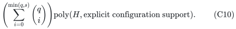

For s=2(r-1), this is q^{O(r)} and is independent of numerical
capacity magnitudes except for their binary arithmetic. This is an
explicit XP separation bound for the new cut family, not an
f(r) poly(H) bound and not the allocation algorithm's stronger
rank-quasipolynomial time.

The configuration variables may still be numerous, and optimizing
their pricing problem with arbitrary local feasible families is not
provided by the original common-value available-count oracle. Thus
(C10) should not be reported as a complete LP optimizer for the full
implicit problem. No polynomial-time separation of the subset family
or rank-only fixed-parameter separation algorithm is established here.

The allocation algorithm remains independent of LP solving and keeps
its original time. The compression theorem changes the mathematical
description and verification cost of the comparator, not that search
algorithm's operations.

## 7. Relation to the earlier gap and scaled resources

The support-one cut for the earlier rank-gap example is now simply
S={a}, with f(S)=D+1, marginal zero at a, and marginal one elsewhere.
It rejects the displayed aggregate configuration point exactly as in
the preceding note.

For a scaled matroid resource f=c r_R, all these cuts are already
implied by its ordinary component configuration column. The earlier
scaled fractional-loss lemma and hinge bound prove this, so the
subset formulation still coincides with that comparator in the scaled
case. For a general polymatroid obtained by merging different
components, the subset cuts can add information that the aggregate
column lost.

The public Bamas et al. discussion in Section 1.2 of
[arXiv:2307.08453v1](https://arxiv.org/html/2307.08453v1) uses
submodular marginal certificates and explicitly notes configuration-LP
obstacles. The present note supplies an exact equivalence between the
specified residual cut family and the subset-marginal formulation,
together with the configuration and algorithmic consequences proved
above. It makes no exhaustive novelty claim for all forms of
submodular covering inequalities.
