# A weak optimizer for bounded-support residual configuration relaxations

For coordinate-box players, the residual configuration relaxation with
reserve support at most s can be approximately optimized in

<!-- math-display: 57fa14c62a648187147e8234
(q+1)^{O(s+1)}\mathrm{poly}(H,\epsilon^{-1}).
 \tag{X1}
-->
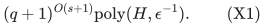

Here q is the number of potential players, all recipient capacities
remain binary encoded, and the output is a fractional configuration
point. Taking s=2(r-1), the support bound needed by the rank-r allocation
proof, gives q^{O(r)} polynomial-bit computation of its LP benchmark.
This is an XP bound in r; it is not a fixed-parameter or rank-
quasipolynomial optimizer. It is also not an integer approximation
scheme. The separate allocation theorem retains its approximation
factor and its better nonlinear dependence on the selected rank.

The stronger statement proved below is polynomial time in the number
of explicitly retained residual cuts. The exponentially many aggregate
polymatroid and player-base constraints are handled by greedy support
optimization. Their dual prices introduce signed linear terms into
local convex pricing, but do not destroy its approximation scheme.

The proof builds on the subset equivalence in
[recipient-polymatroid-subset-cut-compression.md](recipient-polymatroid-subset-cut-compression.md) and the strict-price
and interior-ball arguments in
[residual-configuration-box-pricing-and-weak-solver.md](residual-configuration-box-pricing-and-weak-solver.md). It supplies
the additional aggregate-variable interface and finite primal extraction
needed to avoid enumerating all aggregate subset rows.

## 1. Model and the precise relaxation

Let P be q players and M a player matroid of positive rank r. Each
resource type j has an integral normalized monotone submodular rank
f_j and a common nonnegative rational unit value v_j. Player p has
the coordinate-box local family

<!-- math-display: 8e40af37ef5fc56a15b684e2
0\le n_j\le F_{pj}\le f_j(\{p\}),
             \qquad n_j\in\mathbb Z.
 \tag{X2}
-->
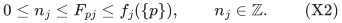

All quotas and ranks are binary encoded. Rank zero is handled separately
by the empty allocation. Assume rational 0<epsilon<=1/2; a requested
accuracy in (1/2,1) may be replaced by 1/2.

For every resource j, fix an explicitly listed family A_j of subsets
of P. Put m=sum_j |A_j|. The target-T LP has a nonnegative weight
mu_pn for every local configuration n with v dot n>=T. Its aggregates
are

<!-- math-display: cc3063960e8d359c2ec2ad88
x_p=\sum_n\mu_{pn},\qquad
          y_{pj}=\sum_n\mu_{pn}n_j.
 \tag{X3}
-->
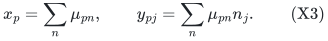

Require x in the base polytope B(M) and each y_.j in P(f_j). For each
retained pair (j,S), impose the residual subset cut

<!-- math-display: 5adb99c68b5a862e2810461e
\sum_{p,n}\mu_{pn}\bigl(n_j-m_{pj}(S)\bigr)_+\le f_j(S),
 \qquad m_{pj}(S)=f_j(S\cup\{p\})-f_j(S).
 \tag{X4}
-->
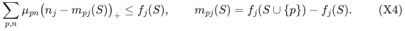

All aggregate resource inequalities remain part of the model, whether
or not they are implied by the retained cut family. Taking every
|S|<=s is exactly the support-s reserve-count relaxation by the
previous subset-equivalence theorem. The case with all subsets is
the full residual configuration relaxation.

The main algorithm returns a feasible point at target at least
(1-epsilon) times this precisely specified relaxation's optimum.
Its runtime is polynomial in H, m and epsilon^(-1).

## 2. Aggregate polytopes have an efficient integral support oracle

Put d=q+qt, where t is the number of resource types, and define

<!-- math-display: d2160297f5f6e9e1a27fd23f
K=B(M)\times\prod_j P(f_j)
                    \subseteq\mathbb R^d.
 \tag{X5}
-->
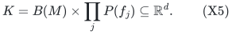

This is a nonempty bounded integral polytope. For arbitrary signed
rational weights alpha in R^d, an integral vertex maximizing alpha
dot v over K is computed separately in each factor.

For B(M), run maximum-weight matroid-basis greedy, retaining negative
weights when needed to complete the basis. For P(f_j), order the
strictly positive coordinate weights and use polymatroid greedy on
their prefixes; all remaining coordinates receive zero. Each factor
uses polynomially many paid rank-value queries. A deterministic tie
rule returns a specific integral maximizing vertex. The product of
these vertices is a maximizing vertex of K.

Thus a linear support inequality over K can be separated and supplied
with its actual maximizing integral vertex. No subset description of
K is enumerated. Its player component always sums to r, a fact used
in the interior-ball argument below.

## 3. Configuration vectors and the compact dual

For a configuration c=(p,n), let e(c) in R^d place 1 in player
coordinate p, place n_j in aggregate count coordinate (p,j), and
place zero in all other coordinates. Let h(c) in R^m consist of the
nonnegative hinge coefficients from (X4). Write b in R^m for the
right sides f_j(S) of these cuts.

The target relaxation is equivalently

<!-- math-display: be304326a44fe127b458efce
\sum_c\mu_c e(c)\in K,\qquad
              \sum_c\mu_c h(c)\le b,\qquad\mu\ge0.
 \tag{X6}
-->
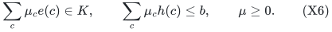

For any finite set C of configuration columns and finite set V of
vertices of K, define the explicit finite primal

<!-- math-display: cb4d9a63665610b142bff71c
\begin{split}
       \sum_{c\in C}\mu_c e(c)&=\sum_{v\in V}\lambda_v v,\\
       \sum_{c\in C}\mu_c h(c)&\le b,\\
       \sum_{v\in V}\lambda_v&=1,\qquad\mu,\lambda\ge0.
 \end{split}
 \tag{X7}
-->
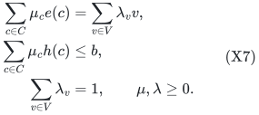

This primal is infeasible exactly when there are a signed vector
alpha in R^d and a nonnegative vector zeta in R^m satisfying

<!-- math-display: 0cb72c0f715884b1f533ddd6
\begin{split}
       \alpha\cdot e(c)+\zeta\cdot h(c)&\ge0\quad(c\in C),\\
       \alpha\cdot v+\zeta\cdot b&\le-1\quad(v\in V).
 \end{split}
 \tag{X8}
-->
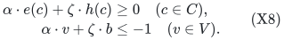

To check this version of Farkas' lemma, include a free multiplier omega
for sum_v lambda_v=1. The configuration columns require
alpha dot e+zeta dot h>=0. The vertex columns require
omega>=alpha dot v. Infeasibility requires zeta dot b+omega<0;
scale it to at most -1 and eliminate omega. This gives (X8).
If V is empty, (X7) is already infeasible and (X8) has no vertex
conditions, as it should.

For the full set of K vertices and all target-T configurations,
(X8) is the exact target-T Farkas system. Its soundness can also be
seen directly: a feasible configuration point would give

<!-- math-display: c601c6dc27e8f0ecfe476372
0\le\sum_c\mu_c(\alpha\cdot e(c)+\zeta\cdot h(c))
   \le\alpha\cdot\sum_c\mu_c e(c)+\zeta\cdot b\le-1.
-->
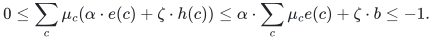

## 4. Signed linear prices still yield convex local pricing

Write alpha_p for its player-coordinate entry and nu_pj for its
count-coordinate entry. A configuration-column violation has the form

<!-- math-display: a92b6ad6e8fd945890e9309b
G_p(n)<w_p,\qquad w_p=-\alpha_p,
-->
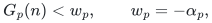

where

<!-- math-display: b4f01844a5b4b1141726db01
G_p(n)=\sum_j\left[
       \nu_{pj}n_j+
       \sum_{S\in A_j}\zeta_{jS}
               (n_j-m_{pj}(S))_+\right].
 \tag{X9}
-->
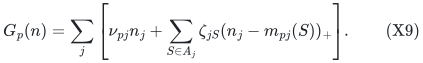

The linear coefficient nu_pj can have either sign. All hinge prices
zeta_jS remain nonnegative. Consequently the marginal unit costs
within a type are nondecreasing, even though an initial interval
may have negative costs.

The sorted integer breakpoints give polynomially many constant-cost
segments with binary capacities. For each type, select its entire
prefix of nonpositive marginal costs. This includes all free units;
all values are nonnegative, so inserting such a missing unit never
reduces the objective and never increases the cost. Let z0 denote
this prefix vector, G0 its total cost and V0 its total value.
The quantity G0 is the minimum possible G_p over the coordinate box.

For a prescribed exact rational budget C, if C-G0<0 no count vector
satisfies that budget. Otherwise subtract the exact cost G0 and
solve the remaining nonnegative-cost problem with budget C-G0.
All remaining segments have positive marginal cost. Their binary
chunks form a zero-one knapsack instance, exactly as in the earlier
pricing proof. Dropping segment-prefix restrictions is harmless:
any selected units can be compressed to cheaper prefixes of their
types without altering counts or values.

Profit scaling returns an exact-budget remaining solution whose
value is at least (1-epsilon) of the best remaining value. Together
with the forced prefix, its total value is at least

<!-- math-display: e7c5e9797f345f2addd1de8a
V_0+(1-\epsilon)\mathrm{OPT}_{rem}
               \ge(1-\epsilon)(V_0+\mathrm{OPT}_{rem}).
 \tag{X10}
-->
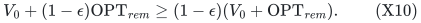

Every original feasible solution may be augmented to include the
nonpositive prefixes, so V0+OPT_rem is the original optimum under
budget C. The resulting count vector therefore respects the original
cost budget exactly and achieves the same multiplicative value
guarantee. No capacity is expanded into units. Negative prices only
change the initial prefix and the exact budget shift.

## 5. Strict weak pricing for every signed threshold

Choose a common integer denominator Dcost for the rational coefficients
in (X9). Every integer configuration cost lies on the grid
Dcost^(-1) Z. For any rational threshold w_p, including a nonpositive
one, define

<!-- math-display: b1050141d0b2aaeb1e91abd3
C_p={\lceil Dcost\,w_p\rceil-1\over Dcost}.
 \tag{X11}
-->
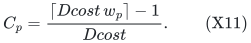

This is the largest cost-grid point strictly below w_p. It can be
negative; Section 4 handles that case by comparing it with G0.
If no cost-feasible vector exists, certify the absence of any
violating target-T configuration. Otherwise run the exact-budget
value scheme. A returned value at least (1-epsilon)T gives a genuine
column violation at the weaker target T'=(1-epsilon)T. If the value
is smaller, no target-T configuration violates the column condition:
such a configuration would fit budget C_p and force the returned
value to reach T'.

The old shortcut for nonpositive w_p is not used here, because signed
linear costs may be negative. The exact cost grid and prefix shift
together handle every sign correctly. All denominators, costs and
comparisons have polynomial bit length in the pricing input.

## 6. A bounded witness for every finite mixed primal

Split alpha=alpha^+-alpha^- with both parts nonnegative. The dual
variable

<!-- math-display: b0aecc05f7e72d71db722596
\beta=(\alpha^+,\alpha^-,\zeta)
                     \in\mathbb R_{\ge0}^{D},
                  \qquad D=2d+m
 \tag{X12}
-->
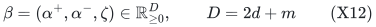

has only nonnegative coordinates. The two normal vectors in (X8) are

<!-- math-display: a7de27b385b0f7a092f1bfc4
a_c=(e(c),-e(c),h(c)),
             \qquad b_v=(v,-v,b).
 \tag{X13}
-->
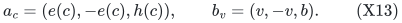

Thus its conditions are beta dot a_c>=0 and beta dot b_v<=-1.
Take an integer coefficient bound

<!-- math-display: d49143caba43a47f54dc4be3
B\ge\max\{1,r,\max_j f_j(P)\}.
-->
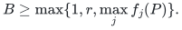

Every entry of a_c and b_v is an integer of absolute value at most
B. This includes every possible configuration and every integral
vertex of K, not merely those already encountered.

Whenever (X7) is infeasible, its nonempty dual region (X8), in the
split variables, is contained in the nonnegative orthant and hence
is pointed. It has a vertex specified by D independent active
equations with integer coefficients bounded by B and right sides
zero or -1. Cramer's rule gives a witness beta0 satisfying

<!-- math-display: 253c26604cd9ace7b9d85fbd
0\le\beta_{0i}\le
                    U_0=(DB+1)^{D+1}.
 \tag{X14}
-->
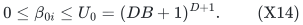

The bound is uniform over every finite pair (C,V), every target,
and every choice of configurations within the boxes. Its logarithm
is polynomial in D and log B. Redundancy from splitting a free
coordinate into two nonnegative parts causes no problem: the region
has no line, and therefore has a vertex whenever nonempty.

## 7. A positive direction survives the mixed signs

Let theta have all D coordinates equal to one, except that each
alpha^+ coordinate belonging to a **player** coordinate is two.
All alpha^- coordinates remain one; both signed copies of a count
coordinate remain one. The latter pairs cancel exactly.

For a configuration column and an aggregate vertex,

<!-- math-display: b90a4b0869cfb77717d1cdb0
\begin{split}
     \theta\cdot a_c&=1+\sum_{i=1}^{m}h_i(c)\ge1,\\
     \theta\cdot b_v&=r+\sum_{i=1}^{m}b_i
                            \le(D+1)B.
 \end{split}
 \tag{X15}
-->
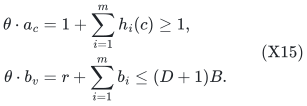

The second identity uses that every player component of v is a
basis indicator and sums to r. This is the required replacement
for the positive direction in the fully enumerated-row solver.
Arbitrary mixed signs in a general linking LP would not justify
this conclusion; here the displayed structure does.

Set

<!-- math-display: fa58847e119e076ad0c60ae2
\gamma={1\over4(D+1)B},\qquad
 \delta={\gamma\over2DB},\qquad
 \beta_*=2\beta_0+\gamma\theta.
 \tag{X16}
-->
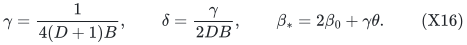

For every finite infeasible primal (X7), beta_* has slack at least
gamma in every column inequality and coordinate lower bound, slack
at least 3/4 in every vertex inequality, and slack at least U0
from each coordinate upper bound 4U0. Since all column and vertex
norms are at most DB, the entire radius-delta Euclidean ball about
beta_* belongs to

<!-- math-display: fe86882c2b33cade6e5c219a
Q_{C,V}=\{0\le\beta\le4U_0:
              \beta\cdot a_c\ge0\ (c\in C),\quad
              \beta\cdot b_v\le-1\ (v\in V)\}.
 \tag{X17}
-->
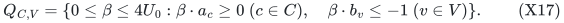

This ball is uniform over both finite families. In particular it
remains valid when only some vertices of K have been generated.
That uniformity is essential for the finite primal extraction.

## 8. The two separation operations and the stopping rule

Run a standard rational ellipsoid procedure in D dimensions, with
initial radius R=4DU0 containing the box [0,4U0]^D. Search the dual
Farkas system for the weaker target T'=(1-epsilon)T. At each query:

1. Separate any violated nonnegativity or upper-box constraint.
2. Compute a maximizing vertex v of K for the signed vector alpha.
   If alpha dot v+zeta dot b>-1, return this exact vertex inequality
   and retain v.
3. Otherwise every vertex inequality is satisfied. Apply Section 5
   to every player. If a weak-target violating configuration is
   found, return its exact column inequality and retain the column.
4. If every player certifies absence of a hard-target violation,
   return the current dual as a valid target-T infeasibility
   certificate.

The vertex step is exact and uses the greedy support oracle of
Section 2. The pricing step either returns a genuine weaker-target
column violation or certifies all hard-target columns for that
player. Thus the early infeasibility outcome is sound even if the
dual has not been certified feasible for the weaker-target system.
Every continuation cut is a valid defining inequality of that
weaker-target system.

## 9. Finite primal extraction records both kinds of objects

Let C and V be the weak-target configurations and K vertices retained
so far. The maintained ellipsoid contains Q_(C,V): its initial ball
contains the box, and every update cuts by an inequality present in
this finite system. Standard polynomial-precision rational ellipsoid
updates preserve containment and the usual volume decrease.

If no hard-target certificate is returned, stop once the ellipsoid
volume is smaller than that of a D-dimensional radius-delta ball.
This takes polynomially many cuts in D and log(R/delta). If the
finite primal (X7) on the retained C,V were infeasible, Section 7
would place a radius-delta ball inside Q_(C,V) and hence inside the
maintained ellipsoid, a contradiction.

The finite primal is therefore feasible. Solve (X7) as an ordinary
explicit rational LP to obtain mu and lambda. All its columns and
rows have polynomial encoding length, and there are polynomially
many generated configurations and vertices. Its aggregate vector is
a convex combination of genuine vertices of K, so it satisfies all
player-base and aggregate-resource constraints, including those never
separated. Its residual rows are all m original retained cuts.
Every configuration in C has value at least T'.

The weak feasibility outcome is consequently

<!-- math-display: 9cdc5922364e71a10b39b703
\boxed{\begin{array}{l}
   \text{a sound certificate that target }T\text{ is infeasible, or}\\
   \text{an explicit feasible configuration point at }(1-\epsilon)T.
 \end{array}}
 \tag{X18}
-->
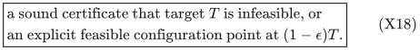

Keeping only generated configurations would not suffice for this
extraction argument unless a separate implicit-polytope LP routine
were supplied. Keeping the generated aggregate vertices makes the
last primal fully explicit. No arbitrary lower-dimensional oracle-LP
certificate theorem is needed; the required interior ball has been
proved for every finite mixed subsystem.

## 10. Runtime and target optimization

The dual dimension D=2q(t+1)+m is polynomial in H and m. The logarithms
of U0, R and delta^(-1) are polynomial in D and log B. Rational
ellipsoid queries have polynomial encoding length. Greedy support
optimization is polynomial in q, t and the paid rank-value queries.
Local pricing has at most m hinge terms and uses binary segment
splitting and a profit-scaling dynamic program polynomial in its
description and epsilon^(-1). The final explicit primal has a
polynomial number of columns, vertices and linking equations.

The complete weak-feasibility procedure is therefore polynomial in
H, m and epsilon^(-1), with polynomial output size in those parameters.
It has no dependence on numerical capacity magnitudes beyond their
binary encoding lengths.

For positive r, the optimum target is at most
Vtot=sum_j v_j f_j(P). All configuration values lie on the common
rational unit-value grid, and the optimal target lies on that grid
because only finitely many bounded integer configurations exist.
At target zero, an arbitrary M-basis with empty configurations is
a feasible point. At a grid target exceeding Vtot/(1-epsilon),
the weak target cannot be feasible, so (X18) returns a sound hard
infeasibility outcome.

Binary search between a successful lower trial and a failed upper
trial uses failures only when hard-target infeasibility is certified.
Every failed trial is strictly larger than the true LP optimum.
At adjacent grid endpoints, the lower trial is therefore at least
the optimum. Its saved weak point has target at least
(1-epsilon)OPT_LP. Success need not mean that the hard trial itself
is feasible, and the success choices need not be monotone.
The number of target trials is polynomial in the input bit length.

## 11. Bounded support, full support, and precise scope

For all |S|<=s, the number of residual cuts is

<!-- math-display: a852e5d2f37cdab64681408b
m=t\sum_{i=0}^{\min\{s,q\}}{q\choose i}.
 \tag{X19}
-->
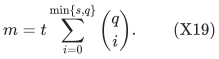

Substitution into the polynomial-in-m algorithm proves (X1). It is
also bounded by 2^{O(q)}poly(H,epsilon^(-1)). The full family recovers
the fully strengthened LP in singly exponential q time, while
s=2(r-1) gives

<!-- math-display: a40ab2e500b63c8e45d1daa0
(q+1)^{O(r)}\mathrm{poly}(H,\epsilon^{-1})
 \tag{X20}
-->
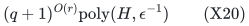

for the weaker support-restricted LP that already suffices for the
rank-r factor-four allocation theorem. The latter comparator is
well-defined and potentially larger than the full-LP optimum; it
must not be described as the full residual LP unless all its cuts
are actually included. A rank-deficit application using support
2(k-1), for k>=1 on its established cap domain, similarly gets an
XP benchmark computation in k.

The local family restriction to coordinate boxes is material.
Negative linear coefficients are handled, but arbitrary additional
local matroids, local knapsacks, or downward-closed value oracles
are not included by this proof. The running time is XP in the
support/rank parameter, not fixed-parameter or quasipolynomial in
that parameter. The computed point is fractional; this proof does
not improve the integer approximation factor.

## 12. Fractional-only extension and review boundary

### Fractional-only corollary: player-dependent linear values

The weak LP optimizer also applies to arbitrary nonnegative rational
values v_pj, with player p's target configurations defined by
sum_j v_pj n_j>=T. Each player's convex-cost pricing instance simply
uses v_pj as its type-j unit profit. All nonpositive-cost prefixes
remain safe because these profits are nonnegative. The aggregate
polytope, subset-cut coefficients, compact dual and interior-ball
proof are unchanged.

Use the common rational grid of all v_pj and the upper bound

<!-- math-display: 79ad26f30988e4a04f9af055
\mathrm{OPT}_{LP}\le
                    \sum_j f_j(P)\max_p v_{pj}.
 \tag{X21}
-->
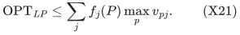

Indeed, total expected configuration value is at least rT, while
the aggregate resource constraints bound it by the displayed sum.
The same weak target search therefore proves the same runtime and
(1-epsilon) fractional-optimization guarantee.

This corollary concerns **fractional LP optimization only**. The
factor-four allocation theorem uses common intrinsic resource values
v_j in its rank potential and charging proof. It is not extended
to player-dependent values by this corollary.

### Classical primitives and review status

Matroid and polymatroid linear optimization by greedy, Farkas' lemma,
rational linear programming, knapsack profit scaling, and the
ellipsoid volume argument are classical primitives. The model-specific
parts here are the compact aggregate-product dual, signed convex
pricing with its strict-grid test, the positive direction (X15),
and extraction using both configurations and aggregate vertices.

The classical ellipsoid source is Groetschel, Lovasz and Schrijver,
[*The ellipsoid method and its consequences in combinatorial optimization*,
Combinatorica 1 (1981)](https://ir.cwi.nl/pub/10046/10046D.pdf).
The knapsack approximation source is Lawler,
[*Fast Approximation Algorithms for Knapsack Problems*, Mathematics
of Operations Research 4(4) (1979)](https://pubsonline.informs.org/doi/10.1287/moor.4.4.339).
Polymatroid operations used elsewhere in the allocation and scheduling
transfers are sourced and audited in those separate notes.

The main derivation (X1)--(X20) has passed both root and independent
mathematical review. The fractional-only value corollary changes
only the nonnegative local profits, the target grid and its upper
bound as displayed above. No implementation, formal verification,
external peer review, or exhaustive publication-priority claim is made.
