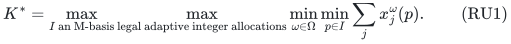
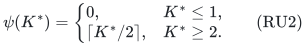
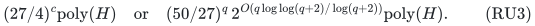
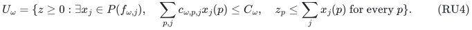
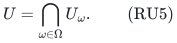
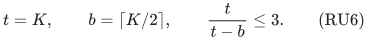
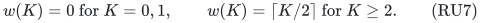
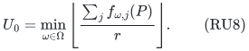

# Robust unit allocation: an additive guarantee and a promised factor two

**25 October 2026. Positive companion to the robust one-unit obstruction;
root and independent full reviews passed.**

A common selected player basis can be served in many explicit scenarios
by intersecting their fractional count-service regions and recovering
integer quotas separately in each scenario. The positive gap closes for
every full quota K>=2. The exact one-unit selection gate need not be
solved: declaring the nominal target one a weak success with a legal
zero allocation gives an unconditional additive guarantee and preserves
factor two whenever the optimal minimum count is at least two.

Alternatively, an externally supplied feasible one-unit basis and its
scenario allocations fill precisely the missing case and give an exact
factor-two theorem. No unrestricted finite multiplicative guarantee is
claimed without that promise or certificate.

## 1. Robust model and guarantees

Let M have rank r>=1 on q nonloop players P, and put c=q-r. A single
actual M-basis I is selected before the scenario is known. There is a
nonempty explicit finite scenario list Omega. In scenario omega, each
resource type j has an integral recipient-polymatroid rank f_(omega,j),
all retained allocatable units have the same common value u>0, and actual assignment
costs c_(omega,p,j) are nonnegative rationals. Its one assignment budget
C_omega>=0 must hold exactly.

If zero-valued pairs are present, first set their counts to zero and
restrict each scenario rank to its positive-value owners. Discarding
such counts is safe under nonnegative costs. All subsequent count
coordinates therefore count units worth u, not zero-valued service.

The integer allocations x^omega may depend on the scenario. Every
scenario has its own resource constraints and assignment budget; no
resource or assignment count is required to be shared across different
scenarios. The selected basis I is the common first-stage decision.
Unused resource units are permitted. The robust minimum **count** is

<!-- math-display: 886390b1ac2981c87871075f
K^*=\max_{I\text{ an M-basis}}
          \max_{\text{legal adaptive integer allocations}}
               \min_{\omega\in\Omega}\min_{p\in I}
                                \sum_jx_j^\omega(p).
 \tag{RU1}
-->

It is a nonnegative integer; the utility optimum is u*K*. H includes
the complete scenario list, binary numerical data, and the paid
polynomial rank, LP and intersection work.

**Theorem RU.** A deterministic polynomial-space algorithm returns one
genuine common basis and explicit integer allocations in every scenario,
respecting every scenario's budget and resource constraints, with
minimum count at least

<!-- math-display: f6c1916edbd9c4fd0fd96dcd
\psi(K^*)=
 \begin{cases}
 0,&K^*\le1,\\
 \lceil K^*/2\rceil,&K^*\ge2.
 \end{cases}
 \tag{RU2}
-->

In particular the unconditional count guarantee is floor(K*/2).
The running time is either

<!-- math-display: d2f4c1bb597becbdac4bf8c0
(27/4)^c\mathrm{poly}(H)
 \quad\text{or}\quad
 (50/27)^q\,
 2^{O(q\log\log(q+2)/\log(q+2))}\mathrm{poly}(H).
 \tag{RU3}
-->

Thus the result is an exact-factor-two utility approximation under
the promise K*>=2. If a feasible one-unit common basis together with
its legal scenario allocations is supplied, retaining that solution
and comparing it with the algorithm's output instead gives minimum
count at least ceil(K*/2) for every instance compatible with the
certificate, hence exact factor two including K*=1.

The supplied one-unit witness is actual integer data and can be
checked by the original rank/LP separation, matroid independence and
budget tests. It is not an assumed solver for finding such a basis.
An invalid certificate does not establish the strengthened guarantee.

## 2. Intersecting the scenario count-service regions

For each omega, define the fractional count-service region

<!-- math-display: 97240a851dcb50f1f3f9305a
U_\omega=\{z\ge0:\exists x_j\in P(f_{\omega,j}),\quad
        \sum_{p,j}c_{\omega,p,j}x_j(p)\le C_\omega,\quad
        z_p\le\sum_jx_j(p)\ \text{for every }p\}.
 \tag{RU4}
-->

Each region is compact, convex, downward and contains zero. It has
the exact nonnegative packing separator from
[one value exact two proof](../../problems/one-value-exact-two/proof.md): optimize its
support through the budgeted fractional resource LP and the normalized
outer support LP, returning a strict nonnegative row for an external
query and membership for a nonpositive support gap. Feasible queries
have polynomial-bit fractional witnesses.

Use their intersection

<!-- math-display: bb59bce34fe1b1fe2c79ef6c
U=\bigcap_{\omega\in\Omega}U_\omega.
 \tag{RU5}
-->

Test a query in every scenario. If one rejects it, that scenario's
nonnegative separating row is valid for U and strictly separates the
query. If all accept, retain or reconstruct a witness in every
scenario. The size of the explicit scenario list is included in H,
so these are still polynomial-time and polynomial-space oracle calls.
No common allocation across scenarios is inferred from membership.

The original scenario regions stay fixed during omissions. A smaller
candidate ground Q means the service vector b*1_Q with zero service
outside Q, using all original resource and cost constraints. Resources
are not contracted or redefined on a smaller player ground.

## 3. Every positive full quota K>=2 has the usual gap

At an integer target K>=2 put

<!-- math-display: a49c6ae4057692dc795b6caa
t=K,\qquad b=\lceil K/2\rceil,
                            \qquad \frac{t}{t-b}\le3.
 \tag{RU6}
-->

A robust integer full-K solution supplies one actual M-basis I*
with K*1_(I*) in every U_omega, hence in U. Use the original M
restriction selector and the weighted prefix-free gap on U. It
returns a genuine basis I with b*1_I in U, or soundly certifies
that no full-K basis exists even in this fractional intersection.

For completeness, at any Q preserving I*, a violated row from any
scenario is valid for K*1_(I*). The usual weighted omitted-mass
inequality therefore supplies a certificate in Q\I*. The supplier
of the separating row may change between scenarios after every
deletion; every such row still belongs to the one fixed intersection
and preserves the same I*. The full branch bound is uniform on
unpromised inputs and is at most (27/4)^c times polynomial work.

Only this K>=2 branch uses the positive-gap routine. There is no
invocation with t=b=1 and no imported multi-scenario exact one-unit
selector.

## 4. Recover every scenario on the same chosen basis

After a successful gap, fix its returned actual basis I once. For
each scenario separately, reconstruct fractional b-service on I,
discard counts outside I, and trim every selected player's total
to exactly the integer b. These operations preserve the scenario's
resource constraints and cannot increase its nonnegative cost.

On that scenario's product ground I times its resource types,
intersect the direct sum of its recipient polymatroids with the
partition-cap polymatroid of count cap b at each p in I. The trimmed
fractional vector has total br, which is the maximum possible total.
This full-total face is integral. Choose a minimum-cost integral
point on it. Its cost does not exceed the fractional witness, so
it satisfies C_omega exactly, and every selected player receives
exactly b units.

Repeat this recovery for all scenarios without changing I. The
integer count vectors may differ, as permitted by the model. There
is no additive unit loss, and the robust minimum is at least b.
All product grounds, binary quotas, resource ranks and cost objectives
have polynomial encoding in H; no individual resource unit is expanded.

Multiple scenario budgets are safe here because they constrain
different adaptive allocations. The proof does not preserve several
independent assignment-cost rows on one common integer allocation.

## 5. The nominal target one is a weak zero success

At target K=1, return any actual M-basis with the zero allocation
in every scenario and declare a weak success of value zero. This
is a valid original solution because assignment costs are nonnegative,
zero counts have zero cost, and every C_omega is nonnegative.

It is neither a full one-unit feasibility claim nor a failure.
Calling this branch infeasible would be incorrect on instances
with K*=1 and would break the upper-endpoint invariant of the
search. Its zero output is precisely the intended unconditional
loss at the difficult one-unit case.

Together with target zero, the guaranteed output quota as a
function of the nominal target is

<!-- math-display: 248fac5f321ece566598d658
w(K)=0\ \text{for }K=0,1,\qquad
 w(K)=\lceil K/2\rceil\ \text{for }K\ge2.
 \tag{RU7}
-->

This function is nondecreasing and at least floor(K/2). Actual
successful positive-gap calls may give better output than this
lower bound; the algorithm makes no weaker-feasibility decision
claim about their possible failures.

## 6. One-sided integer optimization and the boundary promise

A sound upper bound on K* is

<!-- math-display: ef524790d5a316589be8ec39
U_0=\min_{\omega\in\Omega}
                    \left\lfloor\frac{\sum_j f_{\omega,j}(P)}r
                    \right\rfloor.
 \tag{RU8}
-->

Initialize L=0 with any legal zero solution and external upper
target U=U_0+1. At integer midpoints K, use Section 5 when K=1
and the full scenario gap/recovery when K>=2. A weak success
saves its actual allocation and raises L to K. A failure lowers
U to K.

Every actual failure is from K>=2 and excludes the robust full
integer target, so U>K* remains invariant. The target-one branch
never falsely updates U. At adjacent endpoints U=L+1, integrality
therefore implies L>=K*. If K*>=2, this forces L>=2, so the saved
output came from an actual positive-gap recovery and has at least
ceil(L/2)>=ceil(K*/2) units in every scenario. If K* is zero or
one, the guaranteed zero output is valid. This proves RU2, with
no monotonicity assumption on algorithmic successes.

There are O(log(U_0+2)) calls, polynomial in binary resource-rank
encoding. If U_0=0, the initial zero output is already sufficient.
There is no positive initial-service assumption.

If a legal one-unit robust witness has been supplied, retain it
as a separate candidate throughout this search. For K*=1 it is
optimal; for K*>=2 the search gives at least ceil(K*/2). Thus the
best recorded actual output gives the stated exact-factor-two
certificate variant. The promise K*>=2 alternatively supplies
the factor-two conclusion without needing any one-unit witness
as input.

## 7. Forced omissions and the whole-ground bound

For every forced set Z with |Z|<=c, start the K>=2 routine on
Q=P\Z with the original required player rank r. All scenario
resources, costs and service regions remain unchanged. If a full
robust basis I* avoids Z, it remains feasible in their intersection
and is preserved by the restriction selector. The remaining
omission budget is c-|Z|, so its all-input time is
`(27/4)^(c-|Z|) poly(H)`.

The polynomial-space global inclusion cover therefore replaces
each such gap by whole-ground base 2-4/27=50/27. It has the same
sound full-target failure and recovered integer weak success,
so Section 6's search and its nominal-one convention remain valid.
The explicit subexponential overhead and polynomial-space bound
are proved in [global-conversion.md](../../problems/whole-ground-allocation/global-conversion.md).

Only polynomially many scenario witnesses and the current search
data are stored. The scenario count affects H, not the exponential
parameter. Either the direct corank routine or the global routine
may be used; dovetailing retains the smaller valid bound in RU3.

## 8. Scope and the exact low-quota obstruction

The companion
[robust-unit-allocation-corank-obstruction.md](../mechanism-boundaries/robust-unit-allocation-corank-obstruction.md) gives an explicit
Hitting Set reduction with zero costs, a uniform player matroid,
and one Boolean resource per scenario. Its optimum is one on
positive source instances and zero on negative ones. Under
FPT!=W[2], finding any positive integer robust utility with a
uniform finite multiplicative guarantee is therefore not possible
in corank-FPT time for that general explicit-scenario model.

RU2 avoids exactly that prohibited claim: its guarantee may be
zero when K*=1. The promise K*>=2 removes those optimum-one source
instances from the promised positive regime, while an externally
supplied feasible one-unit witness supplies the missing decision
information directly. Neither is an automatic consequence of
fractional feasibility in every scenario.

No unrestricted finite-factor conclusion is inferred from the
unconditional floor(K*/2) bound, and no whole-q time lower bound
is inferred from the parameterized obstruction. When the selected
basis is fixed in advance, each scenario's minimum-cost quota
test is polynomial and the robust optimum can in fact be
optimized exactly by integer search. The difficulty is choosing
one basis that works across all scenarios.

The negative theorem's primary Hitting Set attribution is given
in that companion manuscript. The positive proof here combines
the reviewed nonnegative count projection, weighted omission
gap, exact per-scenario quota recovery, and global cover. It is
an internal theorem composition, not an exhaustive publication-
priority claim or a statement of formal or external verification.
