# Binary multiplicities of recipient matroids retain the configuration comparator

This note identifies a useful class between one-service recipient matroids
and arbitrary integral recipient polymatroids. For each supplied resource
type j, its recipient polymatroid is an integer multiple

<!-- math-display: af640c97c592ca1d84a91d76
f_j(S)=c_j r_{R_j}(S)
 \tag{S1}
-->
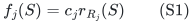

of an arbitrary matroid rank function. The multiplicity c_j is binary.
The compressed natural-matroid algorithm applies with polynomial work
and space per charged search state. A new fractional loss lemma restores
the **component-level configuration-LP comparator**, without storing
patterns of individual copies and without an extra recipient-rank factor.

The required allocation algorithm and its new sharp factor are proved in
[general-recipient-polymatroid-integer-optimum-transfer.md](general-recipient-polymatroid-integer-optimum-transfer.md) and
[recipient polymatroid proof](../../problems/recipient-polymatroid/proof.md). This note proves
the stronger comparator for (S1); it is not inferred from an arbitrary
polymatroid aggregate configuration relaxation.

## 1. Precise model

There are q explicit players, a player-selection matroid M of rank r,
and t supplied resource types. Type j has unit value v_j>=0, multiplicity
c_j in nonnegative binary integers, and an arbitrary recipient matroid
R_j on the players. Its legal aggregate recipient vector n_.j satisfies

<!-- math-display: 02ecc348d1b362c022364ee9
n_.j\in\mathbb Z_{\ge0}^P,\qquad
 n_.j(S)\le c_j r_{R_j}(S)\quad(S\subseteq P).
 \tag{S2}
-->
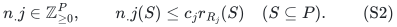

Equivalently, there are c_j identical copies of R_j. Each copy can serve
an independent set of players, with at most one service to a player on
that copy. A player may receive services on several copies. The output
is the binary count vector for each selected player; it does not print
one line per individual copy.

For completeness, the equivalence follows from matroid union applied to
parallel occurrences of each player. If a count vector satisfies (S2),
make n_p occurrences of p in a conceptual parallel extension of R_j.
Every occurrence subset A obeys

<!-- math-display: 53dbbd135590c0b5a218f914
|A|\le n(\mathrm{supp}A)
       \le c_j r_{R_j}(\mathrm{supp}A).
-->
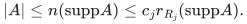

The c_j-fold matroid-union criterion partitions the occurrences into
c_j independent sets. Conversely any such partition implies (S2).
This is an existence proof of a compressed count allocation, not an
implementation that expands c_j or the occurrence set.

Player p may have any supplied type-symmetric downward-closed local
family F_p of integer vectors in the box

<!-- math-display: 65498bdf81735b1db1393ee5
0\le n_{pj}\le c_j r_{R_j}(\{p\}).
-->
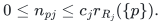

A deterministic available-count oracle returns a feasible vector under
arbitrary additional integer coordinate caps A, with value at least
lambda times the available optimum. The certified lambda is a positive
rational (or a supplied rational lower bound), and eta below is a positive
rational accuracy parameter; their encodings are paid. Put tau=1/lambda. Its cost and
workspace are paid. The unrestricted exact oracle is immediate; local
polymatroids or bounded knapsacks can use the previously audited exact
or approximate count-oracle implementations. Zero-supply types and
zero-valued services may be removed.

## 2. The small-resource perspective relaxation

For a positive target T, use

<!-- math-display: 15b1b964110f8b3d732bf128
\begin{split}
 &x\in P_{\mathcal B(M)},\qquad y_p\in x_p\mathrm{conv}(F_p),\\
 &y_{\cdot j}/c_j\in P_{\mathcal I(R_j)}\quad(c_j>0),\\
 &\sum_jv_jy_{pj}\ge Tx_p.
 \end{split}
 \tag{S3}
-->
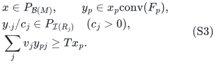

At x_p=0, y_p=0. The algorithm is not given a feasible point. Each
resource type retains its own column. Types with different recipient
matroids are not merged merely because their unit values agree.

At a current search prefix, let W_j be the reserved natural-matroid
service set, z^j its player counts, and

<!-- math-display: 1558270f3bf8b72c0efde4fe
R_j(z)=\min_{S\subseteq P}
            \{c_jr_{R_j}(S)+z(P\setminus S)\}.
 \tag{S4}
-->
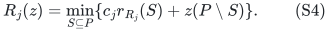

Its rank and residual capacities are computed by deterministic
submodular minimization. Write

<!-- math-display: edb381bf27a3f1299017dfa3
a_{pj}=r(W_j\cup E_{pj})-r(W_j),\qquad
                 0\le a_{pj}\le c_j,
 \tag{S5}
-->
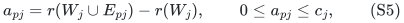

where E_pj is the conceptual player block of c_j copies when p is a
nonloop, and empty for a loop. These are precisely the available-count
queries of the direct polymatroid algorithm. All counts and all rank
queries have polynomial bit length.

## 3. Fractional loss lemma for a scaled matroid

Fix one type, omit j, and put L=r(W). For every independent set I of R,
the union E_I of its player blocks is independent in the natural matroid
and has size c|I|. This follows directly from f=c r_R, since I is
independent and every subset of its service copies obeys that scaled
rank function.

The rank function after contracting W gives

<!-- math-display: 8488bf6cd7aba951da049bf6
\begin{split}
 \sum_{p\in I}a_p
 &\ge r(W\cup E_I)-r(W)\\
 &\ge c|I|-L.
 \end{split}
 \tag{S6}
-->
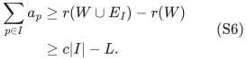

The first inequality is subadditivity of contracted rank on the union
of the player blocks. It does not require W itself to be independent;
contraction by its span has the displayed rank function. Rearranging,

<!-- math-display: a7c02e1774bfaa0245fd0edc
\sum_{p\in I}(c-a_p)\le L.
 \tag{S7}
-->
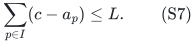

Since y/c is a convex combination of independent-set indicators and
0<=a_p<=c, (S7) implies

<!-- math-display: 73f28bfd3be7a306046ef989
\boxed{\sum_p(1-a_p/c)y_p\le r(W).}
 \tag{S8}
-->
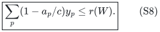

This proof is purely matroidal. There is no recipient-rank bound,
representability assumption, subset enumeration, or copy-pattern table.

## 4. Restricting a player's configurations to its residual counts

Fix a player with x_p>0 and express y_p/x_p as a convex combination of
vectors n in F_p. For each type j, imagine c_j private slots, choose a
uniform n_j-element subset, and retain only its intersection with a fixed
a_pj-element subset of those slots. This conceptual randomization is
only a proof of a convex combination; the algorithm remains deterministic.

The retained count is at most n_j and a_pj, and its expectation is
(a_pj/c_j)n_j. Thus the retained vector belongs to F_p by downward
closure and satisfies the exact availability box used by the algorithm.
For loops the original count is zero, so the same conclusion holds.
Mixing the vectors gives fractional retained value

<!-- math-display: 3563643acbf85a1c8d23d154
H_p=\sum_jv_j(a_{pj}/c_j)y_{pj}.
 \tag{S9}
-->
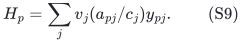

If a fresh, unchanged-state availability scan returns value below B,
the true available optimum is below tau B. Consequently

<!-- math-display: dfb66d8b602813d4c8a6243f
H_p<\tau Bx_p
 \tag{S10}
-->
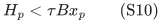

for each positive eligible player coordinate. No common physical copy
permutation across players is being asserted or needed here. This is a
local convex-combination argument followed by the resource inequality
(S8), which supplies the global fractional loss budget.

## 5. The same strict LP cover is recovered

Let J be the independent player set defining eligibility, let
E=P\cl_M(J), and put w=r-r_M(J). The player-basis polytope gives
x(E)>=w. Combining the target value condition in (S3) with (S10),
then summing (S8) over resource types, gives, when T>=tau B,

<!-- math-display: 51422d80f538615e27bca5f8
\begin{split}
 (T-\tau B)x(E)
 &<\sum_{p\in E,j}v_j(1-a_{pj}/c_j)y_{pj}\\
 &\le\sum_jv_jr(W_j)=\Phi.
 \end{split}
 \tag{S11}
-->
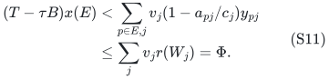

There is positive eligible fractional mass whenever w>0, so strictness
is retained. Therefore Phi>(T-tau B)w, exactly the lower-cover interface
required by the normalized prefix algorithm. Its upper cover remains

<!-- math-display: dacdabb8c86b60eaae5adc92
\Phi\le\max\{u,2B+\min(u,B)\}|Y|.
 \tag{S12}
-->
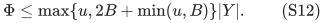

The whole-block reservations, strong free exchanges, eager normalization,
current telescoping rank charge and micro-signature are those of the
full polymatroid proof. We have strengthened its integer-optimum lower
cover to the relaxation (S3) for this special resource class.

## 6. Fat units and the component configuration comparator

The full configuration relaxation assigns each player mass x_p on its
locally feasible **type-count vectors of value at least T**, with x a
player-base vector and per-type marginals y_.j in c_j P_I(R_j).

At fat threshold B0, choose one fat type/unit from every fat-containing
configuration. Let f_.j be the selected one-service marginal of type j.
Then f_.j<=y_.j, and sum_j f_.j<=x<=1. In particular,

<!-- math-display: fe378896bd3c9cf2776644e9
f_.j\in c_jP_I(R_j)\cap[0,1]^P.
-->
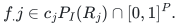

This is the independent-set polytope of the union of c_j copies of R_j.
Indeed its matroid-union rank is

<!-- math-display: 9217fdfd03b0ed6f06939a15
r_{N_j}(S)=\min_{A\subseteq S}
               \{c_jr_{R_j}(A)+|S\setminus A|\};
-->
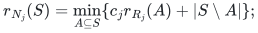

the two displayed bounds on f imply every such rank inequality, and
the reverse inclusion follows from an actual independent-set partition.
For a Boolean one-service assignment, c_j may be clipped to q. Original
matroid union and decomposition therefore have polynomial oracle cost
even when c_j is very large in binary.

Restrict each fat matroid to players whose local singleton is feasible.
Union them to obtain N, and take U=M* vee N. The accepted complement
argument applies to the fractional fat marginal: 1-x+f is union
independent, can be dominated by a U-base vector, and its complementary
U*-base vector x' is at most the mass h=x-f of all-small configurations.
Scale those configurations and marginals playerwise by x'_p/h_p.
The local perspective and every separate resource column are preserved
by down-closure. This supplies the derived small-instance relaxation
(S3) at target T without solving a configuration LP.

Reverse union decomposition combines the resulting small allocations
with one fat service per remaining fat player, and discards allocations
outside the final original player basis. Its count vectors satisfy (S2).

## 7. Result, time and numerical representation

For r>=1 set

<!-- math-display: 80560fc3aa2b42329527715e
d=\lambda^{-1}+3-3/r.
 \tag{S13}
-->
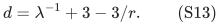

The deterministic algorithm gives factor d against the component
configuration optimum in 2^{O(r)} poly(H) time. For every eta>0 it gives
factor d+eta in

<!-- math-display: 04e94c38894a6ad156bc00b4
\mathrm{poly}(H)
 \min\{2^{O(r)},(r+1)^{O((1+\eta^{-1})\log(r+1))}\}.
 \tag{S14}
-->
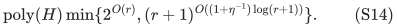

Here H includes the explicit input, binary supplies and numerical data,
original and derived oracle work, and local-oracle accuracy costs. The
wrapper has polynomial space, plus oracle workspace. There is **no**
dependence on total expanded supply, no extra 2^{O(r)} pattern factor,
and no recipient-rank term in the quasipolynomial exponent.

The construction stores O(r) current record count vectors. Formula (S4)
and its coordinate-replacement variants are paid submodular-minimization
queries on q elements. Batched pruning and all record operations have
polynomial bit cost. The target search uses the common rational unit-value
grid and total-value bound sum_j c_j r_Rj(P)v_j. Rank zero and target zero
retain their trivial accepted handling; rank one with exact availability
has factor one.

## 8. Why different component types must remain visible

The rank-gap example in
[configuration-gaps.md](../../problems/allocation-lower-bounds/configuration-gaps.md) uses

<!-- math-display: f998dbd00b2d2870aa8d978b
f(S)=|S|+D\min\{1,|S|\},
-->
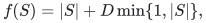

which is a sum of two scaled matroid ranks. Merging its components into
one resource loses their separate configuration marginals and allows
a gap tending to the player-selection rank. The theorem here keeps
the two supplied components as distinct types, even when they have
equal unit value. Its comparator then forbids the gap point.

The full arbitrary-polymatroid algorithm still has its integer-optimum
guarantee after such merging. What fails to survive merging is the
stronger component-level fractional comparison, not the validity of the
integer allocation model or the compressed algorithm.
