# Binary supplies with type-symmetric local feasible families

**25 October 2026. General compressed-oracle extension; internal root
and independent audits completed.**

This note combines the binary intersection-cell representation with
the exact or approximate player-local feasible-bundle interface. Its
new scope includes a different integral polymatroid on resource types
for each player, and binary bounded-knapsack constraints, without
expanding identical unit supplies. The constraints are on each
player's own count vector. They are not arbitrary resource-side
polymatroids on the receiving players.

The imported proofs are
[binary-resource-capacities-compressed-current-blocker.md](binary-resource-capacities-compressed-current-blocker.md),
[player-local-downward-closed-allocation-extension.md](player-local-downward-closed-allocation-extension.md), and
[approximate-available-bundle-oracle-allocation.md](approximate-available-bundle-oracle-allocation.md). This note supplies
the missing symmetry lift, the finite interface and exact local
polymatroid optimization.

## 1. Count-vector model and available oracle

There are <code class="math">t</code> resource types, binary supplies
<code class="math">c_j\in\mathbb Z_{\ge0}</code>, and positive common intrinsic unit
values <code class="math">v_j</code>. Player selection uses a matroid <code class="math">M</code> of rank
<code class="math">r</code> on the explicit player set. Rank zero is the empty allocation.
Zero-supply types are discarded first. In particular a fat-singleton
test is made only when its availability vector <code class="math">e_j</code> satisfies
<code class="math">e_j\le c</code>.

For every player <code class="math">p</code>, let

<!-- math-display: 64cddf815453b4291842e35f
\mathcal F_p\subseteq\prod_{j=1}^t\{0,\ldots,c_j\}
 \tag{S1}
-->
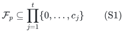

be a nonempty downward-closed family of integral count vectors.
Membership depends only on counts of each type, not on the identities
of unit copies within that type. An allocation gives a vector
<code class="math">n_p\in\mathcal F_p</code> to each selected player, with
<code class="math">\sum_p n_{pj}\le c_j</code>, and value <code class="math">v\cdot n_p</code>.
Input, output and intermediate vectors use binary counts.
Zero-supply types can be deleted before all oracle calls and restored
as zero coordinates in the output. In particular a fat-singleton test
is never made at an availability vector exceeding a zero supply.

For every availability vector <code class="math">0\le A\le c</code>, assume a
deterministic oracle returning <code class="math">n\in\mathcal F_p</code>, <code class="math">n\le A</code>,
such that

<!-- math-display: 475e7c8f483a7b307f38dcaa
v\cdot n\ge\lambda\,
         \max\{v\cdot z:z\in\mathcal F_p,\ z\le A\},
                 \qquad 0<\lambda\le1.
 \tag{S2}
-->
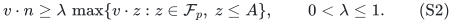

The exact version has <code class="math">\lambda=1</code>. Oracle runtime and
workspace are paid. There is no assumption that an arbitrary
implicitly described downward-closed family admits efficient
optimization. This is an explicit interface condition.

## 2. The aggregate perspective relaxation

Use

<!-- math-display: 8f1acbb52444cca291d6132b
\begin{split}
 &x\in P_{\mathcal B(M)},\qquad
          y_p\in x_p\mathrm{conv}(\mathcal F_p),\\
 &\sum_p y_{pj}\le c_j,\qquad v\cdot y_p\ge T x_p.
 \end{split}
 \tag{S3}
-->
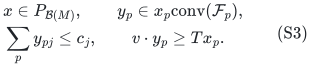

At <code class="math">x_p=0</code>, set <code class="math">y_p=0</code>. The individual quota formulation
in the binary-supply note is a special case. For general
<code class="math">\mathcal F_p</code>, separate coordinate upper bounds do not
replace the perspective condition in (S3).

### Lemma 1: a uniform copy lift respects the entire local family

For every feasible point of (S3), there is a conceptual physical-copy
lift with per-copy marginals <code class="math">y_{pj}/c_j</code>, and each player's
conditional distribution is supported on physical sets whose count
vectors belong to <code class="math">\mathcal F_p</code>.

**Proof.** For <code class="math">x_p&gt;0</code>, express <code class="math">y_p/x_p</code> as a convex
combination of integral vectors <code class="math">n\in\mathcal F_p</code>. Given
<code class="math">n</code>, choose uniformly an <code class="math">n_j</code>-element subset of the
<code class="math">c_j</code> conceptual copies of each type <code class="math">j</code>, independently
across types. This is only an existence construction. Every chosen
physical set has count vector <code class="math">n</code>, and each unit of type <code class="math">j</code>
has conditional marginal <code class="math">n_j/c_j</code>. Mixing and multiplying
by <code class="math">x_p</code> gives the claimed marginal. A type of zero supply
has zero marginal and needs no copies. Summing over players gives
per-copy usage at most one by the aggregate capacity constraint.
<code class="math">\square</code>

For an arbitrary fixed forbidden set of physical copies, let <code class="math">A_j</code>
be the number of available copies of type <code class="math">j</code>. Restrict each
physical set in the conceptual distribution to those available units.
Its new count vector is coordinatewise smaller, so remains in
<code class="math">\mathcal F_p</code>, and it is at most <code class="math">A</code>. Hence its value
is at most the true available optimum in (S2). The fractional value
outside that forbidden set is exactly

<!-- math-display: babe428a7547ab3fd6d05255
\sum_{j:c_j>0}v_j A_j y_{pj}/c_j.
 \tag{S4}
-->
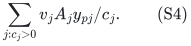

If a completed unchanged-state scan has oracle return below <code class="math">B</code>
for every eligible player, (S2) and Lemma 1 show that (S4) is strictly
less than <code class="math">(B/\lambda)x_p</code> whenever <code class="math">x_p&gt;0</code>. This is
the same strict outside-value bound as the explicit-item algorithm.
It holds for the actual retained forbidden set, not merely for an
average forbidden set.

## 3. No unit-copy allocation or relabeling is needed

Use the existing count cells

<!-- math-display: 15a6cc611f9b54c1ae4b418f
z_j[a,b]
-->
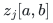

indexed by resource type, current matching-bundle label or zero, and
selected-bundle label or zero. There are <code class="math">O(t(r+1)^2)</code> cells.
Their sums are the supplies. Each label has an owner and a current
layer flag, but different selected labels may have the same player
owner.

The available count is still

<!-- math-display: 5f166affd7e17ca9bd9b3842
A_j=\sum_{a=0\text{ or }a\notin Y}z_j[a,0].
 \tag{S5}
-->
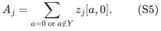

Undiscovered matching rows are included. Invoke (S2) on this vector.
If its returned count vector has value at least <code class="math">B</code>, select
those counts from the available cells in a fixed row order.
Type symmetry guarantees that this choice of unit identities is
feasible for the owner: only the returned counts matter.

Prune the candidate by removing, for each represented type <code class="math">j</code>,

<!-- math-display: fa1393ac4a174efa4e56be3f
\min\left\{n_j,
                  \left\lfloor\frac{v\cdot n-B}{v_j}\right\rfloor
               \right\}
-->
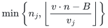

units in one batch. Downward closure preserves local feasibility.
After one type pass every remaining unit is individually essential
to the value threshold. There is no iteration proportional to a
supply or to a returned count.

Blocker discovery, row exchanges, column retirement and slot reuse
are exactly the audited cell operations. In particular a stored free
column is copied into the new matching row before its old column is
retired, or its provisional counts are first saved. Reuse clears
old owner and layer flags.

The cell operations admit an execution in one fixed conceptual unit
universe. A split chooses a subset of one old cell; a tag move does
not change unit identity. Thus old lower forbidden sets and their
maximality statements remain literally valid. No global permutation
of resource copies is used in the proof.

## 4. Quality, time and fat resources

Let <code class="math">u</code> be the largest positive-supply unit value, or zero when
there is no such type. Since all
minimality and physical star proofs take place in the conceptual
unit universe, their sharp coefficient remains

<!-- math-display: 8fe699225096255f77ec12e2
C(B,u)=\max\{u,2B+\min(u,B)\}.
-->
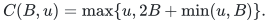

The sufficient compact-relaxation condition is therefore

<!-- math-display: a3e0fb0e0640e372b06cba72
B/\lambda+\frac{r-1}{r}C(B,u)\le T,
 \tag{S6}
-->
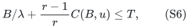

with the same positive-gap refinement. Binary multiplicities enter
only the cell count bit lengths and available-oracle complexity.
The charged-state factor is the same minimum of rank-exponential
and rank-quasipolynomial terms proved in the approximate-oracle note.
Ordinary work per state is polynomial in the explicit player/type
input, rank, total numerical bit length and oracle runtime.

For arbitrary unit sizes, a fat type has <code class="math">v_j</code> above the fat
threshold. Player <code class="math">p</code> can receive one fat unit precisely when
the unit vector <code class="math">e_j</code> belongs to <code class="math">\mathcal F_p</code>. Testing
(S2) at availability <code class="math">e_j</code> decides this exactly for every
<code class="math">\lambda&gt;0</code>. The fat-player matroid is a capacitated
transversal matroid on the type graph, with capacities
<code class="math">\min(c_j,q)</code>; it does not require <code class="math">c_j</code> item vertices.

The forward/reverse fat union reduction, and the configuration-LP
split using quota-feasible count-vector configurations, are unchanged.
They give ratio

<!-- math-display: 1802ddb5ef03c796792bf9a3
d_{r,\lambda}=\lambda^{-1}+3-3/r
 \tag{S7}
-->
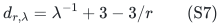

in rank-exponential time, or <code class="math">d_{r,\lambda}+\eta</code> in

<!-- math-display: 6ab665e86a6f2937940e2c99
\mathrm{poly}(\text{explicit input bits, oracle work})
 \min\left\{2^{O(r)},
       (r+1)^{O((1+\eta^{-1})\log(r+1))}\right\}.
 \tag{S8}
-->
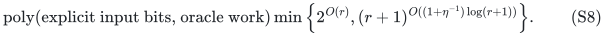

Here the rank exponent is uniform in <code class="math">\lambda</code>; oracle accuracy
costs are still paid. Wrapper space is polynomial in the explicit
binary input, in addition to oracle workspace. Target search uses
the common value denominator and an initially failed target greater
than <code class="math">(d_{r,\lambda}+\eta)\sum_jc_jv_j</code>. Its number of
trials is polynomial in the numerical encoding, not in total supply.

## 5. Exact availability for a player's integral polymatroid

Suppose player <code class="math">p</code> supplies a normalized, monotone, integer-valued
submodular function <code class="math">f_p</code> on the type set, through a value oracle.
Its feasible count vectors satisfy

<!-- math-display: 34fd05df328fd989e2cbe2c8
n(S)\le f_p(S)\quad(S\subseteq[t]),
                \qquad n\in\mathbb Z_{\ge0}^t.
 \tag{S9}
-->
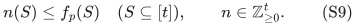

The global supply bound, and the current availability <code class="math">n\le A</code>,
are imposed by the allocation interface. The returned function values
and the original supplies have paid bit lengths. Different players
may have entirely different polymatroids.

Define the box-restricted rank function

<!-- math-display: 7fd57d2a5f3bc55dec40f2e8
g_A(S)=\min_{Q\subseteq S}
                         \{f_p(Q)+A(S\setminus Q)\}.
 \tag{S10}
-->
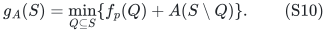

It is normalized, monotone, integral and submodular. Submodularity
follows by taking minimizers for two sets and uncrossing them with
submodularity of <code class="math">f_p</code>; the two modular <code class="math">A</code>-terms have
exactly the same union/intersection sum. Monotonicity follows by
restricting a minimizer for a larger set to the smaller set and using
monotonicity of <code class="math">f_p</code> and nonnegativity of <code class="math">A</code>.

Moreover,

<!-- math-display: bea9f6d87bd2667b336681c1
P(g_A)=P(f_p)\cap[0,A].
 \tag{S11}
-->
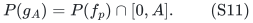

For the forward inclusion from right to left, split <code class="math">n(S)</code>
over <code class="math">Q</code> and <code class="math">S\setminus Q</code>, using <code class="math">f_p(Q)</code> and
<code class="math">A(S\setminus Q)</code>, and minimize. Conversely choosing
<code class="math">Q=S</code> and <code class="math">Q=\varnothing</code> proves respectively the
original rank inequalities and the singleton coordinate caps.

Order the types by nonincreasing <code class="math">v_j</code>. On the corresponding
prefixes <code class="math">S_i</code>, set

<!-- math-display: 89f178a2a7c3b2232808d005
n_{j_i}=g_A(S_i)-g_A(S_{i-1}).
 \tag{S12}
-->
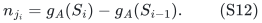

The ordinary polymatroid greedy proof shows this vector belongs to
<code class="math">P(g_A)</code> and maximizes the nonnegative weighted objective:
every prefix of any feasible vector is at most <code class="math">g_A(S_i)</code>,
whereas (S12) has equality; summation by parts finishes the proof.
Submodularity supplies feasibility of the greedy vector, and
integrality makes its coordinates integers. Thus it is an exact
available count vector.

Each prefix value in (S10) is one submodular minimization of
<code class="math">f_p(Q)-A(Q)</code> restricted to that prefix, plus the constant
<code class="math">A(S_i)</code>. There are at most <code class="math">t</code> such calls, and deterministic
submodular minimization is polynomial in the ground-set size and
oracle encoding. A primary source is Iwata, Fleischer and Fujishige,
*A Combinatorial, Strongly Polynomial-Time Algorithm for Minimizing
Submodular Functions*,
[arXiv:math/0004089](https://arxiv.org/abs/math/0004089);
see also Schrijver's
[original algorithm](https://homepages.cwi.nl/~lex/files/minsubm6.pdf).
Only the existence of a deterministic polynomial implementation is
used here, not a claim of a new or best submodular-minimization bound.

This implements <code class="math">\lambda=1</code> with no dependence on expanded
capacity. In particular the result handles cross-type local rank
constraints; it is not merely the coordinate-quota case renamed.

## 6. Binary bounded knapsack as an approximate available oracle

Suppose a player's local constraint is
<code class="math">\sum_j a_{pj}n_j\le b_p</code>, possibly together with coordinate
quotas, where costs are nonnegative and the available counts are
binary integers. For each type, split its allowed available count
into binary chunks of sizes <code class="math">1,2,4,\ldots</code> with a final
remainder. The chunks have total size exactly that bound and their
subset sums realize every integer count up to it. There are only
<code class="math">O(\sum_j\log(c_j+1))</code> chunks.

A chunk of size <code class="math">h</code> has profit <code class="math">h v_j</code> and cost
<code class="math">h a_{pj}</code>. Apply the self-contained deterministic profit-scaling
FPTAS from the approximate-oracle note to this ordinary finite
knapsack. Discard singleton-infeasible chunks first. Every feasible
count vector has a chunk representation in which each chosen chunk
is individually feasible, so this discarding loses no feasible vector.
The FPTAS returns a <code class="math">(1-\kappa)</code>-approximate available value
in time and workspace polynomial in the binary input and
<code class="math">1/\kappa</code>.

Convert its chosen chunks back to counts before interacting with the
allocation state. The subsequent minimalization removes single units
in type batches and may split chunks; this is legal because the local
count family is downward closed. The allocation star parameter remains
the unit value <code class="math">u=\max_jv_j</code>, not a large chunk profit. Chunks
are only private to the available-oracle implementation.

Choosing <code class="math">\kappa</code> and the outer positive error as in the
approximate-oracle note gives ratio <code class="math">4-3/r+\zeta</code>, with
polynomial cost in the binary input and <code class="math">1+\zeta^{-1}</code> outside
the same rank-sensitive search term. No exact solution to binary
knapsack is being asserted at rank one.

## 7. Scope and comparison boundary

The symmetry assumption is essential to the cell implementation.
If copies of one nominal type have different liking or feasibility
status, a type-count oracle does not identify which physical units
may be selected from an available cell. Such units must be split
into genuine types or handled by a different representation.

The integral polymatroids in Section 5 belong to individual players
and constrain their own resource-type counts. They should not be
confused with the arbitrary resource polymatroids of Bamas et al.,
which constrain the receiving-player vector of a resource. The latter
direction has the separate reservation obstruction, and the proved
laminar-resource adapter addresses only its stated class.

This is a representation and interface extension of the rank-sensitive
allocation method. Public all-player consequences and any novelty
claim require the same-model comparison already being maintained in
[item-matroid-allocation-public-scope-audit.md](item-matroid-allocation-public-scope-audit.md); numerical capacities
alone are not asserted to create a new approximation record.
