# Unrelated two-size job scheduling with an exact assignment budget

A job type may take the smaller processing time on some machines and
the larger time on others. Its mandatory units are kept in one original
recipient polymatroid throughout the algorithm. A changing joint LP
forbids large assignments only at omitted machine positions; it never
discards mandatory jobs. Reserving integer small-job capacity at the
remaining positions then allows one exact full-total recovery of all
original job bases and their assignment cost.

For every fixed integer d>=2, the makespan factor is 2-1/d and the
whole-machine time base is 2-1/Gamma((d+1)/(d-1)). In particular, exact
factor three halves has base 50/27 and exact factor five thirds has
base 7/4. The assignment budget is preserved without augmentation.

## 1. Mandatory-job model and theorem

There are q>=1 physical machines P and resource/job types j. Type j
has a normalized monotone integral submodular recipient rank f_j.
Its original mandatory job count is

<!-- math-display: d3df0b4c46abc75ff10d7963
n_j=f_j(P),\qquad N=\sum_j n_j.
 \tag{US1}
-->
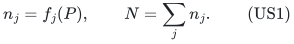

A schedule has integer base vectors x_j in B(f_j), so every one of
these original units must be scheduled. On an eligible pair (p,j),
its processing time ell_pj is either u or a, with 0<u<a. Values may
differ between machines for the same type. The assignment cost c_pj
is a nonnegative rational and one budget B>=0 requires

<!-- math-display: 350f1686a9efe32c5ae79ad4
\sum_{p,j}c_{pj}x_j(p)\le B.
 \tag{US2}
-->
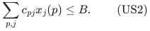

The load of machine p is sum_j ell_pj x_j(p); OPT is the minimum
possible maximum load among schedules satisfying US2. Unusable pairs
can be encoded by the original ranks. If a separate eligibility mask
is supplied, restrict to it while retaining the original n_j; rank
loss below n_j means the original instance is infeasible. Do not
replace a mandatory count by a reduced masked rank.

All numerical ranks, times and costs are binary encoded. H includes
the full input and the paid polynomial rank, submodular-minimization,
LP and polymatroid-intersection work. The job types may have binary
large multiplicities; no individual job-unit expansion is used.

For fixed integer d>=2 define

<!-- math-display: 1557d32ee054b31c552425d7
\rho_d=2-1/d,\qquad R_d=\frac{d+1}{d-1},\qquad
 A_d=\Gamma(R_d)=\frac{R_d^{R_d}}{(R_d-1)^{R_d-1}},\qquad
 B_d=2-1/A_d.
 \tag{US3}
-->
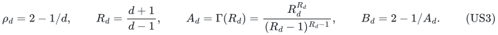

**Theorem US.** A deterministic algorithm detects infeasibility of
the assignment budget even with unbounded makespan, or returns a
legal schedule of makespan at most rho_d*OPT in

<!-- math-display: bb7cccf1daf6aa32cd766fef
B_d^q\,2^{O(q\log\log(q+2)/\log(q+2))}\mathrm{poly}(H)
 \tag{US4}
-->
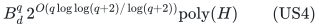

time and polynomial workspace. The original job counts and the
assignment budget are exact. The exponent counts physical machines,
not job units, recipient copies, or a binary-expanded slot ground.

The principal constants are rho_2=3/2 with B_2=50/27 and rho_3=5/3
with B_3=7/4. There is no intrinsic-processing-time, small-corank,
large-job-support or bounded-cost-diversity promise.

## 2. Initial feasibility and the integral full-total primitive

If N=0, the empty schedule is optimal. Otherwise minimize assignment
cost over each original base B(f_j), using integral polymatroid base
optimization, and add the minimum costs. The resource bases are
independent before load restrictions, so this gives exactly the
minimum possible total assignment cost. If it exceeds B, no legal
schedule exists. Otherwise retain the actual integral minimizing
bases as a legal initial schedule. Its makespan is at most a*N.

We repeatedly use the following primitive. On the product ground
P times the types, take the direct sum of masked original resource
ranks and an integral machine-cap polymatroid. The masks only remove
allowed pairs, so every masked type rank is at most n_j. Demand total
N, the sum of the **original** mandatory counts. If that total is
attainable, every type must attain n_j: no other type can compensate
for a missing unit because its own upper rank is at most its own n_j.

The intersection of the two integral polymatroids is integral, and
its maximum-total face at N remains integral. Minimize actual
assignment cost on that face and compare with B. A given fractional
point at total N and cost at most B guarantees an integer point of
no larger cost. Conversely, infeasibility of total N or a minimum
cost above B excludes a legal schedule under those exact caps.

Partition count caps and the nested per-machine caps used below are
integral polymatroids. For example, a cap h_p on the large-pair count
and cap c_p>=h_p on the total count at machine p have rank equal to
the maximum of weights h_p on its large-pair coordinates and c_p on
its small-pair coordinates. Summing these ranks over machines gives
the corresponding integral laminar cap polymatroid. Empty subsets
have rank zero. This representation concerns count coordinates and
does not expand large capacities into copies.

## 3. Cost-preserving upper rounding for the easy target range

Fix a target T. The fractional scheduling LP retains every original
base equality x_j(P)=n_j, every resource rank constraint, all machine
load bounds T and US2. Infeasibility excludes an integer target-T
schedule.

For a feasible fractional point let H_p be its large-pair count and
Z_p its total count at machine p. Its load is
`u*Z_p+(a-u)*H_p`. Impose integer nested caps

<!-- math-display: d96a134ef2c46600ca8c4b4f
H'_p\le\lceil H_p\rceil,\qquad
               Z'_p\le\lceil Z_p\rceil.
 \tag{US5}
-->
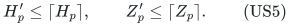

The fractional point satisfies these caps and all original bases.
Apply the full-total minimum-cost primitive. It returns integer
original bases at no larger cost and with load at most

<!-- math-display: e68e05abf0340a060cd694fb
\begin{aligned}
 u\lceil Z_p\rceil+(a-u)\lceil H_p\rceil
       &\le uZ_p+(a-u)H_p+a\\
       &\le T+a.
 \end{aligned}
 \tag{US6}
-->
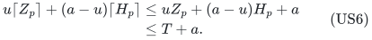

This is the per-machine upper-prefix ceiling argument specialized
to the two processing values. It permits a different large/small
type partition at each machine and minimizes cost on the same
integral full-total face that preserves all jobs.

Whenever

<!-- math-display: bedc5adb3ca5c0263a57eb58
T\ge\frac d{d-1}a,
 \tag{US7}
-->
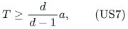

one has T+a<=rho_d*T, so US5--US6 provide the complete polynomial
target branch. For d=2 this is T>=2a. No assignment-budget violation
or discarded mandatory resource is introduced by the rounding.

## 4. Small-only schedules and hard-range count definitions

At any target, a small-only schedule is tested exactly by retaining
only u-pairs, imposing total count cap floor(T/u) on every machine,
and using the full-total minimum-cost primitive at original total N.
If it succeeds, it gives load at most T and may be returned immediately.
If T<a, a target-T integer schedule cannot use any a-pair, so failure
of this small-only test soundly excludes the full target.

After the easy branch and small-only check, the remaining range is

<!-- math-display: 0c2f014bc3fa02e48df9cfc5
a\le T<\frac d{d-1}a\le2a.
 \tag{US8}
-->
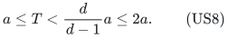

Every target-T integer schedule places at most one large unit on
each machine. Define

<!-- math-display: 9313757fa36fa83e46d7d4cf
\begin{aligned}
 C_T&=\lfloor T/u\rfloor,\qquad
 \delta_T=a+C_Tu-T,\\
 K&=C_T-\left\lfloor\frac{T-a}{u}\right\rfloor
                =\left\lceil\frac{\delta_T}{u}\right\rceil.
 \end{aligned}
 \tag{US9}
-->
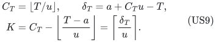

These quantities obey 0<delta_T<=a<=T and 1<=K<=C_T. A machine
with a large unit in a target-T schedule has at most C_T-K small
units, while a machine with no large unit has at most C_T small
units. All counts and floors have polynomial binary length.

## 5. Every K<=d has a polynomial one-reserve gate

For 1<=K<=d, impose on every machine the integer nested caps

<!-- math-display: fbdda2d4ec46cf834aeaf38b
\text{large count}\le1,
                    \qquad\text{total count}\le C_T.
 \tag{US10}
-->
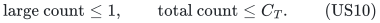

Every full target-T integer schedule obeys these caps: at a large
recipient its total is at most 1+C_T-K<=C_T, and elsewhere its
small count is at most C_T. Thus failure of the full-total minimum-
cost intersection under US10 excludes the full target.

At a success, a machine with no large unit has load at most C_Tu<=T.
A machine with one large unit has load at most

<!-- math-display: c1c9e89aa06c83fcffc7de4b
\begin{aligned}
 a+(C_T-1)u
       &=T+\delta_T-u\\
       &\le T+(1-1/d)\delta_T
        \le\rho_d T,
 \end{aligned}
 \tag{US11}
-->
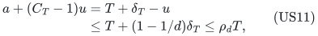

because delta_T<=Ku<=du. The assignment cost stays at most B.
This is a one-sided weak success for K>1, not a claim that the
nominal full target T is feasible. At K=1 the caps are in fact
equivalent to the exact hard-range load requirement, since
`floor((T-a)/u)=C_T-1`.

Handling all K<=d by this gate permits the sharper positive-gap
ratio below. For d=2 both K=1 and K=2 are polynomial branches.

## 6. The joint small-capacity service region

Assume K>=d+1 and set b=ceil(K/d). A current set Q permits large
assignments only on its machines. Small assignments remain allowed
on **every original physical machine**. For each original type put

<!-- math-display: b24cbdcd269ba2dd963eb598
A_j(Q)=\{p:\ell_{pj}=u\}\cup\{p\in Q:\ell_{pj}=a\},
                       \qquad f_j^Q(S)=f_j(S\cap A_j(Q)).
 \tag{US12}
-->
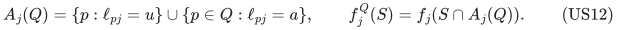

Use variables x_j with the original mandatory equalities
`x_j(P)=n_j`, even after this mask. Let S_p(x) and H_p(x) denote
its small and large counts at machine p. Define X_Q by

<!-- math-display: 5c796f453c8b19690eb7b8ff
\begin{aligned}
 x_j&\in P(f_j^Q),\qquad x_j(P)=n_j &&\text{for every type }j,\\
 H_p(x)&\le1 &&(p\in Q),\\
 S_p(x)&\le C_T &&(p\in P),\\
 \sum_{p,j}c_{pj}x_j(p)&\le B.
 \end{aligned}
 \tag{US13}
-->
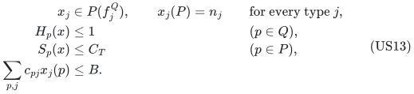

Outside Q, large counts are zero by the masks. Test X_Q for
emptiness first. Rank loss in a masked type, insufficient capacity,
or insufficient budget must cause rejection; none may silently
reduce the number of mandatory jobs.

For nonempty X_Q, define the spare-small-capacity projection

<!-- math-display: ee8e7115c3488c96410f66ae
U_Q=\{z\in\mathbb R_+^Q:\exists x\in X_Q,\quad
                          z_p+S_p(x)\le C_T\ (p\in Q)\}.
 \tag{US14}
-->
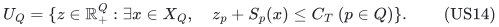

This is a compact convex downward region containing zero. Each
coordinate is at most C_T. For a nonnegative normal a on Q, its
support is the exact polynomial LP

<!-- math-display: 554ea6c46881b7e5fad213b8
h_Q(a)=\max_{x\in X_Q}
                              \sum_{p\in Q}a_p(C_T-S_p(x)).
 \tag{US15}
-->
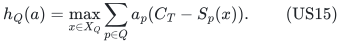

The objective has a constant term and possibly negative coefficients
on counts, which is harmless for bounded linear optimization. The
service row itself has nonnegative normal and nonnegative capacity.
As in the reviewed joint-role allocation separator, normalize a(Q)=1
and solve the outer support LP. A positive support excess returns a
strict nonnegative packing row; a nonpositive excess proves membership.
Choose extreme support optimizers by exact lexicographic refinement.

The base equalities, masked rank constraints, count caps and cost row
all have uniform polynomial bit bounds. Exact primal and dual LP
optimization, with paid submodular minimization for resource separation,
therefore supplies polynomial-bit rows and reconstructs a queried
service witness. No assumption of sparse projected separators is made.

## 7. The full target preserves every original job at protected nodes

Fix a target-T integer schedule and let I* be its set of machines
receiving a large unit. The small-only check already handles I* empty;
otherwise put k=|I*|>=1. At any Q containing I*, the **same full
schedule** belongs to X_Q. Every large pair removed outside Q was
unused by it. No job count is deleted or moved, and its cost and
all original base totals are unchanged.

At a machine in I*, the schedule's small count is at most C_T-K.
Consequently

<!-- math-display: 7a892127cac6e944ae3e34eb
K\,1_{I^*}\in U_Q.
 \tag{US16}
-->
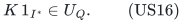

For this exact promised cardinality k, start on Q=P, require
|Q|>=k, and query b*1_Q in U_Q. If an exact nonnegative row
a*z<=U separates the weak query, US16 gives

<!-- math-display: 6e3b1124880afb726fd1dddc
K a(I^*)\le U<b a(Q),\qquad
              a(Q\setminus I^*)>(1-b/K)a(Q).
 \tag{US17}
-->
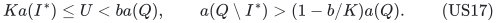

The weighted first-density-crossing deletion certificates contain
one subset of Q\I*. Its child retains the same complete original
schedule, so US16 applies again. At zero deficit Q=I*, its full
service promise makes the weak query feasible. The empty-X_Q gate
is also sound along this protected path.

For K>=d+1, the integer-quota calculation gives

<!-- math-display: de39cc10b3f13605b7a5ee17
\frac K{K-b}\le\frac{d+1}{d-1}=R_d.
 \tag{US18}
-->
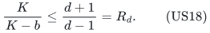

Thus this fixed-k extension, including all failed and unpromised
branches, costs at most
`A_d^(q-k-|Z|) poly(H)` after forced omissions Z. The same uniform
polynomial encoding holds on every branch. The selected set used
for this proof is the full schedule's large-recipient set; there
is no independent optional-active-machine requirement.

## 8. Exact job and cost recovery at a successful service query

A successful b*1_Q query gives a fractional joint assignment with
integer group caps

<!-- math-display: 613eab49678fb19f9578f8c1
\begin{array}{c|cc}
       &\text{large count cap}&\text{small count cap}\\ \hline
 p\in Q&1&C_T-b\\
 p\notin Q&0&C_T .
 \end{array}
 \tag{US19}
-->
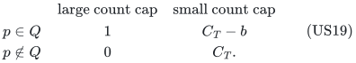

The caps are nonnegative because b<=K<=C_T. The large and small
groups partition the pair coordinates at every machine. These
integer partition caps form a polymatroid, even though a resource
type can meet different groups on different machines.

Intersect it with the single joint direct sum of the masked resource
ranks, retain full total N, and minimize actual assignment cost.
The successful fractional point witnesses that this face is
nonempty and has cost at most B. The resulting integer point has
every original type total n_j, satisfies the same caps, and costs
no more than the fractional witness.

At a machine outside Q the load is at most C_Tu<=T. At a machine
inside Q its load is at most

<!-- math-display: 94c3d3f4ab14a53615c3a0b3
\begin{aligned}
       a+(C_T-b)u
       &=T+\delta_T-bu\\
       &\le T+(1-1/d)\delta_T
        \le\rho_d T,
 \end{aligned}
 \tag{US20}
-->
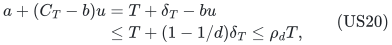

using bu>=Ku/d>=delta_T/d. A machine receiving no large unit
has only a smaller load. All original job units remain scheduled.

The output's actual number of large recipients may differ from
the promised k, especially after an early success with |Q|>k.
That is legal: the original optimization problem fixes mandatory
job totals and cost, not the number of large processing choices.
No current Q\I machines are deleted after recovery. If the
global wrapper records a selected k-set, any k-subset of Q may
serve as auxiliary proof metadata; the returned full schedule
and all its actual large positions are retained.

## 9. Every target, one-sided minimization and global time

The complete target procedure consists of: the high-range LP and
upper rounding when US7 holds; the exact small-only check; its
sound rejection when T<a; the laminar weak gate when K<=d; and,
otherwise, every fixed-k gap for k=1,...,q. A full target schedule
is either small-only or supplies one of those exact k values, so
total failure always certifies OPT>T. Every successful branch
returns a legal schedule of makespan at most rho_d*T.

Choose a positive rational g dividing u and a. All integer schedule
loads and OPT lie on its grid. For N>0, zero is a certified failed
target and T_hi=a*N is genuinely feasible by the initialized
minimum-cost full schedule. Keep that actual schedule at the
initial upper endpoint. At integer-grid midpoints, a failure
raises the lower endpoint and a weak success lowers the upper
endpoint, saving its actual schedule.

No monotonicity of weak successes or full-feasibility claim on
success is used. Every lower endpoint stays strictly below OPT.
At adjacent grid endpoints the successful upper target is at
most OPT, so its saved makespan is at most rho_d*OPT. The number
of target calls is polynomial in the binary encoding of a*N/g.

For each hard target and exact k, the protected omitted set has
size q-k and US18 supplies the required forced-omission time
bound. Apply [global-conversion.md](../../problems/whole-ground-allocation/global-conversion.md) to it.
Its block cover finds a seed avoiding the full schedule's large
positions, and the schedule remains unchanged at that seed.
The output at success is always the complete original schedule,
regardless of its recovered large-position cardinality.

Each fixed-k global gap costs
`B_d^q 2^{O(q log log(q+2)/log(q+2))} poly(H)`. The q possible
cardinalities and polynomial target calls are absorbed into the
polynomial factor. All easy and small-quota branches are polynomial.
This proves US4 with polynomial workspace. No fallback with a
larger unaccounted exponential time is run.

The sharp displayed bases are for fixed d. For varying binary d,
the original branching uses exact rational quotas, while the
global wrapper may use a paid polynomial-bit rational upper bound
such as 3R_d instead of expanding large algebraic powers.

## 10. Interpretation, inherited barriers and primary baseline scope

The first useful tradeoffs are:

| d | Makespan factor | Whole-machine base |
| --- | --- | --- |
| 2 | 3/2 | 50/27, approximately 1.851852 |
| 3 | 5/3 | 7/4=1.75 |
| 4 | 7/4 | Approximately 1.674270 |

This extends the earlier intrinsic two-size job-polymatroid transfer
to processing times that depend on both the type and the machine,
and preserves an arbitrary nonnegative assignment-cost budget.
Its small-only and laminar gates are joint original-resource
intersections; its weighted gap preserves mandatory job bases by
forbidding only unused large positions on the protected path.

The balanced oracle construction in
[allocation lower bounds proof](../../problems/allocation-lower-bounds/proof.md) is an intrinsic
zero-cost subclass of this model. It therefore still forces
`2^(q-O(log q))` value queries for every factor strictly below
three halves. This is an oracle-model approximation boundary,
not optimality of the base 50/27 at factor three halves or a
hardness claim for ordinary explicit job eligibility lists.

Exact-cost additive upper rounding in ordinary generalized
assignment is public background; see Shmoys and Tardos,
[*An approximation algorithm for the generalized assignment
problem*](https://www.cs.cornell.edu/~eva/Approx.Algorithm.Generalized.Assignment.Prob.pdf),
Theorem 2.1. The resource-polymatroid and pair-dependent grouped-
prefix implementation needed here is proved directly in Sections
2--3, rather than inferred by changing the model of that paper.

The bounded primary comparison must distinguish ordinary complete
two-value processing matrices, unrelated matrices with forbidden
pairs, intrinsic restricted assignment, and the present binary
job-polymatroid plus exact-cost model. No first ordinary two-size
three-halves approximation claim is made. The numerical global
conversion is existing monotone-local-search background, with
polynomial space supplied by the separately reviewed block proof.

This manuscript requests full root and independent review of the
original mandatory totals after masks, cost-preserving upper
rounding, small-K laminar gate, spare-capacity separator, protected
unchanged schedule, joint full-total recovery, and all target-search
boundaries. No formal or external verification is asserted.
