# The alias, geometric, and raw-circulation bridge

**Scope, 24 October 2026.** This note makes one numerical interface
explicit. A retained alias spanner is replaced by a geometric graph
with one central edge per original edge lifetime; the recursive child
returns a raw certificate; that certificate is lifted to the actual
parent graph. The proof distinguishes original lengths, frozen-gauge
gradients, edge-ID cancellation, and literal traversal cost.

It supplements
[the legal alias construction](portal-alias-api-reconstruction.md),
[the Steiner bridge](constant-degree-steiner-bridge.md), and
[the numerical lifetime interface](numerical-backend-lifetime-and-loops.md).
It applies both to the earlier large port scaling and to
[the small integer scaling](local-length-aspect-preservation.md).
No exponent or recurrence is changed.

## 1. Every geometric label must use one frozen gauge

Let the current parent graph be <code class="math">J=T\cup E_{\rm off}</code>, with positive
lengths <code class="math">\ell_J</code> and oriented gradients <code class="math">g_J</code>. At the beginning
of a portal period choose a potential <code class="math">\pi</code> such that every initial
tree edge has residual zero, and keep <code class="math">\pi</code> fixed. Define, for
EVERY current parent edge,

<!-- math-display: 312118a8da97628b591ae7ed
\bar g_J(e)=g_J(e)+\pi(\mathrm{tail}e)
                         -\pi(\mathrm{head}e).
 \tag{1}
-->
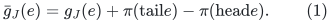

A new isolated vertex receives the prescribed fixed potential, for
example zero. A new tree edge retains its actual residual (1);
it is not assigned residual zero merely because it is a tree edge.

The geometric graph <code class="math">S</code> consists of a compressed Steiner forest
<code class="math">K</code> and selected original off-edges. A central edge corresponding
to <code class="math">e\in E_{\rm off}</code> has labels

<!-- math-display: 64860bf177d0c066ef00f279
\ell_S(e)=\ell_J(e),\qquad
                 \bar g_S(e)=\bar g_J(e).
-->
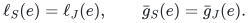

If a compressed edge <code class="math">f=(x,y)</code> represents the oriented current tree
path <code class="math">P_f</code>, its labels are

<!-- math-display: e707b2c7f4d04a7fe40fec04
\ell_S(f)=\sum_{e\in P_f}\ell_J(e),\qquad
 \bar g_S(f)=\sum_{e\in P_f}\sigma_{f,e}\bar g_J(e).
 \tag{2}
-->
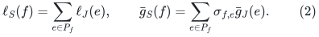

Thus the length is the real original path length, while the gradient
is the signed sum in the SAME frozen gauge as the central edges.

Let <code class="math">\Psi</code> map a central edge to its parent edge and a compressed
edge to its oriented parent path. It is a boundary-preserving map.
For any circulation <code class="math">x</code> on <code class="math">S</code>,

<!-- math-display: 91e9220d83034c6abea5270f
\bar g_S^{\mathsf T}x
 =\bar g_J^{\mathsf T}\Psi x
 =g_J^{\mathsf T}\Psi x.
 \tag{3}
-->
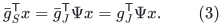

The second equality uses the fact that <code class="math">\Psi x</code> is a complete
circulation. It need not hold for an individual open path or edge.

### Counterexample to mixing the two gauges

Take a parent triangle with tree edges <code class="math">a\to b</code>, <code class="math">b\to c</code>,
off-edge <code class="math">a\to c</code>, unit lengths, and gradients <code class="math">1,0,1</code>,
respectively. Every cycle has gradient zero. The potential
<code class="math">\pi(a)=0,\pi(b)=\pi(c)=1</code> makes all residual gradients zero.

Suppose the compressed tree edge <code class="math">a\to c</code> incorrectly stores its
ORIGINAL gradient <code class="math">1</code>, while the central off-edge correctly stores
its residual gradient <code class="math">0</code>. Their two-edge geometric cycle then
has gradient <code class="math">-1</code>, even though its physical parent circulation
has gradient zero. This would produce a false useful direction.

The repair is exactly (2). Initial compressed tree paths then have
gradient zero, and paths containing new tree edges retain the sums
of their nonzero residuals. The wording in the Steiner note now
states this formula explicitly.

## 2. Work on the projected alias graph, with distinct alias IDs

The auxiliary spanner may use several copies of one physical portal.
Let <code class="math">\mathcal A</code> be the graph obtained by identifying those copies
with their current physical portal images, while KEEPING every
auxiliary input-edge ID distinct. Write <code class="math">\widehat H</code> for the
similarly projected retained spanner. These graphs may have parallel
edges and real loops.

Each alias <code class="math">a</code> has positive stored length <code class="math">\lambda_a</code>, fixed
gradient <code class="math">h_a</code>, and a current parent walk <code class="math">L_a</code> such that

<!-- math-display: 0568a6e6ab4524ab80e748ad
\mathrm{raw}_{\ell_J}(L_a)\le\lambda_a,\qquad
                    \bar g_J^{\mathsf T}L_a=h_a .
 \tag{4}
-->
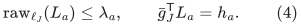

For an off-edge alias, the unchanged initial-tree legs have residual
zero and <code class="math">h_a=\bar g_J(e)</code>. A tree-path alias uses the residual
path sum. The second identity in (4) is a residual-gradient identity;
after summing a closed alias circulation it becomes an identity for
the original physical gradient by (3).

The public spanner provides a route for each auxiliary edge between
its auxiliary endpoints. Let <code class="math">\rho\ge1</code> be a common bound for its
weighted stretch AND its explicit number of route edge occurrences,
as provided by source Theorem 5.13. Projecting that route to physical
portals gives a walk <code class="math">R_a</code> in <code class="math">\widehat H</code> with the correct endpoints and

<!-- math-display: ce635a1ca03cb656fb59f1da
\lambda(R_a)\le\rho\lambda_a,\qquad |R_a|\le\rho .
 \tag{5}
-->
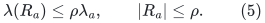

For <code class="math">a\in\widehat H</code>, the identity route can be used. Auxiliary
copies need not be connected to each other merely because their
physical images agree. The proof needs only (5) for each edge.

In particular a circulation on <code class="math">\mathcal A</code> need not be a
circulation BEFORE auxiliary identification. Applying a min-ratio
theorem only to circulations of the unprojected auxiliary graph
would be the wrong interface. The edgewise projected routes
instead preserve divergence on physical portals.

The source for the route guarantee is Chen et al.,
[arXiv:2311.18295v1](https://arxiv.org/abs/2311.18295v1),
Theorem 5.13. The decomposition below is the direct weighted
argument behind its Lemma 5.14, stated for these projected routes.

## 3. Coalescing central edges is a linear lift, not an injective map

The set <code class="math">E_\star</code> includes one copy of an original off-edge
lifetime whenever at least one of its aliases is retained.
All such aliases share that central edge. The terminal set of <code class="math">K</code>
contains every physical portal and both original endpoints of every
edge in <code class="math">E_\star</code>.

A retained alias therefore maps to a walk <code class="math">F_a</code> in <code class="math">S</code>: its
first tree leg, its shared central edge, and its last tree leg.
A retained tree-path alias maps to its compressed <code class="math">K</code> path.
Equations (2) and (4) give

<!-- math-display: 6a3e944be918bb52d3fa4a50
\bar g_S^{\mathsf T}F_a=h_a,\qquad
             \mathrm{raw}_{\ell_S}(F_a)\le\lambda_a .
 \tag{6}
-->
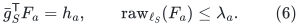

Extend <code class="math">F</code> linearly to signed edge vectors of <code class="math">\widehat H</code>.
For a circulation <code class="math">x</code> in <code class="math">\widehat H</code>,

<!-- math-display: c916b543158e79af2cbdbd04
Fx\text{ is a circulation in }S,\qquad
 \bar g_S^{\mathsf T}Fx=h^{\mathsf T}x,\qquad
 \|L_SFx\|_1\le\sum_a|x_a|\lambda_a.
 \tag{7}
-->
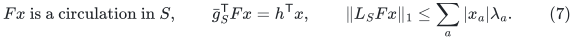

The final inequality follows by expanding each walk with its
literal length and then applying the triangle inequality. It does
not assert that literal traversals cancel for free.

The map <code class="math">F</code> need not be injective. Two different aliases of one
edge can occur with opposite coefficients, so their central
traversals cancel. For example two parallel aliases with identical
physical legs give a nonzero alias vector <code class="math">a_1-a_2</code> whose image
is zero. Its numerator is also zero, because both labels in (6)
come from the same physical residual walk.

More generally,

<!-- math-display: 9da75edc00c781fd95371503
Fx=0\quad\Longrightarrow\quad
                         h^{\mathsf T}x=0.                  \tag{8}
-->
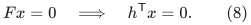

This is the needed guarantee. A nonzero-numerator spanner comparison
cannot disappear under central-edge coalescing. Extra cycles present
in <code class="math">S</code> are harmless: each is a valid current parent circulation.

## 4. A raw spanner decomposition using the actual geometric child

For each alias define the correction circulation
<code class="math">d_a=\mathbf 1_a-R_a</code> on <code class="math">\mathcal A</code>, and the literal bound

<!-- math-display: d33843cfdb6cabb9987f0396
D_a=\lambda_a+\lambda(R_a)\le(1+\rho)\lambda_a .
-->
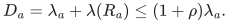

Let

<!-- math-display: 3dcb82874a7d9e75a2f478f3
b_{\rm corr}=\max_a\frac{|h^{\mathsf T}d_a|}{D_a},\qquad
 \mu_S=\max_{x:\,B_Sx=0,\ x\ne0}
        \frac{|\bar g_S^{\mathsf T}x|}{\|L_Sx\|_1},
 \tag{9}
-->
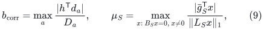

with score zero when no nonzero-numerator candidate exists.

Take any circulation <code class="math">z</code> on <code class="math">\mathcal A</code>. The routed vector
<code class="math">Rz=\sum_a z_aR_a</code> is a circulation in <code class="math">\widehat H</code>, and

<!-- math-display: 2e222cb92e1d52132a98f03b
z=Rz+\sum_a z_a d_a.
-->
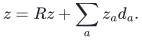

Using (5)--(7),

<!-- math-display: 8a23d0d1c5900cd52ff348df
|h^{\mathsf T}Rz|
 \le \mu_S\,\|L_SFRz\|_1
 \le \rho\mu_S\,\|\Lambda z\|_1.
-->
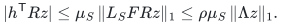

Also,

<!-- math-display: 3099d73e95cc6da4278fd0a5
\left|\sum_a z_a h^{\mathsf T}d_a\right|
 \le(1+\rho)b_{\rm corr}\,\|\Lambda z\|_1.
-->
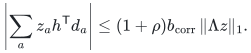

Consequently

<!-- math-display: aaadc35702ff41d67a2381e7
\frac{|h^{\mathsf T}z|}{\|\Lambda z\|_1}
 \le \rho\mu_S+(1+\rho)b_{\rm corr}.                         \tag{10}
-->
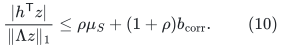

This proof needs the actual geometric optimum <code class="math">\mu_S</code>, not a
net-ratio oracle on the unprojected auxiliary spanner. It covers
zero geometric images, repeated aliases, and projected loops.

A correction candidate has an immediate raw parent certificate:
substitute the parent walk of every alias in
<code class="math">\mathbf 1_a-R_a</code>. Its numerator is <code class="math">h^{\mathsf T}d_a</code>;
its literal parent traversal is bounded by <code class="math">D_a</code>. No coalescing
of parent edge IDs is used to reduce that denominator.

## 5. Using a best NET correction without mistaking it for a raw answer

The implementation may maintain the best direct score in (9).
There is also a valid alternative if the source helper already
returns a correction maximizing

<!-- math-display: 2d0f0a61617aa4f50cc3f4d6
|h^{\mathsf T}d_a|/\|\Lambda d_a\|_1 .
-->
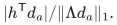

Work on the small projected-alias graph formed by its explicit
edge and route. Coalesce the signed vector by ALIAS EDGE ID,
then decompose it into sign-compatible directed simple cycles.
If the vector is zero, its numerator is zero and it is ignored.

For the nonzero vector, this decomposition satisfies

<!-- math-display: 85d11c4f13c5157ed8627a0f
\sum_i\theta_i\|\Lambda c_i\|_1=\|\Lambda d_a\|_1,\qquad
 \sum_i\theta_i h^{\mathsf T}c_i=h^{\mathsf T}d_a,\quad
 \theta_i>0.
-->
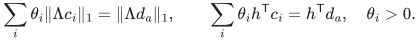

Some oriented unit simple component has ratio at least that of
<code class="math">d_a</code>. Its alias-ID net norm equals its literal alias traversal
length, so (4) supplies a parent raw certificate with no greater
denominator. A real loop is a legitimate one-edge simple cycle.

This extraction takes <code class="math">O(r^2)</code> elementary work for an explicit
correction with <code class="math">r</code> edge occurrences; here <code class="math">r\le\rho+1</code>.
The integer multiplicities and score arithmetic have the usual
polynomial bit overhead. It does not expand the physical
length-<code class="math">k</code> tree paths.

Do NOT identify distinct aliases merely because they share an
original central edge during this extraction. Such aliases can
have different portal endpoints. Their central coalescing is the
separate boundary-preserving map <code class="math">F</code> of Section 3. Likewise a
small net norm after expanding and canceling parent walks is not
automatically the cost of the unexpanded literal walk.

The best net-correction score is at least <code class="math">b_{\rm corr}</code>, since
<code class="math">\&#124;\Lambda d_a\&#124;_1\le D_a</code>. The selected simple component thus
supplies a raw score at least <code class="math">b_{\rm corr}</code>, and can replace the
direct raw correction in (10).

## 6. Port expansion and a recursive RAW answer

Let <code class="math">B</code> be the binary-port expansion of <code class="math">S</code>. Give a nonfiber
edge length <code class="math">H\ell_S</code> and gradient <code class="math">H\bar g_S</code>; give a fiber
connector length one and gradient zero. If the port-tree height
is <code class="math">h</code>, take <code class="math">H\ge4(h+1)</code>.

A unit simple cycle of <code class="math">S</code> uses at most <code class="math">2h</code> connector
traversals per real geometric edge when routed through the fibers.
Since every geometric length is at least one, its routed cycle
has length at most <code class="math">2H</code> times its original length and numerator
exactly <code class="math">H</code> times its numerator. Cycle decomposition gives the
same comparison for the optimum, so

<!-- math-display: 1f7f868702a18be5eaa94d22
\mu_B\ge\mu_S/2.              \tag{11}
-->
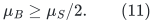

Suppose the recursive child returns a closed signed circulation
represented by paths and edges, with numerator <code class="math">N_B</code> and a
certificate <code class="math">U_B</code> dominating ALL literal real-<code class="math">B</code>-edge
traversals, and

<!-- math-display: 7642f408aee8c7c1c2299c3d
|N_B|/U_B\ge\mu_B/D.              \tag{12}
-->
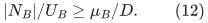

Map each nonfiber input edge to its current parent path, and each
fiber connector to zero. The input-edge path-pool construction
performs this substitution without rebuilding a physical path for
every child forest log. For the complete returned circulation,

<!-- math-display: 0991f3310a65a938f102f68e
N_J=N_B/H,\qquad
 \mathrm{raw}_{\ell_J}(\text{returned lift})
                   \le U_B/H .
 \tag{13}
-->
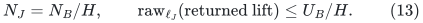

The first identity uses the common frozen gauge and telescoping
only after the whole circulation has been lifted. Every nonfiber
traversal satisfies the second inequality individually; true-null
connections add no physical charge. Repetition or opposite
traversal of an input edge is counted on both sides.

The parent uses BOTH rescaled quantities <code class="math">N_B/H,U_B/H</code>.
The traversal coefficients remain unit signed integers; the
division rescales the scalar certificate, not the walk.
Its ratio is unchanged. A nonzero child numerator cannot project
to the zero parent circulation. A cycle consisting only of null
fibers has zero numerator.

Thus the parent receives a raw child score

<!-- math-display: bfe1c402fec56c145f71a075
b_{\rm child}\ge\mu_S/(2D).
 \tag{14}
-->
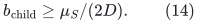

## 7. Combined quality and the exact output meaning

Combining (10) and (14),

<!-- math-display: d0b97fc31ca2bfd9ce246dde
\frac{|h^{\mathsf T}z|}{\|\Lambda z\|_1}
 \le (2\rho D+\rho+1)\max\{b_{\rm child},b_{\rm corr}\}
 \le4\rho D\max\{b_{\rm child},b_{\rm corr}\}.
 \tag{15}
-->
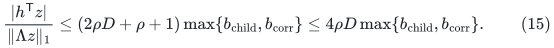

The alias construction supplies, for every routed fundamental
parent cycle, a reference <code class="math">z</code> of the same numerator and
<code class="math">\&#124;\Lambda z\&#124;_1</code> at most twice that parent's simple cycle length.
The reference uses the current first/last portals and the latest
sufficiently short alias; it does not include an arbitrary
cancelling detour. Therefore the better returned candidate has
raw ratio at least the fundamental comparison divided by
<code class="math">8\rho D</code>. Local zero-portal and one-portal fundamental cycles
are compared directly in the parent heap.

The output is a current parent circulation and a certificate for
its literal traversal. It is not required to be the exact reference
cycle or to remain simple after every lift. The HRG reduction uses
this against its fundamental-cycle comparison; extra useful parent
cycles are permitted.

The constant factors in (11)--(15) fit the existing local envelope.
The proof introduces no additional recursive edit factor and no
factor proportional to a physical path length.

## 8. Maintenance conditions needed by this lemma

The proof is a settled-state statement. Its dynamic use requires:

* Fixed potentials throughout a period; any whole-period gauge
  replacement retires the old representations first.
* Compressed paths use (2). Repricing an interior tree edge first
  promotes its endpoints and retires the affected old compressed
  lifetime, rather than silently changing a retained path label.
* Alias labels are immutable. Route changes, alias births/deaths,
  and relevant spanner-membership changes trigger the explicit
  correction-score updates. A physical endpoint move does not by
  itself change an alias's scalar labels.
* Refcounts preserve a central edge and its endpoint terminals
  while any retained alias still uses them.
* Auxiliary origin identification is only a projection. Every
  projected route still has the correct current endpoint images.
* Every returned path/edge keeps its old metadata until consumed
  or discarded. Representation changes and signed/absolute
  retirement callbacks finish before any new parent query or
  repricing.

These are the already charged lifetime and recourse conditions.
The proof does not replace them with an assumption that an
arbitrary newly selected circulation can be physically expanded
for free.
