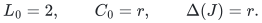
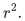
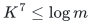
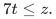
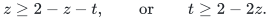

# Two limitations on substituting sparsification primitives

This note isolates two mathematical scope checks used in developing the
separated static construction. Neither statement is a lower bound for
general-graph matching or for a suitably designed ambient-aware sparsifier.

## 1. Own-graph congestion does not preserve ambient congestion additively

For every integer <code class="math">r\geq2</code>, let the demand graph <code class="math">J</code> consist of <code class="math">r</code>
disjoint cliques, each on <code class="math">r+1</code> vertices. In each clique choose a center
<code class="math">c</code> and a distinguished leaf <code class="math">a</code>. Embed the distinguished edge
<code class="math">ca</code> by the two-edge ambient path <code class="math">cxa</code>, using the SAME new
ambient vertex <code class="math">x</code> for all cliques. Embed every other demand edge
<code class="math">uv</code> through its own private new middle vertex <code class="math">z_{uv}</code>.

Every input path has length two. Each original vertex belongs to
exactly <code class="math">r</code> input paths, <code class="math">x</code> belongs to exactly <code class="math">r</code> input
paths, and each private middle vertex belongs to one. Thus
<!-- math-display: 29375058ff33468aa2e257c2
L_0=2,\qquad C_0=r,\qquad\Delta(J)=r.
-->

Choose as the sparse subgraph the star centered at <code class="math">c</code> in each
clique. Route each clique edge along its unique star path. These
routes have length at most two and own-graph edge congestion at
most <code class="math">r=\Delta(J)</code>. Nevertheless, in each clique all <code class="math">r</code>
demands incident to <code class="math">a</code> use the distinguished spoke. After
composing with the original ambient paths, all of them use <code class="math">x</code>.
The composed ambient congestion at <code class="math">x</code> is therefore
<!-- math-display: 7ca23f54f7550598747dace8
r^2.
-->

Consequently, a guarantee consisting only of constant path length,
linear-size selected support, and own-graph edge congestion
<code class="math">O(\Delta(J))</code> does not imply ambient vertex congestion
<code class="math">O(L_0(C_0+\Delta(J)))</code>. The ordinary composition inequality
multiplies own-graph edge congestion by the old ambient congestion;
it does not turn the product into a sum.

This is a counterexample to that inference, not to existence of a
better selected subgraph. A construction that sees the ambient
embedding can make different choices. In particular, it does not
rule out using a newer own-graph primitive together with a new
ambient-aware selection argument.

The literal ambient guarantee used in the current construction is
[van den Brand et al., arXiv:2309.16629v1, Theorem 8.1](https://arxiv.org/pdf/2309.16629v1):
it explicitly retains the factor <code class="math">L_0</code> multiplying
<code class="math">C_0+\Delta(J)</code>. The source-to-source discrepancy between this
statement and a length-free restatement is recorded separately in
[the static-base note](short-period-static-spanner-base.md).

## 2. A conservative old parameter guard can itself limit a balance

Suppose an older instantiation enforces the finite guard
<!-- math-display: 6a85c830ed22929064acac01
K^7\leq\log m
-->

at every nonbase recursive instance. Let the smallest nonbase
logarithmic size be of order <code class="math">x=\log k</code>. On the power scale,
write <code class="math">K=U^t</code> and <code class="math">x=U^z</code>. The guard requires
<!-- math-display: 24449c2c947d2c43420d7d23
7t\leq z.
-->

If recursive update propagation still charges
<code class="math">(U/x)(U/K)</code>, fitting this term into logarithmic overhead
<code class="math">U^z</code> requires
<!-- math-display: 8e416d7a0563c8521c6a0b83
z\geq2-z-t,
 \qquad\text{or}\qquad t\geq2-2z.
-->

Together these imply <code class="math">z\geq14/15</code>, irrespective of whether
some separate output factor has been improved.

This observation applies only to that guarded instantiation.
It is not an intrinsic restriction of deterministic routing.
The new
[explicitly clocked short-period construction](amortized-static-base-distance-sparsifier.md)
reconstructs its repairs and amortized feedback directly, and does
not import this unrelated guard. Its own static-call parameter
conditions are checked in
[the separated parameter note](separated-static-sparsifier-parameters.md).

## 3. What the new separation changes

The new proposal neither replaces ambient congestion by
own-graph congestion nor deletes the input-path-length factor.
It proves a smaller output envelope <code class="math">\Gamma</code> while allowing
a larger construction-work envelope <code class="math">F</code>. Only <code class="math">\Gamma</code>
enters the route-length and route-congestion recurrence; <code class="math">F</code>
is charged as local work. This is a different change from the
two invalid substitutions excluded above.

Its prospective <code class="math">6/7</code> balance is a separate conditional
composition. The model-optimality calculation is in
[the parameter-balance note](backend-exponent-balance.md), and
the complete numerical and matching obligations are recorded in
[the conditional matching composition](conditional-matching-6-7-composition.md).
