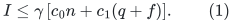
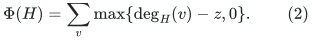
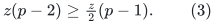
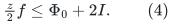
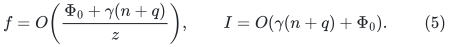
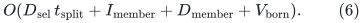
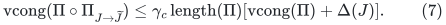
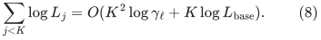

# Amortized native-split feedback and a settled selected transcript

**Conditional interface lemma, 24 October 2026.** This note isolates a
replacement for the worst-case degree-feedback analysis in the
KMPG distance vertex sparsifier. It is useful when an edge sparsifier
has a small AMORTIZED membership-recourse bound but can emit a large
batch after one update. It does not prove a faster edge sparsifier.
In particular, it does not remove the input-path-length factor in the
deterministic static sparsification theorem discussed in Section 6.

The primary constructions are
[KMPG, arXiv:2311.06402v1](https://arxiv.org/abs/2311.06402v1),
Theorem 3.8 and Claims 3.16--3.18, and
[Chen et al., arXiv:2311.18295v1](https://arxiv.org/abs/2311.18295v1),
Section 7. The current 14/15 backend is unchanged.

## 1. Required one-level interfaces

Let the parent graph have physical maximum degree <code class="math">\Delta_0</code>,
which is three in the proposed degree-reset recursion. A fixed
collection of stable forests <code class="math">F_i</code> gives uncontracted core graphs.
Each core vertex corresponds to one component of one <code class="math">F_i</code>,
with a persistent physical root identity. Core components have
<code class="math">O(k)</code> parent vertices. Native forest cuts split core vertices;
they do not merge them. Auxiliary zero links between equal physical
roots contribute only the separately accounted polylogarithmic degree.

Let <code class="math">H</code> be the selected subgraph of the uncontracted cores. A
native edge-sparsifier call may return edge membership insertions and
deletions together with native vertex splits. Assume the following
prefix guarantee, including initialization, holds on every proceeding
input sequence:

<!-- math-display: e714a055863c0d1986434b19
I\le\gamma\,[c_0n+c_1(q+f)].
 \tag{1}
-->

Here <code class="math">I</code> counts selected edge membership INSERTIONS, <code class="math">n</code>
is the initial resident core-size allowance, <code class="math">q</code> counts external
parent edits with their fixed polylogarithmic translation, and <code class="math">f</code>
counts requested feedback cuts. The constants <code class="math">c_0,c_1</code> may
include the stated stable-forest translation factor: one requested cut
can induce several additional monotone forest cuts and core updates.
They must be explicitly bounded when this lemma is composed.
The bound (1) must apply to prefixes of an unfinished feedback cascade,
not merely to sequences whose final selected degree is already small.

The physical tree partition routine has the following property. If a
selected core star has degree <code class="math">d&gt;2\Delta_0z</code>, it finds cuts
partitioning its underlying forest tree into <code class="math">p</code> components such
that every component receives at most <code class="math">\Delta_0z</code> selected
incidences, and all but at most one receive at least <code class="math">z</code>.
It requests <code class="math">p-1</code> cuts. This is the `FindSets`/`ReduceDegree`
interface of KMPG Theorem 3.8; its local time is charged separately.
The stable-forest maintenance may make extra cuts, which only refine
this partition. No selected child edit is published to the recursive
solver while the degree-repair cascade is unfinished.

## 2. Greedy repair terminates under an amortized recourse bound

For the positive core edges define

<!-- math-display: a81dfcb337812d57d403ea7f
\Phi(H)=\sum_v\max\{\deg_H(v)-z,0\}.
 \tag{2}
-->

Native splitting and edge deletion never increase this potential.
Indeed splitting divides the old incidence multiset between descendants,
and for nonnegative degrees <code class="math">d_1+\cdots+d_p=d</code>,
<code class="math">\sum_i(d_i-z)_+\le(d-z)_+</code>. A selected edge insertion
increases <code class="math">\Phi</code> by at most two, counting a loop twice.

Suppose the partition routine is applied to a star with
<code class="math">d&gt;2\Delta_0z</code>. Since every new component has degree at most
<code class="math">\Delta_0z</code>, there are at least three components. All but
at most one have degree at least <code class="math">z</code>. Therefore the immediate
potential drop before processing the edge sparsifier's response is at
least

<!-- math-display: a03c42e516c2e1386a01880e
z(p-2)\ge\tfrac z2(p-1).
 \tag{3}
-->

Extra monotone forest splits only increase this drop. Starting with
<code class="math">\Phi_0\le2&#124;E(H_0)&#124;</code>, summing (3) over any finite prefix of
the feedback loop gives

<!-- math-display: 3fa919f6e79c8302ee1f0c2c
\tfrac z2 f\le \Phi_0+2I.
 \tag{4}
-->

Choose <code class="math">z\ge8\gamma c_1</code>, with additional constant slack
for the chosen definition of <code class="math">I</code>. Substitution of (1) into (4)
absorbs its feedback term into the left side and gives

<!-- math-display: 2c791f81e533e8dc558cbf7c
f=O\!\left(\frac{\Phi_0+\gamma(n+q)}z\right),
 \qquad I=O(\gamma(n+q)+\Phi_0).
 \tag{5}
-->

The quantities on the right are fixed before a putative infinite
cascade. Thus (4)--(5) bound every partial cascade and prove that the
greedy repair terminates. This is stronger than an argument that only
counts completed repair sequences. At settlement every positive core
star has degree at most <code class="math">2\Delta_0z</code>. Adding the explicitly
bounded equal-root links and identifying the fixed number of core
copies changes this by only their recorded polylogarithmic factor.

Consequently an amortized edge-sparsifier recourse guarantee can be
used here without invoking the worst-case pile-splitting game from
KMPG Claim 3.18. The cost of finding and executing the requested
partitions, including <code class="math">O(k)</code>-scale native-core work, remains local
to this parent level.

## 3. Coalescing selected endpoint changes removes a transient-degree factor

Consider one whole external parent edit and the ensuing finite
feedback cascade as one transaction. Let <code class="math">H^{\rm old}</code> be its
selected graph at the preceding settled state. Its maximum degree is
at most a known bound <code class="math">D_{\rm sel}</code>. Keep the old edge IDs,
endpoint images, forest-instance provenance, prices and lifetime
metadata until the transaction's recursive callbacks finish.

Partition physical selected edge lifetimes into two classes.

* A member of <code class="math">H^{\rm old}</code> that remains selected continuously
  is an old survivor. Its core endpoints can change only through
  nested native splits of its old endpoint vertices. For each old
  vertex whose descendants are split, there were at most
  <code class="math">D_{\rm sel}</code> old selected incidences at that vertex.
  Regardless of how often those incidences move internally, their
  final endpoints require at most that many published replacements.
* A membership insertion during the cascade is a new selected record.
  Do not publish it prematurely. If it survives to the final graph,
  publish its final provenance once; if it disappears before then,
  no recursive child record need be created. A previously selected
  edge that dies and is reselected is handled as an old retirement
  and a new membership record, rather than silently retaining its
  lifetime.

The number of old endpoint vertices touched by any split is no more
than the total number of native splits. Thus the ordinary edge-edit
transcript from <code class="math">H^{\rm old}</code> to <code class="math">H^{\rm final}</code> has size

<!-- math-display: ced10739cd36667de030c9e1
O\!\left(D_{\rm sel}\,t_{\rm split}
                +I_{\rm member}+D_{\rm member}
                +V_{\rm born}\right).
 \tag{6}
-->

Here the membership deletion term includes genuine old retirements;
the source membership-recourse theorem bounds insertions and deletions
as usual. There is no factor equal to the maximum transient selected
degree, and no <code class="math">k</code> factor in (6). Repeated native movements of a
new unpublished edge are local parent work.

This statement counts OUTPUT edits, not the work of every internal
source update. Internal core vertex partitions can still inspect their
<code class="math">O(k\Delta_0)</code> incident records, and that work must remain in
the local one-level envelope. Nor does (6) permit a physical root to
be silently renamed. An implementation's smaller-side labels are
private; every selected occurrence retains its actual physical-root
and parent-edge provenance. The final old-to-new endpoint comparison
is made using those physical identities.

## 4. Compatibility with recursive port fibers and flat callbacks

Only the settled transcript is sent to the recursive degree-reset
child. First retire the old child edges whose endpoints, prices or
provenance change; then create required roots/fibers and add the final
edges. Old and final selected degrees are at most <code class="math">D_{\rm sel}</code>,
so the fixed port capacity needs to cover that bound, not an internal
unsettled selected-degree burst. Native unsparsified degree remains a
local source parameter and does not size the child fibers.

The complete parent edit is a no-motion transaction: no cycle query,
primal update or coordinate refresh may inspect an unfinished state.
Maintain old metadata through every descendant retirement. Physical
edge deletion is committed only after every old mapped occurrence has
transferred its signed and absolute counters. Exposed forest changes
are then published in the legal deletion-first old-to-final order.
This is the same explicit lifetime requirement used by the current raw
backend. Coalescing does not authorize forgetting temporary old
physical images or resetting a dormant pool's counters.

The source's stable-forest changes and the occurrence-pool changes are
still charged in their own local work term. Equation (6) proves only
that publishing child input changes need not expand an intermediate
high-degree native split into <code class="math">k</code> recursive edits.

## 5. Small-period direct insertions are compatible with the feedback bound

KMPG Claim 3.16 translates a parent edge update or a stable-forest cut
into a fixed polylogarithmic number of native core updates. Retargeting
old core incidences is a native split; it does not count as an arbitrary
batch of new edge births. A new root adds only its recorded equal-root
links. Therefore, over a parent period with <code class="math">q=O(n)</code> external
edits, (5) bounds additional feedback cuts and native edge births by
<code class="math">n</code> times the stated polylogarithmic/source factors.

This supports a sparse base containing an initially sparsified graph
plus every currently live later-born input edge directly, when the
base's other lifetime and repair hypotheses are proved. It avoids
assuming that a bounded CURRENT degree automatically bounds the
historical master degree. The explicit direct-insertion base proof is
a separate lemma; it must discard dead demand records and account for
empty-loop endpoints during splits.

## 6. The unresolved linear-depth bottleneck is static congestion

Theorem 7.11 of arXiv:2311.18295v1 states a stronger static resource
congestion bound than its cited source. In the cited
[arXiv:2309.16629v1, Theorem 8.1](https://arxiv.org/abs/2309.16629v1),
the actual guarantee is

<!-- math-display: a68f717fc6f744b9dbb7f795
\mathrm{vcong}(\Pi\circ\Pi_{J\to\widetilde J})
 \le\gamma_c\,\mathrm{length}(\Pi)
                  [\mathrm{vcong}(\Pi)+\Delta(J)].
 \tag{7}
-->

That input-length multiplier appears in both the theorem and its proof.
It cannot be dropped merely by citing the later shortened restatement.
If embedding lengths grow by <code class="math">O(\gamma_\ell)</code> per batching
level, substituting (7) gives a congestion exponent containing

<!-- math-display: 32c57e89187a0c1791a5f4d5
\sum_{j<K}\log L_j=O(K^2\log\gamma_\ell
                                      +K\log L_{\rm base}).
 \tag{8}
-->

The cheap initial base and the feedback/encoding lemma above do not
remove (8). A linear-in-<code class="math">K</code> work bound, and hence the suggested
8/9 numerical exponent, still requires a stronger deterministic static
resource-sparsifier theorem or a new repair scheme avoiding that
repeated length multiplier. This note establishes an interface module;
it does not assert that the missing static theorem has been proved.
