# A short-period distance sparsifier with amortized degree feedback

**Alternative construction, 24 October 2026.** This note composes a
static initial distance spanner, touched-set repair, and amortized
degree feedback. It provides an alternative one-level interface for
the distance backend at the same quantitative 14/15 rate. It does not
improve that rate. In particular, its local work retains the quadratic
dependence on the repair depth required by the literal deterministic
static sparsification theorem.

The construction avoids the worst-case pile-splitting argument in
KMPG Claim 3.18. The same high-degree excess potential and publication
after settlement appear in Kyng--Meierhans--Zöcklein,
arXiv:2408.11375, Claim 4.6 and Algorithm 2; the proof below states the
additional initial-credit and inactive-loop details needed here.
It still imports the stable core forests, their
monotone-cut implementation, the deterministic static sparsifier,
and the stated dynamic-tree primitives. The existing 14/15 construction
is unchanged.

## 1. One-level data and source interfaces

Let the parent be a graph of maximum degree three with initial active
size <code class="math">m=&#124;V&#124;+&#124;E&#124;</code>, and let <code class="math">k\geq2</code> be its reduction parameter.
Consider a parent period containing at most <code class="math">c m/k</code> external edits,
where <code class="math">c&gt;0</code> is a fixed sufficiently small constant. The period starts
on the maintained nonisolated endpoint list. Newly isolated native
slots are retained for this period and reused upon reactivation.
Historical private isolates from earlier periods are not rescanned.

Use the componentwise stable-forest construction of
[the disconnected-component wrapper](disconnected-component-backend-wrapper.md).
Write <code class="math">A=\mathrm{poly}(U)</code> for one fixed polynomial large enough
to include its number of forests, length buckets, ancestor-closure
cuts, and ordinary local indexing factors, where <code class="math">U</code> is the common
master bit/size parameter. In particular:

1. Each stable forest component contains at most <code class="math">O(k)</code> parent
   vertices. A positive core vertex therefore has current degree at
   most <code class="math">Ak</code>. A native cut partitions incidences and never merges
   core vertices.
2. Initial core roots incident to positive **nonloop** core edges
   number at most <code class="math">Am/k</code>. The full private core universe may contain
   <code class="math">\Theta(mA)</code> additional loop-only or isolated roots.
3. An external parent edit causes at most <code class="math">A</code> native core edits.
   Each requested degree-feedback forest cut causes at most <code class="math">A</code>
   additional native edits, including its ancestor closure.
4. Native core cuts change the endpoints of existing positive edge
   IDs; they do not create those edge IDs. New positive core edge
   lifetimes arise only from external parent edge births or explicit
   repricing replacements. Their number is at most <code class="math">Aq</code> through
   <code class="math">q</code> external edits. Equal-root alias links are separate gluing
   records and are not positive-metric spanner inputs.

Items 1, 3, and 4 are the constructive stable-core interface of KMPG
Lemma 3.5 and Claim 3.16. Item 2 uses the explicit small-component
initialization in the wrapper; it is false for the total number of
private core roots.

For each positive length bucket use the literal deterministic static
sparsifier of van den Brand et al., arXiv:2309.16629v1, Theorem 8.1.
Choose a common upper envelope

<!-- math-display: ed9b7b9c8c6776dde7b34c10
\Gamma=\exp\bigl(O(U^{2/3}\log(U+2))\bigr)
 \tag{1}
-->
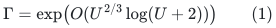

for its path-length, congestion, sparsity, and fixed polynomial factors.
The important literal guarantee is

<!-- math-display: a064673b4ca47a23a5df4d56
C(\Pi\circ\widehat\Pi)
 \leq \Gamma L(\Pi)\bigl(C(\Pi)+\Delta(J)\bigr),
 \qquad
 L(\Pi\circ\widehat\Pi)\leq\Gamma L(\Pi).
 \tag{2}
-->
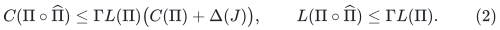

Its running time is bounded by the actual input size times

<!-- math-display: 82035b2271a031d993f7d295
A\Gamma^2L(\Pi).
 \tag{3}
-->
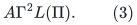

Here path cardinalities and congestion count parallel demand IDs and
repeated edge occurrences. The input-path-length factor in (2) is
retained throughout this proof.

## 2. An initially small selected base in a larger private universe

Initialize one static sparsifier on the nonloop part of each positive
core and length bucket. Do not allocate selected vertices for the
loop-only private roots. Let <code class="math">I_0</code> count all selected edge membership
births in these initial calls, before degree feedback. Then

<!-- math-display: f15dd8d7012c6430f7886816
I_0\leq A\Gamma m/k.
 \tag{4}
-->
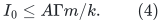

Equal-root alias stars do not allocate a child graph on the private
universe. Identify equal physical roots before publication, or
equivalently suppress every selected component having no positive
nonloop core edge. An inactive core alias sharing a physical root with
an active alias uses that same external root record. Recursive roots
are counted by endpoints of selected nonloop records and already paid
root births, rather than by all native core slots.

Every registered loop demand has an empty base route with its CURRENT
endpoint incidence records. It remains in the native splitter and in
the touched-demand index. An old loop exposed by a split is not a new
input edge lifetime.

Within one core, use reference counts for ownership of an original
core edge ID by the base and different repair layers. The actual
selected graph contains that edge once, even if several layers own it.
Insertion counts above may count every layer membership and therefore
upper-bound actual selected insertions. Degrees and the preimage
weights passed to the tree partition routine count the deduplicated
selected graph. Thus each physical parent vertex contributes at most
three selected incidences in a given core, as required by FindSets.

Keep all surviving initially selected base edges. Every subsequently
born nonloop input edge is put directly into the base with its identity
route. Remove a demand and its route-index memberships when that
input lifetime dies. Through <code class="math">q</code> external edits, at most <code class="math">Aq</code> such
direct base births occur. After native cuts or deletions a base route
may be broken, as allowed by the touched-set construction.

The current base route length is at most <code class="math">\Gamma</code>. Its vertex
congestion is at most <code class="math">A\Gamma k</code>: surviving initial demand records
can only be partitioned between descendants, and currently live direct
identity routes contribute at most the CURRENT core degree. This
argument does not use a cumulative master-degree bound.

If a loop becomes a nonloop, both resulting endpoints are touched.
Its projected repair demand uses those endpoints and the surviving
central input edge. One may scan <code class="math">O(kA)</code> such records locally, but
one must not replace this native split by that many synthetic edge
insertions. The repair graph is sparsified on its touched vertices.

## 3. A prefix repair bound with no large initialization subsidy

Let <code class="math">K\geq1</code> be the repair depth. Choose an integer radix

<!-- math-display: e7c778adacde8403f78d0a42
\rho=\left\lceil M_{\rm cap}^{1/K}\right\rceil\geq2,
 \qquad N_{\rm sched}=\rho^K,
 \tag{5}
-->
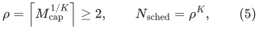

where <code class="math">M_{\rm cap}</code> is any polynomial-master upper bound on the
private native universe and the period's native history. This is only
a counter parameter: no array of size <code class="math">N_{\rm sched}</code> is allocated.
For example, when the actual parent size is at most <code class="math">2^U</code>, take
<code class="math">M_{\rm cap}=2^{8U}</code> and impose executable size/history guards.
The proof below gives <code class="math">m\mathrm{poly}(U)</code> private records, so
this fixed choice eventually suffices without knowing an asymptotic
constant. Then

<!-- math-display: eda03d91afa2389d6871799b
\log\rho=O(U/K+1).
 \tag{6}
-->
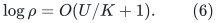

Run the touched-set layers of Chen et al., arXiv:2311.18295v1,
Section 7.2, with periods

<!-- math-display: 2c6ec71b25fbcd88adcd8f5c
p_j=\rho^{K-j},\qquad 0\leq j\leq K.
 \tag{7}
-->
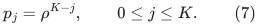

The clock <code class="math">t</code> counts native deletions and splits. A new edge birth
only changes its base identity route. At a multiple of <code class="math">p_j</code>,
rebuild the least eligible layer and clear all higher layers.
All repair layers start empty. The base is Section 2, rather than the
source's incremental APSP-based spanner.

The usual validity induction is unchanged: an affected edge had a
valid lower-layer route either at the last lower-layer rebuild or at
its own birth. Prefixes up to the first touched vertices are still
valid. A static repair routes the projected edge between these first
touched vertices. Annotated empty loop paths obey the same argument.

The static output is a sparse SUBGRAPH of the projected graph <code class="math">J</code>.
For each selected projected edge, insert only its central original
core-edge ID into the repair layer. Its prefix and suffix are paths
in lower-layer graphs that are already retained. Do not expand the
embedding of the selected projected edge into new membership births:
route records and selected memberships are different objects.
This is Algorithm 7's separate central-edge selection and route
assignment. It is why a static output of <code class="math">O(\Gamma&#124;S&#124;)</code> projected
edges creates only <code class="math">O(\Gamma&#124;S&#124;)</code> memberships, even when the
preexisting base routes have length <code class="math">\Gamma^{O(K)}</code>.

For the recourse bound, a layer of period <code class="math">p</code> can first be rebuilt
only when <code class="math">t\geq p</code>. At a rebuild, its touched set has size at most

<!-- math-display: 608ed4223b5f41e40a1196f3
O(\min\{t,\rho p\}).
 \tag{8}
-->
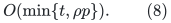

The factor <code class="math">\rho p</code> is the preceding layer's period; clearing by a
lower layer only shortens the interval. Each such rebuild creates at
most <code class="math">A\Gamma\min\{t,\rho p\}</code> selected memberships. Through an
arbitrary prefix of length <code class="math">t</code>, the total contribution of this
layer is at most

<!-- math-display: df8392dca0e46824e45ccf37
A\Gamma\rho p\lfloor t/p\rfloor
                    \leq A\Gamma\rho t.
-->
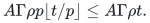

Summing the <code class="math">K+1</code> layers, and enlarging <code class="math">A</code> to absorb <code class="math">K+1</code>
when <code class="math">K\leq U</code>, gives

<!-- math-display: 7147be05f502fdd31f59f371
I_{\rm repair}(t)\leq r t,
             \qquad r=A\Gamma\rho.
 \tag{9}
-->
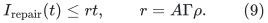

This bound holds for EVERY prefix, including a prefix of an unfinished
feedback cascade. It has no additive <code class="math">\Gamma N_{\rm sched}</code> term.
The only initial selected credit is the actual <code class="math">I_0</code> in (4).
Private empty roots do not enter the selected graph merely because
they are included in the scheduling upper bound.

Native splitting does not create selected edge memberships. Any
local smaller-side relabeling work is separate from (9); the ordinary
selected endpoint transcript will be bounded in Section 5.

## 4. Degree feedback closes using the actual initial credit

Let <code class="math">f</code> be the number of requested degree-feedback forest cuts,
including those at initialization. The fixed native translation gives

<!-- math-display: 5ef01ce6d45aaa451ccdfc63
t\leq A(q+f),\qquad
 I\leq I_0+Aq+Ar(q+f),
 \tag{10}
-->
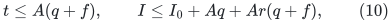

where <code class="math">I</code> counts all selected membership insertions. Calls in
different cores and buckets are included in these totals.

Set

<!-- math-display: 23448adec1bd5d1e467cbf06
z=\lceil 64Ar\rceil.
 \tag{11}
-->
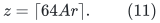

Whenever a positive selected star has degree greater than <code class="math">6z</code>,
apply KMPG Theorem 3.8 (`FindSets`) to its physical preimage tree.
Because the parent has degree three, the resulting pieces each have
at most <code class="math">3z</code> selected incidences, and all but one have at least <code class="math">z</code>.
If there are <code class="math">p</code> pieces, then <code class="math">p\geq3</code>, and <code class="math">p-1</code> cuts are
requested. Extra ancestor-closure cuts only refine this partition.

Use the potential

<!-- math-display: fb44ab4e1e71d0a53cba53c8
\Phi=\sum_v(\deg_H(v)-z)_+,
 \tag{12}
-->
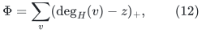

summed over positive uncontracted core stars. Splits and deletions
never increase it. A selected insertion increases it by at most two.
The requested partition decreases it, before the repair response, by
at least

<!-- math-display: bf20da59d493fd4bc2567586
z(p-2)\geq z(p-1)/2.
-->
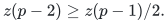

Starting before the initial selected memberships are inserted therefore
gives, on every partial cascade,

<!-- math-display: ee2a896a8e1b203cfd3258b9
zf/2\leq2I.
 \tag{13}
-->
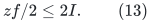

Substituting (10) and using (11) absorbs its feedback term. Hence

<!-- math-display: 7b4019d8e1402b9167f96487
\boxed{
 f=O(I_0/z+q),\qquad
 I=O(I_0+Arq),\qquad
 t=O(AI_0/z+Aq).
 }
 \tag{14}
-->
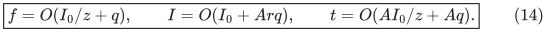

Because these are bounds on every finite prefix, they also prove
termination of a proposed infinite feedback cascade. At settlement
every positive selected star has degree at most <code class="math">6z</code>. Identifying
equal physical roots across the <code class="math">A</code>-bounded family multiplies this
bound by at most <code class="math">A</code>; alias gluing is handled after the exact gauge
correction used in the existing distance lift.

There is no circular universe assumption. Equations (4), (9), and
(11) imply <code class="math">I_0/z\leq O(Am/k)</code> after enlarging the fixed polynomial
<code class="math">A</code>. Thus all native slots and cuts during a period with
<code class="math">q=O(m/k)</code> fit in <code class="math">m\mathrm{poly}(U)</code> private records, well
within the polynomial-master allowance in (5). A guard checks this
before a branch can rely on it.

## 5. Ordinary child edits: keep the initial credit

Treat one external parent edit together with all its feedback as an
atomic publication transaction. No child query or accepted flow step
is allowed during that transaction. The old settled selected graph
has degree at most

<!-- math-display: 9d0aa72fa0c46633f9dae018
D_{\rm sel}=O(Az).
 \tag{15}
-->
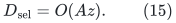

For an old selected edge surviving continuously, compare only its old
and final physical endpoints. At most <code class="math">D_{\rm sel}</code> old incidences
belong to any old core vertex whose descendants are split, regardless
of how often internal labels move during the transaction. New
membership records remain unpublished until settlement; a transient
birth followed by death produces no child edge, and an old death and
reselection is an old retirement plus a new record.

Consequently the ordinary endpoint-edit transcript has size

<!-- math-display: d0f0550b42e489fa398c2b11
O\bigl(D_{\rm sel}\,t_{\rm split}
          +I_{\rm member}+D_{\rm member}+V_{\rm born}\bigr).
 \tag{16}
-->
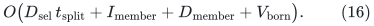

Combining this with (14), and charging newly activated selected
endpoints to selected memberships, gives a fixed polynomial envelope

<!-- math-display: bd4dafc7ceb570ce8c7fca53
R=(A\Gamma\rho)^{O(1)},\qquad
 \log R=O(U/K+U^{2/3}\log(U+2)),
 \tag{17}
-->
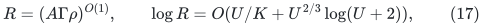

under which the initial child size is at most <code class="math">O(mR/k)</code> and the
ordinary child prefix after <code class="math">q</code> external updates has size at most

<!-- math-display: 20a1d26b49f852803c3935b0
O(mR/k+Rq).
 \tag{18}
-->
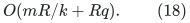

The additive term in (18) is intentional. Even after initialization,
a future feedback cascade may spend potential present in the initial
selected graph. We do not assert a prefix bound <code class="math">Rq</code> with no initial
credit. The total initial credit is charged once to this parent's
initialization allowance, even if some of its work occurs late in
the period.

An executable prefix guard for this alternative must accordingly
check <code class="math">A_0+Rq</code>, with one <code class="math">A_0=O(mR/k)</code> budget for the whole parent
period. A guard checking only <code class="math">Rq</code> would assert a stronger interface
than this proof. The allowance is an accounting bound, not a padded
child allocation: empty or small actual children are initialized
lazily on their actual records.

Old root labels are not silently renamed to implement smaller-side
splits. Each record retains its physical-root, stable-forest, and
parent-edge provenance. Retire old changed records using their old
metadata before publishing final new records. Pure loop-only native
slots remain private. Every actually published isolated child root
and every retained port-fiber ghost is counted in (18).

## 6. Local work, route reports, and exact flat-lift compatibility

The static base has <code class="math">L_{-1}\leq\Gamma</code> and
<code class="math">C_{-1}\leq Ak\Gamma</code>. The literal recurrence (2) gives

<!-- math-display: b1626662f8603d71665a3787
L_j\leq c\Gamma L_{j-1},\qquad
 C_j\leq c\Gamma L_{j-1}C_{j-1},
 \tag{19}
-->
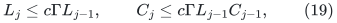

and therefore

<!-- math-display: 42903ccebba0314b7073867a
L_K\leq\Gamma^{O(K)},\qquad
 C_K\leq Ak\Gamma^{O(K^2)}.
 \tag{20}
-->
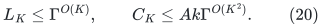

At a rebuild, affected demand records are enumerated from touched
vertices. Their count is bounded by the touched-set size times the
appropriate <code class="math">C_j</code>. Computing and indexing all new explicit routes
costs their actual total length. Thus the static work and route-change
notifications can be charged by the same geometric-period summation
as in Section 3, with the additional local factor in (20).
Native incidence scans, positive loop awakenings, and physical
`FindSets` scans cost at most <code class="math">k\mathrm{poly}(U)</code> per relevant
native event. They remain local work; they are not child edits.
For a local static call, its ambient graph is the union of the
explicit affected routes and central edges, with isolated unrelated
private vertices omitted. It is not obtained by rescanning the entire
selected base or allocating the scheduling universe.

A sufficiently generous common local envelope is

<!-- math-display: 5209cc057e85204f868b11c9
W=k^{O(1)}\rho^{O(1)}
                    \Gamma^{O(K^2)}\mathrm{poly}(U).
 \tag{21}
-->
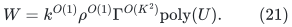

The one-level total local time through <code class="math">q</code> external edits is
<code class="math">O(mW+qW)</code>, including actual-size initialization, complete route
records, and initial-credit feedback. This bound also covers explicit
candidate-circulation changes in the distance cycle reduction.
It does not claim that demand-route congestion is <code class="math">k</code>-free.

Selected nonloop edges have the same core lengths, gradients, and
physical provenance as in the original distance construction.
Positive core loops remain local fundamental-cycle candidates.
Hence its ASZ comparison, correction-cycle decomposition, and exact
raw lift apply unchanged. The retained-edge gauge correction still
makes equal-root gluing gradients zero before contraction.

The [existing pool and lifetime implementation](distance-degree-reset-candidate.md)
applies to the settled ordinary transcript (18). A parent transaction
retains all old metadata and old pool images until their exact signed
and absolute retirement callbacks have been consumed. It flushes
retiring physical lifetimes before forgetting their records. No
intermediate transaction state is exposed to a raw-cycle query.
Dormant pool counters persist. An internal demand embedding is not a
published flat-forest occurrence, and reindexing that embedding never
creates an uncharged physical pool.

The stable core-forest cut logs obey their own <code class="math">A(q+f)</code> bound.
They are processed with the same complete old/new transaction and
with the existing descendant-occurrence factor. Neither the pool
maintenance nor (16) expands each child forest log by a <code class="math">k</code>-edge
parent path. Thus no extra <code class="math">k</code> factor multiplies recursive updates.

### Optional fresh-base normalization after initialization

The additive credit is sufficient for Section 7, but it can also be
removed from the subsequent child transcript by one actual
initialization operation. First perform the initial feedback just
proved, reaching maximum positive selected degree <code class="math">6z</code>. Before
publishing any child graph, freeze the ENTIRE settled, deduplicated
selected graph as a new base <code class="math">H_{\rm base}'</code>. For every currently
live demand, copy its current valid highest-owner route into this
base. Clear all repair layers and touched sets and reset the native
clock to zero. No forest, physical root, gradient gauge, input edge
ID, or physical lifetime is reset by this operation.

There are <code class="math">O(I_0)</code> frozen selected edges by (14) with <code class="math">q=0</code>.
Fully flattening all old route owners and rebuilding the inverse
route lists is actual
initialization work. Equations (20) bound their length by
<code class="math">\Gamma^{O(K)}</code> and their congestion by <code class="math">Ak\Gamma^{O(K^2)}</code>;
the total copying cost is absorbed by <code class="math">mW</code>. Annotated empty loops
are copied as such. Subsequent input births still get direct identity
base routes, and input deaths remove their demand records.

For subsequent feedback use
<!-- math-display: 3371394f9428bdad498f7648
\Phi'(H)=\sum_v(\deg_H(v)-6z)_+,
-->
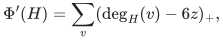
which starts at zero, and trigger a partition only at degree
<code class="math">d&gt;12z</code>. The same partition with parameter <code class="math">z</code> creates pieces of
degree at most <code class="math">3z</code>, so its immediate potential drop is
<!-- math-display: 42daa6e51a06f93411045162
d-6z>d/2\geq z(p-1)/2.
-->
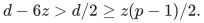
The final inequality follows because all but one of its <code class="math">p</code> pieces
carry at least <code class="math">z</code> incidences. The touched-set repair layers start
empty, so their new memberships have the pure prefix bound (9).
The potential argument now gives <code class="math">f=O(q)</code>, with no initial term,
and the settled ordinary child transcript after publication has
<code class="math">O(Rq)</code> updates. Initialization still has actual size <code class="math">O(mR/k)</code>.
The maximum settled degree is now <code class="math">12z</code>, only a constant change.

The new base routes are longer than those of Section 2, but not
enough to change (21). Starting (19) with
<code class="math">\log L_{\rm base}'=O(K\log\Gamma)</code> and
<code class="math">\log(C_{\rm base}'/(Ak))=O(K^2\log\Gamma)</code> still yields
<code class="math">\log L_K=O(K\log\Gamma)</code> and
<code class="math">\log(C_K/(Ak))=O(K^2\log\Gamma)</code>. In particular no cubic power of
<code class="math">K</code> is introduced. Future splits and deletions can only decrease
the ancestor congestion of the frozen route records.

This normalization is performed once, before child publication, in
each parent period. Repeating a global route copy after every update
would not have the claimed cost. The unnormalized construction and
the safe initial-credit recurrence below remain valid independently
of this optional step.

## 7. The same 14/15 recurrence

Apply the existing fixed port-fiber degree reset after the settled
selected graph. Take a port cap <code class="math">C=R^{O(1)}</code>, and enlarge
<code class="math">P=R^{O(1)}</code> to cover the fiber size, child edit encoding, root-pool
factor, and additive initial credit. The root fiber identities,
inactive-fiber suppression, and exact scaling remain those of the
degree-reset construction.

For <code class="math">r</code> remaining levels write <code class="math">G_r</code> for flat occurrence/answer
size, <code class="math">J_r</code> for an initial ALLOWANCE per parent record, and <code class="math">T_r</code>
for amortized update work. The allowance includes work caused later
by initial recourse credit; it is not a claim that all of that work
is done at initialization. With fixed constants safe coupled bounds
are:

<!-- math-display: 9d99202e28a7f1b67273a8e5
\begin{aligned}
 G_r&\leq P(G_{r-1}+1),\\
 J_r&\leq W+P(G_{r-1}+1)
                   +(P/k)(J_{r-1}+T_{r-1}),\\
 T_r&\leq O\bigl(kW+kP(G_{r-1}+1)\bigr)
                   +O(P)(J_{r-1}+T_{r-1}).
 \end{aligned}
 \tag{22}
-->
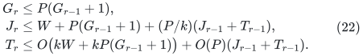

In the second line, <code class="math">(P/k)J_{r-1}</code> charges the actual small child.
The separate <code class="math">(P/k)T_{r-1}</code> term charges the <code class="math">mP/k</code> child UPDATES
that may occur later when initial recourse credit is spent. Calling
that credit an initialization allowance does not make those updates
cost <code class="math">J_{r-1}</code> each. On a completed parent period, dividing the
entire allowance by <code class="math">\Theta(m/k)</code> parent edits contributes
<code class="math">O(P)(J_{r-1}+T_{r-1})</code>. The ordinary <code class="math">P</code> child updates per parent
edit fit in the same term. Initial or incomplete periods retain the
displayed <code class="math">mJ_r</code> allowance. The full initial credit is not recharged
after every edit.

To solve these coupled bounds, set <code class="math">H_r=J_r+T_r/k</code>. Since
<code class="math">(J_{r-1}+T_{r-1})/k\leq H_{r-1}</code>, equations (22) imply

<!-- math-display: 39bb98619950979e32bf5f65
H_r\leq c\bigl(W+P(G_{r-1}+1)\bigr)+cP H_{r-1}
-->
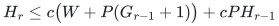

for a fixed <code class="math">c</code>, while <code class="math">G_r\leq P(G_{r-1}+1)</code>.
Consequently <code class="math">H_r\leq (c'P)^{r+1}W</code> after enlarging the common
local/base envelope, and
<code class="math">J_r\leq H_r,\ T_r\leq kH_r</code>. Thus there is one overall polynomial
factor in <code class="math">k</code>, not a factor <code class="math">k</code> at every recursive level.

Let <code class="math">x=\log k</code>. The recursion has depth <code class="math">O(U/x)</code>. Equations
(17), (21), and (22) give a total logarithmic overhead bounded by a
constant multiple of

<!-- math-display: ae4f2aabb43ba417f104620f
x+K^2U^{2/3}\log(U+2)
       +\frac{U^2}{Kx}
       +\frac{U^{5/3}(K+1)\log(U+2)}{x},
 \tag{23}
-->
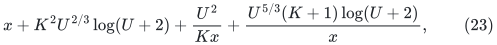

plus smaller logarithmic terms. The <code class="math">K</code> part of the last term
explicitly includes multiplication of the one-level
<code class="math">\Gamma^{O(K)}</code> quality loss through <code class="math">O(U/x)</code> levels.
With

<!-- math-display: b917dd523c82251b2b2922bf
K=\Theta\bigl(U^{2/15}(\log(U+2))^{-2/5}\bigr),\qquad
 x=\Theta\bigl(U^{14/15}(\log(U+2))^{1/5}\bigr),
 \tag{24}
-->
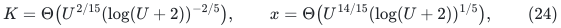

this is <code class="math">O(U^{14/15}(\log(U+2))^{1/5})</code>. Literal integer choices,
master length/gradient caps, raw-certificate computation, and finite
guards can be those of the current 14/15 degree-reset note, with their
fixed constants enlarged. This alternative batching proof does not
invoke the old restriction <code class="math">K=o(\log^{1/6}m/\log\log m)</code> from the
different KMPG worst-case spanner theorem. Its elementary clock
construction only requires <code class="math">K\leq O(U)</code>, and its static calls use
the stated actual-input static primitive.

For the finite program, replace the analytical factors <code class="math">A,\Gamma,r,z</code>
by the existing declared dyadic caps of the form
<code class="math">2^{c_C(\lceil U/K\rceil+\lceil U^{2/3}\rceil \lceil\log_2(U+4)\rceil+\lceil\log_2(U+4)\rceil)}</code>, raised to fixed
powers where needed. Use one such cap for the feedback threshold and
check the selected-membership prefix on every intermediate cascade.
Some fixed enumerated <code class="math">c_C</code> eventually dominates all the fixed
polynomial and static-source constants. Thus no unknown asymptotic
constant is supplied as executable advice. The child prefix guard is
the initial-credit guard just specified, rather than a pure <code class="math">Rq</code>
guard.

The maximum stretch of a one-level spanner is
<code class="math">\Gamma^{O(K)}</code>. Its multiplication through the hierarchy and the
single terminal local extraction factor fit within (23). The
arbitrary-graph matching driver, exact projection recovery, and
finite-program verification wrapper are not changed by this note.

## 8. What this alternative does and does not establish

Subject to the named stable-core, static-sparsifier, and dynamic-tree
interfaces, the construction supplies actual-size initialization,
bounded selected degree, a complete settled ordinary transcript,
explicit short demand routes and route-change reports, and the
existing exact raw flat lift. Its prefix child bound includes the
necessary initial credit. Arbitrarily many initially loop-only cores
are not charged as child vertices or selected initial edges.

This replaces the source's worst-case degree-control dependency by
the explicit amortized potential and publication argument above.
It retains the current 14/15 asymptotic envelope. Removing the
<code class="math">L(\Pi)</code> congestion factor in (2), or proving a different route
repair theorem, could improve the local-work recurrence. That alone
does not imply an 8/9 raw-backend bound: the accumulated
<code class="math">O((U/x)K\log\Gamma)</code> inverse-quality exponent must also fit the
new target. Under the naive balance <code class="math">x\asymp K\log\Gamma</code> this
quantity is <code class="math">\Theta(U)</code>. Neither a better static theorem nor a
better full quality balance follows from cheap base initialization
or from degree feedback alone.

## Primary references

* [Kyng, Meierhans and Probst Gutenberg, arXiv:2311.06402v1](https://arxiv.org/pdf/2311.06402v1),
  Lemma 3.5, Theorem 3.8, and Claims 3.16--3.18.
* [Chen, Kyng, Liu, Meierhans and Probst Gutenberg, arXiv:2311.18295v1](https://arxiv.org/pdf/2311.18295v1),
  Section 7.2, Algorithm 7, Lemma 7.14, and the geometric rebuild
  argument in Lemma 7.16. Its length-free restatement of static
  congestion is not used here.
* [van den Brand et al., arXiv:2309.16629v1](https://arxiv.org/pdf/2309.16629v1),
  Theorem 8.1 and its proof, including the input-path-length factor.
* [Kyng, Meierhans and Zöcklein, arXiv:2408.11375](https://arxiv.org/pdf/2408.11375),
  Claim 4.6 and Algorithm 2, for an independent primary precedent for
  amortized degree feedback and child publication after settlement.
