# A finite-bit petal-tree adapter with polynomial aspect-bit overhead

**Research construction, 24 October 2026.** This note uses the
weighted petal geometry of Abraham--Neiman (AN), with explicitly represented
geodesic portals. It does not use the earlier unpromoted weighted-star
reconstruction.

The stable-forest application needs stretch polynomial in its master
parameter U. Its input lengths have b_*=poly(U) bits. It is therefore
sufficient here to obtain stretch and work polynomial in b+log(m+2), rather
than insist on a stretch bound independent of b. This permits a simpler
finite-arithmetic implementation: **omit short-edge contractions**, use a
coarse event-based radius test, and count all recursion depths explicitly.

## 1. Interface and the retained geometric theorem

Let G be a connected undirected multigraph on n original vertices, with
m nonloop edges and positive integral lengths 1 <= ell_e <= 2^b. Parallel
IDs are distinct. A singleton is returned directly. Set

<!-- math-display: 7c684a413f608e5f491f29e0
B=b+\lceil\log_2(n+m+4)\rceil+4,\qquad H=16B.                \tag{1}
-->
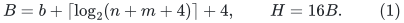

The adapter returns an actual spanning tree of G with total stretch

<!-- math-display: fc4612cfb9741ca4cadde239
\sum_{e=uv}\frac{d_T(u,v)}{\ell_e}
                       \leq m\mathrm{poly}(B),         \tag{2}
-->
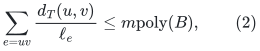

using (m+n) poly(B) bit operations. The polynomial degrees are fixed.
The tree may subsequently be rooted at any prescribed original vertex.

The imported geometric part is AN's petal construction and its highway
proof, not its optimized radius selector. Its required properties are:
petal radii lie in [R/2,R]; remaining center-to-vertex shortest paths stay
inside the remaining set; a child has radius at most 7/8 of its parent's;
and the assembled tree has center-to-vertex distance at most four times
the current distance. AN Sections 3--4 prove these using geodesic portal
locations and the rule that a highway has half its **original** length.
Section 6 supplies the weighted interpretation; Section 7 gives the
private directed metric for a petal.

We spell out the portal interpretation and arithmetic below. In particular
we do not identify a ball's chosen radius with the maximum distance of
the old vertices that happen to be inside it.

## 2. Geodesic portals, highways, and terminal calls

At a call with center x and radius Delta, fix a shortest-path tree rooted
at x, containing the call's prescribed x-to-target path. Distances and
that parent tree are frozen throughout the partition, apart from literal
subdivision of its edges. The first petal uses R=Delta/4; subsequent
petals use R=Delta/8.

To construct this tree, first compute the exact root distances. For each
nonroot vertex of the prescribed shortest highway, fix its predecessor
to the previous highway vertex. At every other vertex choose a tight
predecessor deterministically. All working lengths are positive, so
distance strictly decreases along every chosen predecessor and no cycle
is possible. This is a shortest-path tree containing the required path.
A fresh symbolic edge ranking is not assumed to select that inherited
highway automatically.

Each working target t' is the point at distance Delta/2 from x on a
chosen center-to-target path. If the first prescribed target is closer,
append a single pendant weighted edge of length
Delta/2-dist(x,t) and use its far endpoint. There is never a unit-edge
expansion of that length. If the point is inside an edge, split that
edge at its exact offset. A selected petal radius r gives its center
p_r at distance r from t' toward x. Split there too if necessary.
The bridge goes from p_r to its preceding vertex toward x.

Distinguish the first WORKING target t'_1 from the first child's
PRESCRIBED target t_1. When the old target t is at distance at least
Delta/2, t'_1 is the intervening point at Delta/2 but t_1 remains t.
When a pendant extension is needed, both t'_1 and t_1 are its new far
endpoint. For every later child t_j=t'_j. The stigma's prescribed
target is the preceding endpoint y_1 of the first bridge. These literal
assignments ensure that inherited half-length segments remain on the
new first-child or stigma highways.

Thus

<!-- math-display: dc0e3daf831d0eaccc8bdf18
d(x,t')=\Delta/2,\qquad d(x,p_r)=\Delta/2-r.                 \tag{3}
-->
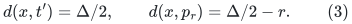

For the first petal the second quantity is in [Delta/4,3Delta/8]; for
the others it is in [3Delta/8,7Delta/16]. These are the actual
geodesic inequalities used in the highway and radius proof. A missing
old vertex at a particular radius is handled by a portal, not by a
false equality about the old central ball's radius.

Each segment retains its base geometric length. Its current working
length is either that length or half of it. Setting a highway to half
length means half of its base length, never half of an already halved
length. When an edge is subdivided, the flags and the base lengths are
split consistently. The first-child and stigma target paths contain all
inherited halved segments; the other child paths are disjoint from them.
This is the invariant used in AN's highway proof.

Terminate a call containing at most one ORIGINAL vertex by retaining its
whole current tree. It really is a tree: the expanded graph contains only
subdivisions of original nonloop edges and pendant additions, so every
cycle would contain at least two original vertices. Equivalently one may
return a rooted shortest-path tree containing the prescribed highway.
In base lengths it has distance at most twice each current root distance,
and the target highway retains its required exact length. This is a
stronger base case for the imported factor-four induction. Terminal
portals leave the active recursion but remain in output connector
records until unpacking.

Any two original vertices still in one current graph have distance at
least 1/2: their path is a subdivided path of G, with each portion at
least half its original length. Added pendant edges cannot shortcut it.
A nonterminal call consequently has radius at least 1/4, even when its
center is a portal. The initial radius is at most n*2^b, and child radii
decrease by 7/8. Hence the number of nonterminal depths is less than H.
This argument would not be literal after persistent contractions; the
adapter performs no short-edge contractions at all.

The use of this original-edge output in stable core forests, including
the noncircular stored-label bit induction, is proved separately in
[the stable-forest integration lemma](polynomial-bit-stretch-stable-forest-integration.md).

## 3. One static private metric for every petal

On the current remaining graph write d_x(v)=dist(x,v). For an oriented
edge u->v of working length ell, the ordinary private length is

<!-- math-display: e5c2ff6021a1ca65ca720c0c
a(u,v)=\ell+d_x(u)-d_x(v).                 \tag{4}
-->
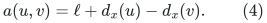

These lengths are nonnegative. On **every** arc of the chosen target-
to-root highway, use ell/2 instead, including beyond the eventual p_r.
No other arc is changed. Denote this static directed graph by P.

This complete prehalving gives the same radius-r/2 ball as AN's
prefix-only interpretation. Put z=d_x(u)-d_x(v). Every private arc
has length at least z/2: an ordinary arc has ell+z, and a highway arc
has ell/2=z/2. Telescoping along any walk from t' to its highway point
p_k gives length at least k/2. The highway attains this bound. Therefore

<!-- math-display: 34ce84ba34517c113558e62e
d_P(t',p_k)=k/2.                       \tag{5}
-->
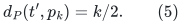

A ball of radius r/2 cannot reach a point beyond k=r. This includes
interior points of a straddling highway edge. Prehalving beyond that
point cannot add a reachable endpoint or exit.

The petal/ball identity also has a direct proof in this static metric.
For 0<=k<=r, the cone based at p_k contains exactly the points v with

<!-- math-display: 938b487f79ded4173a9e6e3d
d_G(p_k,v)+d_x(p_k)-d_x(v)\leq (r-k)/2.                 \tag{5a}
-->
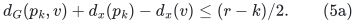

If v satisfies (5a), follow the highway from t' to p_k, at private
cost k/2, and then a shortest ordinary working-metric path from p_k
to v. Replacing some ordinary reduced arcs by highway arcs only
decreases its private cost. The second path therefore costs at most
d_G(p_k,v)+d_x(p_k)-d_x(v), so v lies in the private ball of radius
r/2.

Conversely, take a private t'-to-v path of cost at most r/2, and let
p_k be its LAST point on the entire chosen highway. The prefix costs
at least k/2 by the potential-drop inequality above. The remaining
tail uses only unmodified arcs, so its exact reduced cost is its
working length plus d_x(p_k)-d_x(v). That is at least the left side
of (5a). Nonnegativity gives k<=r, and the total path budget gives
(5a). If v itself is on the highway, choose p_k=v and the tail is
empty. Thus the private ball is precisely the union of these cones,
including exact subdivision points. This proof does not use a
changing-metric or printed radius-induction claim.

This also directly justifies reusing the frozen root distances during
the entire partition. An outward arc of the frozen shortest-path tree
has ordinary private cost zero and is not one of the modified
target-to-root arcs. A private ball is therefore closed under taking
descendants along that tree, as long as those descendants remain in the
current graph. Removing the ball leaves the whole frozen root path to
every surviving vertex. The root x itself is outside the petal because
its private distance from t' is Delta/4, greater than r/2. Thus the
frozen paths remain shortest paths in the remaining graph; there is no
new full-source shortest-path computation after each petal.

Run a truncated Dijkstra search in P, with exact dyadic distances. The
relevant radius events are r=2*d_P(t',v). Intersect every interval between
successive events with [R/2,R], and test its midpoint when that intersection
has positive length. Process a tied event in full before inspecting the
next open interval. The midpoint convention avoids deciding a pre-event
boundary from the closed ball after that event. If the heap is empty, the
final interval extends to R. The radius never advances by one unit or by
another numeric-magnitude-dependent step.

Highway membership is tested against the frozen parent shortest-path
tree; it is not established by scanning the full target-to-root path
for every petal. Standard deterministic dynamic-tree path queries support
edge subdivisions and pendant attachment in logarithmic amortized work
within this one static call. An original static tree plus equivalent
path-index dictionaries is also sufficient. No amortized tree history
is forked.

## 4. An exact coarse boundary test

For each original input edge e choose the dyadic capacity

<!-- math-display: fd3ffd15ca16006c145d57ef
c_e=2^{-\lceil\log_2\ell_e\rceil}.
 \qquad \frac1{2\ell_e}\leq c_e\leq\frac1{\ell_e}.          \tag{6}
-->
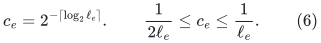

Every subdivided portion of e has this SAME capacity. Artificial pendant
edges have capacity zero. Let ell_f be a portion's current working
length. The sum of c_f*ell_f over all current portions at any depth is
at most m; subdivision preserves the sum, and highway halving reduces it.
In particular tiny portal segments do not create enormous reciprocal
mass. The capacity is derived from the original edge, not its short
portion.

For a current petal W define

<!-- math-display: 087ecde9995f87fd0b96d085
C(W)=\sum_{f\in\partial W}c_f,\qquad
 V(W)=1+\sum_{f:\,f\text{ has an endpoint in }W}c_f\ell_f,
 \qquad \Lambda=\lceil\log_2(4m+4)\rceil.                    \tag{7}
-->
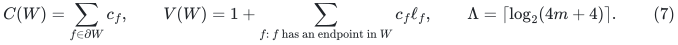

Take the first inspected midpoint in [R/2,R] satisfying

<!-- math-display: 77f0b716de5b35e77e43ee38
C(W)\leq\frac{128\Lambda}{R}V(W).    \tag{8}
-->
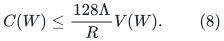

Such an event occurs before R. Here is an independent region-growing
proof. Write tau(v)=2*d_P(t',v). Since both private orientations of an
edge have length at most 2*ell_f,

<!-- math-display: 106da5333d534974982cbfb4
|\tau(u)-\tau(v)|\leq4\ell_f.         \tag{9}
-->
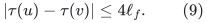

Let a_f=min(tau(u),tau(v)), z_f=|tau(u)-tau(v)|, and define the
continuous auxiliary volume

<!-- math-display: 8e891093ff9f20d946d143db
F(r)=1+\sum_f c_f\min\{\max\{r-a_f,0\},z_f\}.           \tag{10}
-->
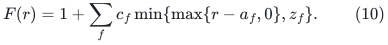

Away from events F'(r)=C(W_r), while 1 <= F(r) <= 1+4m. Integration
over [R/2,R] supplies a point with C(W_r)/F(r) at most
2*ln(1+4m)/R. Also F(r) <= 4V(W_r). Between events both C and V
are constant, so the same accepted set passes at the midpoint of the
corresponding nonempty interval intersected with [R/2,R]. In particular,
the executable test uses the incident volume V, not the affine F.
Equation (8) has ample constant slack. This proves
termination without evaluating a logarithm or an irrational threshold.

All boundary and volume sums in (7) have a common dyadic denominator.
The test is an exact integer cross multiplication. It is not a comparison
whose required precision depends on closeness to an irrational value.

## 5. Portal inventory and total stretch

Only a constant number of fresh points is created for a child: its
working target, its petal center, and possibly the first pendant target.
All belong to that child. The preceding endpoint of a bridge is an
already present vertex; the stigma's new target is that old endpoint.
In particular portal creation for a terminal child does not leave a
fresh population of vertices in the nonterminal stigma.

Within a partition all fresh points have center distance at most Delta/2.
Every later petal removes an old vertex outside that ball: choose its
working target on the fixed tree path to such a vertex. That vertex is
in the petal by the source's forward-path property. Thus the number of
petals is at most the old vertex count plus one, without repeatedly
creating new outside vertices.

At each depth the nonterminal clusters have disjoint original vertex
sets and each contains at least two originals. At most O(n) fresh portals
can therefore be passed into the next nonterminal depth. Inherited live
portals are passed to at most one child. The number of live auxiliary
vertices at depth d is O(nd), and the total current edge inventory is
O(m+nd): an edge split or pendant attachment increases both counts by
only a constant. Terminal output records are kept but are not processed
again. Summing over d <= H costs O((m+n)H^2) records.

Charge each original edge at the first partition separating one of its
portions. Before that separation its two original endpoints are in the
same parent. The factor-four radius theorem bounds its final tree
distance by 8*Delta. By (6), its reciprocal length is at most twice the
capacity of that separated portion. Equation (8), with R equal to
Delta/4 or Delta/8, consequently bounds the total charge of that petal
by O(Lambda*V(W)).

During a partition, an edge's incident mass is charged at most once:
after its first petal endpoint is removed, it is absent from the remaining
graph. Subdivision preserves that mass. The added one in V is charged
to the number of petals. Summing by depth gives total stretch

<!-- math-display: c9fcdf7af18d07dbdd0d8bd1
O\big((m+n)\Lambda H^2\big)
                         =m\mathrm{poly}(B).           \tag{11}
-->
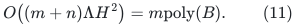

Every original edge is charged before both endpoints could reach a
terminal call, since such a call contains at most one original vertex.
We do not need the optimized AN active-scale or minimal-index argument.

The expanded result is a tree on original vertices and the stored portals.
Repeatedly remove every leaf that is not an original vertex, then suppress
every remaining nonoriginal degree-two point. The leaf rule includes both
artificial pendant extensions and dangling portions of subdivided original
edges. Removing only the explicitly added pendant extensions would not
specify what happens to the latter portions.

**Original-edge extraction lemma.** This pruning and suppression returns
an actual spanning tree of G and preserves all distances between original
vertices, measured in base lengths.

**Proof.** Removing a nonoriginal leaf cannot change the unique tree path
between any two original vertices. Repeated removal therefore retains the
minimal subtree containing all original vertices; its vertices and edges
remain connected and acyclic. Each artificial pendant extension was
attached at only one old point. Its branch contains no original vertex,
so the entire extension is removed. Once these extensions are gone, an
interior point of a subdivided original edge has degree at most two in
the expanded graph. Every retained nonoriginal point consequently has
degree exactly two. A retained path between consecutive original vertices
cannot stop inside an original edge, change to another edge at an interior
point, or enter a pruned pendant extension. It must be the complete chain
of one original edge, with that edge's original identifier and total base
length. Suppression replaces exactly that chain by its original edge.
It preserves connectivity, acyclicity and the lengths of all paths between
original vertices. Parallel edge identifiers remain distinct. A singleton
original graph is returned as its single vertex. This proves the claim. ∎

A queue of nonoriginal leaves and a traversal of the surviving chains
perform the extraction in time linear in the expanded output inventory,
which has already been charged above. In particular the distance bound
used in (11) survives the extraction without an additional stretch factor.

## 6. Common denominator and actual sequential work

Suppose all base segments entering depth d lie on one dyadic grid.
Highway flags add at most one denominator bit. Computing a radius, taking
Delta/2, Delta/4 or Delta/8, forming (4), and prehalving highway arcs add
only a fixed number more. Dijkstra keys are sums, not products, of these
lengths. Its event radii are twice those keys, and the selected interval
midpoint adds only one denominator bit. A portal offset is a
difference of a radius and a tree-path distance; converting a position on
a halved portion to its base length multiplies by two.

All petals of ONE call use the same frozen working metric. Newly created
target/center points belong to the removed petal, so their denominators
do not accumulate through later petals of that call. Thus a generous
common grid 2^{-10(d+1)} relative to the integral initial input contains
all coordinates needed by its children. Through H depths, numerators and
denominators have O(b+H+log(m+nH+2))=poly(B) bits. The capacities (6)
and volumes (7) add only the common initial b denominator bits.

The remaining vertices keep their center distances after each petal,
so the reduced arc formula (4) reuses those labels. A petal search scans
arcs only from vertices it settles and then removes; queued but unsettled
records are charged to those scans. Sparse labels and ordinary heaps
avoid a graph-sized initialization per petal. Each original or current
portal vertex is removed once within that partition. Implicit highway
membership and literal subdivisions add only logarithmic dynamic-tree
work per inspected arc or created point.

Marking child highways also costs only linear work in that partition's
inventory: the center-to-target paths lie in disjoint child graphs.
Their common base-length flags are updated once. Combining this fact,
the record bound in Section 5, and ordinary exact multiword arithmetic
gives (m+n) poly(B) bit work.

Shortest-path ties use fixed deterministic choices. A frozen parent path
is subdivided in place, never retroactively redefined by fresh ranks on
its pieces. For a fresh invocation, the
[symbolic shortest-path tie implementation](deterministic-symbolic-shortest-path-ties.md)
is available on the common grid for distance computation and private
searches. The prescribed-highway predecessor rule above takes priority
when selecting the root tree. Its original-vertex and predecessor
IDs are actual records, with the inventory already charged above.

## 7. Stable-forest use and scope

Apply this primitive to the at-most-2m replica graph from the
component-local weighted call. Positive smoothing, replica ceilings and
the reciprocal-ordering proxy multiply (11) by fixed constants or
polynomials already accounted for in the stable-forest construction.
Original importance weights use their actual bit lengths; no magnitude-
proportional replication is made.

Only the resulting original spanning tree is exported. CKL's rooted
ancestor hierarchy and fixed stretch-label products use the original
integer lengths, exactly as before. A poly(B) effective tree-stretch
factor is enough because B=poly(U) in the numerical backend. Forest
counts, high-stretch thresholds, component initialization and update
work gain only fixed polynomial factors in U. There is no factor 2^b
and no exponent depending on p, r or K.

This is an arithmetic/work adapter to the stated weighted AN geometric
construction. It does not replace its geometric proof with the output
matching verifier. It explicitly uses the weighted portal interpretation,
the radius/highway induction and the source's petal/ball identity.

## Primary source locations

* Abraham--Neiman, *Using Petal-Decompositions to Build a Low Stretch
  Spanning Tree*: Sections 3--4 (Claims 1--12 and Lemma 13), weighted
  interpretation in Section 6, and the directed metric/Claim 15 in
  Section 7.
  [Author full text](https://www.microsoft.com/en-us/research/wp-content/uploads/2012/01/spanning-full1.pdf).
* Abraham--Bartal--Neiman, *Nearly Tight Low Stretch Spanning Trees*,
  Appendix A, explains the weighted geodesic portal interpretation.
  Its randomized partition is not called by this adapter.
  [Primary full text](https://arxiv.org/pdf/0808.2017).
