# Independent audit of the any-source fixed-tree matching interface

**25 October 2026. Independent mathematical and implementation audit.**

This audit concerns [any-source-fixed-tree-matching-interface.md](any-source-fixed-tree-matching-interface.md), with its
operative initialization and feasible labels defined using the persistent
conservative donor prices

<!-- math-display: 603899764072b5a5469ac1a9
\bar c_e=\left\lceil H/(4\ell_e)\right\rceil,
             \qquad \ell_e<x_e<2\ell_e.
-->
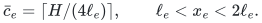

The local interface passes the checks below. It does **not** bound the
number or total construction cost of refreshed shortest-path forests and
does not improve the established matching exponent. Polynomial magnitude
guards, the common primal grid, and the actual matching comparison are
explicit imports from the existing matching ledger. A guard or structural
repair terminates the current epoch.

The distinction between conservative initialization and true-price
initialization is material. It is resolved in Sections 1 and 6 below;
certificates for these two graphs must not be combined.

## 1. Initialization must use the same conservative graph as the detector

Write <code class="math">\alpha_v=1/s_v</code>, and use source and terminal prices

<!-- math-display: a26ae2454b3366f47c8207f8
\sigma_v=\lfloor 3H\alpha_v/4\rfloor,
 \qquad \tau_v=\lceil5H\alpha_v/4\rceil.
-->
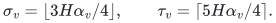

The source arc to a bin has cost <code class="math">A-\sigma_v</code>, receiving arcs have cost
zero, and donor arcs have cost <code class="math">\bar c_e</code>. Choose a nonnegative integer
offset <code class="math">A\ge\max_v\sigma_v</code>. The exact initial distances and a directed
shortest-path tree in **this graph** are denoted by <code class="math">D</code> and <code class="math">T</code>.

After deleting the artificial source, the tree is a directed forest rooted
at its source-child bins. All receiving tree arcs have equal labels at their
endpoints. Each allocation incidence can contribute at most one orientation
to the tree, because including both orientations would create a directed
two-cycle. Therefore every allocation changed by a tree transfer has a fixed
motion direction throughout this epoch.

The conservative lengths obey

<!-- math-display: 4c0979edcb3011ad9aae5b5c
\frac{H}{4x_e}\le\bar c_e<\frac{H}{2x_e}+1.       \tag{A1}
-->
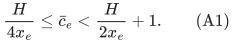

Any directed bin-to-bin path whose true one-sided ratio exceeds one half
satisfies

<!-- math-display: 51e6f7948be072ead18c11f8
L_x(a,b)<\alpha_a-3\alpha_b.
-->
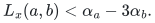

Consequently its unrounded conservative threshold margin is greater than
<code class="math">(\alpha_a+\alpha_b)/4</code>. A simple path has at most <code class="math">N</code> donor arcs;
donor ceilings and the two endpoint roundings lose at most <code class="math">N+2</code>
integer units. The requirement

<!-- math-display: 6c4065746f0fec72fe1a2d37
H\min_v\alpha_v\ge8(N+2)             \tag{A2}
-->
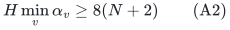

leaves a strict positive margin. An exact conservative shortest path to its
terminal is no more expensive. Thus a newly built conservative SPT contains
a passing source-child-to-bin path whenever the genuine matching comparator
exists.

There is an even stronger fresh-state statement. Suppose no source-child
path in this freshly built SPT passes the integer test. If <code class="math">a</code> is the
source child on the SPT path to <code class="math">b</code>, exactness gives

<!-- math-display: 547bbda1edfe27e090e1bcde
D(b)=A-\sigma_a+\bar L(a,b)\ge A-\tau_b.
-->
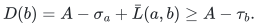

For <code class="math">\pi_v=(A-D(v))/H</code>, this yields

<!-- math-display: b1f535972570f4316a0093a7
\pi_b\le\tau_b/H\le5/(4s_b)+1/H,
 \qquad
 \sum_b(s_b\pi_b-5/4)_+\le\frac{\sum_b s_b}{H}.         \tag{A3}
-->
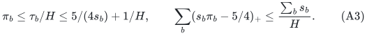

The right side is at most <code class="math">N</code> under the certificate scale below. Fresh
TREE-EMPTY therefore supplies a semantic LOW certificate. This implication
is only asserted at fresh initialization: after numerical steps the fixed
tree need not remain shortest.

An SPT built instead for <code class="math">\lceil H/(4x_e)\rceil</code> is a valid object for the
older local feasibility lemma, but its selected path need not minimize the
conservative path price. The existence of a passing conservative path then
does not by itself show that this different SPT contains one. The operative
interface avoids this unsupported implication by using <code class="math">\bar c</code> for both
initialization and detection.

## 2. Any starting bin preserves the fixed labels

For an ancestor bin <code class="math">a</code> and descendant bin <code class="math">b</code>, the detector accepts
when

<!-- math-display: 942b890bb1f1aba1b692680b
\sigma_a-\tau_b-\bar L(a,b)>0.       \tag{A4}
-->
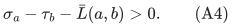

The transfer subtracts <code class="math">\eta</code> from every donor allocation, adds it to
every receiver allocation, increases <code class="math">s_a</code>, and decreases <code class="math">s_b</code>.
Internal row and bin equations are preserved exactly. The path is simple,
so there is no hidden multiplicity in these updates.

Assume that the unchanged labels <code class="math">D</code> are feasible immediately before the
transfer. Tree donors decrease, so their registers can only reset downward
and their conservative prices cannot decrease. Tree receivers increase;
their reverse donor price can decrease when its register resets upward.
That reverse edge is still feasible because the receiving tree arc was
<code class="math">D</code>-tight at initialization and its two endpoint labels remain equal.
Unchanged incidences preserve their previous inequalities.

At the starting bin, the source cost increases. At the terminal bin,
feasibility along the current conservative tree path gives

<!-- math-display: df80fcd58dcbc0186ab1e70b
D(b)\le D(a)+\bar L(a,b)
            \le A-\sigma_a+\bar L(a,b)<A-\tau_b.         \tag{A5}
-->
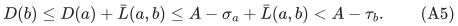

Thus its current source inequality has margin greater than
<code class="math">\tau_b-\sigma_b\ge H\alpha_b/2</code>. If
<code class="math">\eta\alpha_b\le1/256</code>, the source-cost decrease is at most

<!-- math-display: c3883ea08bb900201f1beaa8
\frac{3H\alpha_b}{4}\,
 \frac{\eta\alpha_b}{1-\eta\alpha_b}+1,
-->
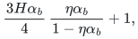

which is less than the available margin by (A2). No source-tightness at
<code class="math">a</code> was used. This is the precise reason an intermediate bin may start
the transfer.

Acceptance also implies <code class="math">\alpha_a&gt;(5/3)\alpha_b</code>. The new reciprocal
at <code class="math">a</code> decreases, and that at <code class="math">b</code> is at most
<code class="math">(256/255)\alpha_b&lt;\alpha_a</code>. Hence the largest bin reciprocal never
increases, and the fixed offset <code class="math">A</code> remains valid.

This proof preserves one fixed feasible potential. It does not assert that
current exact shortest distances are monotone between arbitrary subsequent
non-shortest tree steps.

## 3. The heavy-light max-plus search is complete for its stated domain

For each tree vertex <code class="math">v</code>, let

<!-- math-display: eb0c196522a3d92e0eff2854
M_v=\max_{b\in T_v\text{ bin}}
       [-\tau_b-\mathrm{dist}_{\bar c}(v,b)]
-->
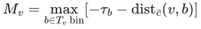

and let <code class="math">F_v</code> be the maximum of (A4)'s left side over ancestor-descendant
bin pairs inside <code class="math">T_v</code>. If the first bin is <code class="math">v</code>, its best value is
<code class="math">\sigma_v+M_v</code>. Otherwise both bins lie in a single child subtree.
These two cases prove the main note's recurrence, including the exclusion
of pairs in different branches.

Separating the heavy child gives the stated constant-size triangular
max-plus transformation. The <code class="math">M</code> state carries a terminal bin; a
coefficient from <code class="math">M</code> to <code class="math">F</code> carries the chosen starting bin; an
<code class="math">F</code> constant carries the complete pair. These metadata types are closed
under the required matrix compositions. No expanded tree path is needed
to report the two endpoint IDs.

A point price change affects one heavy-path product and then at most one
light-child dictionary at each ancestor heavy head. There are
<code class="math">O(\log &#124;T&#124;)</code> heads, each costing <code class="math">O(\log &#124;T&#124;)</code>. Thus the claimed
<code class="math">O(\log^2 &#124;T&#124;)</code> deterministic update bound is valid.

The implementation must propagate witness and tie metadata as well as
numbers. Equal maximum values can conceal a changed maximizing pair.
Propagating the full head state, or simply continuing unconditionally along
the affected head chain, avoids stale witnesses. This clarification is
present in the audited main note.

## 4. Implicit updates discover both register and guard events

An ancestor-descendant path consists of <code class="math">O(\log &#124;T&#124;)</code> heavy-path
intervals, with each edge indexed by its child. On a donor edge store
<code class="math">x-\ell</code>; on a receiver edge store <code class="math">2\ell-x</code>. Both buffers decrease
by exactly <code class="math">\eta</code> under the transfer. One lazy range-add/minimum
structure therefore identifies every expired register without inspecting
the complete path.

At an expired register, the exact current <code class="math">x</code> is recoverable from its
orientation, buffer and old register. Resetting <code class="math">\ell=3x/4</code> restores
the buffer to <code class="math">x/4</code> for a donor and <code class="math">x/2</code> for a receiver. A donor
reset changes one maintained tree price. A receiver reset changes only its
non-tree reverse donor price, already covered by Section 2's feasibility
argument.

Register expiration alone does not identify an allocation guard crossing:
different registers have different offsets. The additional guard buffer in
the corrected main note is therefore necessary. With fixed epoch guards
<code class="math">\chi_e,U_e</code>, store <code class="math">x_e-\chi_e</code> on a donor and
<code class="math">U_e-x_e</code> on a receiver. Both again decrease by <code class="math">\eta</code>. A path
minimum and its witness detect any proposed violation before committing the
step. The two endpoint slack guards are checked directly.

The donor-cost sum is an integer aggregate. Current allocation values can
be read on demand or materialized at epoch end. Full materialization is
charged to epoch rebuilding, not hidden in a cheap path update.

## 5. Grid, positivity, progress and finite arithmetic

Set

<!-- math-display: ae5ef58ab1482ddeace0976a
V_{\rm up}=\alpha_a+\alpha_b+4\bar L(a,b)/H.
-->
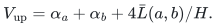

By (A1) it dominates the true one-sided path charge, and (A4) gives
<code class="math">G=\alpha_a-\alpha_b&gt;V_{\rm up}/4</code>. Choose a common-grid step with

<!-- math-display: fa8ee3f7ab481dc1206071cb
1/512\le\eta V_{\rm up}\le1/256.      \tag{A6}
-->
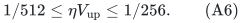

A polynomial guard range gives a fixed polynomial <code class="math">V_{\max}</code>.
A dyadic primal grid of spacing at most <code class="math">1/(4096V_{\max})</code> has a
multiple in every interval prescribed by (A6). Registers need only the
fixed grid four times finer than this primal grid. Their denominator length
does not grow with the number of resets.

The sum defining <code class="math">V_{\rm up}</code> contains only two endpoint reciprocals
and one integer sum divided by <code class="math">H</code>. Its exact numerator and denominator
have <code class="math">O(\log S)</code> bits under the stated guards. This does not require
forming a sum of unrelated reciprocals along the entire path.

Each donor and the terminal slack decreases by less than a <code class="math">1/256</code>
fraction. The row equations control receiving magnitudes; the explicit
guards handle the imported finite-range restriction. With
<code class="math">z=\eta V_{\rm up}</code>,

<!-- math-display: d3d1a7d5404a29c7ddf33d97
\Delta\Phi\ge\eta G-2z^2>z/4-2z^2\ge z/8
                      \ge1/4096.                       \tag{A7}
-->
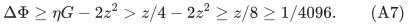

The endpoint, donor, and receiver updates therefore provide the claimed
positive step whenever a proposed step passes its explicit guards.

## 6. The conservative graph has a valid five-N semantic certificate

For the operative conservative graph, feasible labels imply

<!-- math-display: 7f14c08d21c0d3cd6839bf17
0\le\pi_d-\pi_r<\frac1{2x_e}+\frac1H,
 \qquad \pi_d\ge\frac3{4s_d}-\frac1H.                  \tag{A8}
-->
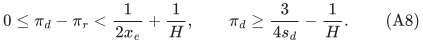

Let <code class="math">(x',s')</code> be the genuine comparison with the same row and bin
equations. Write <code class="math">h=x'-x</code>, <code class="math">h_s=s'-s</code>, and use the existing
normalized masses <code class="math">P,Q_s,Q_x</code>. Conservation gives

<!-- math-display: afb93326b10fd33e4456accd
\sum_d\pi_dh_{s_d}
 =-\sum_{e=(r,d)}(\pi_d-\pi_r)h_e
 \le\tfrac12Q_x+L|R|/H.                               \tag{A9}
-->
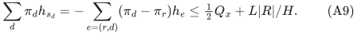

Let <code class="math">T_s=\sum_d s_d=\sum_d s'_d</code>, and define

<!-- math-display: 1d61f42c447cfdc20f6172a6
E=\sum_d(s_d\pi_d-5/4)_+.
-->
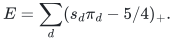

Separating positive and negative slack changes, using
<code class="math">(-h_{s_d})_+\le s_d</code>, and applying (A8)--(A9) proves

<!-- math-display: 0a191248f4653c81c8b54c3a
\tfrac34P-\tfrac54Q_s-\tfrac12Q_x
                 \le E+(L|R|+T_s)/H.                  \tag{A10}
-->
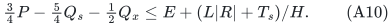

The actual matching comparison has <code class="math">P&gt;12N</code>, <code class="math">Q_s\le N</code>, and
<code class="math">Q_x\le3N</code>. Hence the left side is strictly greater than

<!-- math-display: 57f89f80070d436ea94b5084
9N-5N/4-3N/2=25N/4.
-->
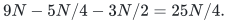

Choose <code class="math">H</code> also to satisfy <code class="math">(L&#124;R&#124;+T_s)/H\le N</code>. Then a promised
improvement requires <code class="math">E&gt;21N/4</code>, and **<code class="math">E\le5N</code> is a safe semantic
LOW certificate**. This is consistent with the stronger fresh-state upper
bound (A3).

All terms of <code class="math">E</code> share the fixed primal-grid denominator times <code class="math">H</code>.
The fixed potential changes no term except the two endpoint slack terms
during a tree step. Exact maintenance therefore takes constant many
finite-word term replacements. Rebuilding the potential pays for every
changed term.

The earlier true-price certificate in
[slack-potential-semantic-certificate.md](slack-potential-semantic-certificate.md) uses donor coefficient <code class="math">1/4</code>
and threshold <code class="math">E\le6N</code>. It remains valid for labels feasible for that
different graph. The operative conservative graph only supplies the
coefficient <code class="math">1/2</code> in (A8); it must use (A10), not the six-N screen.

## 7. Register accounting survives changes of epoch and direction

After a reset at value <code class="math">x_0</code>, the next reset requires either
<code class="math">x\le3x_0/4</code> or <code class="math">x\ge3x_0/2</code>. Thus each reset after the initial
one consumes a fixed positive amount of absolute logarithmic variation.
This remains true if later epochs reverse the incidence's tree role,
because a role change does not itself reset the register.

During a numerical step, only donor allocations contribute negative log
variation, which is at most

<!-- math-display: 4bd8967debfddf2998b090b3
2\eta\sum_{\rm donors}1/x_e\le2\eta V_{\rm up}=O(1).
-->
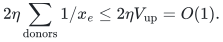

Over a coordinate lifetime, positive log variation is bounded by negative
variation plus its endpoint log difference. Polynomial magnitude guards
bound that difference by <code class="math">O(\log S)</code>. Explicit births, deletions and
sets contribute the same endpoint allowance. Therefore the total number of
register resets over <code class="math">J</code> numerical steps is

<!-- math-display: 6919176e24dc021cbcaab1f5
O\bigl(J+(N+A_{\rm ext})\log S\bigr). \tag{A11}
-->
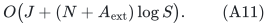

This is a history-wide count, rather than a per-epoch count. The two slack
endpoint price updates per accepted step add only <code class="math">O(J)</code> point events.

## 8. Exact status and remaining gap

The audited operative interface now has mutually consistent initialization,
threshold detection, fixed-label feasibility, and semantic certification.
It searches every ancestor-descendant bin pair in a supplied fixed forest;
finds and applies a qualifying path implicitly; discovers register and guard
events; and globally charges the register resets. A freshly initialized
forest either contains a passing path or already gives semantic LOW.

None of these results pays for the number of full shortest-path/DP rebuilds
after an old forest is exhausted. Later TREE-EMPTY is only a statement about
that old forest. Its fixed feasible potential may still have <code class="math">E&gt;5N</code>,
and useful paths may use non-tree arcs. Constant progress from at least one
step per fresh epoch is not an adequate near-linear rebuilding bound.

The remaining positive theorem must bound actual forest repair or creation
work, not merely re-use (A11) as if a price notification paid for a whole
SPT. No such theorem, and no resulting improved general-matching exponent,
is asserted here.
