# Parameter balance for the reconstructed backend

**Scope: optimizations within explicit cost models.** These
calculations are not lower bounds for matching, cycle detection,
dynamic graph algorithms, or all possible versions of this construction.
Sections 1--4 optimize the stated inequalities for uniform parameters.
Section 5 treats nonuniform shrink parameters in the separated distance
cost model. None of these optimization bounds is a running-time lower
bound for the underlying primitives.

Let `p` denote the exponent in the logarithm of the imported cover
factor. Here `p=41/42`. Write

    log k = U^x * polylog(U),
    kappa = U^t / polylog(U),
    log A = U^beta * polylog(U).

The outer recursion has depth exponent `1-x`. Its common running-time
envelope has exponent at least

    R >= max(x, beta+1-x).                         (1)

Logarithmic slack and hidden absolute constants are ignored in this
exponent-only optimization; the constructive notes separately supply
computable logarithmic margins.

## 1. Accumulating length aspect

Suppose each outer level adds O(U) length bits. Then the maximum
length bit bound has exponent `2-x`. The tree-family and routing
aspect terms require

    beta >= max(p+t, 2-x-t).                       (2)

For a fixed x, the two affine terms are balanced at

    t=(2-x-p)/2,
    beta=(p+2-x)/2.

This t is nonnegative for `0<x<=1` and `0<p<1`. Equations (1)--(2)
therefore give

    R >= max(x, (p+4-3x)/2).

The first expression increases with x and the second decreases.
Their intersection uniquely minimizes the maximum:

    x=R=(p+4)/5,
    t=3(1-p)/5,
    beta=(2p+3)/5.

For `p=41/42`, these are

    x=R=209/210,       t=1/70,       beta=104/105.

Thus `209/210` is the optimal balance in this PARTICULAR model,
including its O(U) per-level length-aspect accumulation premise.
Changing that premise, allowing nonuniform reductions, or using
a different primitive is outside this statement.

## 2. A uniform O(U)-bit length aspect

If a separately proved metric construction keeps all length bits
O(U), the aspect term instead requires

    beta >= max(p+t, 1-t).                         (3)

For every t, its right side is at least `(p+1)/2`, with equality
at `t=(1-p)/2`. Then (1) is minimized by balancing its two terms:

    beta=(p+1)/2,
    x=R=(beta+1)/2=(p+3)/4,
    t=(1-p)/2.

For the same cover exponent,

    x=R=167/168,       t=1/84,       beta=83/84.

This is only a conditional target until the O(U)-bit length
invariant is established. Gradient bit lengths may be larger if
their exact arithmetic remains polynomial in U and the distance
primitives and HRG aspect parameter depend only on lengths.

The difference between the two models is therefore precise:
removing accumulated LENGTH aspect changes the constraint
`2-x-t` to `1-t`. It is not enough merely to restate a fixed-depth
little-oh bound with a varying depth.

## 3. Leading logarithms in the preserved-aspect model

There is a further model-specific balance if the source cover has
its literal leading form

    log Gamma = c_Gamma U^p L,        L=log U,

with an adequate fixed constant, rather than an extra logarithmic
factor chosen to absorb an unknown coefficient. Keep the optimal
power exponents from Section 2 and write

    kappa = Theta(U^t L^y),
    log k = Theta(U^alpha L^z).

The tree-family logarithm is `U^beta L^(1+y)`, while the
O(U)-bit length aspect contributes `U^beta L^(-y)`. Thus if
`log A=Theta(U^beta L^f)`, the model requires

    f >= max(1+y,-y) >= 1/2.

The base and recursive terms then have logarithmic powers z
and f-z. Their maximum is at least f/2>=1/4. Equality is attained
at

    y=-1/2,         f=1/2,         z=1/4.

This gives the candidate common factor

    exp(O(U^(167/168) (log U)^(1/4))).

The calculation alone does not select adequate unknown constants
or prove the outer matching client's margin. An explicitly
enumerated fixed-constant family with final exact output checking
is one possible way to address that separate issue. It does not
change the power/log optimization, and it must not be confused
with a noncomputable choice of a size threshold. As throughout
this note, `1/4` is optimal only inside the stated uniform-
parameter cost model, not a lower bound on all algorithms.

## 4. Separate propagated recourse from local distance work

This is a different model, corresponding to the proposed
[distance degree reset](distance-degree-reset-candidate.md). It is
conditional on that construction's legal port reset and raw lift;
the algebra alone does not establish either interface.

Suppose the local distance primitive has

    log gamma = Theta(U^p L),             L=log U,
    log R = O(U/K + U^p L),
    log W = O(log k + K^2 U^p L),

up to fixed powers and polynomial factors. R propagates to recursive
edits and occurrence copies. W is only additive local work in the
update recurrence. The common envelope therefore has

    log E = O(log k + K^2 log gamma
                       + (U/log k) log R).              (4)

Write K=U^t times logarithmic factors and log k=U^x times
logarithmic factors. In the range where U/K dominates log R,
the relevant power exponent is

    r >= max(x, p+2t, 2-x-t).                            (5)

For any feasible x,t, the first two inequalities imply
x<=r and t<=(r-p)/2. Substituting in the third gives

    r >= 2-r-(r-p)/2 = 2+p/2-3r/2,

and hence r>=(4+p)/5. Equality is attained at

    x=r=(4+p)/5,          t=2(1-p)/5.                    (6)

At this point p+2t=x<1, so p+t<1-t. Thus the displayed U/K
term really does dominate the U^p contribution to log R, and the
per-level quality factor gamma^O(K) is smaller than R on the
power scale. For p=2/3 the balance is

    t=2/15,              x=r=14/15.                     (7)

The source's independent restriction on K must still be checked.
At the smallest nonbase size, log m is of order log k, so the
condition K=o((log m)^(1/6)/loglog m) requires t<x/6
before leading logarithms are considered. Equation (7) satisfies
this with strict power slack. For general p, (6) satisfies that
strict inequality only when p>8/13; no source conclusion is drawn
outside its permitted range.

For the leading logarithms at p=2/3, write

    K = Theta(U^(2/15) L^y),
    log k = Theta(U^(14/15) L^z).

The three leading logarithmic powers in (4) are

    z,                   1+2y,                 -y-z.     (8)

If v bounds all three, then z<=v and y<=(v-1)/2.
The last inequality yields
v>=-(v-1)/2-v=1/2-3v/2, so v>=1/5. Equality is attained at

    y=-2/5,              z=v=1/5.                       (9)

The candidate numerical factor in this model is therefore

    exp(O(U^(14/15) (log U)^(1/5))).

In particular K^7/log k is of order L^-3, providing an easy
eventual source-range check. An explicit integer parameter family,
fixed capacity guards, active-size periods, and the separated G/J/T
recurrences are given in the candidate note. A fixed-constant
portfolio and the matching client remain separate composition
obligations. Neither 14/15 nor 1/5 is asserted as a lower bound
for all algorithms or all implementations of the distance primitive.

## 5. Nonuniform shrink choices in the separated model

Allowing a different shrink parameter and spanner parameter at each
recursive level does not improve the `14/15` power while retaining
the same three charged expressions. Here is a direct finite-scale
calculation, stronger than a uniform-parameter optimization.

Let `u_i` be the logarithmic instance-size envelope at level `i`,
starting at `u_0=U`. Write `h_i=log k_i` and let `K_i>=1` be its
local spanner parameter. In this model a known logarithmic upper
budget `A` must pay, up to fixed positive constant factors,

<!-- math-display: 37fecd3a2cff2bd2e7d0ba3d
\max_i h_i,\qquad
 \max_i K_i^2 u_i^{2/3}\log(u_i+2),\qquad
 \sum_i\frac{u_i}{K_i}.
 \tag{10}
-->
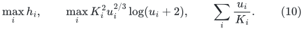

The first quantity represents local/base shrink work. The second
represents local spanner work, even granting the more favorable use
of each local size rather than one global master factor. The sum
represents propagated recourse. In the source size-envelope recurrence,
one level decreases `u_i` by at most a fixed multiple of `h_i`;
the positive selected-size overhead can only reduce that progress.
Here `u_i` is the envelope generated by that recurrence, not the
observed size on an easy input, whose child graph can shrink faster.
An exact terminal routine on logarithmic size `u` has cost exponential
in a fixed positive multiple of `u`, so a budget `A=o(U)` cannot
terminate while `u>U/2`.

If `A` is already a fixed positive fraction of `U`, it exceeds the
claimed sublinear expression and there is nothing to prove. Otherwise
the path from `U` to `U/2` uses at least `c U/A` levels with
`u_i>=U/2`, for a fixed `c>0`. The second expression in (10) forces

<!-- math-display: 236bc27013e5a077d6695fe8
K_i\le C\sqrt{\frac{A}{U^{2/3}\log U}}
-->
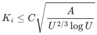

at each of those levels. Consequently their contribution to the sum
in (10) is at least

<!-- math-display: 622d4f1b439ddefa6959c51e
c'\frac U A\,
       \frac{U^{4/3}(\log U)^{1/2}}{A^{1/2}}
 =c' U^{7/3}(\log U)^{1/2}A^{-3/2}.
-->
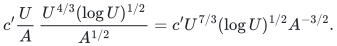

Requiring the common budget to dominate this quantity gives

<!-- math-display: f159f41b609cbeda871282ae
A\ge c'' U^{14/15}(\log U)^{1/5}.
 \tag{11}
-->
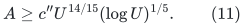

The uniform construction in Section 4 attains the order in (11).
Therefore merely adapting `k_i,K_i` to each local size does not improve
either displayed power in this charged model. One must change a
primitive's dependence, reduce propagated recourse, reduce the local
route cost, or find a different recurrence.

The distinction between a charged-model constraint and an algorithmic
lower bound is essential. An upper bound such as
`gamma^{O(K^2)}` is not a proof that the primitive takes that much
time. Sharper analysis or a replacement algorithm could change (10).
This section says only that the currently used positive expressions
cannot certify a better rate by nonuniform parameter selection alone.

## 6. Separating static output quality from static construction work

The new
[separated static construction](separated-static-sparsifier-parameters.md)
has two parameters, the cut-player depth <code class="math">r</code> and the expander
path hierarchy depth <code class="math">q</code>. With <code class="math">L=\log(U+2)</code>, its output factor
and local work factor are

<!-- math-display: 76a9bb3a5c2aee6499be4c70
\log\Gamma=O(qrL),\qquad
 \log F=O(U/r+U/q+r^2L+qrL).
-->
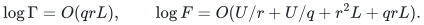

After the explicitly clocked short-period batching construction,
the prospective logarithmic numerical overhead is

<!-- math-display: 4387daa5dc7cacfc37a2973e
A=O\!\left(
 x+\frac Ur+\frac Uq+r^2L+qrL+K^2qrL+
      \frac{U^2}{Kx}+\frac{UqrL}{x}
      +\frac{UKqrL}{x}\right),
 \qquad x=\log k.                                    \tag{12}
-->
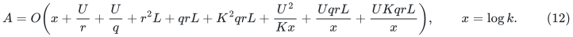

This formula still keeps the input-path-length congestion factor.
It changes the older model because the large static work <code class="math">F</code>
is additive locally, while only the smaller output factor
<code class="math">\Gamma</code> participates in the <code class="math">K^2</code> route envelope.

On the power scale put <code class="math">r=U^a,q=U^b,K=U^t,x=U^z</code>.
A common exponent <code class="math">z</code> must satisfy
<!-- math-display: 8c839c1875d6c0dc9f4390ea
a,b\geq1-z,\qquad t\geq2-2z,\qquad
 z\geq a+b+2t.
-->
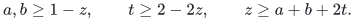
Therefore <code class="math">z\geq6-6z</code>, or <code class="math">z\geq6/7</code>. Equality is attained
at <code class="math">a=b=1/7,t=2/7</code>. The previously unused term <code class="math">r^2L</code>
is smaller at that point, and the output contribution to
propagated recourse is smaller than <code class="math">U/K</code>.

The same calculation has a finite-scale version that includes the
leading logarithm and permits different parameters at each level.
Suppose a known logarithmic budget <code class="math">A=o(U)</code> must pay the current
charged expressions. Consider the levels before the source size
envelope drops below <code class="math">U/2</code>. There are at least <code class="math">cU/A</code> such
levels, because local shrink work gives <code class="math">\log k_i\leq O(A)</code>.
At each of these levels, the static work terms imply
<!-- math-display: e234e06f903dd8cc2309a2d8
r_i,q_i\geq cU/A.
-->
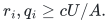
The route-work term <code class="math">K_i^2q_ir_i\log U\leq O(A)</code> then gives
<!-- math-display: 9fc09b4566b0da01e10fdee6
K_i\leq C\,\frac{A^{3/2}}{U(\log U)^{1/2}}.
-->
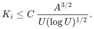
Hence the propagated-recourse sum over these levels is at least
<!-- math-display: b9a24ffd649a485526a90f8a
c'\frac U A\cdot
       \frac{U^2(\log U)^{1/2}}{A^{3/2}}
 =c'U^3(\log U)^{1/2}A^{-5/2}.
-->
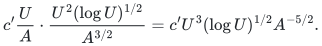
Requiring this to fit within the same budget yields
<!-- math-display: 6f668ec1c2f86459ae033285
A\geq
          c''U^{6/7}(\log U)^{1/7}.                    \tag{13}
-->
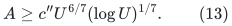
The uniform choices
<!-- math-display: ef49275be9fa8cf070877bcf
r,q=\Theta((U/\log U)^{1/7}),\quad
 K=\Theta((U/\log U)^{2/7}),\quad
 \log k=\Theta(U^{6/7}(\log U)^{1/7})
-->
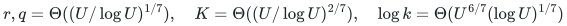
attain this order in (12). Thus neither uneven <code class="math">q,r</code> choices
nor level-dependent parameters alone improve this particular
envelope. Improving it requires changing at least one charged
dependency, not merely rebalancing the displayed parameters.
The last term of (12) is the raw-quality loss across the numerical
hierarchy. At the displayed <code class="math">6/7</code> balance it is smaller than
the leading term, but it must be retained when changing the local
route-cost model.

As throughout this note, (13) is a limitation of a stated
upper-bound accounting model. It is not a lower bound for
deterministic sparsification, dynamic minimum-ratio cycles,
or general-graph matching.

## 7. Raw quality remains a cost if a local congestion recurrence improves

Suppose, hypothetically, that a replacement static argument reduced
the local <code class="math">K^2\log\Gamma</code> work term to <code class="math">K\log\Gamma</code>, but still
returned paths of length <code class="math">\Gamma^{O(K)}</code> per numerical level.
Then it would be incorrect to remove <code class="math">K^2\log\Gamma</code> from the
model and ignore the remaining quality term
<!-- math-display: 4dcab2ab576a1a83d1852a55
(U/x)K\log\Gamma.
-->
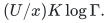

For the tunable output <code class="math">\log\Gamma=\Theta(qr\log U)</code>, the
quality-aware power constraints are
<!-- math-display: 29b257781ebfa95ec6b753c7
a,b\geq1-z,\qquad t\geq2-2z,\qquad
 z\geq1-z+t+a+b.
-->
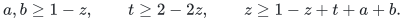
They imply <code class="math">z\geq5-5z</code>, hence <code class="math">z\geq5/6</code>.
The model balance is attained by
<!-- math-display: 991bbef22029de948ef3bc7b
r,q=\Theta((U/\log U)^{1/6}),\qquad
 K=\Theta((U/\log U)^{1/3}),\qquad
 \log k=\Theta(U^{5/6}(\log U)^{1/6}).
-->
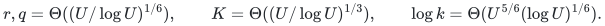
This balance is now supplied by the separate normalized-route
construction in [length-free-ambient-static-sparsifier.md](length-free-ambient-static-sparsifier.md) and
[normalized-projected-route-composition.md](normalized-projected-route-composition.md). Its complete matching
assembly is [quantitative-matching-5-6-composition.md](quantitative-matching-5-6-composition.md). It is not
obtained by dropping a term from the old length-sensitive theorem.

For a uniform logarithmic budget A, the static work requires
q,r >= c U/A, and propagated recourse requires
K >= c U^2/A^2 when log k <= O(A). The accumulated quality then
requires

<!-- math-display: e141dcf61f50c9b06153861c
A\geq c\frac U A Kqr\log U
   \geq c'\frac{U^5\log U}{A^5}.
-->
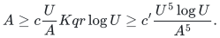

Consequently A >= c'' U^{5/6}(log U)^{1/6} within this explicit
uniform accounting model. This is a limitation of these charged
expressions, not a lower bound for matching or for other routers.

For comparison, if a different proposed primitive had the fixed
output factor <code class="math">\log\Gamma=\Theta(U^p\log U)</code>, retaining both
propagated recourse <code class="math">U/K</code> and per-level quality
<code class="math">K\log\Gamma</code> gives the balance
<!-- math-display: 86126553321c7c2d82a304fd
\log E\ \geq\
       \Omega(U^{(3+p)/4}(\log U)^{1/4})
-->
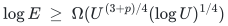
within this model, even if local construction work is smaller.
Indeed, a budget <code class="math">A</code> needs <code class="math">\Omega(U/A)</code> levels before the
size envelope halves, and at each level the product of the two
charged terms is <code class="math">\Omega(U^{1+p}\log U)</code>. Cauchy--Schwarz
on their sums gives
<code class="math">A^2\geq \Omega((U/A)^2U^{1+p}\log U)</code>.
For <code class="math">p=1/2</code>, the resulting power is <code class="math">7/8</code>, which is larger
than <code class="math">6/7</code>. Thus a square-root logarithmic output factor by
itself is not an improvement over the current tunable
construction. A proposed new router must be assessed with its
whole preprocessing/output/quality interface.

## 8. Linear router parameters and the 4/5 model boundary

The new router and static composition have log Gamma=O((p+r)log U)
and log F=O(U/p+U/r+r^2 log U+(p+r)log U). Their full quantitative
assembly is [quantitative-matching-4-5-composition.md](quantitative-matching-4-5-composition.md).
The independent optimization in [linear-router-backend-balance.md](linear-router-backend-balance.md)
shows that its charged-expression model needs
A=Omega(U^(4/5)(log U)^(1/5)), even with level-dependent parameters.
It uses accumulated recourse and full-depth raw quality, rather than
discarding the latter. This is a limitation of the stated envelope,
not a lower bound for matching or for different constructions.
