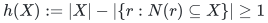

# A local pair oracle from a balanced row forest

**Static auxiliary theorem used on a current carrier forest.** This
note proves local joint exposure from a supplied balanced selected
forest. The persistent integral-carrier construction supplies a fresh
such forest at every settled state; the pruning data below is built
locally for the current query and is not reused after a graph edit.

## 1. Interface

Let `D` be bins of positive integer weights `w`, and let `A` be rows with at most three distinct bin neighbors. A selected row forest `T` has one edge for each row, joining two of that row's neighbors. Suppose each tree of `T` has total bin weight at most `B`.

Rooting each selected tree at a bin gives an injection of rows into bins: assign a row to the child endpoint of its selected edge. The roots are precisely the free bins. A selected forest implies strict Hall in the form

<!-- math-display: 445ce151be1c1a2eede76a42
h(X):=|X|-|\{r:N(r)\subseteq X\}|\ge 1
-->

for every nonempty bin set `X`. Indeed, every captive row contributes a different selected edge internal to `X`, and the subgraph of a forest induced by `X` has at most `|X|-1` edges.

Given two bins `i,j`, the task is to return either their unique inclusion-minimal tight set, when one exists, or a new row injection leaving both free. The theorem here gives `O(B polylog N)` work, including explicit changes within the involved selected trees if requested.

## 2. Only one tree needs to be examined

If `i,j` lie in different selected trees, reroot those two trees and finish. Their total physical bin weight is at most `2B`.

Otherwise let `C` be their common selected tree. Every tight set is connected in every selected row forest: its `|X|-1` captive selected edges already form a tree on `X`, leaving no room for a second induced component. Hence any tight set containing `i,j` lies entirely in `C`.

Enumerate `C`, its selected rows, and those rows' at most three incidences. A neighbor outside `C` is an immediate exterior witness; its tree need not be traversed. No row selected in another tree can be captive in a subset of `C`.

This enumeration also supplies the required component test when the
selected forest is implicit in a carrier. After the preceding tight
detector has certified joint freeability, enumerate the selected
component of `i` and test whether `j` is in its local bin dictionary.
It is unnecessary to maintain or initialize a global dynamic-tree
structure for the derived selected forest. Enumerating a current
selected component uses carrier membership/parent point queries and,
in the matching application, O(weight) physical incidence traversal.

Run the ordinary parallel pruning procedure on the selected edges inside `C`: remove a row edge when its third neighbor is outside its current component, and record the round and witness. An initially exterior neighbor gives round one. Finite rounds are at most `|C|`, because every nonterminal round removes at least one of the original `|C|-1` edges. Queue processing and smaller-component incidence scans take `O(|C| polylog N)` total work. This bound does not require computing a global pruning certificate.

The surviving components are the actual maximal tight blocks inside `C`. If `i,j` lie in the same block, close their selected-tree path under captive rows' remaining neighbors and connecting paths. This returns the unique inclusion-minimal tight set. The closure stays in `C` and costs at most `O(B polylog N)`; the separate local-cut algorithm can be used if an output-sensitive bound in the smaller tight-set weight is needed.

## 3. Joint exposure uses at most two original trees

If the pair lies in different surviving blocks, use the descending-level exchange algorithm from [static-pair-exchange.md](static-pair-exchange.md), with the locally computed levels. Give all selected edges outside `C` level infinity for this one execution. No certificate for those outside rows is needed.

The infinite levels outside `C` are an analytical convention, not an
instruction to allocate or traverse those trees. Initialize the
exchange dynamic tree only on the enumerated `C`. While a recorded
witness `z` is in `C`, both endpoints of its proposed edge are in that
local structure. If `z` is outside `C`, the proposed edge is immediately
terminal: all previous cycle exchanges have preserved `C` as one
connected component and have touched no outside edge. Enumerate the
original selected tree `C'` of `z` only now, add it to the local
structure, and perform the final link. Thus no global connectivity
query or global forest initialization is hidden in the exchange.

Before its final step every cycle exchange occurs wholly inside `C`. A recorded exterior witness causes the final link to another original selected tree `C'`; it does not start another search inside `C'`. Deleting the artificial pair edge then separates `i` from `j`. The selected edges have changed only in `C union C'`, of total weight at most `2B`.

There are at most `|C|` strictly descending finite levels. Dynamic-tree path-minimum, link, cut and reroot operations therefore cost `O(B polylog N)`. If the caller needs an explicit injection, enumerate the two involved trees after the exchange and orient their row edges toward the two requested free roots. There are at most `2B` bins, and their total physical bin volume is `O(B)`, so this materialization also fits the bound.

For repeated read-only queries on one fixed incidence graph, roll back the prior query's selected-edge and root changes before the next query. This preserves the original balance bound and gives the same amortized bound per query. A structural mutation of the incidence graph requires a separate maintenance argument.

## 4. Balance supplied by the actual integral carrier

The current application uses the actual allocation representation in
[persistent-integral-ledger-carrier.md](persistent-integral-ledger-carrier.md), with its standalone theorem in
[dynamic-integral-allocation-theorem.md](../allocation-and-scheduling/dynamic-integral-allocation-theorem.md). Every row has integral sum L,
every bin load is at most L-w_d, and all positive incidences lie in an
acyclic carrier that may also contain zero edges.

Root a carrier tree at a bin. Keep both incidences of a degree-two row
and the two child incidences of a degree-three row. Suppressing rows
produces the selected forest used here. Each component has at most one
internal row exporting allocation and that export is less than L.
Summing column capacities gives w(C)<2L. Thus B=2L is a valid bound.

The canonical injection is obtained by selecting a deterministic child
of each carrier row. Forward and inverse point queries use the retained
carrier version. Enumerating the query component also uses all physical
row alternatives, including zero noncarrier incidences. In the subcubic
odd-bin application its full physical volume, including represented rows,
is below 4L. The local query bound is therefore O(L polylog N).

A tight pair is first handled by the independent output-sensitive
routine in [deterministic-local-tight-discovery.md](deterministic-local-tight-discovery.md). Only a certified
freeable pair needs the O(L) component enumeration and exchange here.
This preserves the arity charge on contractions.

## 5. Transaction scope

An exchange may produce two trees with weights near 2B. The application
does not assume that these exchanged trees remain balanced for a later
query. The temporary injection is consumed immediately by the gain,
using the frozen pre-event assignment oracle plus explicit overrides
on the at most two enumerated original trees.

After the structural edits and projection settle, the actual ledger is
normalized and its new canonical selected forest is published. The
carrier theorem proves the balance afresh from the unchanged margins.
It does not attempt to retain old pruning levels through contractions,
gains, expansions or peels. Sparse carrier maintenance, rather than
repeated global pruning, supplies the required dynamic composition.

This local theorem alone would not justify a dynamic phase. The complete
transaction and phase accounting are separate statements in
[Deterministic Exact General Matching through Persistent Integral Carriers and Normalized Routing](../../problems/general-matching/proof.md).

## Sources and attribution

The row/bin ledger assumptions are from the OAI September 24, 2026
matching manuscript:

<https://github.com/openai/math/tree/main/preprints/Almost-Linear-Time-Maximum-Cardinality-Matching-in-Sparse-General-Graphs-September-24-2026>.

The local pruning/exchange combination and its proof are mathematical
components of this research construction. No publication-priority claim
is made. The older optional confluent-rounding route is not a dependency
of the current carrier composition.
