# A binary ledger hierarchy independent of numerical accuracy

**Separate mathematical refinement, 24 October 2026.** This note changes
the parameterization of the matching phase, leaving all frozen
quantitative constructions unchanged. The ledger hierarchy needs only
a geometric sequence of reset periods and adjacent residual floors
differing by one. Its branching ratio need not bound the numerical
backend's cost, multiplicity, or inverse approximation quality.

We prove the structural and allocation statements directly, with
explicit dependence on the number of levels. We then combine them with
the independently specified [decoupled numerical client](decoupled-numerical-client.md).
The resulting theorem is parameterized by the complete raw-cycle,
persistent-carrier, local-pair, and physical-lifetime interfaces. The
[main matching proof](../../problems/general-matching/proof.md), Sections
5–6 and Theorem 11.6, supplies these interfaces for the current
four-fifths construction. An eventual fast-time bound follows from those
mathematical constructions, separately from final output verification.

The underlying matching-state equations and local projection are from
[OAI Sections 3--5](https://github.com/openai/math/tree/main/preprints/Almost-Linear-Time-Maximum-Cardinality-Matching-in-Sparse-General-Graphs-September-24-2026).
The explicit component proofs used here are
[ledger algebra](ledger-algebra-and-phase-budget.md),
[local exact projection](local-exact-projection-from-priced-steps.md),
[near-feasible rounding and exact recovery](near-feasible-rounding-and-exact-projection.md),
[persistent integral carriers](persistent-integral-ledger-carrier.md),
and [the general-graph gap driver](general-graph-gap-reduction.md).
Their former fixed-parameter running-time conclusions are not premises
of this calculation.

## 1. Parameters and numerical interface

Let a subcubic physical graph have order <code class="math">N</code>, and choose the one
master size <code class="math">S=2^s</code> with <code class="math">N\le S&lt;2N</code>, outside bounded empty
cases. For every phase use

<!-- math-display: 7c019644e9af2a6ddcf14381
a=s,\qquad C=s+1,\qquad B_{\rm ledger}=2,\qquad
 c_j=C-j,\qquad b_j=2^{s-j}\quad(0\le j\le s).
 \tag{1}
-->
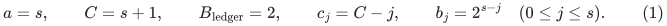

Thus <code class="math">b_0=S</code>, <code class="math">b_1=S/2</code>, <code class="math">b_s=1</code>, and the bottom
floor is <code class="math">c_s=1</code>. There are <code class="math">s+1</code> ledgers. All these
integers have <code class="math">O(s)</code> bits and are computed exactly. Retain

<!-- math-display: 70d63b2aa5393b1a788a5d84
\delta=S^{-1000},\qquad \varepsilon=S^{-3000},
 \qquad H_{\rm price}=S^{100}.
 \tag{2}
-->
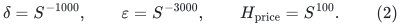

Let a complete master-controlled raw backend have a computable cap
<code class="math">E_*\ge1</code> for initialization per actual input record, update/query
cost, complete logs, occurrence multiplicity, pieces, and inverse raw
quality. It accepts the specified <code class="math">O(s)</code>-bit root prices, actual
nominal sizes at most <code class="math">S^2</code>, and polynomial master lifetimes.
Its full numerical-lifetime contract is retained. Define

<!-- math-display: d7b64d3ade323be832b0cc66
D=2^{\lceil\log_2\max\{16,4E_*\}\rceil},
 \qquad q=\frac1{16D}.
 \tag{3}
-->
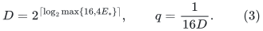

The explicit cap may be rounded upward before (3). Both <code class="math">D</code> and
<code class="math">q^{-1}</code> are powers of two. Check <code class="math">q\ge S^{-1}</code>,
<code class="math">D\le S^2</code>, and all remaining numerical prerequisites. For any
favorable fixed backend constants with <code class="math">E_*=S^{o(1)}</code>, these
checks eventually hold. In particular

<!-- math-display: 508dd240e2d3ef6a8a22c45c
q<1/100,\qquad \frac1{4D}>2q,
 \qquad E_*\le D/4.
 \tag{4}
-->
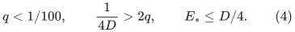

For an actual numerical lifetime <code class="math">R</code>, use only ordinary
power-of-two rounding

<!-- math-display: 102f052cff3cec1f6c6792d7
M=2^{\lceil\log_2(16(R+2))\rceil},
 \qquad 16(R+2)\le M<32(R+2).
 \tag{5}
-->
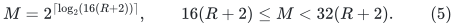

There is no divisibility requirement by <code class="math">2a^2</code>. The root integer
price cap is stated in the master form <code class="math">S^{1200}</code>, rather than
deduced from a local power <code class="math">M^{1200a}</code>. The backend is run at
master logarithmic parameter <code class="math">2s</code>; this does not allocate an
<code class="math">S</code>-sized array for a small local instance.

The decoupled client proves the following useful uniform cost form.
If <code class="math">J</code> is the number of accepted steps and <code class="math">Q</code> counts requests
from its owning client, including failed and LOW queries but excluding
internal refresh work, then

<!-- math-display: 1a436f7fdcdf51ea45095612
T_{\rm priced}
 \le O(MD+QD+D^2J)\mathrm{poly}(s).
 \tag{6}
-->
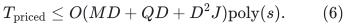

The <code class="math">D^2J</code> term includes full copy sweeps. The polynomial has a
fixed exponent. Longer internal backend words are charged in its cap
and in this polynomial; unbounded-word unit-cost arithmetic is not used.

## 2. Exact state invariants do not require a small number of levels

For a phase target <code class="math">1\le K\le N</code>, define

<!-- math-display: d2b97aa8c5cae797febbeb6b
L=\left\lceil\frac{10000CN}{K}\right\rceil,
 \qquad g_* =\max\left\{1,
                 \left\lfloor\frac K{100C}\right\rfloor\right\}.
 \tag{7}
-->
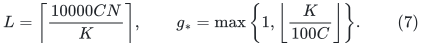

The impossible-target precheck in the gap driver may return LOW before
initialization. Every initialized phase satisfies <code class="math">L&gt;C</code>, so its
singleton top slacks are positive. Integral levels satisfy

<!-- math-display: 0b543ff539bb21e5a3c8e7ba
\sum_{e\text{ at row }r}x^j_e=L,\qquad
 y^j_d=L-\mathrm{load}^j(d),\qquad
 y^j_d+p^j_d\ge c_jw_d,
 \qquad x^j,p^j\ge0.
 \tag{8}
-->
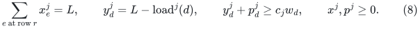

The bottom has zero debt at settled states. These are coordinatewise
algebraic statements for every <code class="math">j</code>; they do not contain <code class="math">B</code>,
<code class="math">q</code>, or a requirement that <code class="math">a</code> be fixed. A tight contraction
adds bin weights, residuals and debts. An expansion adds debt at most
<code class="math">c_j\le C</code> at each integral level. A preserving deletion of bins
<code class="math">R</code>, under the fixed injection for that event, changes the total
debt of a floor-<code class="math">c</code> ledger by at most

<!-- math-display: a32caf380b8da7d5b6b12886
Lh(R)-cw(R).
 \tag{9}
-->
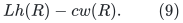

A projection from floor <code class="math">c+1</code> to floor <code class="math">c</code> either produces
a zero-debt child or a full residual peel satisfying
<code class="math">Lh(R)&lt;cw(R)</code>. Equation (9) then decreases the debt of every
preserved coarser ledger by at least <code class="math">w(R)</code>. The adjacent-floor
difference is exactly one in (1), as required. The target floor is
always positive, including the last projection with <code class="math">c=1</code>.

Persistent transportation pivots preserve row sums and column loads.
They therefore preserve (8)--(9), independently at all <code class="math">s</code> integral
levels. A projection reads one immutable parent, writes a separate
child, and then normalizes that child. Sharing its roots with deeper
fresh ledgers does not scan the old bottom allocation. Applying one
structural batch to all preserved levels contributes a factor at most
<code class="math">s</code>, not a product of costs across levels.

The frozen injection/overlay is retained throughout each deletion,
contraction and its projection transactions. A later canonical
assignment switch uses the existing carrier construction. Increasing
the number of ledgers changes neither that transaction order nor the
factor-critical physical witnesses.

## 3. Uniform structural, debt, and physical-size bounds

The choice (7) gives the explicit inequality

<!-- math-display: ec1534b5fd131ca84b9b4508
Lg_*\le10001CN.
 \tag{10}
-->
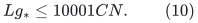

If <code class="math">K\ge100C</code>, use <code class="math">g_*\le K/(100C)</code> and the ceiling
bound for <code class="math">L</code>; in fact <code class="math">Lg_*\le101N</code>. If <code class="math">K&lt;100C</code>,
then <code class="math">g_*=1</code> and <code class="math">L\le10000CN+1</code>. Thus small targets do
not require a separate unproved progress rule. There is no repaired
gain or positive-weight peel before the one terminal gain in that case.

Before the terminal gain, the top debt pays all peeled weight:

<!-- math-display: b041cdc60dae5dafff8258d5
\sum_{\rm peels}w(R)
       \le2L(g_*-1)+S^{-800}.
 \tag{11}
-->
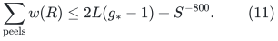

The strict blocker inequality and integrality give at most
<code class="math">2C(g_*-1)</code> blockers, provided the checked inequality
<code class="math">CS^{-800}/L&lt;1</code> holds. It holds with very large slack when
<code class="math">C=s+1</code>. No fixed-<code class="math">a</code> constant is used in this rounding.

The materialized physical volume of a peel is at most <code class="math">2w(R)</code>,
and the two bins of a gain have total weight at most <code class="math">2L</code>.
Counting initial physical vertices, reentries from the paired remainder,
expansions and contraction arities therefore gives absolute bounds

<!-- math-display: 4d2037d656fd1901ad91fc25
\text{physical erasures, expansions, total contraction arity}
                 =O(CN),\qquad \tau=O(CN)=O(sS).
 \tag{12}
-->
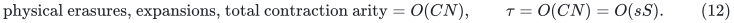

Here expansions and contractions add one tick, repaired gains add
<code class="math">L</code>, and peels add none. The terminal gain ends the phase without
repairing obsolete ledgers. Local pair work is charged to the returned
tight-set arity or to the two <code class="math">O(L)</code> selected components immediately
consumed by a gain. It is included in (10)--(12).

Retaining the largest bin at contraction moves a physical vertex at
most <code class="math">O(\log S)</code> times in each stay. There are <code class="math">O(CN)</code>
stays and row absorptions. Since physical degree is at most three,
total changed physical incidence records are <code class="math">O(CNs)</code>. Processing
them at all integral levels, including persistent normalization, costs

<!-- math-display: e608823e400097183ed42dc3
S\mathrm{poly}(s).
 \tag{13}
-->
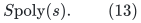

Every integral ledger receives at most <code class="math">C</code> debt per expansion
and <code class="math">2L</code> per repaired gain. Its debt is consequently
<code class="math">O(C^2N)=O(s^2S)</code>. The top has the sharper bound
<code class="math">2L(g_*-1)+S^{-800}=O(sS)</code>. All weights, allocations, column
loads, debts and exchange capacities have <code class="math">O(s)</code> bits with fixed
absolute constants. For example <code class="math">L=O(sS)</code> and a column load is
at most <code class="math">LN=O(sS^2)</code>. These quantities fit the existing loose
<code class="math">S^{20}</code> client magnitude envelope eventually.

## 4. Binary reset periods and the exact additive sum

For an event with positive tick increase, select the smallest
<code class="math">j\in\{1,\ldots,s\}</code> for which
<code class="math">\lfloor\tau/b_j\rfloor</code> increases across that event. Such
a <code class="math">j</code> exists because <code class="math">b_s=1</code>. Reset this level and all
deeper levels by the existing projection rule.

If <code class="math">j&gt;1</code>, no <code class="math">b_{j-1}</code> boundary is crossed. The parent
<code class="math">(j-1)</code>-ledger was last reset within the same coarser interval.
Per tick, expansions add at most <code class="math">C</code> debt and repaired gains add
at most twice their <code class="math">L</code>-tick increase. Contractions preserve debt
and peels decrease it. Thus its input debt obeys

<!-- math-display: 9e277b56111a394012cce599
P\le(C+2)b_{j-1}
      \le(s+3)S/2.
 \tag{14}
-->
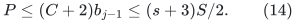

This proof covers arbitrarily large <code class="math">L</code>-tick jumps. If such an
event crosses a coarser boundary, the coarser level is selected instead.
No proof assumes a unit tick increment or one reset for each boundary
skipped inside one event.

There are at most <code class="math">\lfloor\tau/b_j\rfloor</code> events selecting
level <code class="math">j</code>. With <code class="math">b_{j-1}=2b_j</code>,

<!-- math-display: 2a56574189839e11d4051ef9
\begin{split}
 \sum_{j=2}^{s}\frac{\tau}{b_j}
                    [(C+2)b_{j-1}+2]
 &\le 2(s-1)(s+3)\tau+
                2\tau\sum_{j=2}^{s}\frac1{b_j}\\
 &< [2(s-1)(s+3)+4]\tau
   =O(s^3S).
\end{split}
\tag{15}
-->
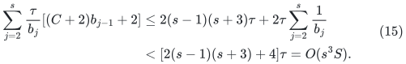

The additive 2 pays even a zero-debt invocation's fixed local overhead.
Level one uses an all-expanded exact exchange recovery and a fresh
integral carrier. The number of such resets is at most
<code class="math">1+\tau/b_1=1+2\tau/S=O(s)</code>, where the additive one may also
cover initialization. Its graph has <code class="math">O(S)</code> actual records. The
exact recovery from near-feasible rounding applies even if its initial
assignment-supported allocation does not meet the target residual
floor; it does not call the old static exact-flow algorithm.

## 5. Local nominal sizes and objective bounds

Use nominal top lifetime

<!-- math-display: 195daa7f44dbb6dab558c182
R_{\rm top}=S(s+1)^{10}.
 \tag{16}
-->
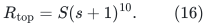

This covers the <code class="math">O(CNs)</code> logical births and incidence retargetings
from Section 3, plus one attempted physical-size batch before a first
guard failure. Numerical price replacements on retained endpoint slots
do not consume new topological lifetime. Equations (5) and (16) imply
<code class="math">M_{\rm top}&lt;S^2</code> eventually.

A higher-level local projection uses nominal lifetime
<code class="math">R_{\rm loc}=8192(P+1)</code>, or an absolute larger constant. The
seed-weight, boundary-lock, region-size and exact union-cut proofs
give this bound with constants independent of <code class="math">c</code>, <code class="math">a</code> or
<code class="math">B_{\rm ledger}</code>. They use the one-unit stronger parent floor,
<code class="math">\beta\le P</code>, integral <code class="math">u_d\ge1</code>, and polynomial
capacity magnitudes. They do not require <code class="math">P\le S</code>.
By (14), (5) now gives <code class="math">M_{\rm loc}=O(sS)&lt;S^2</code> eventually.
The new numerical interface accepts this bound directly.

The original restriction
<code class="math">R+B\le S^{1+2/a}</code> would equal <code class="math">R+2\le4S</code> at
<code class="math">a=s</code>, and need not hold. It is deliberately removed: it was
used to obtain the original local power and price caps, not in the
allocation, locality, lock, or residual-cut proofs. Reimposing it would
be an invalid application of that old packaged numerical theorem.
Similarly, retaining exponent rounding by <code class="math">2a^2</code> would introduce
an unnecessary enormous nominal size and is not part of this construction.

Each local threshold has <code class="math">O(P+1)</code> represented logarithmic terms,
return weight <code class="math">20000(P+1)</code>, and argument logarithmic width
<code class="math">O(s)</code>. Its objective range plus all insertion/lock losses is
<code class="math">O((P+1)s)</code>. The binary search has <code class="math">O(s)</code> threshold tests.
With <code class="math">q^{-2}=256D^2</code>, the numerical-client and exact-rounding
proofs give

<!-- math-display: cbba9dfd4dfd4fa6e40ede1b
T_{\rm local}\le(P+1)D^4\mathrm{poly}(s).
 \tag{17}
-->
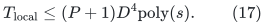

All-expanded recovery on a graph of <code class="math">Z</code> records has the same
bound with <code class="math">P+1</code> replaced by <code class="math">Z+1</code>. Return-arc locking,
ordinary-residual search, common-grid rounding, and exact cut checking
are unchanged. Their proofs use a fixed constant tolerance margin and
total unpadded violation below one; no comparison with the ledger
period ratio occurs.

The top has <code class="math">O(S)</code> terms and objective range <code class="math">O(Ss)</code>.
Its <code class="math">O(CNs)</code> structural term changes lose <code class="math">O(s)</code> each.
Hence

<!-- math-display: 80ed791c4d0ad4daa85d28b5
J_{\rm top}=O(sS s^2D^2),\qquad
 Q_{\rm top}\le[O(sSs)+O(DJ_{\rm top})]
                                       \mathrm{poly}(s).
 \tag{18}
-->
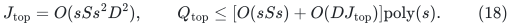

The second expression counts genuine motion-triggered notifications
and constantly many client services per notification. It does not
relabel all explicit settings as fresh numerical motion. Substitution
in (6), with (16), yields
<code class="math">T_{\rm top}\le SD^4\mathrm{poly}(s)</code>.

## 6. Phase cost, direct maximum matching, and finite guards

Multiplying (15) by the common cost in (17), adding <code class="math">O(s)</code>
all-expanded resets, and then adding the top, structural and
materialization work gives

<!-- math-display: 51b0094a9c136fb7d82a17a8
T_{\rm phase}\le SD^4\mathrm{poly}(s).
 \tag{19}
-->
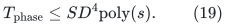

The multiplications in this expression are a fixed number of numerical
factors. There is no <code class="math">D</code>-factor for each of the <code class="math">s</code> ledger
levels; their input volumes were summed in (15).

The direct gap driver retains its integer upper bound on the possible
improvement. For a large bound, a successful phase reduces it by a
<code class="math">\Theta(1/C)</code> fraction and LOW approximately halves it. For a
bound below a constant multiple of <code class="math">C</code>, every successful phase
gains at least one and every LOW strictly reduces the bound. Therefore
there are <code class="math">O(C(1+\log N))=O(s^2)</code> phases. This reasoning uses
the arbitrary-comparison-matching no-false-LOW proof, not a perfect-
matching promise. The complete branch cost is

<!-- math-display: f220848c3a793d6094275458
SD^4\mathrm{poly}(s).
 \tag{20}
-->
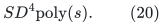

All guard adequacy is uniform. Check, for example,
<code class="math">s\ge1000</code>, <code class="math">100000(s+1)\le S^{1/20}</code>, the numerical
conditions in Section 1, and the ordinary magnitude/record caps.
Retain the <code class="math">S^{20}</code> main-action and threshold-iteration caps and
the <code class="math">S^{100}</code> instance-operation cap. Before a first putative
overflow those loose caps already bound all <code class="math">O(\delta)</code> positivity
and pad changes by a fixed polynomial in <code class="math">S</code>, leaving total added
debt/violation below <code class="math">S^{-800}</code>. They establish the algebra and
locality needed for the sharper counts; the reasoning is not circular.

Equations (10)--(18), applied to prefixes and one final attempted
batch, then give <code class="math">S^{1+o(1)}</code> total charged work whenever the
favorable cap satisfies <code class="math">D=S^{o(1)}</code>. They are far below the
fixed loose guards. The actual values retain the same fixed
<code class="math">O(s)</code>-bit root envelope. Persistent memory addresses and all
charged arithmetic likewise fit polynomial master histories. A backend
prerequisite failure still suspends the branch, never supplies LOW.

No allocation-side proof requires <code class="math">a\ll\sqrt{s}</code>,
<code class="math">B_{\rm ledger}\ge E_*</code>, or an old local exponent
<code class="math">M^{10/a}</code>. The required conditions are the explicit floor,
period, magnitude, and numerical contracts stated above.

## 7. Consequence for the 14/15 backend and a finite program

Use the computable degree-reset backend of
[the separate 14/15 construction](distance-degree-reset-candidate.md),
at master <code class="math">2s</code>. Its adequate fixed constants <code class="math">(c_C,c_E)</code>
give

<!-- math-display: ee0155cba0c77cf95576ba30
E_*=
 \exp O\!\left(s^{14/15}(\log(s+4))^{1/5}\right).
 \tag{21}
-->
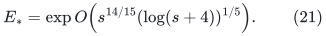

Since <code class="math">D=O(E_*+1)</code>, (20) is
<code class="math">SE_*^4\mathrm{poly}(s)</code>, with a constant factor for
the fixed cap rounding. The same rate follows for all general graphs
after the exact subcubic reduction and decoder:

<!-- math-display: 61739cb533ae891c7aef23cd
O(n+m)+(m_s+1)
 \exp O\!\left((\log(m_s+2))^{14/15}
                 (\log\log(m_s+4))^{1/5}\right).
 \tag{22}
-->
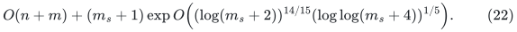

Only the two backend constant choices are enumerated. The outer
level count <code class="math">a=s</code>, period ratio 2, and (3) are explicit; there
is no third parameter chosen to make a separate ledger <code class="math">B</code>
dominate the backend. A weighted instruction portfolio runs these
guarded fixed-constant branches and a classical exact fallback. Before
accepting any branch, it validates the original matching and performs
one exact deterministic augmenting-path search. Original input cleanup
is shared once; final original-ID translation is done for the winner.

Every branch has a finite executable parameter rule and charged word
simulation. Some fixed favorable pair has constant scheduling share;
its polynomial scheduling overhead is absorbed in the polynomial of
(20), and therefore in (22). If desired, since the explicit adequate
<code class="math">E_*</code> dominates every fixed polynomial in <code class="math">s</code>, a coarser
eventual bound <code class="math">SE_*^5</code> includes that polynomial overhead.
The verifier ensures accepted-output correctness, while existence of
the favorable pair and the mathematical interfaces above are what
establish the fast-time conclusion for the instantiated backend. The
displayed 14/15 specialization is historical; the same binary-ledger
calculation is used with the stronger cap in the
[four-fifths composition](quantitative-matching-4-5-composition.md).

The cover-kernel optional preprocessing from the complete composition
is unaffected: it preserves the optimum and can replace <code class="math">m_s</code>
by <code class="math">m'\le\min\{m_s,O(\nu(G)^2)\}</code> in the second term.
All graph classes, densities, and no-perfect-matching inputs remain in
scope.
