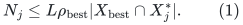
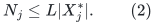
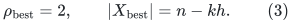
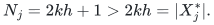
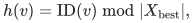

# Two explicit boundaries in the CHS routing reconstruction

This note concerns a proposed sequential use of
[Chang--Huang--Su, arXiv:2405.03908v1](https://arxiv.org/abs/2405.03908).
It records two implications that require additional proofs or modifications.
Neither affects the separate CS21-based construction. This is not a
disproof of the published top-level distributed routing theorem.

The independent polynomial-work repairs for leaf preprocessing and the
exhaustive energy-cut search are in
[sequential-leaf-routing-and-chs-work.md](sequential-leaf-routing-and-chs-work.md)
and [polynomial-energy-cut-player.md](polynomial-energy-cut-player.md).
They do not automatically resolve the interfaces below.

## 1. Terminal unions and induced expanders are different objects

CHS Appendix A, Step 3, identifies a successful parent <code class="math">X</code> with a union of
terminal sets <code class="math">U_i^*=U_i\cup U_i'</code>, where <code class="math">U_i'</code> consists of vertices
matched to <code class="math">U_i</code>. Its Property 3.1 requires the child parts to partition
<code class="math">X</code>, and associates the root with <code class="math">H_X=G[X]</code>.

The cited [Chang--Saranurak source, arXiv:2007.14898](https://arxiv.org/abs/2007.14898),
Section 4.3, Lemma 4.10, instead defines <code class="math">W^*</code> to contain **all vertices used
by the embedded paths** of the surviving graphs <code class="math">H_i^*</code>. Its Lemma C.9 proves
expansion for <code class="math">G[W^*]</code>. It does not state that all internal path vertices
belong to the terminal union <code class="math">\bigcup_i U_i^*</code>.

### 1.1 An explicit distinction

Let <code class="math">U_1=\{a_1,a_2\}</code> and <code class="math">U_2=\{b_1,b_2\}</code>, with each <code class="math">H_i</code> a single
edge. Embed their edges by <code class="math">a_1-x_1-a_2</code> and <code class="math">b_1-x_2-b_2</code>, and add genuine
edges <code class="math">a_1b_1,a_2b_2</code>. The host is a six-cycle. The child expanders have
expansion one, their embedding has dilation two and congestion one, and the
cut respecting the two terminal groups has outer expansion one.

The host induced by all embedding vertices has positive expansion.
In contrast, <code class="math">G[U_1\cup U_2]</code> consists of two disjoint edges and has
expansion zero. Thus the hypotheses of the embedding-to-induced-expander
lemma do not permit replacing all path vertices by the terminal union.
This example refutes the implication; it is not asserted to be a complete
execution trace of the source cut-matching algorithm.

### 1.2 A possible repair changes the recursive interface

CS20 Lemma C.9's proof constructs a graph <code class="math">G_0</code> on the terminal union:
retain genuine edges between terminal parts and replace each part's internal
graph by its expander <code class="math">H_i^*</code>. The proof establishes expansion for this
virtual graph and a controlled embedding into the parent host.

Using <code class="math">G_0</code> is promising, but changes the recursive certificate. The
original cut player terminates with an induced expander in its current
matching-union graph. A virtual expander with an embedding is different.
A repair must preserve the child partition and simultaneous-embedding
bounds, rather than silently identify these objects.

Rebuilding a fresh hierarchy on each returned induced expander also needs a
new cost proof. Its expansion may already be <code class="math">(\log n)^{-O(p)}</code>, where
<code class="math">p=1/\epsilon</code>. An inverse-expansion factor at every level could produce
<code class="math">(\log n)^{O(p^2)}</code>, rather than <code class="math">(\log n)^{O(p)}</code>.

## 2. Task 2's promise does not imply Task 3's promise

CHS Definition 3.7 sets
<!-- math-display: 82c8be46fb651e50d94895f5
\rho_{\rm best}=\max_{Y\in\mathcal T}|Y|/|Y_{\rm best}|.
-->

Task 2, Definition 4.2, permits <code class="math">L\rho_{\rm best}</code> tokens per best-vertex
destination. Marking destinations by a child part proves only
<!-- math-display: b74dfdd90e51d5a7cf827ecb
N_j\leq L\rho_{\rm best}|X_{\rm best}\cap X_j^*|.
 \tag{1}
-->

Task 3, Definition 4.3, assumes
<!-- math-display: 3b5395f566d9c039b04827b4
N_j\leq L|X_j^*|.
 \tag{2}
-->

The global maximum inverse density does not turn (1) into (2).
Theorem 6.8 nevertheless invokes Task 3 with the same <code class="math">L</code>.

### 2.1 A uniform-depth toy hierarchy

Fix <code class="math">k\geq2</code> and put <code class="math">h=k^4</code>. The root has <code class="math">k</code> equal parts of size
<code class="math">2kh</code>, each entirely a good child. Each good child has <code class="math">k</code> parts of size
<code class="math">2h</code>.

For all but one root child, every grandchild part is entirely good. For the
remaining root child, each grandchild part has a good leaf of size <code class="math">h</code> and
<code class="math">h</code> bad vertices, matched injectively to that leaf. All good leaves have
the same depth and sizes between <code class="math">k^4</code> and <code class="math">2k^4</code>. The part-size and
good/bad counting conditions of Property 3.1 hold. Bounded-degree expanders
and matching links can be placed on these sets; disconnected good nodes are
not the reason for the example.

The root has <code class="math">n=2k^2h</code> vertices. A high-density root child has <code class="math">2kh</code>
best vertices, while the low-density child has <code class="math">kh</code>. Thus
<!-- math-display: 1e3127887d949d09531e34ee
\rho_{\rm best}=2,\qquad |X_{\rm best}|=n-kh.
 \tag{3}
-->

With <code class="math">L=1</code>, put <code class="math">2kh+1</code> tokens at distinct root vertices and give all of
them destinations in one high-density child, with at most two per destination.
This satisfies Task 2 but violates Task 3:
<!-- math-display: 78248dc77c3dfdf863c3d90d
N_j=2kh+1>2kh=|X_j^*|.
-->

This also interacts with the modular map in Appendix D. Order a high-density
child's best vertices first, and give the original vertices compact IDs
<code class="math">0,\ldots,n-1</code>. Under
<!-- math-display: e85fa343296e920e5d209690
h(v)=\mathrm{ID}(v)\bmod |X_{\rm best}|,
-->

the first <code class="math">kh=n-&#124;X_{\rm best}&#124;</code> best ranks have two preimages.
One token created at every original vertex, as in the described preprocessing,
therefore gives <code class="math">3kh</code> destinations in the first high-density child, which
has only <code class="math">2kh</code> vertices. The missing inequality is relevant to a described
caller, not merely an arbitrary formal Task 2 instance.

### 2.2 What a repair would have to track

One possible strengthened invariant bounds destinations in every descendant
part. Another observation repairs a standalone Task 2 call: inflate its
initial active load once by <code class="math">\rho_{\rm best}</code>. The per-destination count is
then at most that active load, and recursive loads need not acquire another
<code class="math">\rho_{\rm best}</code> factor solely for this reason.

That observation is not yet a complete accounting for the mutually recursive
routing, sorting, and preprocessing calls. Precompiled comparator routes and
all-to-best routes must be charged consistently. A proof cannot introduce a
new <code class="math">\rho_{\rm best}</code> factor at every boundary and quote the old recurrence.

## 3. Current scope

The polynomial-work leaf router and energy-cut construction remain independent
lemmas. A sequential CHS-based theorem with
<code class="math">\log\Gamma=O(p\log\log n+\log\phi^{-1})</code> still requires a complete hierarchy
and load-composition argument addressing Sections 1 and 2.
No improvement to the matching exponent is inferred from CHS here.
