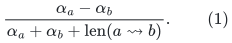
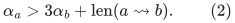
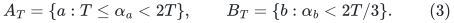
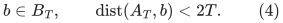
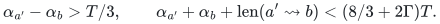
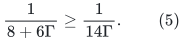
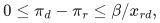
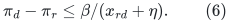
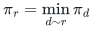

# Coarse directed paths suffice for the slack-only matching comparison

**Research lemma, 25 October 2026.** The directed path interface exposed
by [slack-only-one-sided-matching-client.md](slack-only-one-sided-matching-client.md) does not require
near-exact distances merely to obtain a useful numerical direction.
A coarse multiplicative factor <code class="math">\Gamma</code> yields an inverse-<code class="math">\Gamma</code>
one-sided ratio. This is a reduction of an oracle requirement, not a
construction of the required dynamic directed path provider.

## 1. The exact path ratio and the strong comparison

Write <code class="math">\alpha_d=1/s_d</code>. The ordinary directed allocation graph has
receiving arcs <code class="math">r\to d</code> of length zero and donor arcs <code class="math">d\to r</code>
of length <code class="math">1/x_{rd}</code>. For a directed path from bin <code class="math">a</code> to bin
<code class="math">b</code>, its slack-only ratio is

<!-- math-display: bac72c02e5f0857616d4136f
\frac{\alpha_a-\alpha_b}
            {\alpha_a+\alpha_b+\mathrm{len}(a\leadsto b)}.
                                                               \tag{1}
-->

The actual matching comparison has ratio greater than <code class="math">1/2</code>.
Decomposing it into directed simple cycles supplies a path satisfying

<!-- math-display: 54d12785e1b72a1f130b8313
\alpha_a>3\alpha_b+\mathrm{len}(a\leadsto b).
                                                               \tag{2}
-->

This reduction uses the actual matching comparison theorem. It does
not rely on an arbitrary positive-ratio cycle in a matching-optimal
state.

## 2. Dyadic source buckets

For each dyadic threshold <code class="math">T</code>, define

<!-- math-display: 85e5c944f18751114e2a5cac
A_T=\{a:T\le\alpha_a<2T\},\qquad
 B_T=\{b:\alpha_b<2T/3\}.                                    \tag{3}
-->

The guarded polynomial slack range requires only <code class="math">O(\log S)</code>
nonempty source buckets. Take the bucket containing the source
of (2). Then

<!-- math-display: d8e49f8bf979fea15602ae11
b\in B_T,\qquad
                  \mathrm{dist}(A_T,b)<2T.             \tag{4}
-->

Suppose a directed multisource provider has upper distance estimates
within a factor <code class="math">\Gamma\ge1</code>, with current path witnesses whose
actual lengths are no larger than those upper estimates. It can
therefore certify a path from some <code class="math">a'\in A_T</code> to this target
with length less than <code class="math">2\Gamma T</code>.

More generally, accept any current path from a source in <code class="math">A_T</code>
to a target in <code class="math">B_T</code> with length at most <code class="math">2\Gamma T</code>.
Equation (3) gives

<!-- math-display: e3b97e920bc462582fe5b3b1
\alpha_{a'}-\alpha_b>T/3,\qquad
 \alpha_{a'}+\alpha_b+\mathrm{len}(a'\leadsto b)
          <(8/3+2\Gamma)T.
-->

Its ratio is consequently greater than

<!-- math-display: 1007f7c6f00ab669e730f40e
\frac{1}{8+6\Gamma}
                         \ge\frac{1}{14\Gamma}.             \tag{5}
-->

Thus the strong comparison is always detected in at least one bucket,
and every accepted bucket answer is safe for the one-sided progress
lemma. The path may start at a different bucket source from the
original comparison; all sources in the bucket satisfy the same
inequalities.

The path cannot be a zero-edge self-path, since the two price ranges
are disjoint. If the provider supplies a walk, charging donor
traversals before cancellation gives the same raw-ratio bound. Loop
erasure can only reduce its nonnegative ordinary length.

## 3. What the required query must actually return

For the intended running time, one needs a set-to-set threshold
operation: find a target in <code class="math">B_T</code> with a sufficiently short
source path, or certify the absence of a path of length less than
the strong threshold. Merely exposing numerical estimates for all
vertices does not make a full scan of all targets free.

One can state the provider contract as:

* current source set <code class="math">A_T</code> and target set <code class="math">B_T</code>;
* detection whenever their true directed distance is below <code class="math">2T</code>;
* a current witness of length at most <code class="math">2\Gamma T</code> when a path
  is returned;
* support for the actual donor-price updates and source/target
  membership changes.

Separate instances for the <code class="math">O(\log S)</code> buckets add a logarithmic
factor. This does not remove the need to pay for weight updates,
threshold discovery, path reporting, or structural record lifetimes.
The current undirected APSP machinery does not meet this directed
contract.

## 4. Old-potential feasibility is an additional requirement

The monotonicity result in [slack-potential-semantic-certificate.md](slack-potential-semantic-certificate.md)
preserves a feasible old potential when receiving arcs on the chosen
path are tight in that potential. A general coarse path has no such
guarantee. Increasing a receiving allocation lowers the reverse
donor price, which can invalidate an old potential inequality.

More explicitly, for an old potential satisfying
<!-- math-display: fa6e37784c8d67f0cab985d9
0\le\pi_d-\pi_r\le\beta/x_{rd},
-->

increasing <code class="math">x_{rd}</code> to <code class="math">x_{rd}+\eta</code> is safe only if
<!-- math-display: f0002375ebfefad76f368f6f
\pi_d-\pi_r\le\beta/(x_{rd}+\eta).        \tag{6}
-->

If the receiving arc is tight, <code class="math">\pi_d=\pi_r</code>, this holds for
any positive new donor price. Otherwise a strictly positive step
can exhaust the margin in (6), and a tight donor inequality can
leave zero admissible increase under the frozen potential.

Consequently (5) cannot be combined with the exact-SPT monotonicity
lemma without proving a compatible path/potential guarantee.
Restricting paths to potential-tight receiving arcs is a legitimate
possible interface, but its ability to detect the full matching
comparison is currently unproved.

Row normalization
<!-- math-display: 0cfb026d949d196eacf55c2b
\pi_r=\min_{d\sim r}\pi_d
-->

provides at least one tight receiving exit per row. It does not
prove that every needed endpoint is reachable using only those
exits. It also does not make their directed donor metric symmetric.

## 5. Current consequence

The accuracy requirement for a future directed provider is weaker
than a <code class="math">1+\varepsilon</code> distance guarantee: a factor <code class="math">\Gamma</code>
can produce progress of order <code class="math">1/\Gamma^2</code> per safe normalized
step. The unresolved interface is simultaneous coarse path
discovery, one-sided update support, and either feasible-potential
preservation or a charged potential refresh mechanism. No running
time below the existing matching <code class="math">4/5</code> bound follows yet.

