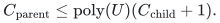
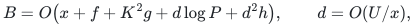

# Root audit of the proposed colored core-forest pool lift

**Final implementation choice.** The complete no-recursive-reset
construction in [decremental strong forest proof](../../problems/decremental-strong-forest/proof.md) has now
passed the root and two independent mathematical audits. The sections
below retain the earlier bounded-degree local formulation. Its port
retirement requirement is specific to that optional recursive-port
variant; it is not a dependency of the accepted implementation.
The accepted variant colors with <code class="math">O(\Delta_j)</code> base colors and
<code class="math">2C</code> occurrence slots, keeps one native child name per physical
parent name, and pays <code class="math">\sum_j\log\Delta_j=O(d^2h)</code>.

**Working independent audit, 25 October 2026.** The local compression
lemma is proved in [marked-steiner-compression-root-audit.md](marked-steiner-compression-root-audit.md). This
note checks the next combinatorial step, its lifetime requirements,
and the separation of occurrence bounds from update work. The full
strong-SSSP consequence remains subject to the main construction and
the independent interface audits. No exponent is promoted solely by
this working note.

## 1. Input objects and the two occurrence bounds

The current parent graph has native maximum degree three. Its local
provider maintains at most polynomially many in <code class="math">U</code> cut-only core
forests <code class="math">F_i</code>, each a subforest of the parent graph. A selected
core edge retains the identity of its original physical edge and
its core. The selected graph is a subset of the core union; it is
not an arbitrary path-replacement graph.

Expose selected physical edges at their original endpoints. In each
core mark its live roots and these endpoints, and compress the minimal
marked subtree. Each compressed edge denotes an exact physical path.
Equal exposed physical vertices can be identified across cores.
There is no closure operation on hidden intersections of different
cores. The number of live exposed incidences at any parent vertex is
polynomial in <code class="math">U</code>: within one core it is bounded by the parent's
native degree, and each physical selected edge occurs at most once
per core.

After the already audited positive-length degree adapter, each parent
vertex has at most <code class="math">b=\mathrm{poly}(U)</code> **live** child port
aliases. Let an incoming flat forest have both vertex occurrence and
native-edge occurrence at most <code class="math">C</code>. Its nodes have persistent
identifiers and fixed child-native images while alive.

The two occurrence bounds must both be assumed. A forest can have
arbitrarily many isolated nodes while its edge occurrence is zero.
Each incoming node therefore gets a separate persistent representative
in the parent lift; no edge-count argument substitutes for this
inventory.

## 2. Coloring occurrences of compressed edges

For one core, form a multigraph whose vertices are the exposed
physical endpoints and whose edges are incoming occurrences of that
core's compressed edges. Distinct occurrences are different edges
even when they use the same compressed edge.

The degree of this occurrence multigraph is at most <code class="math">3bC</code>: every
occurrence incident at the physical vertex is incident at one of its
live child-native aliases, and that alias has native degree at most
three and edge occurrence at most <code class="math">C</code>. Put <code class="math">D=3bC</code>.

A deterministic greedy proper edge coloring with <code class="math">2D-1</code> colors
suffices. For an insertion, at most <code class="math">2D-2</code> colors are blocked by
the other endpoint incidences. Deletions free the assigned color;
no existing edge is recolored. A simple scan of <code class="math">O(D)</code> colors is
allowed. It is computation, not <code class="math">O(D)</code> reported forest edits.

Within one color the selected compressed edges are a matching.
Their expanded physical paths are vertex-disjoint: the compressed
core paths have disjoint interiors, meet only at their retained
endpoints, and a matching has no shared retained endpoint.

This argument uses the physical endpoints, rather than the identities
of incoming forest copies. Coloring only by copy identity would not
prove disjointness. Conversely, coloring does not require <code class="math">C^2</code>
colors; its degree bound is linear in <code class="math">C</code>.

## 3. One full-forest pool per color

For each core and color allocate a copy of the full current live
core forest. Choose and store one physical cut edge on every nonempty
compressed path. In a given color, remove that cut edge whenever
the compressed edge has no occurrence assigned that color. Leave
it present when that color selects the compressed edge.

Every component of the resulting pool contains at most one selected
compressed path. Indeed, a physical path between two selected paths
lies in the minimal marked subtree. Unless the selected paths share
a retained endpoint, which the coloring forbids, this connection
crosses an unselected compressed edge and its removed cut edge.
Branches outside the marked subtree attach as dangling trees and
cannot bypass a cut in a forest.

For a selected occurrence corresponding to the incoming edge <code class="math">xy</code>,
join its two physical path endpoints to the dedicated representatives
of <code class="math">x</code> and <code class="math">y</code>, respectively, by typed true-null edges. These
joins preserve physical images. Distinct occurrences of the same
compressed edge use distinct colors and hence independent paths.

An incoming direct physical edge is represented by one original-edge
copy between its two representatives. An incoming port connector is
represented by a true-null edge. Isolated representatives remain
isolated and retain their identifiers while their input nodes live.

After deleting unused pool components and dangling parts just for
the purpose of the proof, the resulting graph is the incoming forest
with each edge replaced by a separate path. It is therefore a forest.
Restoring the discarded dangling trees and unused components cannot
create cycles. No unrelated nodes are identified merely because they
have the same physical image.

The separately maintained nearest-pivot forest of the parent level
is joined only at its designated pivot roots. Each of its components
has one such root. This is the usual consecutive-family forest
assembly; it must not be replaced by joining all equal-image nodes.

## 4. Count the unused pool vertices too

There are <code class="math">O(Cb)</code> colors per core and polynomially many cores.
Every live parent-native vertex occurs at most once in each full-core
copy. Thus all pool vertices, including unused components and dangling
branches, contribute <code class="math">C\mathrm{poly}(U)</code> occurrences.
The dedicated representatives add at most <code class="math">Cb</code> at any physical
vertex. Direct-edge and true-null incidences obey the same bound.

The local recurrence is consequently
<!-- math-display: 369983f275ed4ce8d54075bf
C_{\rm parent}\le \mathrm{poly}(U)(C_{\rm child}+1).
-->

Its initialization cost is the actual full-core inventory times
<code class="math">C\mathrm{poly}(U)</code>, not just the selected compressed paths.
For <code class="math">d</code> recursive levels, logarithmic occurrence is <code class="math">O(dh)</code>,
or the weaker <code class="math">O(d^2h)</code> envelope after harmless assembly factors,
where <code class="math">h=\log(U+4)</code>. No selected-record factor
<code class="math">\exp(O(U/K))</code> appears in this occurrence recurrence.

## 5. Dynamic transactions

The compression lemma reports constantly many virtual edits for
each mark-status change or physical core cut. Store the old virtual
edge endpoints and its selected default cut edge before applying
the physical change.

An affected old compressed edge has at most <code class="math">C</code> incoming native-edge
occurrences. Detach their endpoint joins and release their color
assignments before changing their pool interpretation. Install new
default cuts before restoring obsolete ones, using reference counts
if an old and new virtual edge choose the same physical cut edge.
Never restore a physical edge that has been deleted from the core.
Finally assign colors to the new incoming occurrences, open their
selected paths, and install their endpoint joins.

An unchanged compressed path cannot overlap the interior of a new
compressed path. Thus installing the new default cuts does not cut
an unchanged selected path. Detaching changed occurrences first
also prevents an obsolete path component from linking two input
components while the compressed representation changes.

The physical cut is applied to every pool copy, costing
<code class="math">C\mathrm{poly}(U)</code> edge operations. Changing a virtual default
cut across all colors has the same bound. A native child-forest edge
edit changes only constantly many joins or direct edges once its
color is found. A naive color scan costs <code class="math">O(C\mathrm{poly}(U))</code>
CPU operations but does not create that many copies or reassignments.

The input update and its recursive child transcript are processed as
one settled transaction. Only the resulting settled forest is queried.
Old endpoint and default-cut identifiers suffice for teardown; no
long physical path is enumerated after a core cut. All requested tree
paths for newly created virtual edges are still live and are obtained
from the compression data structure.

## 6. Retiring private isolated vertices is mandatory

An internal provider may retain an isolated native vertex as a ghost
until its next rebuild. The exposed pools cannot retain all such
ghost lifetimes if many successive port generations map to the same
physical parent vertex.

When a private native port retires, first delete its incident native
edges and end its private terminal lifetime. It is then isolated in
every core because each core is a subgraph of the live native graph.
Delete its isolated copies from every exposed pool, its private
root mark, and its dedicated representatives. Use fresh identifiers
for any later port birth. Internal provider storage may retain its
ghost, but that ghost is outside the exposed lift and its terminal
domain.

Every such retirement costs <code class="math">C\mathrm{poly}(U)</code> and is charged
as an actual graph/terminal event. It introduces no physical cut or
long-path traversal at this point. Root-original canonical vertices
have permanent identifiers and are not private retired ports.

At a synchronous amortized rebuild, retire the old private pool family
and publish the new one, retaining only required original canonical
identifiers. The exposed inventory cannot accumulate all prior
private generations. This lifetime convention is an additional
interface of the proposed lift; it is not obtained by silently
invoking a public lemma with a monotone terminal-domain requirement.

## 7. Work can be larger than occurrence

Let <code class="math">P=\exp O(U/K+g+h)</code> bound selected-record and local graph edits.
The child graph still pays this factor. A conservative inner work
and explicit-recourse envelope is
<!-- math-display: 318882283ed2471a2bd5fd19
B=O\bigl(x+f+K^2g+d\log P+d^2h\bigr),
 \qquad d=O(U/x),
-->

using the older repair bound <code class="math">K^2g</code>. The normalized repair can
replace that term by <code class="math">Kg</code> where its stronger interface is used.

The <code class="math">d^2h</code> term pays the products of the level-dependent color
scans and copied update inventories. It is compatible with the
linear occurrence recurrence in Section 4. There is no requirement
that the output forest's total edit count equal its maximum
simultaneous occurrence.

The local metric exponent is unchanged:
<!-- math-display: d73b7bf68b0b5fd6743df250
a=O(dKg+dh).
-->

Every old selected core edge can be replaced by its root-to-physical
endpoint core paths and the original physical edge. The old stretch
label bounds that walk. Every edge in the new child graph expands
to an actual parent path. These two directions are necessary:
the first retains the old upper stretch, and the second prevents
artificially shortening physical distances.

## 8. Remaining full-construction checks

Before a strong-SSSP or exact Gomory--Hu exponent is stated, the main
proof and a second audit must verify the following interfaces together:

* the selected subgraph provenance and polynomial live port-alias bound;
* the small-instance base, actual-size shrink, and fixed root anchors;
* terminal lifetimes through every recursive wrapper;
* the exact child-edit transaction and output occurrence indexing;
* the outer cover constraints and use of occurrence, rather than all
  inner construction work, in the recursive copy count.

The root has independently read KMG Algorithm 10 and Claims
5.15--5.17: local construction work is charged once, whereas outer
copy multiplicity depends on vertex occurrence. That source check
supports the separation above, provided the new local interfaces
are all fulfilled.
