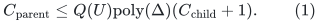
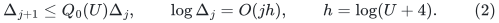
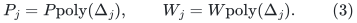
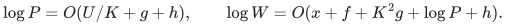
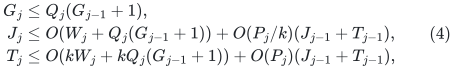
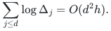
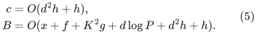
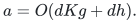
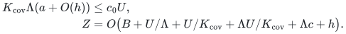
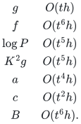

# Independent audit of compressed cores and colored forest pools

**25 October 2026. Final comparison audit passed.** This audit checks
the complete preferred construction in
[decremental strong forest proof](../../problems/decremental-strong-forest/proof.md), with its no-reset native-child implementation.
The final main note was read in full and compared with every obligation
below. The no-reset version avoids requiring a public recursive
provider to support ending private terminal lifetimes inside a period.

The simultaneous forest occurrence bound is independent of the large
selected-record factor <code class="math">P</code>. The source work and child-record transcript
still pay <code class="math">P</code>. This separation supports the strong-forest
<code class="math">6/7</code> point. The public comparison is the newly derived <code class="math">8/9</code> bound,
not the older <code class="math">10/11</code> reconstruction. Nothing here improves the general
matching <code class="math">4/5</code> exponent.

## 1. Physical provenance and the active mark inventory

Each stable core forest is a cut-only subforest of the current native
parent graph, with fixed positive edge lengths during a physical edge
lifetime. There are polynomially many cores and length buckets in <code class="math">U</code>.
Selected edges retain their original native edge identities.

Repeated selection by repair layers is deduplicated before publication.
Thus a physical vertex of native degree <code class="math">\Delta</code> has at most <code class="math">\Delta</code>
selected incidences in one core, even if its contracted core root has
large selected degree. This is an explicit implementation property:
[amortized-static-base-distance-sparsifier.md](amortized-static-base-distance-sparsifier.md),
Section 2, states the reference-counted deduplication.

The same source note, Section 5 and its equation (16), explicitly counts
changed selected endpoint/root records by native splits, membership
changes, and births. Marking the current core root of a selected endpoint
therefore uses the actual transcript. It does not require scanning every
native edge after a forest cut. The initial allowance <code class="math">O(mP/k)</code> must
remain available when it is spent later.

Initially small disconnected components need the actual-inventory
wrapper. An untouched small component keeps its common root private and
answers internal distance queries from its local exact table; outside
distances are infinite. It does not export a child vertex merely because
the provider stores that root. On its first actual endpoint activation,
its common root is activated along with the touched endpoints. This
activation is charged to that edit. Later roots are charged to the native
transcript. Anchors add only their explicitly charged constant number of
handles.

Marking all private initial roots would break the initial shrink bound.
The proof below uses only the active convention just described.

## 2. Dynamic compression: the long path is not an update list

The local proof in [marked-steiner-compression-root-audit.md](marked-steiner-compression-root-audit.md) is sound.
Suppress unmarked degree-two vertices in the minimal marked subtree.
The resulting virtual paths have disjoint physical edge interiors and
can meet only at retained endpoints.

The adversarial cases all cause constantly many virtual record edits:

* A mark in an unused branch attaches its path at the first old subtree
  vertex and can split only the one virtual path containing that vertex.
* Removing a marked leaf removes one virtual leaf edge. Only its former
  neighbor can lose a branching status and require suppression.
* A physical cut inside the marked subtree lies on one virtual path.
  The discarded tails contain no other mark or retained branching point.
  Each old virtual endpoint still has a marked direction on its surviving
  side, unless it is itself the mark.
* A physical cut outside the marked subtree leaves the virtual
  representation unchanged. A newly required root is a separate mark
  event.

These arguments hold at arbitrary native degree. A high-degree retained
vertex does not cause a pruning cascade: losing one incident virtual edge
either leaves its degree above two or suppresses it once.

Only a constant number of dynamic-tree path operations is needed per
event. The algorithm never reports every physical edge of a long virtual
path as recourse.

## 3. Uncontracted selected edges control geometric overlap

In one core, restore every selected real edge at its original physical
endpoints and include the compressed marked forest. A physical vertex
has at most <code class="math">\Delta</code> selected incidences and <code class="math">\Delta</code> virtual
incidences. Over <code class="math">b=\mathrm{poly}(U)</code> cores, the uncontracted
graph <code class="math">J</code> has maximum degree at most <code class="math">2b\Delta</code>.

A physical edge belongs to at most one virtual path and one selected
real copy per core. A physical vertex is either internal to one virtual
path or a retained endpoint of at most <code class="math">\Delta</code> paths. Consequently
vertex and edge overlap are polynomial in <code class="math">U,\Delta</code>. This is a
pointwise overlap bound, not an average.

Exposed junctions with the same physical parent identity are identified.
There is no closure under hidden intersections with every other core.
Such closure is unnecessary and would require an additional size and
update proof.

Every edge of <code class="math">J</code> is an actual physical parent path, so distances in
<code class="math">J</code> dominate physical distances. Conversely, each old selected
contracted core edge can be expanded into its two root legs and its
uncontracted physical edge. Both roots and both physical endpoints are
marked. Their root legs are contained in the compressed subtree, and
their total length is at most the stored core-edge length. This proves
the reverse metric comparison on logical pivots.

## 4. The direct vertex bound also controls a fixed edge's copies

Let <code class="math">C</code> bound all incoming forest nodes at one native child vertex,
including isolated and unused nodes. Fix a nonloop child edge <code class="math">uv</code>.
All forest occurrences of this one edge identity lie on at most <code class="math">2C</code>
nodes. They form a subgraph of a forest, hence number at most <code class="math">2C-1</code>.

Parallel native edges do not invalidate this argument: it fixes one
identity. Two parallel occurrences joining the same two forest nodes
would already violate the forest condition. Immediate typed-null edges
are handled separately and never need a path-pool slot.

The no-reset representation has one native cross-edge for each virtual
edge. The same copy bound therefore applies directly to that virtual
edge, without any factor from ports or aliases.

## 5. Base edge colors times occurrence slots

Properly edge-color the current compressed forest with
<code class="math">2\Delta-1</code> colors. Each new virtual edge encounters at most
<code class="math">2\Delta-2</code> blocked colors at its endpoints. Give it any free color.
A deletion frees a color, and a split or merge only colors its constantly
many new edges. Existing virtual edges need not be recolored.

Give the occurrences of one virtual edge different slots from
<code class="math">\{1,\ldots,2C\}</code>. Its pool label is the pair consisting of the base
edge color and this occurrence slot. There are <code class="math">O(\Delta C)</code> pools
per core. At native degree three this specializes to five colors and
<code class="math">2C</code> slots, or at most <code class="math">10C</code> pools.

If two virtual edges use one pool, their base colors agree, so they have
no common retained endpoint. Their physical paths have no common
internal vertex by compression. Thus all selected paths in one pool are
vertex-disjoint.

Free-slot lists give small index work per incoming forest record.
Searching the base palette costs <code class="math">O(\Delta)</code> only per virtual graph
edit. There is no need to search a palette of size <code class="math">C</code> for every one
of <code class="math">C</code> new occurrences. In particular, no <code class="math">C^2</code> work or copy count
is hidden in the coloring.

## 6. One key cut per unused virtual path is sufficient

For each core and pool label, allocate a copy of the entire live stable
forest. For each virtual path choose one physical key edge. Distinct
virtual paths have distinct keys. Cut its key in a pool precisely when
that virtual edge has no occurrence assigned the pool.

A component of a pool cannot contain two selected virtual paths.
They do not meet at retained endpoints by coloring. Otherwise the unique
core-tree connection between them crosses an unused virtual edge, whose
key is cut. A branch outside the minimal marked subtree attaches at
only one place and cannot bypass a cut in a forest.

Only the endpoints of the one selected occurrence in that component
receive joins to incoming canonical nodes. An unused retained junction
is not joined to an unrelated canonical node merely because their
physical images coincide.

Removing unused hanging branches for the proof leaves one independent
route per incoming virtual edge. Direct selected-real edges and typed
null edges represent the other input edges. Contracting these routes
recovers exactly the incoming forest. Restoring hanging branches and
unused pool components cannot create a cycle.

This proves the forest property without expanding any long route. The
path between canonical nodes follows the original input forest path
with each virtual edge replaced by its physical path, so its physical
length is dominated by the input length.

## 7. Immediate typed-null edges close the recursive interface

An incoming recursive forest can contain a true-null edge whose two
nodes have the same native child image. It is not a native child edge.
It is also distinct from a positive connector edge in the older reset
variant.

Represent this immediate-null edge by a true-null edge between its two
dedicated output representatives. Their physical parent images agree.
It uses no color and causes one output edit. The same forest proof
applies. The main note has been amended to include this fourth input
case; omitting it would leave the recursive input contract incomplete.

Internal null edges are not contracted at every recursive level.
Their handles and physical images remain fixed for their lifetimes.
The bounded-degree original root permits the final quotient separately.

## 8. All unused pool nodes are counted

One core has <code class="math">O(\Delta C)</code> full copies. Every physical parent vertex
appears once in each copy, whether used, dangling, or isolated.
Across all cores this contributes
<code class="math">C\mathrm{poly}(U,\Delta)</code> node occurrences.

In the no-reset representation the child vertex names are a subset of
the parent native names. A dedicated representative for an incoming
node therefore adds at most <code class="math">C</code> nodes at one physical parent name.
Selected-real edge copies obey the <code class="math">2C-1</code> bound per child identity
and only polynomially many core identities use a given physical edge.
Thus a fixed polynomial <code class="math">Q</code> gives

<!-- math-display: 7f1114e549acf40f79d15df0
C_{\rm parent}
   \le Q(U)\mathrm{poly}(\Delta)(C_{\rm child}+1).       \tag{1}
-->

For the explicit pool scheme the dependence on <code class="math">\Delta</code> can be kept
linear up to the core polynomial. The dependence on <code class="math">C</code> is linear.
No output vertex is omitted merely because its pool is inactive.

## 9. Why no recursive degree reset simplifies lifetimes

The root input can be adapted once to constant degree by the already
audited outer adapter. At subsequent levels use <code class="math">J</code> directly, without
port trees. Then

<!-- math-display: 603fe45a5a1e23edc3480320
\Delta_{j+1}\le Q_0(U)\Delta_j,\qquad
 \log\Delta_j=O(jh),\qquad h=\log(U+4).                      \tag{2}
-->

A child vertex keeps its parent physical name. During a private period,
retain a name after it becomes isolated rather than creating repeated
port lifetimes at that same physical name. There is at most one such
native name per physical image in that period.

These retained isolated names count in the actual size and the prefix
birth allowance. The period rebuild rule bounds their total by the same
initial-plus-history inventory. A rebuild retires the old private
instance before publishing the new one; no old generations are left
simultaneously exposed.

This avoids needing a source provider to support arbitrary terminal
death inside its fixed period. The higher-level canonical map is supplied
by its persistent native nearest-pivot forest. Replacing a private child
instance does not replace original root canonical identifiers.

The constant-degree reset variant has a valid local pool proof, but a
complete recursive implementation would additionally have to expose
private terminal retirement or an equivalent rigorously defined filter.
The no-reset version avoids relying on that unproved extra source
interface.

## 10. Pool changes never enumerate long paths

Keep old virtual endpoint and key metadata until retirement. Remove
affected occurrence joins and release slots before changing their path
interpretation. Install new required key cuts and native deletions
first. Restore an old key only if it remains a live physical edge and
is unmasked in the final representation. Finally activate new
occurrences and their endpoint joins.

For a split, install both new masks before restoring the old default
cut. For a merge, install the new mask before restoring either old one.
An unchanged virtual lifetime cannot overlap the interior of a new
virtual path, so these changes do not cut an unrelated unchanged route.

If a physical edge was already masked when deleted, its availability
record is retired without inserting it. No old path handle is queried
after its physical forest version has been discarded; stored edge IDs
and endpoints suffice for teardown.

The child solver settles actual graph edits and buffers its forest
retirement/insertion log. Forwarding this log through the pool never
calls that solver again to compute another recursive update. This
prevents a circular update dependency.

One incoming forest record causes constantly many output records.
A physical cut, virtual birth/death, or native vertex birth costs
<code class="math">C\mathrm{poly}(U,\Delta)</code> pool records. These are different
charges; multiplying both by <code class="math">C</code> would be an incorrect square.

## 11. Uniform degree dependence and recursive work

The constant-degree source statements must be upgraded explicitly:

<!-- math-display: 2dc483608cdee17ec1fcbc49
P_j=P\mathrm{poly}(\Delta_j),\qquad
 W_j=W\mathrm{poly}(\Delta_j).                        \tag{3}
-->

The retained public constructive primitives have fixed polynomial
degree dependence: nearest-pivot work, core degree <code class="math">O(k\Delta_j)</code>,
selected-degree cleanup, and conversion of selected endpoint changes
to ordinary edits. They do not insert an exponential in <code class="math">\Delta_j</code>
or a new <code class="math">\Delta_j</code> factor into the metric loss at each repair depth.
The native support still contains one copy of each physical edge per
core; root-degree growth is controlled by (2).

This degree dependence was also checked directly in the primary KMG
text. Lemma 3.5 permits arbitrary maximum degree <code class="math">\Delta</code>, has
<code class="math">\widetilde O(k\Delta)</code> update work, bounds a core component's
incident edges by <code class="math">k\Delta</code>, and keeps its weighted stretch factor
polylogarithmic independently of <code class="math">\Delta</code>. Theorem 3.8 gives the
tree partition with upper component incidence <code class="math">\Delta z</code>.
Theorem 3.1's proof retains explicit polynomial degree factors in
the split-to-edit translation. In the checkpoint's repair recurrence,
native degree appears in the initial congestion and additive native
term, while the multiplicative stretch factor is <code class="math">\Gamma</code>.
Replacing three by <code class="math">\Delta_j</code> therefore changes a fixed polynomial
degree factor, not the metric exponent <code class="math">Kg</code>.

Let
<!-- math-display: e72b5734e1dfd8afd1732400
\log P=O(U/K+g+h),\qquad
 \log W=O(x+f+K^2g+\log P+h).
-->

The stronger normalized <code class="math">Kg</code> work may be used but is not needed.
The chosen range has <code class="math">x</code> larger than a sufficient constant times
<code class="math">\log P+d h</code>, so the degree factors do not destroy shrink.

Initialization pays the full actual forest inventory times the
declared occurrence capacity. The standard short-period recurrence
must retain the child update credit after initialization:

<!-- math-display: 240fb538b6cfb02f9379c494
\begin{aligned}
 G_j&\le Q_j(G_{j-1}+1),\\
 J_j&\le O(W_j+Q_j(G_{j-1}+1))
       +O(P_j/k)(J_{j-1}+T_{j-1}),\\
 T_j&\le O(kW_j+kQ_j(G_{j-1}+1))
       +O(P_j)(J_{j-1}+T_{j-1}),
\end{aligned}                                               \tag{4}
-->

where <code class="math">\log Q_j=O(h+\log\Delta_j)</code>. A conservative polynomial
degree factor may be absorbed into these quantities.
Setting <code class="math">Z_j=J_j+T_j/k</code> solves the same recurrence without
restarting the static provider once per incoming forest edit.

By (2),
<!-- math-display: dd207c22727086720e584cce
\sum_{j\le d}\log\Delta_j=O(d^2h).
-->

Equations (1)--(4) therefore give
<!-- math-display: f058606b8c41586d6ce4a3e4
\begin{aligned}
 c&=O(d^2h+h),\\
 B&=O(x+f+K^2g+d\log P+d^2h+h).
\end{aligned}                                               \tag{5}
-->

The static work factor enters additively in the logarithmic bound.
The occurrence recurrence contains neither <code class="math">B</code>, <code class="math">F</code>, nor <code class="math">P</code>.
The final root null quotient can spend a fixed polynomial of the
occurrence capacity per explicit change; this stays within (5).

## 12. The 6/7 parameters pass the full budget

The one-level metric comparison retains the selected quality.
The forced-anchor argument uses only pivot-pair distances and gives
<!-- math-display: d73b7bf68b0b5fd6743df250
a=O(dKg+dh).
-->

It does not require the unused pool nodes or all auxiliary vertices
to have small diameter.

The audited public outer copy recurrence uses vertex occurrence
<code class="math">e^c</code>, while local construction and explicit recourse are paid
in <code class="math">e^B</code>. Its constraint and total logarithmic bound are
<!-- math-display: f061b671c89454ee2d195950
\begin{aligned}
 K_{\rm cov}\Lambda(a+O(h))&\le c_0U,\\
 Z&=O\bigl(B+U/\Lambda+U/K_{\rm cov}
             +\Lambda U/K_{\rm cov}+\Lambda c+h\bigr).
\end{aligned}
-->

Write <code class="math">U=t^7h</code>. Choose
<code class="math">p=r=d=\Lambda=\Theta(t)</code>,
<code class="math">K=K_{\rm cov}=\Theta(t^2)</code>, and <code class="math">x=\Theta(U/t)</code>.
Then
<!-- math-display: c3d927adf3fe2b1e9c461f2c
\begin{array}{c|c}
g&O(th)\\
f&O(t^6h)\\
\log P&O(t^5h)\\
K^2g&O(t^5h)\\
a&O(t^4h)\\
c&O(t^2h)\\
B&O(t^6h).
\end{array}
-->

The degree overhead is <code class="math">O(d^2h)=O(t^2h)</code>, well below the
leading work term. The cover product is <code class="math">O(t^7h)=O(U)</code>;
small fixed outer constants satisfy its required constant. All
outer work terms are <code class="math">O(t^6h)</code>. Thus the checked interface
supports the <code class="math">O(U^{6/7}h^{1/7})</code> logarithmic envelope.

The final comparison also rechecked the source wrapper's whole-tree
initialization of small components. Different weighted calls can use
different low-stretch spanning trees, but all share the chosen root
<code class="math">r_C</code>. The componentwise replica normalization and fixed-label proof
in [disconnected-component-backend-wrapper.md](disconnected-component-backend-wrapper.md),
Section 2, ensure that this convention does not add an uncharged
<code class="math">k</code>-factor to the metric stretch.

Historical cover ghosts are covered by the literal over-all-times
overlap clause of KMG Definition 5.2(3): every vertex in a cover's birth
set belonged to its expanded ball at birth. A retained isolated name
therefore retains that charged owner, even after leaving the current
active cover. Unique native names within a period and complete old
period retirement are both needed for this argument.

## 13. The stronger public baseline was independently rechecked

Algorithm 5, Definition 3.22 and Lemma 3.21 of the [primary paper](https://arxiv.org/pdf/2311.06402v1) are the interfaces used in the [direct vertex-inventory proof](public-forest-direct-vertex-inventory.md).

The source's degree-times-edge-congestion conversion is used only
to choose enough slots for incoming nodes at a selected root.
With a direct node capacity <code class="math">C</code>, only <code class="math">C</code> root-tree slots
are required. Each physical vertex lies in one rooted fiber of
each stable forest, giving <code class="math">C\mathrm{poly}(U)</code> node
occurrences. Projected edges create no new nodes.

A root cut is safe after retiring every changed projected input
incidence. The detached old fiber has no old-root designated node
or surviving attachment and can join its new-root slot without
merging two input marks. The input map and all physical images
remain fixed.

The original public hierarchy still has selected-degree work
<code class="math">d^2\log P</code>. With the public provider <code class="math">g=O(qrh)</code>, taking
<code class="math">U=t^9h</code>, <code class="math">q=r=d=\Lambda=t</code>, <code class="math">K=t^3</code>, and
<code class="math">K_{\rm cov}=t^2</code> gives the derived <code class="math">8/9</code> point.

The new gain is therefore not the abstract decision to count nodes
directly. It is the uncontracted compressed child graph, whose
native degree grows only by a polynomial logarithmic factor per
level, together with a flat dynamic pool lift that preserves this
small occurrence while paying all selected-record edits.

