# A conditional sequential full router from a shuffler hierarchy

**Separate mathematical construction, 24 October 2026.** This note
reconstructs the query algorithm directly. It does not invoke the
mutually recursive Task 2, expander sorting, and Task 3 algorithms of
[Chang--Huang--Su, arXiv:2405.03908](https://arxiv.org/pdf/2405.03908).
No global best-leaf density parameter is used.

The hierarchy and precomputed embeddings are explicit hypotheses of
this reusable query theorem. The induced-terminal issue in
[chs-hierarchy-and-load-boundaries.md](chs-hierarchy-and-load-boundaries.md)
is resolved for the current application by the
[virtual-root construction, Section 5.1](virtual-expander-hierarchy-reconstruction.md#51-provider-for-the-full-routers-flattened-family-hypothesis).
The [sequential router, Section 6](sequential-expander-routing-tradeoff.md#6-direct-full-query-induction),
instantiates every query hypothesis using that construction and its leaf
circuits. The resulting router is used by the four-fifths composition;
the older 6/7 and 5/6 compositions use different routers.

## 1. Conditional interface and result

Let <code class="math">G</code> be the physical host, with <code class="math">n</code> vertices and fixed bounded
maximum degree, as supplied by the incidence-port split. Paths are explicit
physical edge-ID lists, with endpoint annotations even when empty.
Parallel IDs remain distinct. Assume a hierarchy of good vertex sets
of depth at most <code class="math">d</code>. At a good internal node <code class="math">X</code>, its vertices
have the disjoint partition
<!-- math-display: 9ad920f350e25b88cbbddb9d
X=Y_1\mathbin{\dot\cup}\cdots\mathbin{\dot\cup}Y_t,\qquad
 Y_i=X_i\mathbin{\dot\cup}B_i.                              \tag{1}
-->
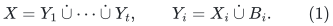
Here <code class="math">X_i</code> is a good child, and a precomputed injective matching
<code class="math">\mu_i:B_i\to X_i</code> has explicit physical paths. Thus
<code class="math">&#124;B_i&#124;\leq&#124;X_i&#124;</code>. For fixed positive constants and a common <code class="math">k</code>,
<!-- math-display: c0e75af2d3c4fd38fc1d5ace
c_-|X|/k\leq |Y_i|\leq n'_X\leq c_+|X|/k,\qquad t\leq k. \tag{2}
-->
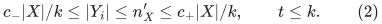
The CHS normalization <code class="math">n'_X=6&#124;X&#124;/k</code> is permitted.

At each <code class="math">X</code>, there are <code class="math">\lambda_X\leq\lambda</code> precomputed
matching families <code class="math">M_X^1,\ldots,M_X^{\lambda_X}</code>.
A matching joins vertices of different parts. If <code class="math">p_{ij}^a</code>
counts matching edges between <code class="math">Y_i,Y_j</code>, put
<!-- math-display: 8c385392d58da4f52f90aa73
m_{ij}^a=p_{ij}^a/n'_X,\quad
 Q_a[i,j]=m_{ij}^a/2\ (i\ne j),\quad
 Q_a[i,i]=1-\tfrac12\sum_{j\ne i}m_{ij}^a.                 \tag{3}
-->
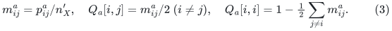
These matrices are symmetric and stochastic. Require
<!-- math-display: f4ea8c27eb0ad88aecd03752
\left|(Q_{\lambda_X}\cdots Q_1)[i,j]-1/t\right|
                                      \leq 1/(100t).     \tag{4}
-->
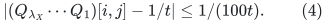
The stronger CHS potential stopping condition implies (4) eventually;
(4) can also be checked directly by rational arithmetic.

Impose the elementary size guards
<!-- math-display: 3d07ecf2c91ed215c77afc0d
\min_i|Y_i|\geq8\lambda t^2,\qquad n'_X\geq\lambda t^2.
                                                               \tag{5}
-->
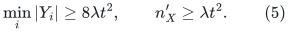
The new sequential construction can enforce these guards without
the source's restriction on its distributed parameter. Given an
integer <code class="math">p\geq1</code>, use the actual host size to set
<!-- math-display: 225cedef06f781b0642ba4dd
v=\lceil\log_2(n+2)\rceil,\qquad
 k=2^{\max\{5,\lceil v/p\rceil\}},\qquad
 \lambda_{\rm cap}=C_0(v+1)^2 .
 \tag{5a}
-->
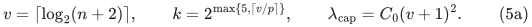
The polynomial energy cut player has
<code class="math">\lambda=O(\log(k+2)\log(n+2))</code>, with an explicit absolute
constant in its potential-decrease proof. Choose a fixed
sufficiently large <code class="math">C_0</code>, and stop recursion at a fixed
sufficiently large multiple of <code class="math">k^5\lambda_{\rm cap}^2</code>
vertices. Each remaining internal terminal set has
<code class="math">\Omega(k^5\lambda_{\rm cap}^2)</code> vertices; its smallest
part has <code class="math">\Omega(k^4\lambda_{\rm cap}^2)</code> vertices.
This implies (5) for <code class="math">t\leq k</code> and
<code class="math">\lambda\leq\lambda_{\rm cap}</code>, without requiring
<code class="math">k\geq c\lambda</code>.

The depth is <code class="math">O(\log n/\log k)\leq O(p)</code>.
All leaves have size <code class="math">\mathrm{poly}(k,\lambda_{\rm cap})</code>,
including a whole small host declared a leaf. Hence one fixed
polynomial leaf algorithm costs only
<code class="math">\exp O(v/p+\log(v+2))</code> per actual host record.
The full hierarchy's preprocessing retains the intended
<code class="math">n\exp O(v/p+p\log(v+2))</code> envelope, apart from its explicitly
separated inverse-expansion factor. No old CHS epsilon clipping
or larger master-sized padded graph is used in this adapter.

Each leaf has a full-router circuit: for arbitrary source/destination
tokens of endpoint load at most <code class="math">L</code>, it returns physical paths of
length at most <code class="math">A_{\rm leaf}</code>, congestion at most <code class="math">LA_{\rm leaf}</code>,
and work
<!-- math-display: 51c7f51ec881aa42f90e3576
|X|L A_{\rm leaf}\mathrm{poly}(\log(nL+2)).
                                                               \tag{6}
-->
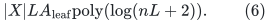
Preprocessing is independent of <code class="math">L</code>, with one fixed polynomial
exponent in leaf size, inverse sparsity, and bit size. Section 7
gives a concrete circuit interface.

Assume the union of all precomputed shuffler paths, folding-matching
paths, and elementary leaf-circuit paths has physical edge
congestion at most <code class="math">A</code>, and each path has length at most <code class="math">A</code>.
A polynomial factor in levels or circuit layers can be included
in <code class="math">A</code>. A per-level congestion bound gives the same statement
after multiplying <code class="math">A</code> by <code class="math">d+1</code>.

This is an explicit flattened-family condition. Child virtual
edges need not be genuine edges induced by child terminals.
A virtual-graph hierarchy with consistent embeddings is allowed.

**Conditional result.** There is a deterministic sequential full
router on the hierarchy root. For endpoint load <code class="math">L\geq1</code>,
<!-- math-display: 5cab8469167cc157b908d5b0
\begin{aligned}
 \text{maximum path length}&\leq A(c(\lambda+1))^{d+1},\\
 \text{edge congestion}&\leq LA(c(\lambda+1)^2)^{d+1},\\
 \text{query work}&\leq nLA(c(\lambda+1)^2)^{d+1}
                          \mathrm{poly}(\log(nL+2)).
 \end{aligned}                                                \tag{7}
-->
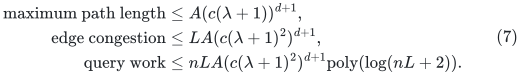
The constant is independent of <code class="math">d,k,L</code>.
For <code class="math">d=O(p)</code>, <code class="math">\lambda=\mathrm{poly}(\log n)</code>, and
<!-- math-display: 0f6435caef008dce8a1f84aa
A=\phi^{-O(1)}(\log n)^{O(p)},              \tag{8}
-->
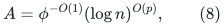
the non-load factors in (7) are
<code class="math">\phi^{-O(1)}(\log n)^{O(p)}</code>. No polynomial factor in
<code class="math">k=n^{1/p}</code> enters query quality. The original root's inverse
conductance is paid once through <code class="math">A</code>, rather than once per level.

The work is intentionally <code class="math">nL</code>-sensitive: the algorithm creates
<code class="math">2L</code> dummies at each vertex. It does not claim work proportional
only to a sparse real token list. Section 8 checks the intended
static witness applications.

## 2. Full routing on a part

Assume the full router on good child <code class="math">X_i</code> is constructed. Define
<!-- math-display: 0329df2dc4bfd8cf6797a23c
h_i(v)=v\ (v\in X_i),\qquad h_i(v)=\mu_i(v)\ (v\in B_i).
                                                               \tag{9}
-->
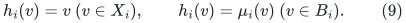
Every fiber has size at most two. For token <code class="math">u\to v</code> in <code class="math">Y_i</code>,
fold <code class="math">u</code> to <code class="math">h_i(u)</code>, route <code class="math">h_i(u)\to h_i(v)</code> in the child,
and unfold to <code class="math">v</code>. Part endpoint load <code class="math">P</code> becomes child
endpoint load at most <code class="math">2P</code>. Each folding-matching edge is used
by at most <code class="math">2P</code> source/final pieces. Output destinations are
exactly the requested ones, with destination load at most <code class="math">P</code>.

Call this the **part router**. It routes on all of <code class="math">Y_i</code>, without
best-leaf ranks. Physical paths may leave the part through its
valid embedding; only endpoints and counted physical paths matter.

## 3. Deterministic scatter with central portal assignments

Tokens on <code class="math">X</code> initially have per-vertex load at most <code class="math">L_0</code>,
and colors in <code class="math">[t]</code>. Let <code class="math">N_{i\ell}^a</code> be the color-<code class="math">\ell</code>
count in part <code class="math">i</code> after step <code class="math">a</code>. At that step send
<!-- math-display: c95646e7a9cccb72374e3da5
q_{ij\ell}^a=
 \left\lfloor p_{ij}^a N_{i\ell}^{a-1}/(2n'_X)\right\rfloor       \tag{10}
-->
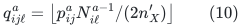
tokens of that color from part <code class="math">i</code> to part <code class="math">j</code>.
At most half a color's tokens in a part move, since the fractional
matching row sum is at most one. Choose disjoint token intervals
in fixed token-ID order.

For each directed pair <code class="math">i,j</code>, concatenate chosen tokens over
colors and assign them cyclically to its <code class="math">p_{ij}^a</code> portals.
Invoke the part router on these tokens to their assigned portals.
Each then follows the stored matching path to its paired portal.
Unselected tokens stay at their existing vertices.

### Integer-error and load bounds

For each color, <code class="math">N_\ell^a-Q_aN_\ell^{a-1}</code> has infinity norm
at most <code class="math">t</code>. Stochasticity bounds accumulated error by
<code class="math">\lambda t</code>. For total color count <code class="math">N_\ell</code>, (4) gives
<!-- math-display: 3f5a0c8083a43fde693fc7d2
.99N_\ell/t-\lambda t
   \leq N_{i\ell}^{\lambda_X}
   \leq1.01N_\ell/t+\lambda t.                                \tag{11}
-->
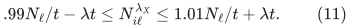
Let <code class="math">N_i^a=\sum_\ell N_{i\ell}^a</code> and
<code class="math">N_{\max}^0=\max_iN_i^0</code>. Summing the color errors gives
<!-- math-display: 10617d819db3203a2aa8bb05
N_i^a\leq N_{\max}^0+a t^2,\qquad
 N_{\max}^0\leq L_0n'_X.                                     \tag{12}
-->
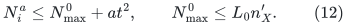
The total quota on portal group <code class="math">i,j</code> is at most
<code class="math">p_{ij}^a N_i^{a-1}/(2n'_X)</code>. Cyclic assignment therefore puts
at most
<!-- math-display: 6e7f5f3567a937bde1572c34
\left\lceil N_i^{a-1}/(2n'_X)\right\rceil
        \leq L_0/2+2\leq3L_0                                \tag{13}
-->
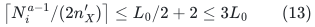
tokens at any sending portal, using (5) and <code class="math">L_0\geq1</code>.
The arrival bound is the same. A matching uses each endpoint
at most once per step.

Vertex load increases by at most <code class="math">3L_0</code> per step. Thus all
part-router source loads are at most <code class="math">4L_0(\lambda+1)</code>, and
their destination loads are at most <code class="math">3L_0</code>. Calling each
part router with parameter <code class="math">O(L_0(\lambda+1))</code> is sufficient.
Temporary physical path intersections do not change these
endpoint counts; the result is an explicit path family, not
an assertion of one-step simultaneous communication.

### Linear token bookkeeping rather than a cubic table

For each <code class="math">i,a</code>, preprocess portal groups in decreasing
<code class="math">p_{ij}^a</code> order. Metadata per step is <code class="math">O(t^2)</code>.
For each nonempty <code class="math">(i,\ell)</code>, scan this list only until
<code class="math">p_{ij}^a N_{i\ell}^{a-1}&lt;2n'_X</code>. Later quotas are zero.
Every enumerated positive quota consumes at least one
selected token, and all selected intervals are disjoint.
There is at most one failed stopping test per nonempty
<code class="math">(i,\ell)</code>. Consequently counts, quota intervals, and
cyclic assignments cost
<!-- math-display: 19010b75108f651e2c6808bc
O((M+t^2)\mathrm{poly}(\log(nL_0+2)))
                                                               \tag{14}
-->
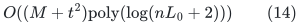
per step, with <code class="math">M</code> the current token count. There is no
<code class="math">t</code>-fold scan per token. Ordinary sorting and bucket lists
suffice. Under <code class="math">n'_X=6&#124;X&#124;/k</code>, each quota is the exact integer
<code class="math">\lfloor k p_{ij}^a N_{i\ell}/(12&#124;X&#124;)\rfloor</code>.

## 4. Scatter, meet, and reverse dummy traces

Suppose real source load is at most <code class="math">L</code>, and at most
<code class="math">L&#124;Y_j&#124;</code> tokens have mark <code class="math">j</code>. Scatter the real tokens.
Create exactly <code class="math">2L</code> dummy tokens at every vertex of <code class="math">Y_j</code>,
all with color <code class="math">j</code>, and scatter those separately. Record
each dummy's full path from its origin.

In each part <code class="math">i</code>, real color-<code class="math">j</code> count is at most
<code class="math">1.01L&#124;Y_j&#124;/t+\lambda t</code>, whereas dummy color-<code class="math">j</code> count is
at least <code class="math">1.98L&#124;Y_j&#124;/t-\lambda t</code>.
Their difference is at least
<!-- math-display: 70ac6b2eecb15cefa3733b10
.97L|Y_j|/t-2\lambda t>0                  \tag{15}
-->
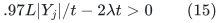
by (5). Centrally assign each real token to a distinct dummy
of its current part and color, using fixed-ID lists.

Within each part, route every real token to its assigned
dummy's final location. Source and destination load are
<code class="math">O(L(\lambda+1))</code>, since selected dummy destinations form
a subset of the actual dummy configuration. Each real token
then follows the reverse of its assigned dummy trace.
It ends in its desired part. No vertex receives more than
<code class="math">2L</code> real tokens: it was the origin of exactly <code class="math">2L</code> dummies.

Every dummy is used at most once. Thus reversed trace length
and congestion are bounded by the already computed dummy
trace inventory. No routing subroutine is invoked to reverse
the paths. This proves the part-mark task with final load <code class="math">2L</code>.

## 5. Full routing by induction

For exact source/destination tokens of endpoint load at most
<code class="math">L</code>, mark each token by its destination part. That mark count
is at most <code class="math">L&#124;Y_j&#124;</code>, so Section 4 applies. Afterwards all
tokens lie in their destination part, source load is at most
<code class="math">2L</code>, and exact destination load remains at most <code class="math">L</code>.
One final part-router call at parameter <code class="math">2L</code> finishes.

The two scatters use at most <code class="math">2\lambda</code> families of part-router
calls. Meeting and final routing add two families. Each family
uses only strictly smaller good children, at folded load
<code class="math">O(L(\lambda+1))</code>. There is no same-level recursive call,
or query preprocessing that depends on the query it answers.

The induction never uses a global best-leaf set, a best-leaf
density ratio, recursive expander sorting, or a renewed
<code class="math">L\rho_{\rm best}</code> destination allowance. Central portal
assignment is followed by genuine counted physical paths.

## 6. Work, path length, and congestion

Let <code class="math">\mathcal V_j</code> be the sum of <code class="math">&#124;X&#124;L_X</code> over all good-node
router invocations at depth <code class="math">j</code> in one root query. Child good
sets are disjoint subsets of their parent's vertices. Thus
<!-- math-display: 2a1ed3e67b61de7d89aaeedb
\mathcal V_0=nL,\qquad
 \mathcal V_{j+1}\leq c(\lambda+1)^2\mathcal V_j.               \tag{16}
-->
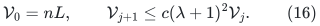
One factor pays the number of families, the other their load
increase. All dummy records and local bookkeeping are paid
by <code class="math">\mathcal V_j\mathrm{poly}(\log(nL+2))</code>.
The <code class="math">t^2</code> metadata is paid because <code class="math">t^2\leq&#124;X&#124;</code>.

For a fixed hierarchy node at depth <code class="math">j</code>, the sum of load
parameters of all its invocations is at most
<!-- math-display: c8debf55b84e41f6c3552bde
L(c(\lambda+1)^2)^j.                 \tag{17}
-->
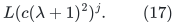
Each stored shuffler or folding edge is used a constant times
that load times a fixed polynomial in <code class="math">\lambda+1</code>. Applying
the globally flattened-family congestion bound yields total
computed-trace congestion
<!-- math-display: cf677beb0ecb9b9bb505dd27
LA(c'(\lambda+1)^2)^{d+1}.           \tag{18}
-->
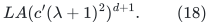
Returned real paths are bounded by this inventory with a fixed
additional factor per recursion level. Within one invocation,
distinct dummy assignments use each returned dummy trace at most
once. That trace can itself contain reversals created by a child
invocation. Inductively, count the child's computed and returned
inventory with multiplicity: consuming a returned trace or its
reverse increases this accounting by at most a fixed factor at
the parent. This factor is included in the constant of
<code class="math">c(\lambda+1)^2</code>, rather than asserting that an original
primitive occurrence is globally used only once. Immutable
concatenation records avoid repeatedly copying growing prefixes;
materialization is charged to explicit route occurrences.
Extra factors polynomial in depth or circuit layers fit (7).

A single token follows only <code class="math">O(\lambda+1)</code> child paths per
parent invocation: its real scatter, a dummy reverse scatter,
meeting, and final routing. Its dilation satisfies
<!-- math-display: 208afae83c20508e229fd55a
D_j\leq c(\lambda+1)(D_{j+1}+A).             \tag{19}
-->
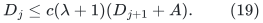
This proves path length in (7), without an <code class="math">L</code> factor.
Combining trace materialization, (16), and (14) proves work.

Concatenation initially gives walks. Before exporting a token
route, erase closed subwalks with a vertex stack and a position
table, in time linear in its explicit list length. The resulting
simple path has the same endpoints, uses only retained physical
edge IDs, and has no larger length or edge-occurrence load.
Parallel IDs are kept distinct. This final token-route
normalization is separate from normalizing an input ambient
embedding table in a later static sparsifier call.

It would be incorrect to multiply an already flattened factor
<code class="math">A</code> once per level. Here only the number of uses of fixed
precomputed path families multiplies. The hierarchy construction
must independently prove their union's physical quality.

## 7. A leaf circuit independent of token load

[sequential-leaf-routing-and-chs-work.md](sequential-leaf-routing-and-chs-work.md)
constructs short, low-congestion paths for a fixed bounded-load
matching in polynomial work. It uses a symmetric lazy walk with
uniform stationary measure, exact matrix powers, and moment
conditional expectations. A next step is an oriented genuine
edge ID or a holding symbol.

For a literal load-<code class="math">L</code> circuit, let <code class="math">h_0</code> and <code class="math">L_0</code> be the
next powers of two above leaf size <code class="math">h</code> and <code class="math">L</code>. There are
<code class="math">h_0</code> blocks of <code class="math">L_0</code> scalar positions; at most two blocks
are assigned to one physical vertex. Give each real token a
distinct destination slot and fill the remaining slots by
dummy keys.

Use the scalar bitonic network on <code class="math">h_0L_0</code> positions.
Comparator distances below <code class="math">L_0</code> stay within one block.
Larger distances pair blocks at equal within-block offsets.
Their block-pair pattern is independent of <code class="math">L_0</code>, and the
number of cross-block layers is
<!-- math-display: 7b16f3d4ff96db2fd172bcf1
\sum_{a=1}^{\log_2h_0}a=O(\log^2h_0).            \tag{20}
-->
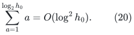
Preprocess the bounded-load matching paths of those layers
once. In a query compute comparisons centrally and move only
tokens requiring a block exchange; at most <code class="math">L_0</code> tokens use
each direction. Local work is
<code class="math">O(h_0L_0\log^2(h_0L_0))</code>. Each real token uses only
<code class="math">O(\log^2h_0)</code> stored paths, independent of <code class="math">L_0</code>, and
congestion scales by <code class="math">O(L)</code>. This proves (6).

A fixed polynomial leaf-size bound, for example <code class="math">O(k^5)</code>,
gives one fixed preprocessing exponent independent of <code class="math">p</code>.
Query quality depends polynomially on leaf inverse sparsity
and logarithmic size, not polynomially on <code class="math">k</code>.
If the original root is itself a leaf, its inverse expansion
is paid in this single construction only once.

## 8. Aggregate work in the static witness applications

The <code class="math">nL</code> term is sufficient for both static witness tasks.

For witness-to-host routing in a degree band <code class="math">J_i</code>, endpoint
load is <code class="math">\mathrm{poly}(\phi^{-1})\deg_{J_i}(v)</code>.
The incidence-port split has <code class="math">O(&#124;E(J_i)&#124;)</code> vertices with
per-port load <code class="math">\mathrm{poly}(\phi^{-1})</code>.
Its query volume is therefore
<!-- math-display: 201cfd11db43df48a99f878e
|E(J_i)|\mathrm{poly}(\phi^{-1}).      \tag{21}
-->
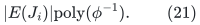
For host-to-witness routing with witness edge weight <code class="math">\rho_i</code>,
per-port load is <code class="math">L_i=\max(1,\lceil\rho_i\rceil)</code>, and
<!-- math-display: e94e2536b5d37278c90aed73
|E(W_i)|L_i
       \leq O(|E(J_i)|+|E(W_i)|).                             \tag{22}
-->
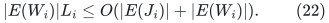
The established band sums pay these inventories.

Preprocess each actual host once. Only the query factor,
not the more expensive construction factor, multiplies
load volume. No new preprocessing call is made per unit
of load. Subsequent route normalization is charged to the
full output lists.

## 9. Remaining scope

This note supplies a sequential query induction and actual
token trajectories. A faster static primitive still requires
a uniform polynomial-work hierarchy with the stated virtual
graphs, the flattened-family bound <code class="math">A</code>, root coverage,
and the actual-size/finite-word preprocessing analysis.
Preprocessing arithmetic is charged at its actual precision.
Spectral elimination, matrix moments, and cut-player conditional
expectations can use a fixed polynomial in <code class="math">k</code> and the input
bit size, and are part of the construction-work factor. They are
not required to fit the numerical client's smaller stored-label
word bound. The exported paths still consist of original IDs and
have the length/congestion bounds above; temporary arithmetic
size contributes no extra <code class="math">k</code> to those geometric bounds.

The constructive leaf router and energy cut player remove
the two unbounded local computations identified in CHS, but
do not alone prove those hierarchy statements.
