# A 6/7 quantitative composition for deterministic general matching

**Research theorem candidate, 24 October 2026.** The two-parameter
STATIC sparsification interface used below is supplied by
[the separated static parameter reconstruction](separated-static-sparsifier-parameters.md)
and [the independent path/degree-band derivation](parameterized-expander-path-and-degree-bands.md).
This note proves its parameter balance, recursive composition,
numerical client bounds, and computable matching wrapper.
The result is a research proof assembly depending on the named
public-source and reconstruction proofs; it is not an externally
verified or implemented theorem. The earlier 14/15 construction
remains available separately.

The target problem is exact maximum-cardinality matching in an
arbitrary undirected graph. No perfect-matching promise, bipartiteness,
bounded-density promise, or approximation guarantee is assumed.

## 1. The precise additional primitive

Let <code class="math">U</code> be a common integer master parameter. The actual input size
of every call is at most <code class="math">2^{O(U)}</code>, but a call must initialize only
its ACTUAL records. Let <code class="math">q_{\rm exp},r_{\rm cut}\geq1</code> be integer
parameters. The proposed primitive has two different envelopes:

<!-- math-display: d4f8eaebb32abaa25372530d
\log_2\Gamma
   =O\!\left(q_{\rm exp}r_{\rm cut}\log(U+4)\right),
 \tag{1}
-->
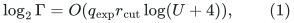
<!-- math-display: f1961836367db843133de510
\log_2 F
   =O\!\left(
     \frac{U}{q_{\rm exp}}+\frac{U}{r_{\rm cut}}
     +r_{\rm cut}^2\log(U+4)
     +q_{\rm exp}r_{\rm cut}\log(U+4)
     \right).
 \tag{2}
-->
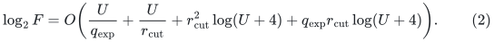

All constants must be absolute for one finite family of constructive
algorithms, rather than constants depending arbitrarily on the two
growing parameters.

Given an ambient graph <code class="math">H'</code>, a demand graph <code class="math">J</code>, and explicit
annotated paths <code class="math">\Pi:J\to H'</code>, the primitive must return a sparse
SUBGRAPH <code class="math">\widetilde J\subseteq J</code> and explicit demand routes with:

<!-- math-display: 173c1a26acecf2e13aee03bf
\begin{split}
 |E(\widetilde J)|&\leq
       \Gamma\,\mathrm{poly}(U)|V(J)|,\\
 L(\Pi\circ\Pi_{J\to\widetilde J})&\leq \Gamma L(\Pi),\\
 C(\Pi\circ\Pi_{J\to\widetilde J})&\leq
       \Gamma L(\Pi)\bigl(C(\Pi)+\Delta(J)\bigr).
 \end{split}
 \tag{3}
-->
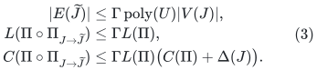

The input-path-length factor in the last line is NOT removed.
Parallel IDs and repeated path occurrences are counted. Empty loop
routes retain current endpoint annotations. The work, including
explicit route indexing and notifications, is bounded by

<!-- math-display: 0d0e5e2ca2ba7474af4492e7
|E(J)|\,F^{O(1)}\Gamma^{O(1)}
                 (L(\Pi)+1)\mathrm{poly}(U),
 \tag{4}
-->
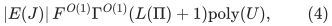

plus ordinary actual-input vertex bookkeeping. The ambient graph for
a local call may be restricted to the used routes and their central
edges. Unrelated isolated native roots and the master scheduling
universe are not scanned or allocated.

The source reconstruction establishes (1)--(4) on the actual static
calls used below, including the parameter ranges and small input
cases recorded in Section 2. In particular, replacing a local input
by a master-sized padded graph is not permitted by (4). Running time
<code class="math">F</code> does not enter the sparsity, path length, congestion, selected
degree, or selected recourse factor <code class="math">\Gamma</code>.

The intended source route separates the hierarchy parameter of the
decremental expander path construction from the cut-player parameter
in the deterministic decomposition. Its mathematical reconstruction
is in [the separated static parameter note](separated-static-sparsifier-parameters.md).
Equations (1)--(2), including that note's source and finite-word
dependencies, are the explicit imported mathematical interface of
this composition. The independent derivation identifies the terminal
cutoff, live-root deletion order, and loopless degree-band conventions
used in that interface.

## 2. Actual-size elementary cases

Write <code class="math">L_U=\lceil\log_2(U+4)\rceil</code>, as in Section 3.
The source construction requires <code class="math">q_{\rm exp}\geq2</code>,
<code class="math">r_{\rm cut}\geq1</code>, both at most <code class="math">U</code>, and
<code class="math">q_{\rm exp}r_{\rm cut}L_U\leq U</code>. Its cut player has an
absolute terminal cutoff <code class="math">&#124;T&#124;^{1/r_{\rm cut}}\geq N_0</code>.
The following actual-size adapters are part of its precise interface.

In a decomposition call on a cluster of size <code class="math">m'</code>, clip
<code class="math">r_{\rm cut}</code> to
<code class="math">\min\{r_{\rm cut},\lfloor\log(m'+2)/c_0\rfloor\}</code>, with a
constant-size base. This improves the output conductance; the
construction work remains within (2), because in the clipped regime
<code class="math">\log(m'+2)/r'=O(1)</code> and <code class="math">(r')^2\log\log(m'+4)\leq O(r_{\rm cut}^2L_U)</code>.

For a path-oracle call of actual size <code class="math">m'</code>, if
<code class="math">\log(m'+2)&lt;c_1q_{\rm exp}r_{\rm cut}L_U</code>, use ordinary expander
pruning and direct BFS queries. Its query work is
<code class="math">2^{O(q_{\rm exp}r_{\rm cut}L_U)}</code>, and its initialization and all
pruning work are <code class="math">m'2^{O(q_{\rm exp}r_{\rm cut}L_U)}</code>.
Otherwise the smallest hierarchy terminal set has logarithmic size
at least <code class="math">c_1r_{\rm cut}L_U</code>. This meets the cut-player cutoff and
the polynomial-logarithmic pruning/degree slack for sufficiently
large fixed <code class="math">c_1</code>. These are local actual-size cases, not padding
with <code class="math">2^U</code> dummy records.

The corresponding ordinary-pruning and hierarchy proofs are part
of the separated-parameter note's named source dependencies.

The interface does not require a sophisticated static call on every
tiny demand graph. For example, if <code class="math">J</code> has <code class="math">v</code> nonisolated vertices,
keep one spanning forest in each component and route each demand along
its tree path. This uses at most <code class="math">v-1</code> edges per component. If
<code class="math">L=L(\Pi)</code>, then each composed route has length at most <code class="math">vL</code>.
Its ambient congestion is at most
<!-- math-display: 698b37d042184541b869e7d3
|E(J)|vL\leq v^2L\,\Delta(J).
-->
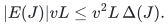
Thus, whenever <code class="math">v^2\leq\Gamma</code>, this elementary construction satisfies
the safe structural bounds (3). Explicit construction costs
<code class="math">O(&#124;E(J)&#124;vL)</code>, which fits the existing <code class="math">\Gamma</code>-polynomial factor
in (4). Loops have their annotated empty routes.

This observation discharges an additional elementary small-static-call
regime. The actual path-oracle and cut-player restrictions are
discharged by the adapters just stated and their source
reconstruction; they are not inferred from this spanning-tree example.

At the recursive cycle-backend level, an actual degree-three input
of size at most <code class="math">24k</code> uses the direct small-graph ratio solver.
This solver handles its actual records and full declared word sizes;
it does not allocate <code class="math">k</code> records when the input is smaller.

## 3. Rounded parameters

Set
<!-- math-display: bb9542019a31837c77c19f7a
L_U=\left\lceil\log_2(U+4)\right\rceil,\qquad
 t=\max\left\{2,\left\lfloor(U/L_U)^{1/7}\right\rfloor\right\},
 \tag{5}
-->
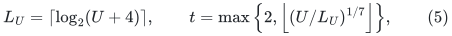
where the integer root is computed by integer comparisons. Use
<!-- math-display: 38705bb2d570396a6cf3df41
q_{\rm exp}=r_{\rm cut}=t,\qquad K=t^2,\qquad
 x=\left\lceil U/t\right\rceil,\qquad k=2^x.
 \tag{6}
-->
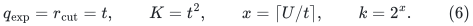
Here <code class="math">K</code> is the touched-set REPAIR depth, while <code class="math">k</code> is the
parent-to-child SIZE reduction parameter. They are different objects.
The numerical logarithmic-step accuracy parameter is introduced
later and is not <code class="math">q_{\rm exp}</code>.

For all sufficiently large <code class="math">U</code>,
<!-- math-display: 9a757758e4febff9434b3fc5
t^7L_U\leq U,\qquad
 t=\Theta((U/L_U)^{1/7}),\qquad
 x=\Theta(U^{6/7}L_U^{1/7}).
 \tag{7}
-->
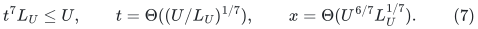
In particular <code class="math">K\leq U</code>. For finite small values where the desired
size shrink or source guards do not hold, the guarded branch may
suspend and the unconditional classical branch remains available.
Check the literal static guard
<code class="math">q_{\rm exp}r_{\rm cut}L_U=t^2L_U\leq U</code> before invoking that
primitive. It holds eventually because
<code class="math">t^2L_U\leq t^7L_U\leq U</code>; it also ensures that the primitive's
constructed witnesses have only <code class="math">2^{O(U)}</code> records.

For the native scheduling counter one may take
<!-- math-display: 0fcdf1a6c7a70a42127fc9fd
\rho=2^{\lceil 8U/K\rceil},\qquad
 N_{\rm sched}=\rho^K.
 \tag{8}
-->
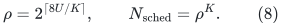
This is a counter only. Its bit length is <code class="math">O(U)</code>, and no graph
with <code class="math">N_{\rm sched}</code> vertices is constructed.

## 4. Static repair plus amortized selected-degree feedback

Apply
[the short-period alternative](amortized-static-base-distance-sparsifier.md),
using (3) for each static repair. Its proof requires the structural
factor <code class="math">\Gamma</code>, while (4) is paid as local work. Its explicit
empty-loop convention, central-original-edge selection, layer
reference counts, and selected endpoint coalescing remain in force.

In particular, selecting a projected edge adds only its central
ORIGINAL core-edge ID. Its old route prefixes already lie in lower
layers. Expanding those prefixes into extra memberships would produce
an incorrect recourse bound.

Let <code class="math">A=\mathrm{poly}(U)</code> cover stable forests, buckets, native
translation, and ordinary indexing. The alternative supplies
<!-- math-display: 7112e639573cde9c592f3c69
R=(A\rho\Gamma)^{O(1)},\qquad
       \log R=O(U/K+\log\Gamma+\log(U+4)).
 \tag{9}
-->
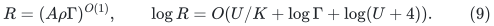
Its initial selected graph has <code class="math">O(mR/k)</code> actual records. With the
explicit initial credit, its ordinary child transcript through <code class="math">h</code>
parent edits has size <code class="math">O(mR/k+Rh)</code>. Alternatively, its one-time
fresh-base normalization gives <code class="math">O(Rh)</code> post-initialization updates:
freeze the settled selected graph and all valid routes before child
publication, then reset only the private touched-set clock and
repair ownership lists.

The literal congestion recurrence is
<!-- math-display: 87722c706c0e1df5808de12c
L_{j+1}\leq O(\Gamma)L_j,\qquad
 C_{j+1}\leq O(\Gamma)L_j C_j.
 \tag{10}
-->
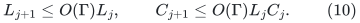
Hence route length is <code class="math">\Gamma^{O(K)}</code>, and route congestion is
<code class="math">k\mathrm{poly}(U)\Gamma^{O(K^2)}</code>.
The fresh-base normalization does not worsen the exponent: its initial
route length is already <code class="math">\Gamma^{O(K)}</code> and congestion is
<code class="math">k\Gamma^{O(K^2)}</code>, and another <code class="math">K</code> levels of (10) still give
<code class="math">\Gamma^{O(K^2)}</code>.

A common local work envelope is therefore
<!-- math-display: 4ec466af1e6d81d3345c63b3
W=k^{O(1)}\rho^{O(1)}F^{O(1)}
                    \Gamma^{O(K^2)}\mathrm{poly}(U).
 \tag{11}
-->
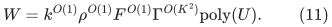
No factor <code class="math">F</code> belongs in (9). The old restriction
<code class="math">K^7\leq\log m</code>, used by a different worst-case spanner
instantiation, is not imported. The elementary repair clock only
requires <code class="math">K\leq O(U)</code>; any restrictions of the new static primitive
must instead be verified directly under Section 1.

## 5. Recursive size, occurrence, and work bounds

Apply the existing fixed port-fiber degree reset to each settled
selected graph. Let <code class="math">P=R^{O(1)}\mathrm{poly}(U)</code> bound the
child size factor, its fully encoded ordinary edits, and its flat-pool
factor. Every actual parent vertex lifetime has one fixed fiber.
Inactive fibers remain counted in the child, and their purely null
parent export is suppressed after complete real-edge retirement.
The stable core forests and frozen gauges are unchanged.

A literal cap can be chosen, for an enumerated positive integer
<code class="math">c_C</code>, as
<!-- math-display: 5b6bd4a0486338cf9cdd642c
C=2^{c_C(\lceil U/K\rceil+t^2L_U+L_U)},\qquad P=C^{c_P},
 \tag{12}
-->
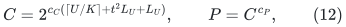
where <code class="math">c_P</code> is one fixed sufficiently large integer for the stated
encoding and pool construction. The port scale is
<!-- math-display: 7bc6653a274736afc7dc8735
H_{\rm port}
   =2^{\lceil\log_2(4(\log_2 C+1))\rceil}.
 \tag{13}
-->
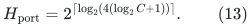
Its logarithm is <code class="math">O(\log U)</code>. It scales real child edges and
gradients; fiber connectors have integer length one and zero gradient.

Use the depth guard
<!-- math-display: d85e6ca4129ff5dbfb4d019b
d_*=\left\lceil 8U/x\right\rceil+10=O(t).
 \tag{14}
-->
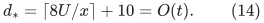
Since
<!-- math-display: 211087bdf09412ef5473198a
\frac{\log P}{x}
   =O\!\left(\frac1t+\frac{t^3L_U}{U}\right)=o(1),
 \tag{15}
-->
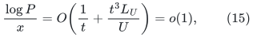
the actual nonbase size shrinks by at least <code class="math">k^{1/2}</code> eventually.
Thus (14) has constant slack.

For completeness, the safe recurrence includes late initial-credit
spending. Write <code class="math">G_d</code> for flat occurrence/answer size, <code class="math">J_d</code> for
the initial work ALLOWANCE per actual record, and <code class="math">T_d</code> for
amortized update work. Then
<!-- math-display: 5ed26c42ad0b2e7a559127fc
\begin{aligned}
 G_d&\leq P(G_{d-1}+1),\\
 J_d&\leq W+P(G_{d-1}+1)
                 +(P/k)(J_{d-1}+T_{d-1}),\\
 T_d&\leq O(kW+kP(G_{d-1}+1))
                 +O(P)(J_{d-1}+T_{d-1}).
 \end{aligned}
 \tag{16}
-->
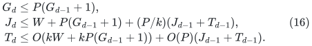
The <code class="math">T_{d-1}</code> term in the second line is essential if the initial
child transcript credit is spent as updates later in an incomplete
parent period. It is not child initialization. Setting
<code class="math">\mathcal H_d=J_d+T_d/k</code> yields
<!-- math-display: 02e3f77fcb64fa2f3d043545
\mathcal H_d\leq
   O(W+P(G_{d-1}+1))+O(P)\mathcal H_{d-1}.
 \tag{17}
-->
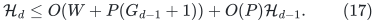
Thus all work, occurrences, and answer pieces fit in
<!-- math-display: 0e25a0d5986a6cc8b190fb76
k^{O(1)}W(cP)^{O(d_*)}.
 \tag{18}
-->
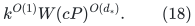
Actual initialization is bounded by the actual local size times
this envelope. There is one overall polynomial factor in <code class="math">k</code>,
not one such factor multiplying each recursive update level.

## 6. Quantitative balance

Equations (1)--(2) and (5)--(7) give
<!-- math-display: 37bf00a212e91f746edf7d92
\log\Gamma=O(t^2L_U),\qquad
 \log F=O(U/t+t^2L_U)=O(x).
 \tag{19}
-->
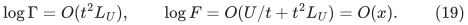
The crucial two remaining terms are
<!-- math-display: 96885ddf4dfb479290bf1a7d
K^2\log\Gamma=O(t^6L_U)\leq O(U/t)=O(x),
 \tag{20}
-->
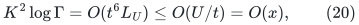
and
<!-- math-display: 2da4363ac70420417155aee9
d_*\log P
  =O\!\left(t(U/t^2+t^2L_U+L_U)\right)
  =O(U/t+t^3L_U)=O(x).
 \tag{21}
-->
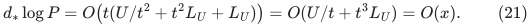
The inequalities use <code class="math">t^7L_U\leq U</code>. The entire logarithmic
overhead is therefore
<!-- math-display: 96bacb303972c4dc14fe10d5
O\!\left(
 x+\log F+K^2\log\Gamma+
       \frac Ux\left(\frac UK+\log\Gamma\right)
 \right)
 =O(U^{6/7}(\log(U+4))^{1/7}).
 \tag{22}
-->
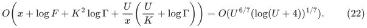
Polynomial factors in <code class="math">U</code> and the fixed source constants are
absorbed in this expression.

The spanner quality does not introduce a larger term. Across the
hierarchy it loses at most
<code class="math">\exp(O(d_*K\log\Gamma+d_*\log U))</code>; terminal explicit
cycle extraction contributes <code class="math">k^{O(1)}</code>. Since
<!-- math-display: 470fc9be1cdcaeee9c0d9637
d_*K\log\Gamma=O(t^5L_U)\leq O(x),
 \tag{23}
-->
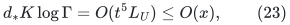
the raw-cycle inverse quality also fits (22). Self-loops remain exact
local fundamental-cycle candidates, and all coefficients use the
unit signed piece/repeated-occurrence convention of the existing
raw lift.

## 7. Word sizes and executable guards

Retain the existing stable-forest metrics, positive port connectors,
exact gauge corrections, and immutable physical edge provenance.
A core edge length is at most a polynomial in its level's graph
size times the parent maximum length. Each port scaling contributes
only <code class="math">O(\log U)</code> additional bits. The same crude bound applies to
frozen potential sums and gradients. Hence, if root input lengths and
gradients have at most <code class="math">c_0U</code> bits, a sufficient declared bound is
<!-- math-display: 10942024d9b4f2c45fe8620c
b_*=(c_0+100)U(d_*+1)=O(Ut).
 \tag{24}
-->
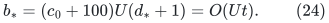
All arithmetic is charged at this word size. At a nonbase input
<code class="math">\log m\geq x-O(1)</code>, and
<!-- math-display: 76f81ab270c528543f9c8e79
\frac{b_*}{x^2}
       =O(t^3/U)=o(1).
 \tag{25}
-->
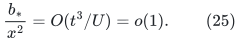
Thus the existing safe finite-word check <code class="math">b_*\leq(\log m)^2</code>
eventually passes. Tiny actual bases use the direct multiword solver;
they do not interpret the root prices as <code class="math">O(\log m)</code>-bit prices.

For an enumerated positive integer <code class="math">c_E</code>, declare
<!-- math-display: 2787d75f6061e852398e1de1
E_*=2^{c_E x}.
 \tag{26}
-->
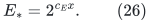
For some fixed <code class="math">c_C</code>, and then some fixed sufficiently large
<code class="math">c_E</code>, this dominates (18), raw quality, all route notifications,
flat multiplicity, and all work factors. Check degree, resident size,
native-prefix counts, output pieces, bit sizes, depth, and complete
retirements against their declared caps before using an answer.
The initial-credit version checks <code class="math">A_0+Rh</code> once per parent period;
the fresh-base version may use the proved pure <code class="math">Rh</code> guard.

The root numerical client never needs a deep abstract denominator
to fit its root word size. It sums the actual root input lengths
along returned exposed forest paths, counting every occurrence.
With at most <code class="math">E_*</code> pieces and root forest size at most <code class="math">ME_*</code>,
<!-- math-display: 7b0426850ee9c0de07e01664
V\leq ME_*^2\max_e\ell_e,\qquad
 |N|\leq ME_*^2\max_e|g_e|.
 \tag{27}
-->
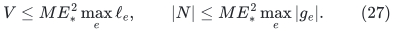
For a fixed favorable tuple <code class="math">E_*=2^{o(U)}</code>, these quantities have
<code class="math">O(U)</code> root bits. Replacing an inherited upper denominator by the
exact raw <code class="math">V</code> only improves the ratio. Deep arithmetic remains
charged at (24).

No complete-source guarantee follows merely from passing these
runtime guards. Eventual fast correctness still requires the
Section 1 primitive and the stated raw/lifetime interfaces.

## 8. Binary ledgers and the numerical client

Let the physical matching instance have size at most <code class="math">S=2^s</code>, and
use master <code class="math">U=2s</code>. Apply the separately proved
[binary ledger hierarchy](binary-ledger-hierarchy-and-decoupled-parameters.md):
<!-- math-display: cd6ad2882b6ab12041fc1c06
a=s,\qquad C_{\rm ledger}=s+1,\qquad b_j=2^{s-j}.
 \tag{28}
-->
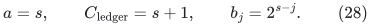
Ledger scale is independent of backend approximation. Keep the exact
grids <code class="math">\delta=S^{-1000}</code>, <code class="math">\epsilon=S^{-3000}</code>, and the existing
price scale. For numerical steps set
<!-- math-display: 75e37aa42a8df7f0c5a37d3d
D=2^{\lceil\log_2\max\{16,4E_*\}\rceil},\qquad
                   q_{\rm num}=1/(16D).
 \tag{29}
-->
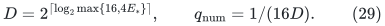
For each fixed favorable tuple, eventually
<code class="math">D\leq S^2,\ q_{\rm num}\geq S^{-1}</code>, and the strict acceptance
margin <code class="math">1/(4D)&gt;2q_{\rm num}</code> holds. No ledger base <code class="math">B</code> is required
to dominate <code class="math">E_*</code>, and no size exponent is rounded to a multiple
of <code class="math">2a^2</code>.

Each actual numerical graph uses
<code class="math">M=2^{\lceil\log_2(16(R_{\rm nom}+2))\rceil}</code>.
The top bound <code class="math">R_{\rm nom}=S(s+1)^{10}</code> and local bound
<code class="math">8192(P_{\rm debt}+1)</code> give <code class="math">M\leq S^2=2^U</code> eventually.
The lower-ledger reset sum is <code class="math">O(s^3S)</code>, global resets are
<code class="math">O(s)</code>, and the gap driver uses <code class="math">O(s^2)</code> phases.

The [decoupled priced client](decoupled-numerical-client.md) bounds
work by
<!-- math-display: 1c6beedf7df4f0f31c90b26a
O(MD+QD+D^2J)\mathrm{poly}(s),
 \tag{30}
-->
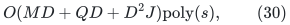
where <code class="math">J</code> counts accepted numerical steps separately from calls
and refreshes <code class="math">Q</code>. The local/all-expanded exact recovery costs
<code class="math">(P_{\rm debt}+1)D^4\mathrm{poly}(s)</code>, and the top run costs
<code class="math">SD^4\mathrm{poly}(s)</code>. Therefore the complete favorable
matching branch has work
<!-- math-display: 5d6473138a0d5619b5f3d558
SE_*^4\mathrm{poly}(s)
 =S\exp\!\left(
    O(s^{6/7}(\log(s+4))^{1/7})
   \right).
 \tag{31}
-->
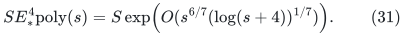
The exact rounding/recovery uses the already available conserved
grid flow, local cycle rounding, and ordinary residual searches.
It does not reintroduce a fresh static max-flow subroutine with a
larger quantitative exponent.

First-failure reasoning is unchanged. Before the first guard failure,
every old state is valid; the physical and padded debt bounds control
the current attempted projection, and the coarse finite-word bounds
remain available. Equations (19)--(31) then imply that, for a fixed
favorable tuple and sufficiently large <code class="math">S</code>, the declared guards
are not reached. This implication uses the reconstructed primitive
and the mathematical interfaces in Section 1, rather than the
optimality verifier.

## 9. One finite program and arbitrary input graphs

Perform ordinary input cleanup once: ignore self-loops, coalesce
parallel copies for cardinality matching while retaining a physical
representative, and compact nonisolated vertices. Write <code class="math">m_s</code> for
the resulting number of simple edges. This costs <code class="math">O(n+m)</code> in the
chosen input model; the same compact input is shared by all workers.
Use the exact degree-three odd-path gadget and its decoder from
[the general-gap reduction](general-graph-gap-reduction.md).
The auxiliary size is <code class="math">O(m_s)</code>, and the exact optimum offset and
decoder hold for arbitrary auxiliary maximum matchings.

Enumerate all positive integer pairs <code class="math">(c_C,c_E)</code> in a fixed
computable order. Give the corresponding guarded workers geometrically
decreasing instruction budgets, together with one deterministic
classical exact matching worker receiving a fixed positive share.
Every arithmetic operation, allocation, source call, and callback is
charged as word instructions. There is no uninterruptible source
subroutine treated as one scheduling step.

Validate each proposed decoded matching on the compact working
graph. Without the optional kernel this is the cleaned original
graph. Before accepting it, run one exact deterministic general-graph
augmenting-path search. Accept only if that search certifies that
there is no augmenting path. This adds only the ordinary near-linear
verification cost. The classical worker guarantees termination and
correctness even if a candidate worker suspends or produces an
incorrect early LOW conclusion.

Using the reconstructed primitive, one fixed pair has all the
eventual bounds proved above. Its budget share is a fixed positive
constant, so the portfolio has the same asymptotic time. A finite
set of exceptional smaller input sizes is handled by the same program;
no unknown size threshold or favorable pair is provided as advice.
The resulting all-graph research bound is
<!-- math-display: d6ebaf3498665894b4a0f0ef
\boxed{
 O(n+m)+(m_s+1)
  \exp\!\left(
    O\!\left(
      (\log(m_s+2))^{6/7}
      (\log\log(m_s+4))^{1/7}
    \right)
  \right).
 }
 \tag{32}
-->
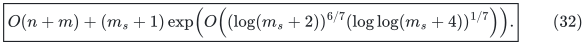

The same elementary matching-size kernel may be applied once before
the workers: a maximal matching yields a cover <code class="math">C</code>, all edges
inside <code class="math">C</code> are kept, and for each cover vertex one keeps
<code class="math">&#124;C&#124;+1</code> arbitrary neighbors outside <code class="math">C</code>. Replacing omitted
matched neighbors by unused kept ones proves that the optimum is
preserved. Thus (32) also holds with <code class="math">m_s</code> in its second term
replaced by <code class="math">m_c\leq\min\{m_s,O(\nu^2)\}</code>, after the same
one-time input scan. This optional refinement does not restrict the
graph class.

When this kernel is used, it is the shared compact WORKING graph for
every branch, including the classical branch and every candidate's
matching validation and augmenting-path verification. The exact
exchange proof of kernel preservation is the mathematical bridge to
the original optimum; workers do not each rescan the larger original
graph to re-prove it. Map only the winning verified kernel matching
back to its retained original edge IDs, once. This preserves the
one-time <code class="math">O(n+m)</code> input term when <code class="math">m_c\ll m_s</code>.

Output correctness of the finite program and its fast-time proof are
different statements. The former follows from exact verification and
the classical worker. The latter uses the supplied uniform static
primitive reconstruction, as well as the previously stated matching,
exact raw-cycle, and lifetime proofs. Their named public-source
dependencies remain part of this research theorem candidate.
Independent agreement on these mathematical notes is not external
verification of the assembled algorithm.
