# A numerical client independent of the ledger radix

**Separate mathematical simplification, 24 October 2026.** The ledger
radix need not determine numerical accuracy or occurrence thresholds.
This note proves the numerical part of that separation. The structural
choice <code class="math">a=s</code>, <code class="math">B_{\rm ledger}=2</code> is proved separately in
[the binary-ledger note](binary-ledger-hierarchy-and-decoupled-parameters.md).
Existing complete 14/15 and earlier frozen constructions are unchanged.

The explicit proofs used here are
[priced logarithmic steps](priced-logarithmic-steps-from-raw-cycles.md),
[near-feasible rounding and exact projection](near-feasible-rounding-and-exact-projection.md),
and [the degree-reset backend](distance-degree-reset-candidate.md).
The original numerical source is
[OAI Section 5](https://github.com/openai/math/tree/main/preprints/Almost-Linear-Time-Maximum-Cardinality-Matching-in-Sparse-General-Graphs-September-24-2026).
We use its reconstructed proof with a different parameter interface;
we do not claim that its printed fixed-parameter statement already
contains the choices below.

## 1. A direct master-scale numerical contract

Fix <code class="math">S=2^s</code>. Assume one deterministic raw backend, with master
parameter <code class="math">U=2s</code>, has a computable cap <code class="math">E=E_*(2s)\ge1</code>.
On every actual numerical root of size at most <code class="math">S^2</code>, with
positive integral lengths and integral gradients of magnitude at most
<code class="math">S^{1200}</code>, the cap bounds:

* initialization work per actual input record;
* amortized edits, queries and complete exposed representation logs;
* occurrence multiplicity, including isolated and dormant exposed copies;
* answer-piece count and inverse raw approximation quality;
* complete retirement and the required polynomial master histories.

The record lifetime, signed/absolute counter, query transaction and
real-loop interfaces remain those in the existing numerical proof.
A ratio-only oracle does not suffice. The cap is a performance and
quality input to this client theorem. The
[main realization theorem](../../problems/general-matching/proof.md#116-deterministic-cycle-search-realization)
supplies it for the four-fifths construction. Its proof, independently
of final matching verification, provides the favorable branch bound.

Define <code class="math">\mathrm{pow2ceil}(x)</code> to be the smallest power
of two at least <code class="math">x</code>, and set

<!-- math-display: ee06d0e13d866fa70c460514
D=\mathrm{pow2ceil}(\max\{16,4E\}),\qquad
 q=\frac1{16D}.
 \tag{1}
-->
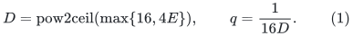

Then <code class="math">4E\le D\le16E</code>. Retain

<!-- math-display: e39e44e3d6d7228032054c5b
\delta=S^{-1000},\qquad\varepsilon=S^{-3000},\qquad
 H_{\rm price}=S^{100}.
 \tag{2}
-->
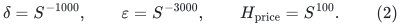

For a logical lifetime allowance <code class="math">R</code>, choose simply

<!-- math-display: a0d84fda5cfc502e14c635c8
M=\mathrm{pow2ceil}(16(R+2)).
 \tag{3}
-->
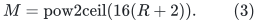

There is no divisibility-by-<code class="math">2a^2</code> requirement. The client keeps
its existing degree-three port paths: a logical endpoint insertion
uses a fresh port, while repricing retains its existing endpoint
ports. Thus actual resident records are bounded by this local
allowance; the choice of <code class="math">M</code> does not allocate <code class="math">S</code> or
<code class="math">S^2</code> records for a tiny local problem.

Check <code class="math">M\le S^2</code>, <code class="math">q\ge S^{-1}</code>, and <code class="math">D\le S^2</code>,
as well as the unchanged descriptor, argument, grid, lifetime and
history guards. If <code class="math">E=S^{o(1)}</code>, then (1) gives the last two
checks eventually. All parameters are exact integers or dyadic
rationals computed by finite integer arithmetic.

This parameter choice has no feedback loop. Compute the backend cap
from master <code class="math">2s</code>, its fixed root-price bound, and the structural
local capacity before choosing <code class="math">D,q</code>. Root prices are bounded
using the fixed <code class="math">\delta,\varepsilon</code> and argument envelopes,
independently of <code class="math">q</code>. Numerical repricing retains endpoint slots,
so the additional notifications affect only the already declared
polynomial operation horizon, not the logical lifetime size <code class="math">R</code>.
The guarded <code class="math">D\le S^2</code> still puts that enlarged history well
inside the backend's master lifespan. Nothing in the definition of
<code class="math">E</code> is silently enlarged after (1).

## 2. Generalized priced-step lemma

With the contract above, the priced client retains all of its
correctness properties:

1. LOW is impossible in the presence of a nonzero circulation
   <code class="math">d</code> with
   <code class="math">g^Td\ge\tfrac12\sum_e\lambda_e&#124;d_e&#124;</code>.
2. An accepted step is an exact <code class="math">\varepsilon</code>-grid circulation,
   preserves positivity through every partial application, has total
   relative absolute motion at most <code class="math">q/100</code>, and increases
   the objective by <code class="math">\Omega(q^2)</code>.
3. Settled registers have relative error at most <code class="math">q/100</code>.
   Genuine refresh and disable reports number <code class="math">O(D)</code> per
   accepted step, apart from explicit client settings.

Here is why no old relationship between the ledger parameters and
<code class="math">M,D,q</code> is needed. The proof's numerical inequalities are

<!-- math-display: 6964a64fb94a6a9604501644
0<q<1/100,\qquad q\ge S^{-1},\qquad D\le S^2,
 \qquad\frac1{4D}>2q.
 \tag{4}
-->
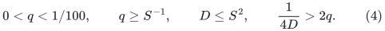

Equation (1) gives <code class="math">q\le1/256</code> and
<code class="math">2q=1/(8D)&lt;1/(4D)</code>. It also gives the required occurrence
bound <code class="math">E\le D/4</code>, and raw quality at least <code class="math">1/D</code>.

At an exact anchor, prices remain
<code class="math">\ell_e=\lceil H_{\rm price}\lambda_e\rceil</code> and
<code class="math">\gamma_e=\mathrm{round}(H_{\rm price}g_e)</code>.
The same argument and weight bounds give
<code class="math">\ell_e\ge S^{80}</code> and prices below <code class="math">S^{1122}</code>,
within the direct <code class="math">S^{1200}</code> backend limit. The old inequality
<code class="math">S\le M^a</code> was only a way to translate these prices into
the original local bound <code class="math">M^{1200a}</code>. That translation is
unnecessary with the explicit master contract.

A logical circulation's degree-three port lift adds at most
<code class="math">2M\sum_e&#124;d_e&#124;</code> connector length. Since <code class="math">M\le S^2</code>
and real prices are at least <code class="math">S^{80}</code>, a strong logical
direction still has integer-priced lifted ratio above <code class="math">1/4</code>.
The raw backend and (4) imply that it passes the unchanged threshold
<code class="math">&#124;\gamma^Tc&#124;\ge2qV</code>.

Choose the step power of two from

<!-- math-display: 6acae468359da951b43c8530
\frac q{400}\le\frac{\mu V}{H_{\rm price}}
 \le\frac q{200},
 \tag{5}
-->
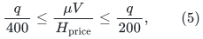

and choose each coordinate's drift threshold from

<!-- math-display: 557a7bf5ffc1bd945e67b91b
\frac{qH_{\rm price}}{800D\ell_e}
 \le\theta_e\le
 \frac{qH_{\rm price}}{400D\ell_e}.
 \tag{6}
-->
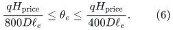

The raw traversal bound, rather than cancellation in the final
circulation, proves partial positivity and the <code class="math">\Omega(q^2)</code>
progress. Threshold settlement gives error at most <code class="math">q/200</code>.
All dormant copies and retirement buckets remain included. A report
consumes at least <code class="math">q/(800D)</code> units of raw priced motion, while
a step creates at most <code class="math">q/200</code>; this proves the <code class="math">O(D)</code>
report bound independently of the size of <code class="math">q</code>.

The <code class="math">\mu</code>- and <code class="math">\theta_e</code>-grid proofs use only
<code class="math">q\ge S^{-1}</code>, <code class="math">D\le S^2</code>, and the unchanged price
and traversal bounds. They remain far above <code class="math">\varepsilon</code>.
No coordinatewise rounding of a direction is introduced. Pad service,
boundary expansion locks and top positivity repairs use only the
fixed small relative margin <code class="math">q/100</code>. Their tiny total violation
uses <code class="math">\delta</code> and the independent polynomial history guard.

Consequently <code class="math">R+B\le S^{1+2/a}</code>,
<code class="math">D=M^{10/a}</code>, and the old <code class="math">2a^2</code> nominal exponent
rounding have no independent role after (3)--(4) and the explicit
root-price limit are supplied. In particular this is a direct proof
with master caps, not an invocation of a fixed-<code class="math">a</code> asymptotic
statement at an unproved growing value of <code class="math">a</code>.

## 3. Work before collapsing the step count into the request count

Let <code class="math">J</code> be accepted steps and let <code class="math">Q</code> count external
requests by the owning client, including failed/LOW queries and exact
point requests. Internal numerical refreshes are a separate
<code class="math">O(DJ)</code> category. The explicit cost is

<!-- math-display: c121e88ba92ef54b9cafff69
\begin{split}
 T_{\rm priced}
 &\le O((M+Q+DJ)E)\mathrm{poly}(s)\\
 &\quad+O((Q+DJ)D)\mathrm{poly}(s)\\
 &\quad+O(Qp_c+DJ)\mathrm{poly}(s)\\
 &\le O(MD+QD+D^2J)\mathrm{poly}(s).
\end{split}
\tag{7}
-->
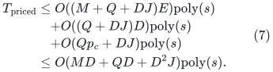

The initial occurrence records, complete signed and absolute motion,
representation retirement, <code class="math">D^2J</code> full-copy sweeps, and raw
inspection of unsuccessful queries are all included. Maintaining
<code class="math">J</code> separately avoids the unnecessarily weaker bound
<code class="math">(M+Q)D^2</code>. All arithmetic and dynamic-tree operations use
charged finite-word work; the fixed polynomial includes their
ordinary bit and identifier overhead.

## 4. Local and global exact recovery

For a local threshold test with parent debt <code class="math">P</code>, the objective
range plus total insertion and lock losses is <code class="math">O((P+1)s)</code>.
Equation (1) gives <code class="math">q^{-2}=256D^2</code>, so

<!-- math-display: 7f679fe5d770c604cfd0a054
J_{\rm loc}=O((P+1)D^2s)
 \tag{8}
-->
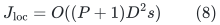

per threshold. Across <code class="math">O(s)</code> thresholds and their checked
recoveries, this is <code class="math">(P+1)D^2\mathrm{poly}(s)</code>.
Client services per genuine numerical notification are constant in
number up to ordinary identifier work. Reanchoring cannot create new
absolute-motion credit. Thus

<!-- math-display: 64e0370870738a5f05c4739a
Q_{\rm loc}=O(P+1+DJ_{\rm loc})\mathrm{poly}(s)
            =(P+1)D^3\mathrm{poly}(s).
 \tag{9}
-->
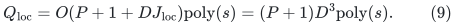

The local graph only grows during a test. Fewer than
<code class="math">1000(P+1)</code> ordinary arcs are born. An arc contributes one
logical edge, two endpoint insertions, and at most two new logical
vertices; the return arc and terminals add constant records.
Descriptor/lock changes do not create ports. Hence the explicit
allowance

<!-- math-display: ae0e155a5130bdb8117c62c0
R_{\rm loc}=8192(P+1)
 \tag{10}
-->
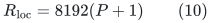

covers the lifetime count, and (3) gives <code class="math">M=O(P+1)</code>.
Substitute (8)--(10) into (7):

<!-- math-display: 8c982775e7d84708d663b8f8
T_{\rm projection}
             \le (P+1)D^4\mathrm{poly}(s).
 \tag{11}
-->
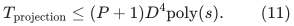

Near-feasible integral cycle rounding, exact reads, cut checks and
ordinary residual searches add only
<code class="math">(P+1)D\mathrm{poly}(s)</code>. There is no new static
max-flow call. The fixed scale 16, return-weight comparison, total
violation below one and exact true-flow/optimistic-cut recovery are
unchanged. All residual searches omit the numerical return arc.

The all-expanded exchange graph has <code class="math">O(N_0)</code> records on an
input state of size <code class="math">N_0</code>. Repeating the same reasoning gives

<!-- math-display: 9b649d1c8de7f6b7d290dd78
T_{\rm global}
             \le (N_0+1)D^4\mathrm{poly}(s).
 \tag{12}
-->
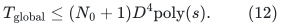

The terminal preprocessing and magnitude assumptions of that theorem
remain in force. The matching use has only polynomial-master
capacities, so no separate general-capacity reduction is needed.

## 5. Top client and admissible lifetime sizes

For the binary-ledger choice <code class="math">a=s</code>, structural objective losses
are <code class="math">O(aSs^2)</code>, while each step gains <code class="math">\Omega(D^{-2})</code>.
Thus

<!-- math-display: d4149e5beac3f8ccaa7a2d6c
J_{\rm top}=S D^2\mathrm{poly}(s),\qquad
 Q_{\rm top}=S D^3\mathrm{poly}(s).
 \tag{13}
-->
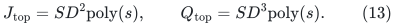

Top logical topology births and retargetings are
<code class="math">O(aS\log S)</code> by the physical movement bound. The fixed
allowance

<!-- math-display: 890a5014f87cc3b59169755c
R_{\rm top}=S(s+1)^{10}
 \tag{14}
-->
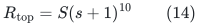

covers them eventually and gives <code class="math">M=S\mathrm{poly}(s)</code>
in (3). It is below <code class="math">S^2</code> eventually. Equation (7) therefore
gives

<!-- math-display: 9c7b444c59f6751d18ff0b35
T_{\rm top}=S D^4\mathrm{poly}(s).
 \tag{15}
-->
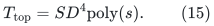

For higher projections the structural bound is
<code class="math">P\le(s+3)b_{j-1}\le(s+3)S/2</code>, so (10) also gives
<code class="math">M&lt;S^2</code> eventually. Level-one global recovery has only
<code class="math">O(S)</code> actual records. These are local capacities: no repeated
master-sized initialization is hidden in (11).

The former nominal-size condition would give only <code class="math">4S</code> when
<code class="math">a=s</code>; (14) need not satisfy it. Its replacement is the
explicit <code class="math">M\le S^2</code> master interface, whose proof was given
above. This distinction is necessary and is not an omitted guard.

## 6. Complete consequence under the stated interface

The binary-ledger proof gives total higher-reset volume
<code class="math">O(s^3S)</code>, <code class="math">O(s)</code> global resets per phase, polynomial
structural work in <code class="math">s</code>, and <code class="math">O(s^2)</code> phases. Combining
these facts with (11), (12), and (15) yields

<!-- math-display: 2fd3d7ed351a342c1f3eacf7
T_{\rm complete}
              =S D^4\mathrm{poly}(s)
              =S E^4\mathrm{poly}(s).
 \tag{16}
-->
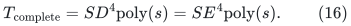

This includes final exact matching verification. The source-specific
favorable branch uses its independent primitive, recurrence and quality
proofs; Theorem 11.6 supplies them for the current distance construction.
The first-failure argument retains the loose
polynomial magnitude/history guards; with <code class="math">E=S^{o(1)}</code>, all
sharp counts in (8)--(16) are <code class="math">S^{1+o(1)}</code> and satisfy those
guards eventually. Polynomial floors such as <code class="math">C=s+1</code> keep
all client fields within the same <code class="math">O(s)</code>-bit master envelope.

For the degree-reset construction, enumerate only its fixed backend
constants <code class="math">(c_C,c_E)</code>. Compute <code class="math">E_*</code>, then <code class="math">D,q</code>
by (1). A further outer balancing constant <code class="math">c_B</code> is unnecessary.
Keep the fixed-share classical fallback and branch-local verification.
Every actual word operation, including computing a cap that is too
large, is interruptible and charged to its branch. Some fixed favorable
pair succeeds beyond one fixed threshold. Its share penalty is a
constant; scheduling contributes a further fixed polynomial in <code class="math">s</code>,
already allowed in (16). Shared compact cleanup preserves the additive
<code class="math">O(n+m)</code> input term.

With the proved degree-reset cap

<!-- math-display: d427f89c288e964f04c93cf7
E_*(2s)=\exp\!\left(O(s^{14/15}(\log(s+4))^{1/5})\right),
-->
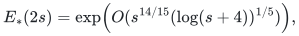

(16) has the same 14/15 logarithmic exponent. For this explicit
family, <code class="math">E_*</code> eventually dominates every fixed polynomial in
<code class="math">s</code>; after collecting all such factors, <code class="math">SE_*^5</code> is a
safe eventual complete allowance. The simplification removes the
outer radix/accuracy balance; it is not a claim of an exponent below
14/15.
