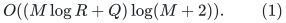
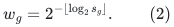
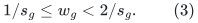
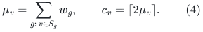
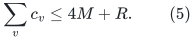
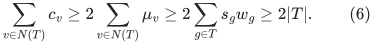
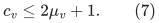
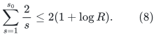

# A deterministic low-recourse lemma for grouped choices under deletions

**Local positive result, 25 October 2026.** This note proves a small
grouped-selection fact relevant to the fixed-base repair investigation.
It is not a general ambient path-routing theorem and does not improve
the current matching exponent. Unlike freezing one route per demand,
the number of selected representatives is charged to the number of
groups.

## 1. Model and conclusion

There are <code class="math">M</code> groups and a resource universe of size <code class="math">R\geq2</code>.
Group <code class="math">g</code> has an explicitly represented nonempty option set
<code class="math">S_g\subseteq[R]</code>. Initially choose one current resource for each
group. A resource deletion removes that resource from every option set.
A group is retired if its last option disappears. Otherwise it must
always retain a choice among its remaining options.

A selected group-resource pair may stand for a genuine central native
edge ID. If its resource disappears, that old central edge may remain
elsewhere in the graph; it merely ceases to be this group's current
representative. Count every change of representative as recourse.

For every chronological prefix containing <code class="math">Q</code> resource deletions,
there is a deterministic rule with total representative recourse

<!-- math-display: d8c493efc529f8fb1cbbbb82
O((M\log R+Q)\log(M+2)).
 \tag{1}
-->

It uses at most one current representative per live group. The proof
also gives an elementary finite implementation. Its auxiliary capacity
bookkeeping takes near-linear time in the initial option incidence
inventory. Finding its augmenting paths by a naive breadth-first search
can be much slower; no near-linear total search bound is claimed here.

## 2. Dyadic fractional charges

For a live group with <code class="math">s_g=&#124;S_g&#124;</code>, define

<!-- math-display: 1b40a3d5a77f70d57296eb29
w_g=2^{-\lfloor\log_2 s_g\rfloor}.
 \tag{2}
-->

Then

<!-- math-display: db4177673679f887479b51bf
1/s_g\leq w_g<2/s_g.
 \tag{3}
-->

For every live resource <code class="math">v</code>, let

<!-- math-display: 432bea118791489cb4d5f48c
\mu_v=\sum_{g:\,v\in S_g}w_g,
             \qquad c_v=\lceil2\mu_v\rceil.
 \tag{4}
-->

While a resource survives, its <code class="math">\mu_v</code>, and hence its capacity
<code class="math">c_v</code>, never decreases. When another resource is deleted, every
surviving term either stays unchanged or increases. A group can retire
only when its last option is the deleted resource, so retirement removes
no term from a surviving resource.

The total current capacity is small:

<!-- math-display: 4e0849596b8827eb155d2275
\sum_v c_v\leq4M+R.
 \tag{5}
-->

Here and below <code class="math">M</code> may be replaced by the number of current groups
for a tighter instantaneous bound.

The dyadic convention avoids an exact sum of unrelated rational
denominators. All weights in (2) have a common denominator that is a
power of two of magnitude at most <code class="math">2R</code>. Numerators and capacities
therefore use <code class="math">O(\log(MR+2))</code> bits.

## 3. Maintain a capacitated group assignment

Maintain an assignment in which every live group has one resource and
resource <code class="math">v</code> receives at most <code class="math">c_v</code> groups. Such assignments
exist with a factor-two surplus. Indeed, for any group set <code class="math">T</code>,
let <code class="math">N(T)=\bigcup_{g\in T}S_g</code>. Then

<!-- math-display: 540c1564137dd7d057c3363b
\sum_{v\in N(T)}c_v
  \geq2\sum_{v\in N(T)}\mu_v
  \geq2\sum_{g\in T}s_gw_g
  \geq2|T|.
 \tag{6}
-->

After deleting a resource, erase the choices of its assigned groups,
retire the groups with no remaining option, update the capacities, and
reassign the remaining orphans one at a time by alternating augmenting
paths. Other assignments remain feasible because surviving capacities
only increased.

**Short augmentation lemma.** Every orphan has an augmenting path
that changes at most <code class="math">\lceil\log_2(M+1)\rceil+1</code> group choices.

To prove this, start alternating breadth-first search from the orphan
group. Suppose the reached group set is <code class="math">T</code>, and no neighboring
resource has free capacity. Every resource in <code class="math">N(T)</code> is full.
Their assigned groups are distinct because each group has only one
choice. By (6), reaching those groups at the next search level gives
at least <code class="math">2&#124;T&#124;</code> assigned groups, together with the starting orphan.
Thus the group set doubles at every unsuccessful level. It cannot
double more than <code class="math">\lceil\log_2(M+1)\rceil</code> times. A free slot
is therefore reached within that many levels. Flipping the corresponding
alternating path proves the lemma.

This argument works while several other groups are still unmatched.
The expansion condition is a property of the option graph, while a
resource being full refers only to the currently assigned groups. If
a search reaches a free capacity slot earlier, the augmentation ends.

Initialization can insert the groups one at a time by the same rule.
The additional initial recourse is <code class="math">O(M\log(M+2))</code>, already covered
by (1).

## 4. A harmonic bound on forced orphan events

Immediately before resource <code class="math">v</code> is deleted, the number of groups
whose current representative disappears is at most

<!-- math-display: ceb7c7dfc1a5b5a73ef319ed
c_v\leq2\mu_v+1.
 \tag{7}
-->

For one particular group, its successive option deletions see remaining
set sizes <code class="math">s_0,s_0-1,\ldots,1</code>. Its total contribution to the
sum of <code class="math">\mu_v</code> over deleted resources is, by (3), at most

<!-- math-display: 247dacd8ed4506786fe4a9ce
\sum_{s=1}^{s_0}\frac2s
                              \leq2(1+\log R).
 \tag{8}
-->

Summing (7)--(8) gives at most
<code class="math">O(M\log R+Q)</code> forced orphan events. Each is repaired with the
short augmentation lemma. This proves the prefix bound (1), including every change of
an intermediate group along the augmenting path, rather than counting
only directly invalidated representatives.

The proof is deterministic and works against an adaptive deletion order.
It does not choose a random initial representative and then assume the
adversary cannot see it.

## 5. Capacity bookkeeping versus path discovery

Maintain each current set size and inverse incidence list. Deleting a
resource scans each removed incidence once. A surviving group's dyadic
weight changes only when its remaining size passes a power-of-two
boundary. When it changes, update <code class="math">\mu_v</code> for its surviving
options. The total number of those scanned options over all such
boundaries is less than twice that group's initial option count.
Thus all weight and capacity changes cost the initial incidence
inventory times logarithmic indexing factors.

This does **not** make repeated BFS searches near-linear. An elementary
implementation may scan the whole current incidence graph during one
augmentation. A faster dynamic augmenting-path search would be an
additional algorithmic result. Keeping that distinction is important
when trying to use (1) as a selected-child recourse statement.

## 6. Relevance to fixed-base repair and its limits

The lemma applies to a restricted projected repair situation in which
each sparse group needs one current representative, and every option
fails because its one designated resource is deleted. Parallel projected
bundles are an example: the group is a bundle, a resource labels a
still-unextracted origin, and a representative is one genuine central
ID from that origin. If an origin is touched, its options disappear
from the still-unextracted bundles. Equation (1) bounds the central-ID
replacement inventory at every prefix, with a one-time group credit without a factor equal to the number of native
demands per bundle.

This illustrates a possible grouped charge for router freezing. It also
shows that the multiple-origin example in
[initial-route-projection-updates.md](initial-route-projection-updates.md) is not itself
a selected-recourse impossibility result. A poor fixed tie rule may
repeatedly select the next origin to be touched, while a globally balanced
choice can distribute those vulnerable representatives.

Three substantive gaps remain for the actual router:

1. A path option can fail at **any** of several ambient vertices or
   edges. It occupies several resources simultaneously; it is not a
   single group-resource assignment. Equation (6)'s ordinary augmenting
   paths do not prove a hypergraph or multiresource replacement theorem.
2. The real projected graph undergoes multiple-origin endpoint
   extraction and creates new routing obligations. Choosing a surviving
   representative of each old parallel bundle does not route all those
   new obligations.
3. The local work of finding replacements and reporting all affected
   demand routes must still fit the existing <code class="math">W</code> envelope. A
   recourse count alone does not give that work bound.

Consequently this is a positive restricted interface for further work,
not a 3/4 matching algorithm. The useful lesson is precise: monotone
dyadic fractional loads and a capacitated assignment surplus can turn
an adaptive deletion sequence into a harmonic **group-level** recourse
budget. Extending that property to actual short ambient path choices
would provide new content beyond the already known central greedy
membership lemma.

### Why the per-deletion term is necessary

Even one group with many options may be forced to change on every
update by an adaptive adversary that repeatedly deletes its selected
resource. Thus the <code class="math">Q</code> term cannot in general be replaced by a
pure <code class="math">M\log R</code> term. This is compatible with the intended
selected-child contract: one-time sparse group credit plus a small
charge per actual touch is exactly the permitted shape. The resource
universe need not be charged as though every resource had already
been deleted.
