# A simple-graph interface for degree-proportional token routing

**Separate research interface, 24 October 2026.** This note checks the
graph-model, token-load, conductance, and parameter boundaries of using
[Chang, Huang and Su, arXiv:2405.03908](https://arxiv.org/pdf/2405.03908)
as a static routing primitive. It does **not** infer sequential work
from CONGEST round complexity. The source permits unbounded local
computation, and the required constructive work bounds for its local
cut player and leaf sorting embeddings remain separate obligations.
The existing <code class="math">6/7</code> construction does not depend on this proposal.

## 1. A loopless multigraph becomes a simple bounded-degree expander

Let <code class="math">G</code> be a loopless undirected multigraph without isolates, with
<code class="math">m</code> edge IDs and conductance at least <code class="math">\phi&gt;0</code>. For each vertex
<code class="math">v</code>, make one port for each of its <code class="math">d_v=\deg_G(v)</code> incidences.
Inside this fiber, place a simple graph of fixed maximum degree
<code class="math">D_0</code> and fixed positive edge expansion <code class="math">\alpha_0</code>.

Such internal graphs follow from the explicit constant-degree
expander construction of
[CGLNPS, arXiv:1910.08025v2, Theorem 2.4](https://arxiv.org/pdf/1910.08025).
Dropping loops and retaining one of each parallel pair loses only
a fixed factor, since the degree bound is fixed. Treat fibers of
size one and two directly. A size-one fiber has no internal edge,
and a size-two fiber has one internal edge; the required inequality
<!-- math-display: f72c6d25e0aa41778b661540
|\partial_{X_v} A|\geq\alpha_0\min\{|A|,d_v-|A|\}
-->
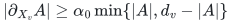
still holds with a common fixed <code class="math">\alpha_0&gt;0</code>.

For every original edge ID <code class="math">e=uv</code>, join its own port in <code class="math">u</code>'s
fiber to its own port in <code class="math">v</code>'s fiber. Distinct parallel original
edges have distinct ports. Consequently the resulting graph
<code class="math">G^\diamond</code> is SIMPLE. It has <code class="math">2m</code> vertices, <code class="math">O(m)</code> edges,
maximum degree at most <code class="math">D_0+1</code>, and minimum degree at least one.
Keep the original ID on each external edge. Internal edges have
an explicitly typed null projection into the original graph.

### Conductance proof

Consider any port cut <code class="math">S</code>. Write <code class="math">a=&#124;S&#124;</code>, <code class="math">b=2m-a</code>, and let
<code class="math">x_v</code> be the number of <code class="math">v</code>'s ports in <code class="math">S</code>. Round each fiber
to its majority side and put
<!-- math-display: 795286b79de9fc983fec87a1
I=\{v:x_v\geq d_v/2\},\qquad
 z=\sum_v\min\{x_v,d_v-x_v\}.
-->
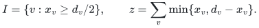
Ties may be resolved arbitrarily. Internal crossing edges contribute
at least <code class="math">\alpha_0z</code>. The whole-fiber cut corresponding to <code class="math">I</code>
has original volume on its two sides within <code class="math">z</code> of <code class="math">a,b</code>.
Thus its original crossing count is at least
<code class="math">\phi(\min\{a,b\}-z)</code>. Changing from the rounded cut to <code class="math">S</code>
can change external-edge crossing status at most <code class="math">z</code> times,
because every misclassified port has exactly one external edge.
Therefore
<!-- math-display: 2bef7e8c006ec74aed289fca
|\partial_{G^\diamond}S|
 \geq
 \max\{\alpha_0z,\ \phi\min\{a,b\}-(1+\phi)z\}.
-->
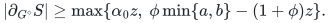
If <code class="math">z\geq\phi\min\{a,b\}/(2(1+\phi))</code>, the first term is
at least a fixed constant times <code class="math">\phi\min\{a,b\}</code>.
Otherwise the second term is at least
<code class="math">\phi\min\{a,b\}/2</code>. Since port degrees are at most <code class="math">D_0+1</code>,
<!-- math-display: f6d63664f45f962b9cc4b8c8
\Phi(G^\diamond)\geq c\phi
-->
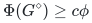
for an absolute <code class="math">c&gt;0</code>.

This proves the model reduction directly for parallel edge IDs.
No native multigraph extension of the distributed router is needed.
The actual hosts used in the proposed static sparsifier are
loopless by construction. Real loop demands, when present in an
outer distance problem, retain their empty-route endpoint records
outside this interface.

## 2. Turning degree-proportional load into one-token batches

Suppose the token list has <code class="math">M</code> directed source-destination pairs
and satisfies
<!-- math-display: 670e6d9880d49d88bfd87357
\#\{\text{tokens starting at }v\}\leq Dd_v,\qquad
 \#\{\text{tokens ending at }v\}\leq Dd_v
-->
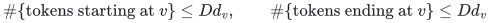
for an integer <code class="math">D\geq1</code>. Assign starting tokens cyclically to
the source ports and destination tokens cyclically to the
destination ports, using fixed token-ID order. Each port is now
the source of at most <code class="math">D</code> tokens and the destination of at most
<code class="math">D</code> tokens. Source and destination port choices are independent.

Form the bipartite token multigraph whose left vertices are source
port copies and whose right vertices are destination port copies.
Its edges are the token IDs and its maximum degree is at most <code class="math">D</code>.
It can be split deterministically into fewer than <code class="math">2D</code> matchings
in <code class="math">O(M\log(D+1))</code> work:

1. In each current bipartite graph, add dummy edges to make all
   degrees even, using at most two dummy vertices if necessary.
2. Alternate colors along its Euler tours. Every tour has even
   length because the graph is bipartite.
3. Drop dummy edges and recurse on both colors.

Each retained degree is at most the ceiling of half its old
degree. After <code class="math">\lceil\log_2D\rceil</code> levels every color class is a
matching. The total real edge count per level is <code class="math">M</code>; the
dummy inventory is <code class="math">O(M)</code> per level and does not require a scan
of unused ports.

In one color class, every port is the source of at most one token
and the destination of at most one token. Thus it is a literal
load-one instance of CHS Definition 4.1 on the simple
bounded-degree graph <code class="math">G^\diamond</code>. The router can be
preprocessed once and reused for every batch.
Within one batch, label a token by its unique source port and
use the destination port's local ID. Both labels have
<code class="math">O(\log(m+2))</code> bits, as required by CONGEST. A separate
charged lookup table maps these local labels back to the
outer token and edge-lifetime IDs. Large master IDs need
not be transmitted as one local message.

## 3. Exporting actual paths

This paragraph requires an explicit store-and-forward
implementation or an equivalent constructive per-token route
trace. It is not a consequence of an arbitrary communication
algorithm's round bound alone.

If one batch executes in <code class="math">Q</code> rounds with a constant number of
token packets per edge per round, its recorded token trajectories
have at most <code class="math">Q</code> hops each and edge congestion <code class="math">O(Q)</code>.
Internal fiber moves project to no original edge; external moves
retain the unique original edge ID. Erasing internal steps and
then closed subwalks gives an original path with at most <code class="math">Q</code>
edges. Across fewer than <code class="math">2D</code> batches, original edge congestion
is <code class="math">O(DQ)</code>. A coarse original vertex-congestion bound is
<code class="math">O(DQd_v)</code>, including token endpoints.

All route records are charged to their explicit lengths. The
path projection does not identify different original parallel
edge IDs. If an application subsequently simplifies the path
in a different ambient graph, that is an additional explicit
operation; it must preserve the endpoint annotation and be
charged to the input path-list size.

## 4. The literal dependence on conductance

CHS Property 3.1 gives a hierarchy of depth <code class="math">O(1/\epsilon)</code>.
Its union of child embeddings has a polynomial dependence on
the input inverse sparsity at the root. At every deeper level,
that dependence is only polylogarithmic in the graph size.
Corollary 3.4 therefore bounds the flattened path quality by
<!-- math-display: b6d4a8d9dec24fbb9fab5ad0
\mathrm{poly}(\psi^{-1})
                         \log^{O(1/\epsilon)}n.
-->
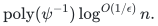
It does not multiply <code class="math">\psi^{-1}</code> once per hierarchy level.

The query recurrences in Section 6.5.2 explicitly upper-bound
their nonrecursive terms by
<!-- math-display: c109e3771c7b39b317dac0d9
L\,g(\psi^{-1},\log^{1/\epsilon}n)
-->
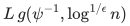
for one fixed polynomial <code class="math">g</code>. The recursive coefficients are
polylogarithmic and have depth <code class="math">O(1/\epsilon)</code>, giving another
fixed polynomial in the same two quantities. Thus the source's
claimed query envelope has fixed-power dependence on
<code class="math">\psi^{-1}</code>, not an unmentioned exponent depending on
<code class="math">1/\epsilon</code>.

On the constant-degree split graph, sparsity and conductance
are within fixed factors. Writing <code class="math">p=1/\epsilon</code>, and taking
<code class="math">\phi^{-1}=2^{O(r\log(U+2))}</code>, the intended query/output
envelope is
<!-- math-display: ff906865e2e29288f4b27e1d
Q=2^{O((p+r)\log(U+2))}.          \tag{1}
-->
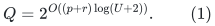
This verifies a parameter dependence of the constructive
interface. It does not certify the source's zero-round local
computations as efficient sequential procedures.

## 5. Actual-size clipping of the router parameter

CHS Appendix D simplifies its preprocessing bound under
<!-- math-display: d221a8d6f1f198d6557bb40c
\epsilon=\Omega\!\left(
                    \sqrt{\frac{\log\log n}{\log n}}\right).
-->
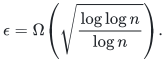
Let <code class="math">v=\lceil\log_2(n+2)\rceil</code> and
<code class="math">h_v=\lceil\log_2(v+2)\rceil</code>. For a master target <code class="math">p</code>,
use a local integer parameter bounded by
<!-- math-display: ad89f05a0841a6eee04c1089
p_{\rm loc}
          \leq \min\{p,\ c\sqrt{v/h_v}\},
-->
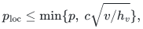
with a sufficiently small fixed <code class="math">c&gt;0</code>. Integer square-root
comparisons implement the bound. Instances below the fixed
constant-size range needed for <code class="math">p_{\rm loc}\geq p_0</code> are
handled directly, for one fixed <code class="math">p_0</code>.

Clipping only improves the <code class="math">\log^{O(p)}n</code> output factor.
When clipping occurs,
<!-- math-display: 2050ae70c5f0dabd5fc1c31c
n^{O(1/p_{\rm loc})}
             =2^{O(\sqrt{v h_v})}
             \leq 2^{O(p\log(U+2))}
-->
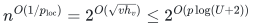
provided <code class="math">n\leq2^{O(U)}</code>. When clipping does not occur,
the same term is <code class="math">2^{O(U/p)}</code>. Thus the intended
preprocessing-round envelope is safely
<!-- math-display: fd7247046a9e245bc950a4dd
2^{O(U/p+(p+r)\log(U+2))}.              \tag{2}
-->
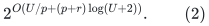
The split graph has only <code class="math">O(m)</code> actual records; no
master-sized padding is involved.

Using BFS for every graph up to
<code class="math">\log n=O(p^2\log U)</code> would instead give an unwanted
<code class="math">2^{O(p^2\log U)}</code> query factor. The clipping rule avoids
that loss.

## 6. The outstanding sequential interface

Before (1)--(2) can be used as a sequential static primitive,
the following source steps need constructive replacements
with the advertised total work:

* Appendix B.1 searches all disjoint pairs of cluster sets;
  this is exponential in the cluster count despite requiring
  no additional CONGEST rounds after the topology is known.
* Section 6.4 computes an embedded leaf sorting network by
  invoking an existence result with zero-round local work.
* Every actual token's physical trajectory and all associated
  preprocessing paths must be explicitly available at the
  claimed work and word cost.

In addition, the expectation identity in the displayed proof
of Lemma B.2 should not be applied without accounting for
the projection-dependent sets and matching choices. A
constructive cut-player replacement that loses only a
polylogarithmic factor in shuffler quality would suffice
for the intended output envelope, but that replacement
is a separate lemma.

Until those obligations are closed, this note supplies the
graph-model and parameter adapters only. It establishes no
new matching exponent.
