# Destructive path-support extraction from the APSP hierarchy

**Constructive bridge and independent interface audit, 25 October 2026.**
This note develops a use of the numerical APSP hierarchy that does not
require an ordinary simple-path query with time measured only by the final
projected path size. An accepted query is consumed: the algorithm removes
every distinct original edge used by its represented walk. That monotonic
consumption pays for the expansion of a large implicit walk.

The application is a bicriteria approximation to length-bounded
edge-disjoint path packing in arbitrary undirected graphs. A second
interface implements the approximate half-layer oracle of BHHS,
[*Disjoint Paths in Expanders in Deterministic Almost-Linear Time via
Hypergraph Perfect Matching*, arXiv:2511.02214v1](https://arxiv.org/html/2511.02214v1),
Definition 3.4, including arbitrary input states and its exclusion of the
current matching edges. The outer expander and strong-Haxell composition
is separate: its conductance and numerical parameter costs must not be
hidden in this local oracle theorem.

The proof imports the metric, explicit lifting, source-center, and work
interfaces already assembled in [separated-metric-forest-and-strong-sssp.md](separated-metric-forest-and-strong-sssp.md)
and audited in [Fully dynamic all-pairs distances: a time–stretch theorem](../../problems/apsp-frontier/proof.md). It is a research proof
assembly, not an implementation or an external verification.

## 1. Input and quantitative contract

Let <code class="math">G=(V,E)</code> be an undirected graph with positive integral lengths
in <code class="math">[1,N^{O(1)}]</code>,
and let <code class="math">C</code> be a collection of named demand pairs with distinct endpoints.
Different names may have the same endpoint pair. Zero-length demands with
equal endpoints are handled directly and omitted from the resource-packing
instance. All physical edges have immutable identifiers, including distinct
identifiers for parallel edges.

Let <code class="math">h_0\ge1</code> be the comparison length bound, represented with
<code class="math">O(U)</code> bits; it may be capped at <code class="math">(n-1)\max_e\ell_e</code>, since no
simple path is longer than that bound. To avoid overloading
notation, write

<!-- math-display: 76bcef3f660365944e5ce903
U=\log(N+4),\qquad h=\log(U+4)
-->
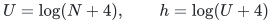

only for the hierarchy's logarithmic parameters. Let <code class="math">\Gamma\ge1</code> be
the concrete upper stretch bound for the APSP oracle, including its
arbitrary-degree positive connector adapter, and put

<!-- math-display: 2f4873e8027b0a92d1075aee
R=\lceil\Gamma h_0\rceil.
\tag{D1}
-->
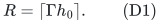

The hierarchy parameters have envelopes

<!-- math-display: 390f89eedda1c73afe1ecb4a
\begin{aligned}
 g&=O((p+r)h),\\
 f&=O(U/p+U/r+r^2h+(p+r)h),\\
 \log P&=O(U/K+g+h),\\
 B&=O(x+f+Kg+d\log P+h),\\
 \log\Gamma&=O(dKg+dh),\qquad d=O(U/x).
\end{aligned}
\tag{D2}
-->
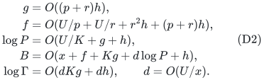

Here <code class="math">N</code> bounds the actual input inventory and the elementary history
up to a polynomial rescaling, not a padded graph size. The construction
below has work

<!-- math-display: d48f25d49a7b63ea35ed05e8
(|V|+|E|+|C|)\exp O(B)
\tag{D3}
-->
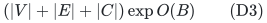

and returns literal simple paths of length at most <code class="math">R</code>. Its resource
approximation ratio is at most <code class="math">R+1</code>, as made precise below. Work does
not incur a separate multiplicative factor <code class="math">R</code>: accepted supports are
disjointly consumed, so their total cardinality is at most <code class="math">m</code>.

For the one-parameter APSP family

<!-- math-display: defa88b018decd36e27086ca
p=r=t,\quad K=t^2,\quad x=\Theta(U/t),\quad d=O(t),
\tag{D4}
-->
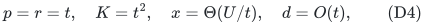

one may use

<!-- math-display: d3661c7ba15c6329d60f6d5d
B=O(U/t+t^3h),\qquad \log\Gamma=O(t^4h).
\tag{D5}
-->
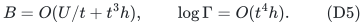

These formulas express a tradeoff between oracle time and path-length/
packing approximation. They do not assert a polylogarithmic approximation.

## 2. The additional flat forest family

The numerical query alone stores exact local legs and a recursively
represented middle path. We now retain a suitable collection of forests
whose root-level paths represent all such query constituents.

At each nonbase level <code class="math">i</code>, retain:

* the current exact nearest-pivot forest <code class="math">N_i</code>;
* for each current vertex <code class="math">v</code>, a shortest-path tree rooted at <code class="math">v</code>
  on its strict pivot ball, with the root included as an isolated vertex
  if the strict ball is empty.

At each actual-size base instance, retain one exact shortest-path forest
for every source vertex, in addition to the exact distance table. A query
that terminates at <code class="math">p(v)</code> uses <code class="math">N_i</code>, so the local strict-ball tree
does not need to include its pivot boundary vertex.

The strict-ball trees are essential. An exact <code class="math">u</code>-to-<code class="math">v</code> path for
<code class="math">v\in B(u,A)</code> need not lie in the nearest-pivot forest. Retaining only
the nearest-pivot forests and the base trees would leave a gap in the
query representation.

### 2.1 Why a local ball family has small pointwise occurrence

A bound on the size of each ball alone would not suffice: many small balls
can contain the same physical vertex. The retained center interface has
both guarantees

<!-- math-display: a816d9b90e7a76bba640728f
|B(v,A)|\le k\mathrm{poly}(U),\qquad
       |C(w,A)|\le k\mathrm{poly}(U),
       \quad C(w,A)=\{v:w\in B(v,A)\}.
\tag{D6}
-->
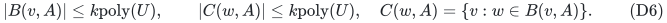

The constructive safe center lemma in
[uniform-source-interfaces-for-4-5.md](uniform-source-interfaces-for-4-5.md), Section 2,
gives <code class="math">&#124;B&#124;\le b</code> and <code class="math">&#124;C&#124;\le2b</code>, with only polynomial logarithmic
changes in the center count. Small initial components have one local
center and size at most the declared threshold, so they satisfy the same
coarse bound. Promotion causes both balls and inverse clusters to shrink.

Use a fixed oldest-center priority for equal real distances: initial
centers have a fixed order, and every newly promoted center is placed after
all older centers. An equal-distance promotion consequently leaves an
existing pivot unchanged. Internal shortest-path ties use the already
audited consistent symbolic path rule. A pivot change caused by a new
center is therefore a strictly closer choice and is charged to a strict
inverse cluster. The union of chosen nearest-pivot paths is still a
forest: if an internal point preferred an equally close older center,
the starting vertex would prefer that same center as well. This avoids
silently charging many equal-distance boundary changes to strict balls.

Every internal vertex on a positive-length shortest path from <code class="math">v</code> to
a point in <code class="math">B(v,A)</code> lies in <code class="math">B(v,A)</code>. Consequently a physical
vertex <code class="math">w</code> occurs in the strict-ball trees of at most
<code class="math">&#124;C(w,A)&#124;+1</code> roots. This bounds local vertex occurrence, and hence
edge occurrence, by <code class="math">k^{O(1)}\mathrm{poly}(U)</code>. The nearest-pivot
forest contributes only one further copy of each native vertex and edge.
At a base instance, its at most <code class="math">k^{O(1)}\mathrm{poly}(U)</code>
shortest-path forests contribute the same kind of bound.

The stored exact paths may be drawn from the source's initial future-path
inventory. Current strict-ball shortest paths survive from that inventory:
before an inserted or deleted edge is processed, its endpoints are
promoted, so a current strict-ball path cannot first traverse such a new or
deleted edge without first hitting a pivot. The source's exact local path
maintenance, or its explicit path inventory with literal tree rebuilding,
therefore maintains the above families in
<code class="math">k^{O(1)}\mathrm{poly}(U)</code> additional local work per native
operation. No current shortest-path search over the entire root graph is
needed for an accepted query.

### 2.2 Lift separately from the level at which a family is born

For each level <code class="math">i</code>, lift its own local forest family through the
ancestor reset interfaces to the root graph. Do not insert a new ball-tree
copy at every step of a single lift. The arbitrary-forest lifting lemma
uses the one-level occurrence recurrence

<!-- math-display: 1401dc740dff6182c25b840f
G_{j-1}\le P(G_j+1).
\tag{D7}
-->
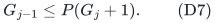

Thus a local family born at level <code class="math">i</code>, with occurrence
<code class="math">k^{O(1)}\mathrm{poly}(U)</code>, has root occurrence at most
<code class="math">k^{O(1)}P^i\mathrm{poly}(U)</code>. Summing the families born at
all <code class="math">d+1</code> levels gives

<!-- math-display: 2445cee5b5740c2ff7bd8039
G_{\rm root}
             \le k^{O(1)}P^d\mathrm{poly}(U).
\tag{D8}
-->
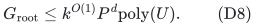

There is no <code class="math">k^d</code> term. The local families are parallel objects born at
different levels; each is lifted by the same occurrence recurrence. At an
ancestor, assigned pool indices provide distinct forest occurrences without
copying a whole <code class="math">k</code>-vertex tree on every child edit.

For work, a native update at level <code class="math">j</code> can change local trees and stable
ancestor attachments, while a child-family edit can change its connecting
records. Source-sized local work and the flattened occurrence bound are
charged separately. A conservative total bound over a root history is

<!-- math-display: 48831868ea945def47bbc4b2
(m_0+n_0+Q)\,\exp O(x+f+Kg+d\log P+h),
\tag{D9}
-->
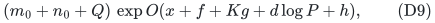

because the extra <code class="math">k^{O(1)}</code> from the local families changes only the
constant multiplying <code class="math">x</code>. The additive initial selected-edge allowance
is retained in this recurrence, including when it becomes edits later in
a parent period. All historical ghosts and dormant allocated pools count
as records. This is the same actual-inventory accounting as the audited
arbitrary-forest lift, with a larger polynomial local family at its leaves.

One may make the work induction explicit. Let <code class="math">b_*=k^{O(1)} \mathrm{poly}(U)</code> bound a local family's pointwise occurrence,
and enlarge local work once to <code class="math">W'=k^{O(1)}W</code>. With <code class="math">j</code> remaining
recursive levels, let <code class="math">J_j</code> be initialization cost per initial native
record and <code class="math">T_j</code> amortized cost per native edit. The safe recurrences,
with fixed absolute constants suppressed, are

<!-- math-display: 5080926371b0907605916acf
\begin{aligned}
 G_j&\le b_*+P(G_{j-1}+1),\\
 J_j&\le O(W'+P(G_{j-1}+1))
             +(P/k)(J_{j-1}+T_{j-1}),\\
 T_j&\le O(kW'+kP(G_{j-1}+1))
             +O(P)(J_{j-1}+T_{j-1}).
\end{aligned}
-->
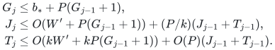

In particular, the initialization line includes <code class="math">T_{j-1}</code>: its
initial allowance is allowed to emit later child edits. Setting
<code class="math">Z_j=J_j+T_j/k</code> gives
<code class="math">Z_j\le O(W'+P(G_{j-1}+1)+PZ_{j-1})</code>. These recurrences yield
<code class="math">G_j,Z_j\le\exp O(x+\log W+j\log P+h)</code>, and multiplying
<code class="math">Z_j</code> by one final <code class="math">k</code> to bound <code class="math">T_j</code> changes only the constant
in front of <code class="math">x</code>. This proves (D9) without a multiplicative <code class="math">k</code>
at each ancestor.

### 2.3 Keep typed connector edges instead of contracting them

Root-level forest edges are either copies of immutable original real edge
identifiers or typed connector/null edges whose endpoints have the same
original physical image. A connector may have positive length in an
intermediate metric. Its projection still has no original real edge, so it
is ignored by the support extractor.

No global null quotient is needed. In particular, the original graph may
have arbitrary degree. The external current-incidence binary-tree adapter
provides the bounded-degree numerical input, while its connectors are
tagged as nonphysical for final extraction. Internal fixed resets and
stable aliases are handled by their typed lifting witnesses.

The pointwise occurrence bound (D8) is first a bound per vertex or edge of
that bounded-degree proxy. Each original real edge has exactly one real
proxy edge, so the same bound holds per original real edge identifier.
Many proxy port vertices may project to one high-degree original vertex;
no constant-factor vertex-occurrence bound after that projection is
claimed or needed. Registry marking uses real edge identifiers, and the
final search scans only the extracted support adjacency lists. It never
rescans the original high-degree adjacency lists.

Images of retained occurrence nodes are fixed during those nodes'
lifetimes. Period rebuilds retire old occurrences before publishing the new
version. A query sees one settled hierarchy version and returns handles
only into that version.

## 3. Query descriptors are short even when the projected walk repeats edges

The APSP query follows one pivot chain at each endpoint. It may use two
nearest-pivot legs per level and then one strict-ball or base-tree middle
path. Each local path has a root-flat representative in the family above.
The query can therefore return a descriptor of at most <code class="math">2d+1</code> pairs
of forest-node handles, specifying paths in the root-flat forests, together
with its numerical estimate <code class="math">\widehat d</code>.

Adjacent descriptor segments may end at different occurrence nodes with
the same physical image; this is enough for their projected walks to
concatenate. The descriptor represents an original walk <code class="math">W</code> with

<!-- math-display: 5292ffde686a4fb2884ffc93
\mathrm{len}(W)\le\widehat d
                          \le\Gamma d_G(s,t).
\tag{D10}
-->
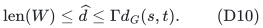

The lower metric bound holds as well. The internal reset scales have
already been divided when producing <code class="math">\widehat d</code>, as in the audited
numerical query. The forest descriptor has only polynomial logarithmic
length and lookup cost. It does not enumerate the individual edges of
<code class="math">W</code>.

This statement is a representation theorem. It is not the claim that
literal expansion of every segment followed by ordinary loop erasure has
time proportional to the final simple path. A real edge may occur many
times in the represented walk, and long stretches of port connectors may
project to nothing.

## 4. Consume distinct real edges with a dynamic-tree aggregate

Maintain a global Boolean <code class="math">\mathrm{seen}[e]</code> for every original real
edge identifier, initially false. For every root-flat forest edge
occurrence, maintain a dynamic-tree weight:

<!-- math-display: 6b81eed12c8cd7111fef1006
w(\text{occurrence})=
 \begin{cases}
 1,&\text{it represents original }e\text{ and }\mathrm{seen}[e]=0,\\
 0,&\text{otherwise.}
 \end{cases}
\tag{D11}
-->
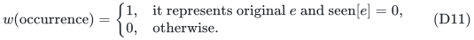

Vertices and connector/null edges have zero weight. Standard dynamic-tree
path sums, together with finding a positive-weight edge on a path, support
the needed queries with polynomial logarithmic overhead. Explicit
occurrence registries list all currently allocated records for each
original edge identifier, including dormant allocated copies.

For one accepted descriptor, freeze graph topology and all underlying
path handles while carrying out the following operation.

1. Initialize an empty support set <code class="math">S</code>.
2. On every descriptor path, find a positive-weight edge occurrence if one
   exists. Let its original identifier be <code class="math">e</code>.
3. Add <code class="math">e</code> to <code class="math">S</code>, set <code class="math">\mathrm{seen}[e]=1</code>, and set the
   weight of every currently allocated occurrence of <code class="math">e</code> to zero.
4. Repeat until all descriptor paths have zero aggregate.

Every distinct real edge in the represented walk is found, and it is found
only once. Repeated occurrences and zero-aggregate connector stretches are
skipped by aggregate queries. New occurrences born later inherit their
identifier's global seen flag. Deleted occurrence records leave their
registry in constant bookkeeping time.

After the support is fully extracted, build its own small adjacency lists
from immutable edge endpoints and run a graph search in <code class="math">(V(S),S)</code>.
The support contains an <code class="math">s</code>-to-<code class="math">t</code> walk, so it contains a simple
<code class="math">s</code>-to-<code class="math">t</code> path <code class="math">P</code>. With positive lengths,

<!-- math-display: ee843fbd88a0d67db6e5bd8e
|S|\le \sum_{e\in S}\ell_e
       \le\mathrm{len}(W)\le\widehat d,
 \qquad
 \mathrm{len}(P)\le\sum_{e\in S}\ell_e.
\tag{D12}
-->
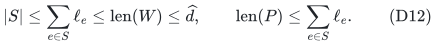

The search costs <code class="math">O(&#124;S&#124;)</code> graph operations, since it traverses the
extracted subgraph rather than the whole current graph. Then permanently
delete **every** edge of <code class="math">S</code>, including edges not used by the selected
simple path <code class="math">P</code>, before the next query. Additional forced deletions
may be included in the same consumption step.

### Total work, rather than repeated-walk work

Every original identifier joins at most one accepted support, so

<!-- math-display: cdacc83653fbd3143eb39f3e
\sum_j |S_j|\le m.
\tag{D13}
-->
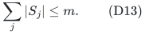

Each allocated occurrence is marked at most once during its lifetime;
future occurrences of a seen identifier start with zero weight. The total
registry/aggregate-update work is bounded by the total occurrence lifetime
and edit inventory, already <code class="math">(m+n+Q)\exp O(B)</code>. Each descriptor incurs
only <code class="math">O(d)</code> final empty-path checks, and each discovered identifier
causes one additional path search. This proves the claimed work without
enumerating repeated edges of <code class="math">W</code>.

Permanent original-edge deletions are distinguished from temporary edge
exclusions in the next section. A temporarily absent edge is not marked
seen unless it is later part of an actually consumed support. A restored
edge has the same immutable original identifier even though its encoded
graph lifetime and port-incidence lifetime are new.

## 5. A general bicriteria path-packing consequence

Consider first the case with no pre-existing matching. Process each demand
group in turn. Until its declared quota <code class="math">\Delta</code> is reached, query its
current endpoints. If <code class="math">\widehat d\le\Gamma h_0</code>, consume its support
as in Section 4 and output the resulting simple path. Otherwise stop this
group. The remaining graph only loses edges.

A failed query certifies that no remaining path of length at most <code class="math">h_0</code>
connects that pair, because any such path would force
<code class="math">\widehat d\le\Gamma h_0</code>. This certificate remains true after
further deletions. Every accepted support is nonempty and permanently
removed, so there are at most <code class="math">m</code> successes and at most one final
failure per demand group.

Let <code class="math">Z^*</code> be any collection of edge-disjoint comparison paths of length
at most <code class="math">h_0</code>, respecting the same quota <code class="math">\Delta</code> per named
demand. For saturated demand groups, their comparison paths number at most
the number of returned paths in those groups. A comparison path in an
unsaturated group must meet a consumed support, since otherwise it would
have survived the failure certificate. Because comparison paths are
edge-disjoint, at most <code class="math">&#124;S_j&#124;\le R</code> of them can be charged to the
support consumed by output <code class="math">j</code>. Hence

<!-- math-display: beb4946c9a55ab4b82d9971d
|Z^*|\le(R+1)|Z|.
\tag{D14}
-->
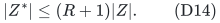

Every returned simple path has length at most <code class="math">R</code>, and the returned
paths are pairwise edge-disjoint. In particular, <code class="math">\Delta=1</code> gives an
<code class="math">(R+1)</code>-approximation to the maximum number of named demands that can
be simultaneously routed by edge-disjoint length-<code class="math">h_0</code> paths, with
length augmentation <code class="math">R/h_0\le\Gamma+1/h_0</code>. The time is (D3).

The approximation includes the original comparison length <code class="math">h_0</code>. It
does not assert that a high-stretch APSP oracle yields a stretch-independent
packing approximation.

## 6. Approximate half layers: arbitrary states and matching blockers

For the demand-path hypergraph, the <code class="math">B</code>-vertices are the physical graph
edges. An oracle state consists of active named demands <code class="math">A'</code>, forbidden
physical edges <code class="math">B'</code>, and a partial matching <code class="math">M</code> represented by
pairwise edge-disjoint simple paths, one for each of its matched named
demands. Fix a degree quota <code class="math">\Delta</code>.

The output must contain paths different from the corresponding matching
hyperedges, avoid <code class="math">B'</code>, be pairwise edge-disjoint, respect the quota,
and intersect any one path of <code class="math">M</code> in at most one output path. These are
exactly BHHS Definition 3.1 in this setting. Simply deleting all paths of
<code class="math">M</code> initially would not implement this interface: valid half layers
are allowed to intersect a matched path once.

Initially remove only <code class="math">B'</code>. For an accepted support <code class="math">S</code>, output its
simple path and permanently remove

<!-- math-display: ffe75282e0043a41c911cec3
D(S)=S\ \cup\!
             \bigcup_{Q\in M:\ E(Q)\cap S\ne\varnothing} E(Q).
\tag{D15}
-->
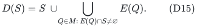

Each matching path is removed at most once, and the matching paths are
edge-disjoint. Their total removal and lookup work is <code class="math">O(m)</code>. A
physical-edge-to-matching-path table gives the intersected paths. Deleting
the larger set based on <code class="math">S</code>, rather than only the selected simple
path, is permitted and is charged explicitly in the approximation proof.

### 6.1 Excluding a demand's own matched path without an extra length factor

BHHS requires <code class="math">Z\subseteq E_H\setminus M</code>. For an arbitrary state,
the query could otherwise return exactly the active demand's own current
matched path <code class="math">P_a</code>. The following temporary-exclusion procedure handles
this issue while preserving (D3).

For each active demand <code class="math">a</code> that belongs to <code class="math">M</code>, keep a fixed ordering
of the edges of its own simple path <code class="math">P_a</code>, and a persistent scan pointer.
If any edge of <code class="math">P_a</code> has already been permanently removed, no further
special exclusion is needed. If all edges remain present, do the following
whenever querying this demand.

1. Temporarily delete the current scan edge <code class="math">e\in E(P_a)</code>, settle the
   fully dynamic hierarchy, and query the demand.
2. If the answer exceeds <code class="math">\Gamma h_0</code>, restore <code class="math">e</code>, settle, and
   advance the scan pointer. Try its next edge.
3. If the answer is at most <code class="math">\Gamma h_0</code>, materialize <code class="math">S</code> and the
   simple path <code class="math">P</code> in that temporarily modified, frozen version.
   Only after extraction is complete, restore <code class="math">e</code>; then permanently
   remove <code class="math">D(S)</code> and settle. Do not advance the scan pointer merely
   because this trial succeeded.
4. If all scan edges fail, stop the demand group unless already saturated.

No extracted path uses the temporarily missing edge, so <code class="math">P\ne P_a</code>.
The successful support also omits that edge. If the support hits another
edge of <code class="math">P_a</code>, (D15) removes the whole own matched path after the
temporary edge is restored, so later queries need no special exclusion.

The failure certificates persist. A failed trial at <code class="math">e</code> proves that
the current permanently retained graph minus <code class="math">e</code> has no
length-<code class="math">h_0</code> path for that demand. The permanently retained graph only
shrinks, so that scan edge never needs to be tried again. There are at most

<!-- math-display: 6f8608b6416ec6065403a5d7
\sum_{P_a\in M}|E(P_a)|\le m
\tag{D16}
-->
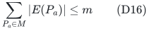

failed scan trials over the entire oracle invocation. Successful trials
consume a nonempty new support and hence number at most <code class="math">m</code>. Unmatched
demands, or demands whose own matched path is already absent, contribute
at most one terminal failure each. Thus the total number of graph queries
and temporary deletion/restoration operations is <code class="math">O(m+&#124;A'&#124;)</code>,
independently of <code class="math">\Delta</code> and independently of the length of each
own matched path.

The exhaustive-scan certificate is also correct. If two distinct simple
<code class="math">s</code>-to-<code class="math">t</code> paths <code class="math">P</code> and <code class="math">P_a</code> are different as physical
edge sets, then <code class="math">P</code> omits some edge of <code class="math">P_a</code>. A simple
<code class="math">s</code>-to-<code class="math">t</code> path cannot properly contain another such path's entire
edge set. Therefore every comparison path other than the forbidden
<code class="math">P_a</code> is ruled out by at least one of the failed edge-exclusion
certificates. This handles arbitrary states without assuming the special
state invariant of the outer alternating-forest algorithm.

Materializing the support before restoring the temporary edge is
essential. Restoration can rebuild the hierarchy and invalidate descriptor
handles. Only aggregate labels change while the descriptor is being
consumed.

### 6.2 Correctness and the <code class="math">R+1</code> approximation

The algorithm returns legal half layers. It enforces active demand and
quota constraints directly. Every returned path lies in a currently
retained graph, so it avoids the initial forbidden set and earlier output
supports. The temporary-exclusion procedure prevents equality with its own
matched hyperedge. If an output path intersects a matching path, that
matching path is deleted before any later output, proving the blocker
condition of Definition 3.1(3).

Fix any comparison half layer <code class="math">Z'</code> of rank at most <code class="math">h_0</code>, for the
same state and quota. Saturated demand groups contribute at most <code class="math">&#124;Z&#124;</code>
comparison paths in total. For every comparison path in an unsaturated
group, the final failure certificate implies that it intersects a
permanent deletion set <code class="math">D(S_j)</code> from some earlier output.

Partition <code class="math">D(S_j)</code> into the following resource atoms:

* each edge of <code class="math">S_j</code> outside the support of <code class="math">M</code> is a singleton;
* every matching path intersected by <code class="math">S_j</code> is one whole-path atom.

The atoms are pairwise disjoint because <code class="math">M</code> is a matching. Their number
is at most <code class="math">&#124;S_j&#124;</code>: distinct whole-path atoms require distinct edges
of <code class="math">S_j</code> inside the matching support. A comparison half layer meets a
singleton atom in at most one path by its edge-disjointness condition. It
meets a whole matching-path atom in at most one path by Definition 3.1(3).
Thus at most <code class="math">&#124;S_j&#124;\le R</code> unsaturated comparison paths can be charged
to one output, even if its deleted matching support is much longer.

Consequently

<!-- math-display: a822df6a1b0ffcd9555a437a
|Z'|\le(R+1)|Z|.
\tag{D17}
-->
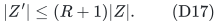

The produced paths have rank at most <code class="math">R</code>. Hence this is an
<code class="math">(h_0,R+1)</code>-approximate half-layer oracle in the <code class="math">R</code>-bounded
demand-path hypergraph, in the sense of BHHS Definition 3.4, with total
time (D3). The tighter atom count is useful: separately charging all
support edges and all touched matching paths would give the weaker
<code class="math">2R+1</code> bound.

## 7. History, finite arithmetic, and boundaries of the theorem

An invocation uses <code class="math">O(m+&#124;C&#124;)</code> underlying graph edits and queries, apart
from the polynomial logarithmic degree encoding. Temporary exclusions are
why the fully dynamic hierarchy is used; a decremental-only oracle cannot
silently restore the excluded edge. A fixed polynomial master cap covers
the encoded connector lifetimes and the flat representation. All work is
charged to actual inventories. Original unweighted graphs need only
polynomially many bits after the audited positive scales and core-label
operations.

The word "global" for the seen array means global **within one oracle
invocation**. Every new outer layer build initializes a fresh seen registry
and a fresh graph instance from the static original graph, with that
build's own forbidden set removed. It does not inherit permanent
consumption marks from an earlier build. Original edges may be reused by
different builds; the build-count multiplier pays for reinitializing and
consuming them again. Only the physical certificate retained by an outer
layer persists beyond the destruction of its temporary oracle instance.

For weighted positive integral graphs, (D12) uses <code class="math">\ell_e\ge1</code> to
bound the number of consumed edge resources by the accepted walk length.
Arbitrary tiny positive weights would need a separate minimum-weight
normalization; no such extension is implicit here. The BHHS application
uses unweighted original edges.

The permanent seen flag is keyed by an original physical identifier,
whereas encoded temporary graph and port lifetimes may change. No original
edge is permanently restored after consumption. This distinction prevents
repeated expansions from recharging the same physical resource.

The new theorem concerns destructive extraction, not an unrestricted
sequence of ordinary path queries on an unchanged graph. Without
consumption, the same expensive repeated-walk expansion could recur, and
the lifetime charging argument would not establish the stated bound.

Finally, applying BHHS Lemma 3.5 requires its own strong-Haxell inequality
<code class="math">\varphi\ge24\alpha\,d(n)R^2</code>, with <code class="math">d(n)\ge4\alpha</code> and
<code class="math">\alpha=R+1</code>. Since <code class="math">R</code> contains the comparison path length
<code class="math">h_0</code>, one must retain its conductance dependence when substituting
<code class="math">h_0=\Theta(\log n/\phi)</code>. The local theorem does not automatically
reproduce the paper's displayed <code class="math">\phi^3</code> condition. That outer
calculation and comparison against the HHL-based public oracle are
separate proof obligations.

The new outer algorithm in
[routing.md](../../problems/strong-haxell-matching/routing.md) supplies an independent
certificate-based composition and avoids that particular black-box
approximate-half-layer loss. It retains the physical deletion set of each
build, freezes its selected layer, and removes the superposition operation.
Its proof uses the same destructive primitive with a fresh per-build seen
registry. The conductance-cubic condition in that note is a separate
proved construction, not a consequence of silently substituting a smaller
<code class="math">\alpha</code> into BHHS Lemma 3.5.
