# A deterministic fixed-k guide-tree mincut adapter

**Research proof assembly, 25 October 2026.** This note supplies the
constructive fixed-parameter interface needed by the quantified
Gomory--Hu transfer. It keeps the centroid and pruning framework of
the public reductions, but changes the leaf routine's maximizer and
its same-parameter children. The change makes the correctness cases and
the aggregate instance inventory hold simultaneously.

The primary source framework is AKL+,
[arXiv:2507.20354v1](https://arxiv.org/html/2507.20354v1), Section 5.1,
and Zhang,
[arXiv:2112.01042v1](https://arxiv.org/pdf/2112.01042), Sections
2.1--2.4. The audit motivating the change is recorded in
[fixed-k-tree-mincut-source-interface-audit.md](fixed-k-tree-mincut-source-interface-audit.md). This note proves the
modified interface directly; it does not assume that the two source
contraction variants have identical runtime recurrences.

## 1. The interface

Let <code class="math">G</code> be a connected undirected graph with positive integer
capacities, and let <code class="math">T</code> be an abstract tree whose vertex set is a
subset of <code class="math">V(G)</code>. A guide-tree edge need not be an edge of <code class="math">G</code>.
Fix a source <code class="math">s\in V(T)</code> and an integer <code class="math">k\ge0</code>.

Write <code class="math">\lambda_G(s,t)</code> for the ordinary minimum cut value and
<code class="math">\lambda_{T,k}(s,t)</code> for the minimum value of an <code class="math">(s,t)</code>-cut
crossing at most <code class="math">k</code> edges of <code class="math">T</code>. An empty feasible family has
value infinity.

The main routine returns values satisfying

<!-- math-display: bf4197dc21bfdb4f65b66636
\lambda_G(s,t)\le\mu(t)\le\lambda_{T,k}(s,t),
       \qquad t\in V(T)\setminus\{s\}.
 \tag{1}
-->
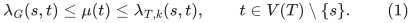

The leaf routine additionally assumes that <code class="math">s</code> is a leaf of <code class="math">T</code>
with incident edge <code class="math">sp</code>. Let <code class="math">\eta_{T,k}(s,t)</code> restrict the
right side to cuts that also cross <code class="math">sp</code>. It returns

<!-- math-display: b6e234e239dc5afd9d76fadb
\lambda_G(s,t)\le\mu(t)\le\eta_{T,k}(s,t).
 \tag{2}
-->
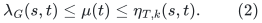

For every fixed <code class="math">k</code>, both routines are deterministic reductions to
exact maxflow on graphs of aggregate size

<!-- math-display: 6ee350473f8f2e7d5201e4df
(m+n)\log^{O(k+1)}(n+4),
 \tag{3}
-->
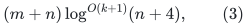

with the same bound on work outside maxflow, up to fixed polynomial
logarithmic factors. Capacities in these flow instances remain
polynomially bounded integers when the input capacities are so bounded.

Thus an exact maxflow factor <code class="math">E_{\rm flow}(N)</code>, monotone in a common
size bound <code class="math">N</code>, gives time
<code class="math">(m+n)E_{\rm flow}(N)\mathrm{polylog}N</code> for fixed <code class="math">k</code>.
In the Gomory--Hu application <code class="math">k=16</code>, so all logarithmic exponents
are fixed constants.

## 2. Local candidate values and target propagation

Each call owns a candidate vector on its current guide-tree vertices,
initially infinity. Updating a candidate means taking its minimum with
a returned valid upper bound. Candidate vectors belonging to different
contracted physical graphs are not silently identified.

Suppose a child contracts a physical set <code class="math">X</code> to a guide vertex
<code class="math">x</code>, and <code class="math">x</code> is **not** that child's source. A cut separating
the child source from <code class="math">x</code> is a cut separating the parent source from
every parent guide target in <code class="math">X</code>. Therefore a returned value for
<code class="math">x</code> is safely broadcast to all those parent guide targets. If the
contracted vertex is the child source, no such broadcast is made.

This propagation is performed only one recursion level upward. A parent
stores its own vector; it does not repeatedly expand a nested aggregate
all the way to the original top-level targets. The total broadcast
cost of the same-k children of a call is <code class="math">O(&#124;V(T)&#124;)</code>. Combining
the lower-k calls costs <code class="math">O(&#124;V(T)&#124;\log n)</code>, which is already charged
by their branching count.

In particular, a value previously computed for the single target
<code class="math">c</code> must not be used as though it were a value for a new contracted
target <code class="math">c'</code> containing <code class="math">c</code> and many other vertices. These are
different cut constraints.

## 3. Centroid blocks and isolating regions

Choose a centroid <code class="math">c</code> of <code class="math">T</code>; every component of <code class="math">T-c</code> has
at most <code class="math">&#124;V(T)&#124;/2</code> vertices. If <code class="math">s\ne c</code>, let <code class="math">T_0</code> be
the component containing <code class="math">s</code>, and let <code class="math">T_1,\ldots,T_l</code> be the
other components. Thus <code class="math">T_0</code> includes <code class="math">s</code>, while no component
includes <code class="math">c</code>. If <code class="math">s=c</code>, there is no <code class="math">T_0</code>, and all
components are indexed <code class="math">i&gt;0</code>.

For <code class="math">s\ne c</code>, use the disjoint terminal blocks

<!-- math-display: 1c45f2bf349bfa31c79eabee
B_0=V(T_0)\setminus\{s\},\quad
  B_i=V(T_i)\ (i>0),\quad \{s\},\quad\{c\}.
 \tag{4}
-->
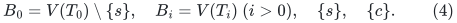

Omit an empty <code class="math">B_0</code>. When <code class="math">s=c</code>, use just the <code class="math">B_i</code> and
<code class="math">\{s\}</code>. The deterministic isolating-cut primitive returns
pairwise disjoint regions <code class="math">W_i</code> for the nonempty branch blocks.
They contain their own block and no other guide-tree vertex. Put
<code class="math">W_0=\emptyset</code> when <code class="math">B_0</code> is empty.

Every call also computes an exact <code class="math">(s,c)</code>-mincut when <code class="math">s\ne c</code>,
updating <code class="math">\mu(c)</code>. A set-terminal mincut is implemented by
contraction or by sufficiently large common-capacity forcing edges.
The isolating-cut construction is a deterministic reduction to maxflow
on total size <code class="math">(m+n)\mathrm{polylog}n</code>.

### 3.1 The two uncrossing facts used below

Let <code class="math">A</code> be the target side of a cut, so <code class="math">s\notin A</code>.

First, if all guide vertices of <code class="math">B_i</code> lie in <code class="math">A</code>, then replacing
<code class="math">A</code> by <code class="math">A\cup W_i</code> does not increase cut capacity. Indeed,
<code class="math">A\cap W_i</code> is a feasible isolating cut for <code class="math">B_i</code>, and
submodularity compares its capacity with that of <code class="math">W_i</code>. If all
guide vertices of <code class="math">B_i</code> lie outside <code class="math">A</code>, the analogous
posimodular argument permits replacement by <code class="math">A\setminus W_i</code>.
Both changes preserve the side of every guide vertex. Applied to
disjoint <code class="math">W_i</code>'s, they place a whole isolating region on the side
already occupied by its branch block.

Second, suppose all guide vertices on the target side lie in one block
<code class="math">B_i</code>. Then <code class="math">A\cup W_i</code> is a feasible isolating cut for
<code class="math">B_i</code>, so submodularity gives

<!-- math-display: 2da4badbbd57034a3436fd69
c(\partial(A\cap W_i))\le c(\partial A).
 \tag{5}
-->
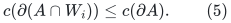

This intersection preserves every guide vertex's side. The hypothesis
is essential: for the source arm it applies when the centroid is on
the source side, not automatically when the centroid is on the target
side.

If <code class="math">A</code> is optimal among a constrained guide-cut family and the
modification preserves that family, its capacity in fact stays equal.
For the induction below, nonincrease is already sufficient.

## 4. Deterministic pruning

The prunable objects are <code class="math">T_1,\ldots,T_l</code>. The source arm and the
centroid are never pruned. Use a family of retained index sets with the
following two properties:

1. For every distinct <code class="math">i,j&gt;0</code>, some set retains <code class="math">i</code> and omits
   <code class="math">j</code>.
2. The empty retained set is present.

Both orientations of each bit position of the branch index, together
with the empty set, give <code class="math">O(\log(n+4))</code> choices. The empty set
matters when there is only one outside branch.

For a chosen retained set, delete all other outside branches from the
guide tree only; the physical graph is unchanged. A retained target
stays connected to the source in the guide tree. Pruning cannot add a
guide-tree cut edge, and removes at least one whenever a cut-bearing
branch is pruned. In the leaf routine the edge <code class="math">sp</code> remains.

## 5. The main routine

For <code class="math">k=0</code>, return infinity for every target. For a fixed small
guide tree, compute all its source-target mincuts exactly and return
them. Exact answers satisfy (1), whether or not a constrained cut
exists.

For a larger tree, form the centroid blocks and regions above, and
perform the following operations.

### 5.1 Same-k source-arm child

If <code class="math">s\ne c</code>, contract

<!-- math-display: 2ce2317bdf2854fc2e0b808b
\{c\}\cup\bigcup_{i>0}W_i
 \tag{6}
-->
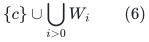

to one vertex <code class="math">c'</code>. Use guide tree <code class="math">T_0</code> together with <code class="math">c'</code>
and the original attachment to the centroid. The source remains <code class="math">s</code>.
Run the main routine with parameter <code class="math">k</code>. Propagate its values for
surviving targets, and broadcast its value for <code class="math">c'</code> to every parent
guide target merged into (6).

Including <code class="math">c</code> in (6) makes the guide an ordinary tree and is also
needed for the clean inventory equality below.

### 5.2 Same-k outside children

For each <code class="math">i&gt;0</code>, contract <code class="math">V(G)\setminus W_i</code> to a source
vertex. The guide is <code class="math">T_i</code> with that source attached at its former
centroid edge. Run the main routine with parameter <code class="math">k</code>, and
propagate the values for targets in <code class="math">T_i</code>.

### 5.3 Lower-k and leaf calls

When <code class="math">k\ge2</code>, call the main routine with parameter <code class="math">k-1</code> on
every pruned guide from Section 4. If <code class="math">s\ne c</code>, also form

<!-- math-display: 53647186220b865b95cc9fc0
T^+=T-(V(T_0)\setminus\{s\})+\{sc\},
 \tag{7}
-->
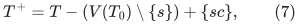

where an already present <code class="math">sc</code> edge is retained only once. Run the
main routine on <code class="math">T^+</code> with parameter <code class="math">k-1</code>, and the leaf routine
on <code class="math">T^+</code> with parameter <code class="math">k</code>. Combine their values for retained
targets. The physical graph in these calls is unchanged.

For <code class="math">k=1</code>, omit these lower-k and leaf calls. The same-k children
and the exact centroid cut already cover every one-respecting cut.

### 5.4 Correctness of the main routine

Fix a target and an optimal cut <code class="math">A</code> for the right side of (1).
The centroid target is handled exactly. If all guide cut edges are
incident to the source arm, every outside branch is uniformly on the
centroid's side. The first uncrossing fact puts each <code class="math">W_i</code>,
<code class="math">i&gt;0</code>, on that same side, permitting contraction (6). A target
inside <code class="math">T_0</code> survives. Any outside target is represented by <code class="math">c'</code>
and receives the child answer by broadcast. The cut still crosses at
most <code class="math">k</code> child-guide edges.

If all cut edges are incident to one outside branch <code class="math">T_i</code>, every
guide target on the opposite side from <code class="math">s</code> lies in <code class="math">T_i</code>.
Equation (5) confines the cut to <code class="math">W_i</code>, so the corresponding
outside child preserves it.

Otherwise, if the target lies in <code class="math">T_0</code>, prune one outside
cut-bearing branch. If the target lies in <code class="math">T_i</code> and another
outside branch is cut-bearing, retain <code class="math">T_i</code> and prune one such
other branch. These calls leave a feasible cut with at most <code class="math">k-1</code>
guide edges.

The only remaining case has a target in <code class="math">T_i</code>, cut edges incident
to both <code class="math">T_i</code> and <code class="math">T_0</code>, and no other cut-bearing outside
branch. In <code class="math">T^+</code>, if <code class="math">s,c</code> are on the same side, the new
edge does not cross and at least one old cut edge is removed. If they
are on opposite sides and at least two old source-arm edges cross,
the new crossing edge replaces at least two. Both cases are covered
by the main lower-k call. Otherwise exactly one source-arm edge is
replaced by the crossing edge <code class="math">sc</code>. The cut has at most <code class="math">k</code>
guide edges and crosses the new source-leaf edge, so the leaf call
covers it. This last case has at least two total cut edges and cannot
occur when <code class="math">k=1</code>.

All returned values are capacities of valid cuts in the current graph
or in its contractions. Their lower bound in (1) follows immediately.

## 6. The modified leaf routine

The source <code class="math">s</code> is a leaf, and <code class="math">sp</code> is its only guide edge.
Use the same small-tree and <code class="math">k=0</code> bases as above.

For <code class="math">k=1</code>, every allowed cut separates <code class="math">s</code> from every other
guide vertex. One exact set mincut between <code class="math">\{s\}</code> and
<code class="math">V(T)\setminus\{s\}</code> therefore gives the value
<code class="math">\eta_{T,1}(s,t)</code> for every target. Return that value for all
targets. This does not identify a physical guide subtree with a cut
shore when Steiner vertices are present.

Assume now <code class="math">k\ge2</code> and the guide is larger than the fixed base
size. Its centroid is not the source leaf. Form <code class="math">T_0,T_i,W_i</code>
and compute the centroid cut as in Section 3.

### 6.1 Complete all lower-k information first

For every pruned guide of Section 4, run the leaf routine with parameter
<code class="math">k-1</code>, combining its answers. Also run the **main** routine on
<code class="math">T^+</code> from (7), with parameter <code class="math">k-1</code>, and combine its answers.

Only after these calls finish, choose

<!-- math-display: 5b8f502d9449578e9817142a
z\in\mathrm{arg}\,\max_{v\in V(T)\setminus\{s,c\}}\mu(v),
 \tag{8}
-->
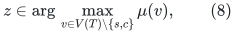

breaking ties deterministically. The maximization includes the entire
source arm <code class="math">V(T_0)\setminus\{s\}</code>. Restricting it to outside
branches would lose the argument below.

### 6.2 If the maximizer is on the source arm

If <code class="math">z\in V(T_0)\setminus\{s\}</code>, create **one** same-k child:
the full source-arm child (6), with guide <code class="math">T_0+c'</code> and source
<code class="math">s</code>. Call the leaf routine on it with parameter <code class="math">k</code>.
Propagate surviving-target values and broadcast the non-source target
<code class="math">c'</code> as described in Section 2. There is no second same-k child.

### 6.3 If the maximizer is on an outside branch

If <code class="math">z\in V(T_j)</code>, create the following two same-k children.

**Restricted source-arm child.** If <code class="math">W_0\ne\emptyset</code>, contract
<code class="math">V(G)\setminus W_0</code> to a source vertex <code class="math">s'</code>. Use the tree
<code class="math">T_0</code>, with its source <code class="math">s</code> relabeled <code class="math">s'</code>. Equivalently,
after quotienting the full guide, delete its old attachment from
<code class="math">T_0</code> to <code class="math">c</code>; keep the edge <code class="math">sp</code>. The result is an ordinary
tree in which the source is still a leaf. Call the leaf routine with
parameter <code class="math">k</code>, propagating the values for the targets of
<code class="math">T_0\setminus\{s\}</code>.

**Selected outside child.** Contract

<!-- math-display: 1b126f1f027cde1a58a2dbc0
\{c\}\cup W_0\cup
                         \bigcup_{i>0,\ i\ne j}W_i
 \tag{9}
-->
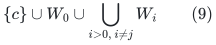

to <code class="math">c'</code>. The source <code class="math">s</code> is not contracted. Use guide tree
<code class="math">\{s,c'\}+T_j</code>, with source edge <code class="math">sc'</code> and the original
attachment of <code class="math">T_j</code> to <code class="math">c'</code>. Call the leaf routine with
parameter <code class="math">k</code>. Propagate its surviving-target values and broadcast
its non-source target <code class="math">c'</code>.

## 7. Correctness of the modified leaf routine

Fix a target <code class="math">t\ne s,c</code>, and let <code class="math">A</code> be an optimal cut for
<code class="math">\eta_{T,k}(s,t)</code>, with <code class="math">s\notin A</code>. The mandatory edge
implies <code class="math">p\in A</code>. Write <code class="math">w=c(\partial A)</code>. If the candidate
after Section 6.1 is already at most <code class="math">w</code>, nothing remains to prove.
Assume it is larger than <code class="math">w</code>.

### 7.1 A target on the source arm

If <code class="math">t\in T_0\setminus\{s\}</code> and an outside branch is
cut-bearing, pruning that branch gives a feasible leaf cut with at most
<code class="math">k-1</code> guide edges. This would already bound <code class="math">\mu(t)</code> by <code class="math">w</code>.
Thus an unresolved target here has every cut edge incident to <code class="math">T_0</code>.

If <code class="math">c\notin A</code>, all target-side guide vertices lie in
<code class="math">B_0</code>. Equation (5) confines the cut to <code class="math">W_0</code>, preserving
the source-leaf edge. It is feasible in the restricted source-arm
child. It is also feasible in the full source-arm child, after putting
all outside <code class="math">W_i</code>'s on the centroid's side by the first
uncrossing fact. Hence this case is covered whichever branch (8)
chooses.

If <code class="math">c\in A</code>, every outside guide vertex lies in <code class="math">A</code>. In
<code class="math">T^+</code>, the same physical cut crosses only the edge <code class="math">sc</code>.
Since <code class="math">k\ge2</code>, the main lower-k call in Section 6.1 bounds
<code class="math">\mu(v)\le w</code> for **every** outside guide vertex <code class="math">v</code>.
Because <code class="math">\mu(t)&gt;w</code>, the global maximizer in (8) must be on the
source arm. The algorithm therefore chooses the full source-arm child.
All outside branches are uniformly on the centroid's side; the first
uncrossing fact permits (6), retaining <code class="math">s</code> separately from <code class="math">c'</code>.
This preserves the required cut and its mandatory leaf edge.

This is exactly the case for which the unrestricted use of
<code class="math">G/(V\setminus W_0)</code> would identify opposite sides of the cut.
The maximizer rule ensures that this restricted child is not relied on
for such a target.

### 7.2 A target on an outside branch

Let <code class="math">t\in T_i</code>. If another outside branch <code class="math">T_j</code> is
cut-bearing, a pruning call retaining <code class="math">T_i</code> and pruning <code class="math">T_j</code>
already provides the required answer. Assume no such branch exists.

Let <code class="math">q_0</code> be the number of cut edges incident to the source arm.
It is at least one because <code class="math">sp</code> crosses. If <code class="math">c\notin A</code>,
the tree <code class="math">T^+</code> removes at least one crossing edge and adds no
crossing edge. If <code class="math">c\in A</code> and <code class="math">q_0\ge2</code>, it removes at
least two and adds one. Either case is covered by the main lower-k
call. Thus an unresolved target must satisfy

<!-- math-display: 91ef20e9bf473369a5b56c83
c\in A,\qquad q_0=1,\qquad
      \text{all outside cut edges are incident to }T_i.
 \tag{10}
-->
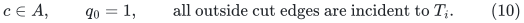

If <code class="math">T_i</code> has no cut edge, the cut crosses only the new <code class="math">sc</code>
edge in <code class="math">T^+</code>, and is again handled by the main lower-k call.
Therefore <code class="math">T_i</code> is cut-bearing.

For every guide vertex <code class="math">v</code> outside <code class="math">T_i</code> and different from
<code class="math">s,c</code>, a pruning call can keep <code class="math">v</code> and remove <code class="math">T_i</code>:
use the empty retained family member for source-arm vertices, or a
bit separator for another outside branch. The cut then has at most
<code class="math">k-1</code> guide edges and still crosses <code class="math">sp</code>. Hence

<!-- math-display: d3f40c3e0f0ae1a19ab152d7
\mu(v)\le w\quad
                 (v\notin T_i,\ v\ne s,c).
 \tag{11}
-->
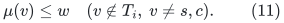

The unresolved target has <code class="math">\mu(t)&gt;w</code>, so (8) forces
<code class="math">z\in T_i</code>. The selected outside child is therefore the one
indexed by <code class="math">i</code>.

Because the source arm has only the cut edge <code class="math">sp</code>, all guide
vertices in <code class="math">B_0</code> are on the centroid's side <code class="math">A</code>. Every
outside branch other than <code class="math">T_i</code> is also uniformly on that side.
The first uncrossing fact puts <code class="math">W_0</code> and those outside <code class="math">W_j</code>'s
wholly in <code class="math">A</code>, permitting contraction (9). The source <code class="math">s</code>
stays separate. The old single source-arm crossing is represented by
the new mandatory edge <code class="math">sc'</code>; no other crossing is added. The
selected child consequently has a feasible cut of value at most <code class="math">w</code>
with at most <code class="math">k</code> crossings and the required source edge.

These cases cover every target. The lower bound in (2) follows because
all candidate values come from valid current-graph cuts or cuts in its
contractions. Broadcasts are valid by Section 2. This completes the
correctness induction, taking the leaf routine at parameter <code class="math">k</code>
before the main routine at parameter <code class="math">k</code>: every call from the leaf
routine to the main routine has parameter <code class="math">k-1</code>.

## 8. Same-k inventory and depth

Let <code class="math">n</code> be the current physical vertex count, including any existing
contraction vertices. Distinct <code class="math">W_i</code>'s are disjoint and exclude
<code class="math">s,c</code>.

For the main routine with <code class="math">s\ne c</code>, its source-arm child has

<!-- math-display: 2d0b7aa6526f313ba9216503
n_0-1=n-1-\sum_{i>0}|W_i|.
 \tag{12}
-->
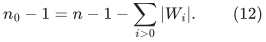

Its outside child <code class="math">i</code> has <code class="math">n_i-1=&#124;W_i&#124;</code>. Summing gives
<code class="math">\sum_i(n_i-1)=n-1</code>. When <code class="math">s=c</code>, the outside children alone
give at most <code class="math">n-1</code>.

In the leaf routine's source-arm-maximizer case there is only one
same-k child, with <code class="math">n_0-1\le n-1</code>. In its outside-maximizer case,
the restricted child has <code class="math">n_0-1=&#124;W_0&#124;</code>. The selected child has

<!-- math-display: 930c857540f6e32b6591daba
n_1-1=n-1-|W_0|-
                               \sum_{i>0,\ i\ne j}|W_i|.
 \tag{13}
-->
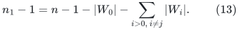

Therefore

<!-- math-display: c097b0b145d4db210cb8e0ec
(n_0-1)+(n_1-1)
                  =n-1-\sum_{i>0,\ i\ne j}|W_i|
                  \le n-1.
 \tag{14}
-->
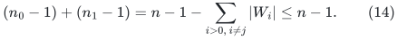

The uncontracted regions of those two children are disjoint:
<code class="math">W_0</code> for the first, and a subset of its complement for the second.
The uncovered Steiner region is never duplicated into both of them.

Every same-k child guide has at most <code class="math">&#124;T&#124;/2+2</code> vertices. For
<code class="math">&#124;T&#124;</code> above the fixed base threshold, this is at most
<code class="math">0.9&#124;T&#124;</code>. The main routine also calls one leaf routine at the same
parameter without necessarily reducing guide size. A typed recursion
branch can make this main-to-leaf transition at most once before
<code class="math">k</code> decreases. A leaf call never calls a main routine with the
same <code class="math">k</code>.

## 9. Solving the aggregate recurrences

Let <code class="math">L=C\log(n_{\rm root}+4)</code> dominate the pruning family size,
the centroid depth, and all fixed overheads. For one fixed respect
parameter, equations (12)--(14) allow the costs of same-k descendants
to be summed by their actual vertex or uncontracted-edge mass, with
only a factor <code class="math">O(L)</code> over one centroid-depth traversal.

Write <code class="math">F_k</code> and <code class="math">H_k</code> for normalized aggregate inventory factors
of the main and leaf routines. Their recurrences have the form

<!-- math-display: fff2cba103e3073deefa0048
\begin{split}
 H_k&\le C L\bigl(1+L H_{k-1}+F_{k-1}\bigr),\\
 F_k&\le C L\bigl(1+L F_{k-1}+H_k\bigr).
 \end{split}
 \tag{15}
-->
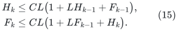

The finite bases are polynomial logarithmic. Induction gives
<code class="math">F_k,H_k\le L^{O(k+1)}</code>. This proves the aggregate vertex bound
and the corresponding bound for original edges not incident to any
new contraction vertex.

Every physical contraction creates a marked contraction vertex, even
if an implementation reuses an old vertex name. Along any recursion
branch there are <code class="math">O(kL)</code> such vertices: there are at most <code class="math">k</code>
respect-parameter phases and logarithmic same-k depth in each. Combine
parallel physical edges whenever they arise. At an instance with
<code class="math">n_*</code> vertices, edges incident to marked contraction vertices then
number at most <code class="math">O(n_*kL)</code>. Summing this using the already proved
vertex inventory gives another fixed polynomial logarithm. Ordinary
graph construction, broadcasting, and candidate merging have the same
bound.

The exact centroid and set-mincut calls add only a fixed number of
maxflow instances per recursion node. The isolating-cut reduction adds
a polynomial logarithm to their aggregate size. This proves (3).
It multiplies the exact maxflow factor once, rather than raising that
factor to the centroid depth.

## 10. Consequence for the quantified application

The preceding argument is the missing fixed-k construction interface.
Together with the other named public reductions audited in
[gomory-hu-external-factors-except-fixed-k.md](gomory-hu-external-factors-except-fixed-k.md), and the strong-forest,
packing, finite-arithmetic, and skeleton adapters in
[gomory-hu-seven-eighths-dependency-audit.md](gomory-hu-seven-eighths-dependency-audit.md), it supplies the intended
exact Gomory--Hu composition, subject to the separately stated local
strong-forest proof imports.

The changes that must be preserved are specific: include the centroid
in each full source-arm contraction; maximize over all non-source,
non-centroid targets after every lower-k call; use only one same-k
child when that maximizer is on the source arm; preserve the source
leaf edge in the restricted child; broadcast non-source contracted
targets; and use the set-mincut base for leaf parameter one. Omitting
any of these can invalidate either the cut argument or the inventory.

Additional source comparisons are recorded in the [guide-tree analysis](fixed-k-global-max-leaf-independent-audit.md). Marked contraction identities
persist throughout the entire recursion of one adapter invocation;
entering a lower-k call does not turn old contraction vertices back
into unmarked original vertices for the edge-inventory proof.
