# Deterministic symbolic ties for globally consistent shortest paths

**Static finite-word lemma, 24 October 2026.** Nonnegative shortest
paths can be made unique and globally consistent without constructing
an integer with one bit per edge. The method uses an exact, persistent
binary representation of the tie signature and deterministic
canonicalization. It is a per-source shortest-path construction,
not an all-pairs or dynamic shortest-path theorem.

## 1. Input and exact tie convention

Let the graph have <code class="math">n</code> vertices and <code class="math">m</code> genuine ranked edge
records. In a directed graph these are directed arc IDs. In an
undirected graph they are genuine physical edge IDs, with the SAME
rank used for both traversal orientations of one edge. Different
parallel edges have different IDs.

Fix an injective rank function into <code class="math">\{1,\ldots,m\}</code>, once for
the graph and all its sources. Distinct immediate native aliases
must remain distinct even when their eventual physical images
coincide. A real edge is not identified with another edge or with
a null image for purposes of this order.
Every actual native graph edge, including a zero-length connector
or an edge with null eventual physical image, receives its own
genuine ID and rank under this convention.

Lengths are nonnegative integers with at most <code class="math">b</code> bits, or have
the form
<!-- math-display: 8a0d60b6b6aa91098be814c4
\ell_e=a_e/D,\qquad
       0\le a_e<2^b,\quad 1\le D<2^b,
 \tag{1}
-->
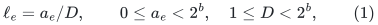
on ONE declared common denominator. All true-distance computations
can then use the integer numerators. Arbitrary unrelated per-edge
<code class="math">b</code>-bit denominators do not give the same arithmetic bound:
their common denominator may have <code class="math">\Theta(mb)</code> bits. In that
case the actual common-grid encoding length must be charged.

For a walk <code class="math">P</code>, including repeated traversals, define the
MATHEMATICAL additive perturbation
<!-- math-display: 151692bf402ff425dc62e86b
\tau(P)=\sum_{e\text{ traversed in }P}
                                     2^{-\mathrm{rank}(e)}.
 \tag{2}
-->
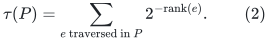
For undirected edges the orientation does not change this
positive tie cost. Order walks lexicographically by
<!-- math-display: 9fa622f21b793d28a6bd33d8
(\ell(P),\tau(P)).
 \tag{3}
-->
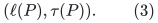
The first component has absolute priority. This does not alter
the ordinary shortest-distance value.

Equation (2) defines an additive cost on ALL walks, with
multiplicity. Its numerical value need not be represented.
The algorithm below only stores signatures of simple paths.

## 2. Existence, uniqueness, and consistency

Every edge has strictly positive cost in the lexicographic order:
its true length is nonnegative and its tie contribution is positive.
Consequently deleting a closed nonempty subwalk strictly decreases
(3), even when that subwalk has true length zero. Every optimal
walk is therefore a vertex-simple path.

A simple path uses any genuine ranked edge at most once. Its tie
signature is a zero-one vector. For two different such signatures,
let <code class="math">r</code> be their first differing rank. The contribution <code class="math">2^{-r}</code>
strictly exceeds the sum of every later available contribution:
<!-- math-display: 71d58803bf5a23db075b526a
\sum_{j=r+1}^{m}2^{-j}<2^{-r}.
 \tag{4}
-->
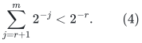
Thus the first differing bit determines the exact comparison;
zero is smaller than one. Distinct finite zero-one signatures
never have equal tie cost.

For fixed ordered endpoints, the edge-ID set of a vertex-simple
path determines that path. In a directed graph its selected arcs
form a directed chain. In an undirected graph its selected edges
form an undirected chain, whose orientation is determined by the
ordered endpoints. Hence every reachable ordered pair has a
UNIQUE minimum under (3).

This uniqueness is globally subpath-consistent. If a subpath of
the selected <code class="math">s</code>-to-<code class="math">t</code> path could be replaced by a cheaper
path between its endpoints, additive costs would give a cheaper
<code class="math">s</code>-to-<code class="math">t</code> walk. Removing any resulting cycles could only
decrease its cost further, a contradiction. Therefore the selected
subpath is the path selected when its own endpoints are used as
source and target.

For an undirected graph, using one rank in BOTH orientations also
gives reversal consistency:
<!-- math-display: 67c9ba8d32c8ca5ee3697966
P(v,u)=P(u,v)^{\rm rev}.
 \tag{5}
-->
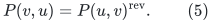
If separate directed arc ranks are assigned to the two orientations
instead, directed subpath consistency remains true but (5) need
not hold. That alternate convention must not be used when a
distance-oracle interface needs undirected reversal consistency.

## 3. The exact canonical signature data structure

Let
<!-- math-display: cc2b154291c2d83bb244a77b
H=\lceil\log_2\max\{1,m\}\rceil,\qquad
                              T=2^H.
-->
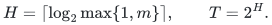
Use a complete conceptual binary segment tree on positions
<code class="math">1,\ldots,T</code>. Positions above <code class="math">m</code> always remain zero.
No full tree or length-<code class="math">T</code> bit array is allocated.

There are two canonical leaf records, for bits zero and one.
A node of height <code class="math">h&gt;0</code>, with child identifiers <code class="math">L,R</code>, is
interned by the exact key
<!-- math-display: 3f6a7854ccf1c33314fc0d05
(h,L,R).
 \tag{6}
-->
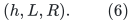
Store keys in an ordinary deterministic balanced search tree.
A successful lookup returns the already existing canonical node;
otherwise allocate one fresh node ID and store its two child
pointers. This is exact structural interning, sometimes called
hash-consing, but it uses no hash value, random seed, or collision
assumption.

The all-zero node of height <code class="math">h</code> is obtained recursively from
two references to the all-zero node of height <code class="math">h-1</code>.
Only one such node per height is necessary. Initialization uses
<code class="math">O(\log(m+2))</code> nodes and dictionary operations.

By induction on height, two stored nodes of the same height have
the same identifier if and only if they encode the same bit
vector. Node IDs are collision-free names, not probabilistic
fingerprints. Node records are immutable.

### Appending a new ranked edge

Given a path root and an edge rank not yet present, follow the
root-to-leaf search for that rank, replace its zero leaf by the
one leaf, and intern the rebuilt ancestors. This changes at
most <code class="math">H+1</code> nodes. The old root remains a valid persistent
version.

There are <code class="math">O(\log(m+2))</code> canonical-node updates, each implemented
by a balanced-map operation. With <code class="math">K_{\rm nodes}</code> currently
stored nodes, the word-operation cost is
<code class="math">O(\log(m+2)\log(K_{\rm nodes}+2))</code>.

### Comparing two signatures

If their root IDs are equal, the signatures are equal.
Otherwise compare their left-child IDs. Descend left if they
differ, and right if they agree. Repeat until the first differing
leaf is reached. Equation (4) then determines the exact order.
This takes <code class="math">O(\log(m+2))</code> node reads and ID comparisons.

The tree is balanced by its fixed conceptual shape. No
probabilistic balancing or data-dependent rotation of this
signature tree is used; only the interning dictionary needs an
ordinary deterministic balanced-map implementation.

## 4. Dijkstra only requests simple signatures

Run Dijkstra with the pair (3) as its key. A finite tentative
label stores:

* its exact integer true-distance numerator;
* its canonical tie-signature root;
* its predecessor vertex and genuine edge ID.

Unreachable labels are separate infinity records. The source
starts at the zero numerator and the all-zero signature.

When a vertex <code class="math">u</code> is settled, scan its outgoing arcs. Relax
<code class="math">u\to v</code> only if <code class="math">v</code> is still unsettled. All vertices on
the settled predecessor path to <code class="math">u</code> are already settled:
each predecessor was settled before its label was installed,
and every edge is strictly positive in the pair order.
Consequently <code class="math">v</code> is NOT on that predecessor path.

The candidate path obtained by appending <code class="math">u\to v</code> is therefore
vertex-simple. In particular, the appended genuine edge ID
has not already appeared in the path. Its signature update
really is a zero-to-one change, rather than a multiset update
with a binary carry. A self-loop has a settled head and is
skipped. The two traversal orientations of one undirected
edge cause no problem for the same reason.

This proves inductively that every stored finite label and every
candidate that is compared has a zero-one signature. Rejected
candidates may leave interned nodes behind; there are still only
linearly many candidate attempts.

The usual Dijkstra proof applies to the lexicographically ordered
additive costs, since every edge cost is nonnegative in that order.
Skipping relaxations into settled vertices is therefore correct.
Zero true-length edges are harmless: their positive tie weights
ensure strict increase in the complete key along each predecessor
edge.

The final predecessor paths are precisely the unique paths of
Section 2. Different sources can use separate canonicalization
dictionaries; the semantic global rank order, not pointer equality
between different dictionaries, supplies their consistency.

## 5. Space, arithmetic, and per-source time

Each directed arc is scanned at most once from a settled tail.
For an undirected edge there are at most two orientation scans.
Thus there are <code class="math">O(m)</code> candidate attempts. Each creates at most
<code class="math">O(\log(m+2))</code> canonical nodes, giving
<!-- math-display: bd7b097ecc17656d48e8135d
K_{\rm nodes}=O(m\log(m+2)+1)
 \tag{7}
-->
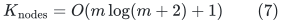
per source, including discarded tentative labels. Canonical node
IDs consequently use <code class="math">O(\log(m+2))</code> bits. There is no hidden
<code class="math">m</code>-bit integer arithmetic.

After compacting the nonisolated part, at most <code class="math">2m</code> vertices
are incident to edges; an isolated source is handled directly.
A simple path has <code class="math">O(m)</code> edges, so its true-distance numerator
uses
<!-- math-display: fd16167daadd565de3b2db3e
O(b+\log(m+2))
 \tag{8}
-->
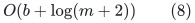
bits. An ordinary binary heap makes
<code class="math">O((m+n_{\rm active})\log(n_{\rm active}+2))</code> key comparisons.
A key comparison uses a comparison of (8)-bit integers, followed
when needed by the <code class="math">O(\log(m+2))</code> signature comparison.
Interning costs <code class="math">O(m\log^2(m+2))</code> balanced-map word operations.
Integer addition and every map/key operation have their ordinary
charged finite-bit costs.

Thus on the compact graph the total work is
<!-- math-display: 9a9e2f395d12823d4e9ffdcc
O\bigl((m+1)\mathrm{poly}
                                  (b+\log(m+2))\bigr)
 \tag{9}
-->
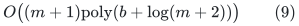
bit operations, with a fixed polynomial. Supplied isolated
vertices require <code class="math">O(n)</code> additional output/bookkeeping records.
If full uncompressed input identifiers are charged bit by bit,
their actual identifier length must also be included; one safe
full statement is
<!-- math-display: d50dd70b48d3c680cd6bc68a
O\bigl((n+m+1)\mathrm{poly}
                              (b+\log(n+m+2))\bigr).
 \tag{10}
-->
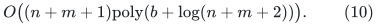
In a word-RAM representation with passive original IDs, one
linear cleanup handles those labels and (9) is the substantive
per-source bound. The compact numerical applications already
supply the required identifier bound.

If several sources share one interning table, its node-ID bit
length depends on the TOTAL number of nodes built for those
sources. Alternatively each source uses its own table and has
the bound (7). Cross-source pointer sharing is not needed for
global consistency.

### 5.1 Truncated-search implementation used by local balls

The same algorithm can stop after a prescribed number of settled
vertices or at a prescribed true-distance radius. Suppose it scans
A actual outgoing arc records and reaches V_A vertex records before
stopping. Its candidate-node count is O((A+1) log(m+2)), and its
work is

<!-- math-display: 11a7fd54705f662e46f344f2
(A+V_A+1)\mathrm{poly}(b+\log(m+2)),
-->
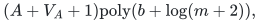

using the already assigned global ranks. Store tentative labels and
visited flags in sparse dictionaries of reached IDs; do not clear an
n-entry array or rebuild the rank map for every local search. Only
O(log(m+2)) all-zero signature nodes are initialized per run. Every
settled path still has its globally defined unique meaning. This
justifies the use in bounded-ball constructions when their own
analysis bounds A and V_A; it does not supply that exploration bound.

## 6. Stability under deletions

Fix the genuine native IDs, their rank order, and all surviving
true lengths. Let <code class="math">P</code> be the selected path in a graph <code class="math">G</code>.
If a subgraph <code class="math">G'</code> deletes no vertex or edge of <code class="math">P</code>, then
<code class="math">P</code> remains available with the same cost. Every competing
path of <code class="math">G'</code> was already a path of <code class="math">G</code>. By uniqueness in
<code class="math">G</code>, none can tie or beat <code class="math">P</code>, so <code class="math">P</code> remains selected
in <code class="math">G'</code>.

The same reasoning permits increases of lengths only on edges
outside <code class="math">P</code>. It does not cover inserting new competitors,
decreasing their lengths, changing ranks, or retiring an edge
lifetime used by <code class="math">P</code>. Preserving only an eventual physical
image is insufficient: distinct native aliases and replacement
lifetimes are distinct ranked objects.

For a deletion sequence the original rank universe may be kept;
its logarithm is charged to that fixed lifetime universe.
No new rank array is cleared or reallocated after each deletion.
The statement concerns the identity of the mathematically selected
path, not the cost of dynamically maintaining all affected paths.

## 7. Scope for shortest-path and routing constructions

This lemma supplies globally additive deterministic ties,
unique shortest paths, subpath consistency, undirected reversal
consistency under the proper rank convention, and selected-path
persistence under avoiding deletions.

It does NOT support arbitrary signature addition by bitset union.
If two stored paths share an edge, their concatenation has a
multiplicity in (2), and its perturbation may have carries.
The zero-one data structure is justified only because the
Dijkstra candidates in Section 4 are simple. A different
algorithm comparing arbitrary concatenated walks needs a
separate representation and arithmetic proof.

Likewise, this lemma alone does not repair a cone-cluster
geometry argument, produce a dynamic shortest-path oracle,
or compute all-pairs distances in the per-source time (9).
Running it from many sources pays for every such run. It is
a precision and deterministic tie-selection component that
may be inserted into an otherwise justified AN/KMPG local
shortest-path construction.
