# Deterministic token routing by edge thresholds and expander pruning

**Mathematical construction, 24 October 2026.** This note turns the
deterministic decremental expander-path primitive reconstructed in
[separated-static-sparsifier-parameters.md](separated-static-sparsifier-parameters.md)
into an explicit simultaneous token router. It uses that primitive's
path length and expander-pruning bounds. It does not use the CHS
distributed hierarchy, a distributed-round-to-work simulation, or a
random routing procedure.

The primary dependencies are Chuzhoy--Saranurak,
[arXiv:2009.08479v1](https://arxiv.org/pdf/2009.08479), Theorem 3.7
and Section 3.2, together with the finite-word, small-instance, and
loopless-multigraph adapters proved in the linked note. The construction
below is separate from those source algorithms.

## 1. Input and the precise decremental interface

Let <code class="math">H=(V,E)</code> be a fixed loopless multigraph with <code class="math">m\geq1</code>
edges and no isolated vertices. Parallel edges retain distinct IDs.
Assume <code class="math">H</code> has conductance at least <code class="math">\phi</code>, where
<code class="math">0&lt;\phi\leq1</code>. Every degree and volume in this note is measured
in this ORIGINAL fixed graph:

<!-- math-display: 6b0a9a29fdba8ef08f495d7c
d(v)=\deg_H(v),\qquad
 \mathrm{vol}(P)=\sum_{v\in P}d(v).
 \tag{1}
-->
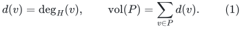

There are <code class="math">M</code> explicitly listed ordered token pairs. At most
<code class="math">D d(v)</code> tokens start at <code class="math">v</code>, and at most <code class="math">D d(v)</code>
tokens end at <code class="math">v</code>, for a known <code class="math">D\geq1</code>. The two bounds are
separate, so the number of token endpoints in a set <code class="math">P</code> is at
most <code class="math">2D\mathrm{vol}(P)</code>. Multiplicities and opposite
orientations are allowed. A pair with identical endpoints is returned
immediately with its empty path; this cannot increase any load.

We use a deterministic decremental oracle with the following interface.
For a fresh copy of <code class="math">H</code>, it starts with a pruned set <code class="math">P=\varnothing</code>,
accepts explicit edge deletions, and only enlarges <code class="math">P</code>. For an
absolute constant <code class="math">c_0</code>, after <code class="math">t</code> explicit deletions, within
its permitted deletion budget,

<!-- math-display: 8477b575126170d9dc03493c
\mathrm{vol}(P)\leq c_0t/\phi.
 \tag{2}
-->
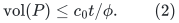

For any two vertices outside <code class="math">P</code>, it returns an explicit path
in the surviving graph, of at most <code class="math">\Lambda</code> edges. We erase any
repeated vertices before using a returned walk as a path. The interface
remains valid with larger <code class="math">\Lambda</code>. Initialization and all allowed
updates in one oracle generation cost <code class="math">mF\mathrm{poly}(U)</code>;
explicit path output costs <code class="math">\Lambda\mathrm{poly}(U)</code> per
query. This is the interface supplied by the linked reconstruction;
in particular <code class="math">F</code> is construction work, not a path-length bound.

Here <code class="math">U</code> bounds record sizes and logarithms of the explicit input
and parameter ranges. If no such master parameter is fixed, all
<code class="math">\mathrm{poly}(U)</code> factors below may instead include the
relevant input-word bit costs and <code class="math">\log(M+m+2)</code>.

### 1.1 Extending the interface through deletion-quota exhaustion

Suppose the permitted number of explicit deletions is
<code class="math">\lfloor\phi m/c_q\rfloor</code>, for an absolute constant <code class="math">c_q</code>.
If the next threshold-deletion request exceeds this quota, count that
request as the next explicit deletion and declare **all** vertices
pruned. Do not send the excessive request to the source oracle and do
not query that oracle again. If <code class="math">t</code> includes this first excessive
request, then <code class="math">t&gt;\phi m/c_q</code>, and therefore

<!-- math-display: 255244afcdee3f8065a03eca
\mathrm{vol}(V)=2m<2c_qt/\phi.
 \tag{3}
-->
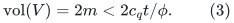

Thus, with <code class="math">c=\max\{c_0,2c_q\}</code>, the augmented interface always
satisfies

<!-- math-display: 42de6746a3b945a467b7e877
\mathrm{vol}(P)\leq ct/\phi.
 \tag{4}
-->
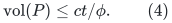

This convention covers quotas below one: the first actual request pays
for declaring the whole host pruned. The internal edges removed because
an endpoint is pruned are not additional explicit deletions in <code class="math">t</code>.
They are already covered by the original-volume guarantee (4).

## 2. The routing algorithm

Fix an integer threshold

<!-- math-display: 75980296a1a5db38057e2476
\tau\geq\max\{2,\lceil8cD\Lambda/\phi\rceil\}.
 \tag{5}
-->
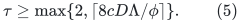

Maintain a global integer load <code class="math">\ell_e</code>, initially zero, for every
original edge ID <code class="math">e</code>. The load counts previously returned paths,
including paths whose edges an earlier oracle generation subsequently
deleted. Such paths remain valid paths in the ORIGINAL static host.

In round <code class="math">j=1,2,\ldots</code>:

1. Initialize a fresh decremental oracle on the full original graph
   <code class="math">H</code>, with <code class="math">P=\varnothing</code>. Retain all global loads.
2. Scan the still-unassigned token pairs in a fixed order. If either
   endpoint is already pruned, leave the token for the next round.
   Otherwise query a path between the endpoints, save its explicit
   original-edge-ID list as that token's final route, and increment
   <code class="math">\ell_e</code> by one on each edge of that simple path.
3. For every edge whose load has now reached <code class="math">j\tau</code>, request its
   deletion if it is still present in the current oracle. A previous
   request in this same transaction may already have removed it through
   pruning; skip such an absent edge instead of issuing an illegal
   duplicate deletion. Apply the live-edge requests and all resulting pruning before
   issuing another query. If the deletion quota is exceeded, use
   Section 1.1 and stop querying in this round. All remaining unassigned
   tokens then have pruned endpoints.
4. Discard this oracle generation, and start the next round only if
   tokens remain.

All changes caused by a path are a single no-query transaction. Its
saved route is valid in the static host even if one of those changes
immediately prunes its endpoints. If several edges reach the threshold
on the last route, it is enough to count the requests actually examined
up to the first excessive request; no later request is needed to
justify (3). All edge loads nevertheless include the whole saved path.

No source operation is reversed. Fresh rounds are separate oracle
generations. Global load counters and already returned paths belong to
the router, not to a decremental oracle generation.

## 3. Progress and congestion

Immediately before round <code class="math">j</code>, every edge satisfies

<!-- math-display: 18faa02a4fb0d1848a6dfa67
\ell_e\leq(j-1)\tau.
 \tag{6}
-->
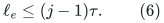

This is true initially. Within the round, an edge is deleted as soon as
its load reaches <code class="math">j\tau</code>, so no later path in that round can use
it. A simple queried path increases its load by at most one. Thus the
load never exceeds <code class="math">j\tau</code>, including when a whole-host abort
ends the round, and (6) follows inductively.

Let <code class="math">B_j</code> be the number of tokens routed in this round, and let
<code class="math">t_j</code> be the number of examined threshold-deletion requests,
counting only still-live edges and including the first excessive request
if any. A newly thresholded edge skipped because pruning already removed
it is unavailable for every later query in this round, so it cannot
violate (6). Every counted edge required
at least <code class="math">\tau</code> NEW path traversals during this round, by (6).
Every newly assigned path uses at most <code class="math">\Lambda</code> edges. Hence

<!-- math-display: 0dd5e62c53f975552d6ffcd4
t_j\tau\leq\Lambda B_j.
 \tag{7}
-->
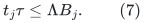

The weaker <code class="math">t_j\tau/2\leq\Lambda B_j</code> would suffice if an
implementation uses harmless integer-threshold slack. We retain (7)
for the literal algorithm above.

At the end of the scan, every remaining token has an endpoint in the
final pruned set <code class="math">P_j</code>. Indeed, a scanned token with two surviving
endpoints was routed, and pruning is monotone during a round. Let
<code class="math">R_j</code> be the number of remaining tokens. The original endpoint-load
bound applies to this subset of the original demand list, so (4), (5),
and (7) give

<!-- math-display: 9da113589bd061b52cd72eee
\begin{aligned}
 R_j
 &\leq2D\mathrm{vol}(P_j)
 \leq 2Dc\,t_j/\phi\\
 &\leq \frac{2Dc\Lambda}{\phi\tau}B_j
 \leq B_j/4.
 \end{aligned}
 \tag{8}
-->
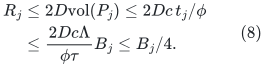

In particular <code class="math">R_j\leq B_j/2</code>, even under the weaker version of
(7). If <code class="math">N_j</code> tokens enter a round, <code class="math">N_j=B_j+R_j</code> and thus
<code class="math">R_j\leq N_j/3</code> with this conservative constant. A nonempty
round must route at least one token: otherwise it makes no explicit
deletion, prunes nothing, and could not leave a token unassigned.

There are therefore <code class="math">O(\log(M+2))</code> rounds, and all tokens are
routed. Every output route has at most <code class="math">\Lambda</code> edges, while
(6) bounds the final edge congestion by

<!-- math-display: 3d52dcd0487729af0729fe02
\boxed{
  O\!\left(\frac{D\Lambda}{\phi}\log(M+2)\right).
 }
 \tag{9}
-->
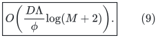

The ceil in (5) adds only a constant factor because
<code class="math">D\geq1</code>, <code class="math">\Lambda\geq1</code>, and <code class="math">\phi\leq1</code>.
Both orientations of a physical undirected edge contribute to the
same load. Distinct parallel edges have distinct loads.

## 4. Work, explicit outputs, and finite numbers

The still-unassigned lists shrink geometrically. Scanning them costs
<code class="math">O(M)</code> total. Exactly one successful path is saved per nontrivial
token, so path extraction, loop erasure if needed, and edge-load
increments cost

<!-- math-display: 25c2e2171cd7905c843fb7fc
O(M\Lambda)\mathrm{poly}(U).
-->
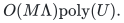

An edge reaches the current threshold at most once in a round. The
source's update work, including its own pruning metadata, fits its
generation bound. Initialization and updates across all generations
cost

<!-- math-display: 49258423ca635fcd75eec097
O(mF\log(M+2))\mathrm{poly}(U).
-->
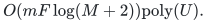

Resetting the oracle and initializing its original edge IDs is charged
to this actual <code class="math">m</code>-sized setup. No array is padded to a larger
master universe. The router's edge-load array is initialized only once.
Tracking whether an endpoint is pruned takes the oracle's explicit
membership query or a Boolean mark updated through its pruning log.
The total original-volume log in a generation is at most <code class="math">2m</code>.

Consequently the total work is

<!-- math-display: 6b5a650ef6d9f9b10e961771
\boxed{
  O\bigl(mF\log(M+2)+M\Lambda\bigr)
       \mathrm{poly}(U).
 }
 \tag{10}
-->
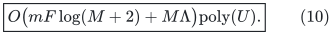

There is ONE aggregate demand list and one oracle generation per round.
In particular, initialization is **not multiplied by <code class="math">D</code>**. The
algorithm does not require coloring the token demands into <code class="math">D</code>
matchings. The only dependence on <code class="math">D</code> outside the unavoidable
explicit token count is in the congestion threshold and its word size.

All thresholds can be conservatively rounded upward from the supplied
rational or dyadic parameters. Loads and token counters use
<code class="math">O(\log(M+\tau+2))</code> bits. The number of rounds is discovered
by the remaining-list test; no real logarithm or noncomputable cutoff
is used. If desired, an explicit geometric bound on the number of
rounds is a checked guard.

## 5. The parameterized router obtained from the reconstructed oracle

Let <code class="math">h=\lceil\log_2(U+2)\rceil</code>, let <code class="math">q\geq2</code>,
<code class="math">r\geq1</code>, and assume <code class="math">q,r\leq U</code> and <code class="math">qrh\leq U</code>.
The reconstructed oracle supplies, on the expander pieces used by the
static sparsifier,

<!-- math-display: 5f8da00c2b11aa0587762e12
\phi^{-1}=\exp O(rh),\qquad
 \Lambda=\exp O(qrh),\qquad
 F=\exp O(U/q+U/r+r^2h+qrh).
 \tag{11}
-->
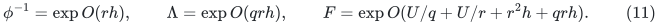

The graph and its entire token list must be explicit and have at most
<code class="math">2^{O(U)}</code> records. The same actual-size clipping and small-graph
base cases as in the oracle note apply. Enlarging a fixed constant in
the output factor gives

<!-- math-display: 6fdcab36f0828b98338e9d73
\Gamma=\exp O(qrh)
 \tag{12}
-->
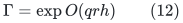

such that the token paths have length at most <code class="math">\Gamma</code>, edge
congestion at most <code class="math">D\Gamma</code>, and total work

<!-- math-display: 2d7771f1ba14837fd720e451
\bigl(mF+M\Gamma\bigr)\mathrm{poly}(U).
 \tag{13}
-->
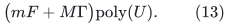

The factor <code class="math">\log(M+2)</code> is absorbed by the displayed polynomial
and <code class="math">\Gamma</code>. The construction-work factor <code class="math">F</code> does not
enter (12), nor the degree-proportional congestion factor <code class="math">D\Gamma</code>.

For the weighted-witness application, the resulting token paths are
fed to
[deterministic-weighted-path-selection.md](deterministic-weighted-path-selection.md).
That separate lemma first simplifies each individual ambient input
image and then selects one candidate per witness edge. It is the
selection lemma, not the threshold router alone, that removes the
ambient input-path-length factor from composed congestion. Physical
ambient list expansion still costs its actual output size.

## 6. Scope

The theorem applies to arbitrary explicit token pairs in the fixed
expander host under the stated degree-proportional endpoint bound. It
does not assume demands form a matching, a permutation, or a simple
graph. It provides routes in the original host, so the temporary
deletions made by different generations have no effect on the final
validity of any output route.

This is an auxiliary routing theorem. A general-graph matching time
bound additionally requires the separately proved static ambient
sparsifier, touched-set maintenance, recursive raw-cycle backend, and
matching-driver interfaces. No new matching exponent follows merely
from (9).
