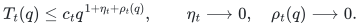
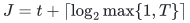
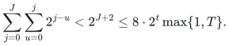
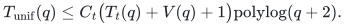
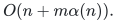
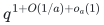
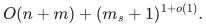

# Uniform deterministic optimization from independently checked branches

## 1. Uniformization theorem

Fix an explicit input representation of size <code class="math">q\ge2</code> and a deterministic physical computation model. Assume the following interfaces.

1. A deterministic verifier accepts exactly the valid optimum outputs and runs in <code class="math">V(q)=q^{1+o(1)}</code> time.
2. A single finite program accepts an integer branch index <code class="math">t\ge1</code>. For every sufficiently large fixed <code class="math">t</code>, it proposes an optimum on every sufficiently large input, uniformly over inputs of that size, in
   <!-- math-display: f308509c0c060a9695aecc9c
   T_t(q)\le c_t q^{1+\eta_t+\rho_t(q)},
      \qquad \eta_t\longrightarrow0,\quad \rho_t(q)\longrightarrow0.
   -->
   
   Here <code class="math">c_t</code> and the convergence rate may depend on the fixed branch. All arithmetic, allocation, and output work is included.
3. A deterministic exact fallback has a fixed polynomial time bound in the same model.

Branches need not be sound on exceptional sizes. They may suspend, reject an internal precondition, or propose an incorrect answer; they cannot bypass the independent verifier. The eventual-performance assumption in item 2 is a hypothesis, not a consequence of output verification.

**Theorem 1.** Under these interfaces, one deterministic finite program always returns an optimum and has worst-case running time <code class="math">q^{1+o(1)}</code>. It requires no computable table of the exceptional thresholds or the constants <code class="math">c_t</code>.

**Proof.** Give each branch private mutable state and shared read-only input. A proposed output is copied or frozen before its verifier runs. Charge verification to that branch. Retire a branch after a rejected proposal or an explicit suspension. Branch zero runs the exact fallback and its verifier.

In round <code class="math">j=0,1,\ldots</code>, give each unfinished branch <code class="math">0\le t\le j</code> at most <code class="math">2^{j-t}</code> elementary steps. Stop at the first accepted output. For a fixed branch needing <code class="math">T</code> steps, including verification, round
<!-- math-display: c68ccc7b452829b0d45413ac
J=t+\lceil\log_2\max\{1,T\}\rceil
-->

alone provides enough service unless an earlier accepted branch has already terminated the algorithm. The total allowances through that round satisfy
<!-- math-display: 708cea70a3a1a898fdd39e5c
\sum_{j=0}^{J}\sum_{u=0}^{j}2^{j-u}
<2^{J+2}
\le 8\cdot2^t\max\{1,T\}.
-->

Loop and coroutine bookkeeping introduce at most polynomial logarithmic overhead. In particular, for every fixed successful branch,
<!-- math-display: 012a8812fbfebd337f3e09bf
T_{\mathrm{unif}}(q)
\le C_t\bigl(T_t(q)+V(q)+1\bigr)\mathrm{polylog}(q+2).
-->

Every accepted output is optimum. The fallback receives enough service to terminate on every input, so the program always terminates.

Fix <code class="math">\epsilon&gt;0</code> in the analysis. Choose a sufficiently large fixed <code class="math">t</code> with <code class="math">\eta_t&lt;\epsilon/3</code>. For all sufficiently large <code class="math">q</code>, the term <code class="math">\rho_t(q)</code>, fixed constants, verifier cost, and simulation logarithms fit the remaining exponent slack. Thus the same program satisfies <code class="math">T_{\mathrm{unif}}(q)\le q^{1+\epsilon}</code> for all sufficiently large inputs. Since this holds for every <code class="math">\epsilon&gt;0</code>, its worst-case time is <code class="math">q^{1+o(1)}</code>. The program never needs to determine which fixed branch proves a given exponent. ∎

One may define a nonincreasing exponent envelope by taking the supremum of the excess logarithmic worst-case exponent over all input sizes at least <code class="math">q</code>. The polynomial fallback bounds that supremum, and the last paragraph makes it tend to zero. This gives no explicit practical convergence rate.

## 2. Charged implementation and one physical word constant

An elementary allotted step is a bounded physical instruction. A graph subroutine, large integer operation, memory reservation, or complete verifier call is not one atomic step.

Represent each branch by an instruction pointer and private state. Long integers are digit arrays; sparse logical address spaces are dictionaries of touched cells. Allocation and initialization write actual words one at a time. Every primitive loop is interruptible, including construction of a large parameter-dependent object.

If the fallback uses at most <code class="math">q^C</code> steps for a fixed <code class="math">C</code>, it completes within <code class="math">O(\log q)</code> rounds. The total service, control work, and actual allocations before that completion are polynomial in <code class="math">q</code>, independently of the other branches' indices. Therefore one fixed physical word-size constant suffices for actual addresses and counters. Larger logical values remain multiword objects. This argument does not assume that an arbitrarily large logical parameter fits in one word.

The fixed-branch hypothesis must already charge its own arithmetic. A conventional dictionary or persistent-memory simulation may add polynomial logarithmic factors; it cannot hide a parameter-dependent exponential operation as one step.

## 3. Maximum-matching verifier

For an undirected graph and a proposed matching <code class="math">M</code>, first validate the edge identifiers and endpoint disjointness. Then run one deterministic augmenting-path search from <code class="math">M</code>. By Berge's criterion, accept exactly when no augmenting path exists.

The [classical verifier manuscript](classical-matching-optimality-verifier.md) specifies the interface and initialization from an arbitrary supplied matching. Its primary inputs are Gabow, [The Weighted Matching Approach to Maximum Cardinality Matching](https://arxiv.org/abs/1703.03998v1), Sections 3 and 5, and Mehlhorn–Nobahari, [Gabow's Maximum Cardinality Matching Algorithm, Revisited](https://arxiv.org/pdf/2603.22909v2), Part I. The conservative bound is
<!-- math-display: 660a63e7f4d681eb6ebb51e0
O(n+m\alpha(n)).
-->

This is one search relative to the proposed matching, not a complete solve from the empty matching.

The search is independent of the candidate's ledger, numerical certificates, and internal LOW decisions. Invalid data or a failed arithmetic precondition retires the candidate. The verifier itself remains an ordinary charged branch computation.

## 4. Fixed-parameter matching specialization

Suppose one finite implementation accepts <code class="math">a=a_0+t</code> and, for every sufficiently large fixed <code class="math">a</code>, eventually returns an exact maximum matching in
<!-- math-display: c4a0839e812ba3314484d9e8
q^{1+O(1/a)+o_a(1)}
-->

time, with an absolute coefficient in <code class="math">O(1/a)</code>. Its numerical parameters must be computed by finite arithmetic from <code class="math">a</code> and the input size. Neither a branch-dependent asymptotic constant nor an unknown exceptional-size cutoff is executable advice.

Theorem 1 then gives one deterministic <code class="math">q^{1+o(1)}</code> matching algorithm. For the carrier construction, the required fast-branch statement includes the complete raw-cycle realization, persistent ledger operations, exact projection, and phase accounting. The [current matching proof](../../problems/general-matching/proof.md), particularly its explicit cycle-search implementation requirements, records that dependency. This uniformization theorem does not discharge it.

A flaw in every fast branch would leave the fallback's exactness and polynomial termination intact, but would invalidate the improved running-time conclusion.

## 5. Shared input cleanup and exact kernels

Read the original graph once. In the stated word-RAM representation, dense endpoint counting/radix sorting removes loops, coalesces parallel edges while retaining an original witness identifier, and discards isolated vertices in <code class="math">O(n+m)</code> time.

If <code class="math">m_s</code> distinct nonloop edges remain, the nonempty compact graph has at most <code class="math">2m_s</code> vertices and size <code class="math">q=\Theta(m_s)</code>. Run every branch and verifier on this shared compact graph. Translate only the accepted matching back to original identifiers. The resulting conditional bound is
<!-- math-display: f7c462471a0933fa4fd53f08
O(n+m)+(m_s+1)^{1+o(1)}.
-->

The empty graph is settled during cleanup.

An exact witness-preserving kernel can likewise be computed once before the portfolio. Verification takes place on that trusted kernel, and its exact decoder lifts the accepted optimum. The kernel's own preprocessing is charged separately; uniformization does not improve it for free.
