# Deterministic selection of one weighted path from each token family

**Auxiliary mathematical construction, 24 October 2026.** This note
gives a sparse conditional-expectation algorithm. Its input is an
EXPLICIT family of candidate paths; it does not construct those
paths. In particular, it does not assert that a distributed routing
algorithm has an efficient sequential implementation.

The result explains how an appropriate token-routing primitive could
remove the input-path-length factor from an ambient-congestion
sparsification bound. The currently established 6/7 research
construction is unchanged.

## 1. Discrete selection problem

There is a finite set of resources <code class="math">X</code> and a collection of groups
<code class="math">\mathcal G</code>. Group <code class="math">g</code> has exactly <code class="math">Q_g\geq1</code> options.
Option <code class="math">j\in[Q_g]</code> specifies nonnegative integer multiplicities
<code class="math">a_{g,j,x}</code> on resources <code class="math">x</code>. Multiplicities may be supplied as
repeated entries and aggregated deterministically by sorting.

Let <code class="math">S</code> be the explicit input-list size, including group and option
headers and every resource occurrence. Thus the number of groups,
options, nonzero group-resource pairs, and used resources are all at
most <code class="math">S</code>. Define
<!-- math-display: 53cb6eb5f0f81a15f62cb39e
\mu_x=\sum_{g}\sum_{j=1}^{Q_g} a_{g,j,x},\qquad
 B=\max_{g,j,x}Q_ga_{g,j,x}.
 \tag{1}
-->
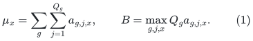
If all multiplicities are zero, choose any option in each group.
Otherwise <code class="math">B\geq1</code>, and the algorithm below chooses one <code class="math">j(g)</code>
per group so that
<!-- math-display: 205df6c508e32962914d14aa
\boxed{
 \sum_g Q_g a_{g,j(g),x}
 \leq 2\mu_x+B\log(8|X|+8)
 \quad\hbox{for every used resource }x.
 }
 \tag{2}
-->
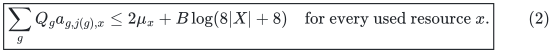
A harmless increase of the numerical constant accommodates the
finite-precision implementation described below. In particular,
one may use the convenient bound
<code class="math">4\mu_x+4B\log(2&#124;X&#124;+2)</code>.

The total number of scalar operations is
<code class="math">S\mathrm{polylog}(S+2)</code>. Resource-ID comparisons additionally
use the given ID word size. All mantissas and binary exponents have
<code class="math">O(\log(S+2))</code> bits; there is no least-common-denominator computation.

If the application assigns a real or rational weight
<code class="math">0&lt;w_g\leq Q_g</code> to group <code class="math">g</code>, the same selected options satisfy
(2) with <code class="math">Q_g</code> in the load replaced by <code class="math">w_g</code>.

## 2. Exponential potential

Independently choose a uniformly random option in each unprocessed
group only for the analysis. For a group and resource define
<!-- math-display: 29e10ba3b017f1090e1f86e6
E_{g,x}
   =\frac1{Q_g}\sum_{j=1}^{Q_g}
       \exp(Q_ga_{g,j,x}/B).
 \tag{3}
-->
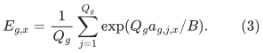
Every exponent in (3) is between zero and one. Since
<code class="math">e^u\leq1+(e-1)u</code> for <code class="math">0\leq u\leq1</code>,
<!-- math-display: 6ef1302ae145eee54e33d6bf
E_{g,x}\leq
 1+\frac{e-1}{B}\sum_j a_{g,j,x}.
 \tag{4}
-->
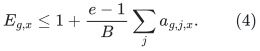

For current selected load <code class="math">b_x</code>, maintain the conditional potential
<!-- math-display: 4300a46e82bdfbfe58d7f0d6
W_x=\exp((b_x-2\mu_x)/B)
                 \prod_{\text{unprocessed }g} E_{g,x}.
 \tag{5}
-->
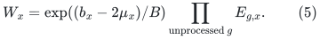
Initially (4) and <code class="math">e-1&lt;2</code> give <code class="math">W_x\leq1</code>, so
<!-- math-display: 7191e5d638e58da7f5db36f3
\sum_xW_x\leq |X|.
 \tag{6}
-->
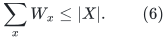
After choosing option <code class="math">j</code> of group <code class="math">g</code>, the potential changes by
<!-- math-display: 630c29d37094075b1cc69797
W'_x=W_x\exp(Q_ga_{g,j,x}/B)/E_{g,x}.
 \tag{7}
-->
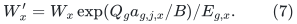
Its expectation over a uniform option is exactly <code class="math">W_x</code>.
Thus some option does not increase the total potential.

## 3. Finding that option with sparse positive sums

One must not scan every resource for every candidate option.
Let <code class="math">X_g</code> be the union of resources appearing in group <code class="math">g</code>'s
options. For fixed <code class="math">g</code>, the potential resulting from candidate
option <code class="math">j</code> is
<!-- math-display: 4328c885b4a49050b3863034
\sum_x\frac{W_x}{E_{g,x}}
 +\sum_{x:a_{g,j,x}>0}
       \frac{W_x}{E_{g,x}}
                \bigl(\exp(Q_ga_{g,j,x}/B)-1\bigr).
 \tag{8}
-->
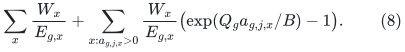
The first sum is common to all candidates. It is never necessary
to compute it. Choose a minimum candidate using only the second
sum, whose terms are nonnegative. Evaluating every candidate uses
the explicit resource occurrences of group <code class="math">g</code>, once.

After selection, update (7) only on <code class="math">X_g</code>; all other factors are
one. The factors themselves can be constructed sparsely as
<!-- math-display: 91ce4b50d53dd68f94b2e21c
E_{g,x}
  =1+\frac1{Q_g}
       \sum_{j:a_{g,j,x}>0}
          \bigl(\exp(Q_ga_{g,j,x}/B)-1\bigr).
 \tag{9}
-->
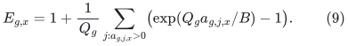
The sum of <code class="math">&#124;X_g&#124;</code> over all groups is at most <code class="math">S</code>.
Computing all factors, initializing their products in (5), evaluating
all candidates, and applying all updates therefore takes
<code class="math">S\mathrm{polylog}(S+2)</code> operations.

With exact arithmetic the total potential never increases, so the
final value <code class="math">\exp((b_x-2\mu_x)/B)\leq&#124;X&#124;</code> proves the slightly
stronger exact-arithmetic form of (2).

## 4. Finite-word implementation

The exponential expressions are not stored as exact transcendental
numbers. Use binary floating-point values with an explicitly signed
integer exponent, and a sufficiently large fixed multiple of
<code class="math">\log(S+2)</code> mantissa bits.

All quantities in (3) and (9) lie in <code class="math">[1,e]</code>. Their nonzero
increments have magnitude at least a polynomial reciprocal in <code class="math">S</code>:
<code class="math">Q_ga_{g,j,x}/B\geq1/B</code> and <code class="math">B\leq S^2</code>.
Taylor expansion on <code class="math">[0,1]</code>, followed by positive sums and ordinary
division, computes them and their positive increments to any
relative accuracy <code class="math">(S+2)^{-c}</code> in
<code class="math">\mathrm{polylog}(S+2)</code> scalar work.

For initialization, the exponent <code class="math">-2\mu_x/B</code> has absolute value at
most <code class="math">2S</code>. Compute its exponential by scaling into <code class="math">[-1,0]</code>,
using the reciprocal of a positive Taylor series there, and then
repeated squaring with enough extra guard bits. Only <code class="math">O(\log S)</code>
squarings are needed. Every exact intermediate <code class="math">W_x</code> is between
<code class="math">\exp(-O(S))</code> and <code class="math">\exp(O(S))</code>, because there are at most <code class="math">S</code>
groups and each update factor in (7) lies in <code class="math">[e^{-1},e]</code>.
Its binary exponent therefore needs only <code class="math">O(\log(S+2))</code> bits,
even when its numerical value is exponentially small.

Choose the elementary relative error below
<code class="math">(S+2)^{-c}</code> for a sufficiently large fixed <code class="math">c</code>, and round only
positive values. Products, divisions, and the positive sums in (8)
then have total relative error less than <code class="math">1/(100(S+1))</code> per
group decision, including accumulated representation error. Choosing
the minimum APPROXIMATE positive score gives a true score at most
<code class="math">1+1/(20(S+1))</code> times the true minimum.

The common term in (8) is nonnegative. Thus this approximate choice
increases the true total potential by at most the same multiplicative
factor. Across at most <code class="math">S</code> choices, the total increase is less than
two; allowing another fixed factor for initialized and final
representations gives a final potential at most <code class="math">8(&#124;X&#124;+1)</code>.
This proves (2) with the displayed slack.

No cancellation of nearly equal positive numbers is used in selecting
an option. In particular, the algorithm computes
<code class="math">\exp(u)-1</code> directly by its positive series and does not obtain it
by subtracting rounded numbers close to one. It never materializes
products of unrelated rational denominators.

## 5. Application to weighted witness paths

Let <code class="math">J</code> be an unweighted demand graph embedded into an ambient graph
<code class="math">H'</code>. First replace every <code class="math">\Pi(e)</code> by a SIMPLE ambient path with
the same endpoints, by loop erasure. This costs the already explicit
path-list work and does not increase length or congestion.
Write <code class="math">C=C(\Pi)</code> for its ambient vertex congestion.
Loop erasure compares the actual IMMEDIATE vertex lifetime IDs of
<code class="math">H'</code>. It never identifies vertices merely because they have the
same eventual physical image under a later projection. In particular,
an open path through two different aliases of one physical root
cannot be erased as a closed walk. A zero physical image does not
make an edge or path a true null object in the immediate graph.
The normalized route table is part of the output type; the
congestion conclusion below applies to that table.

Let <code class="math">W</code> be a sparse weighted witness on <code class="math">V(J)</code>, with positive
edge weights <code class="math">w_g</code>. For each witness edge <code class="math">g</code>, suppose a separate
procedure supplies <code class="math">Q_g=\lceil w_g\rceil</code> unit-token paths in <code class="math">J</code>.
Suppose each token path is simple and has at most <code class="math">D_{\rm route}</code>
edges, and the entire unit-token family uses each edge of <code class="math">J</code> at
most <code class="math">T_{\rm route}</code> times.

For each token path, take its composed ambient vertex-occurrence
list through <code class="math">\Pi</code>. These lists define the options in Section 1.
They may be walks; multiplicities are retained. Because each
individual <code class="math">\Pi(e)</code> is simple,
<!-- math-display: 4fdc4f02af2f79c691b18770
a_{g,j,x}\leq 2(D_{\rm route}+1)
 \tag{10}
-->
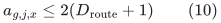
under a convention that safely counts shared endpoints twice.
Furthermore,
<!-- math-display: 194256bd8b229d6a8668e367
\mu_x\leq 2T_{\rm route}C.
 \tag{11}
-->
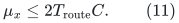
The factors of two only reconcile endpoint conventions.

Apply (2) with
<!-- math-display: c010c2509b94361018c66e44
B\leq 2(D_{\rm route}+1)
                 \max_g\lceil w_g\rceil.
 \tag{12}
-->
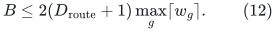
Choose one token path for each witness edge and assign that selected
path its original weight <code class="math">w_g</code>. Its composed ambient congestion is
at most
<!-- math-display: a57d798129ac1dad77c7288f
O\!\left(
  T_{\rm route}C+
  D_{\rm route}(\max_g w_g+1)\log(|V(H')|+2)
 \right).
 \tag{13}
-->
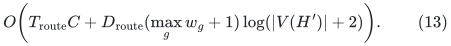
The bound has NO factor <code class="math">L(\Pi)</code>. Its work does depend on the
explicit composed path-list size, which is necessary and permitted.

In the usual degree-band witness construction,
<code class="math">w_g\leq\Delta(J)/\phi</code>. If
<code class="math">D_{\rm route},T_{\rm route},\phi^{-1}</code> are bounded by a common
factor <code class="math">\Gamma_0</code>, then (13) is
<!-- math-display: 930026507571d80ebae877a2
\Gamma_0^{O(1)}\mathrm{polylog}M
                         \bigl(C+\Delta(J)\bigr).
 \tag{14}
-->
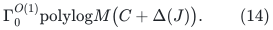
Selecting one path per witness edge preserves sparsity:
the retained subgraph of <code class="math">J</code> has at most
<code class="math">&#124;E(W)&#124;D_{\rm route}</code> edges. If a subsequent embedding from <code class="math">J</code>
to <code class="math">W</code> has weighted edge congestion at most <code class="math">\Gamma_1</code>, the
standard composition bound multiplies (14) by <code class="math">\Gamma_1</code>.

### Why simple preliminary paths are essential

Without loop erasure of the individual input images, one edge of
<code class="math">J</code> might already visit an ambient vertex <code class="math">L(\Pi)</code> times.
Then (10) would contain that factor, and the intended improvement
would disappear. This normalization is legitimate for a distance
spanner and for the touched-set construction: erasing a closed walk
from a projected edge's preliminary route leaves a path in the old
lower layers together with, at most, its own central original edge.
If erasure removes the central edge, selecting that central ID is
merely unnecessary; it is still a valid bounded-size selection.

Individual edge gradients are not asserted to be preserved by this
distance normalization. The cycle construction must keep its
explicit correction circulation <code class="math">e-\Pi(e)</code>, as in the existing
distance backend. A gradient-preserving application that lacks those
corrections cannot use this argument without a separate proof.

## 6. Elementary batching of token demands

Here is a separate useful reduction for supplying the paths.
For a routing host <code class="math">G</code>, distribute each vertex's token starts and
token destinations cyclically over its <code class="math">\deg_G(v)</code> incidence ports.
Let the maximum resulting port load be <code class="math">D</code>. Make the bipartite
multigraph whose left and right vertices are source and destination
ports and whose edges are the token IDs. Its maximum degree is
at most <code class="math">D</code>.

This graph can be split into at most
<code class="math">2^{\lceil\log_2D\rceil}\leq2D</code> matchings in
<code class="math">O(M_{\rm tok}\log(D+2))</code> work. At each step, decompose every
component into trails with odd-degree vertices as endpoints and
alternate the two colors along each trail. Closed tours have even
length because the graph is bipartite. Each color has maximum
degree at most the ceiling of half the old maximum. Recurse until
the maximum degree is one. Temporary trail-completion edges are
discarded and are not token demands.

Each resulting batch has at most one source token and one destination
token per port. Therefore a routing primitive on the host's
constant-degree expander-split graph can be used with its ordinary
one-token-per-node guarantee. Preprocess the routing host once, then
answer every batch. A token's path length is bounded by one QUERY's
dilation; it is not multiplied by the number of batches.

The total sequential work of this reduction still requires a bound
on the actual routing primitive's sequential work. A bound on
distributed rounds alone is insufficient.

## 7. Current boundary

The sparse path-selection algorithm and the elementary batching
argument above are independent of a fast expander router. They
establish what can be done with explicit candidate token paths.

Chang--Huang--Su,
[arXiv:2405.03908v1](https://arxiv.org/abs/2405.03908v1),
give a deterministic distributed preprocessing/query tradeoff that
would be promising for the application. Its literal construction
has local-computation steps for which a suitable sequential work
bound is not supplied: the cut-player search in Appendix B.1 and
the leaf sorting-network embedding in Section 6.4 require further
constructive replacements. This note neither assumes that those
steps are cheap nor derives a new matching exponent from them.
