# A disconnected-component wrapper for the distance cycle backend

**Research construction, 24 October 2026.** This note repairs a literal
scope problem in the distance route: a spanning forest of a graph with
many small connected components cannot have only <code class="math">O(m/k)</code> components.
It also makes the pivot interface and resident isolated vertices
explicit. The construction is for arbitrary undirected multigraphs.

This is a wrapper around the named constructive low-stretch and
spanner algorithms. Its spanner conventions are stated in Section 4;
a black box that only returns an arbitrary sparse subgraph, with no
native-split or constructive initialization interface, is not sufficient.

The relevant primary sources are:

- [CKL+22, arXiv:2203.00671v2](https://arxiv.org/pdf/2203.00671):
  Definition 6.4, Lemma 6.5, and Appendix B.3, especially equation (56).
- [KMPG, arXiv:2311.06402v1](https://arxiv.org/pdf/2311.06402v1):
  Theorem 3.1, Lemma 3.5, Theorem 3.7, and Algorithms 2--4.
- [vdBCK+23, arXiv:2309.16629v1](https://arxiv.org/pdf/2309.16629):
  the constructive static sparsifier and its dynamic reduction in
  Section 8, and the empty self-loop embedding convention in
  Appendix A.3.
- [DO26, arXiv:2609.23852v1](https://arxiv.org/pdf/2609.23852v1):
  the local cycle alternatives and Lemma 4.1.

The root-pool lift, exact gauges, integral lengths, and numerical
callbacks remain those of
[the distance integration](distance-backend-general-matching-integration.md)
and [the lifetime interface](numerical-backend-lifetime-and-loops.md).

## 1. Size, component types, and the actual difficulty

At the start of a local instance let
<!-- math-display: 5591c35a6bfb501ec24092d9
n_0=|V(G_0)|,\qquad e_0=|E(G_0)|,\qquad m_0=n_0+e_0.
-->
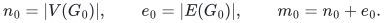
Every actual resident input vertex is included, even if it is isolated.
The graph has degree at most a declared <code class="math">\Delta\geq1</code>, and <code class="math">k\geq2</code>.

Partition the **initial** graph into connected components. Call a
component small if it has fewer than <code class="math">k</code> edges, and large otherwise.
An isolated vertex is small. Every nontrivial small component has at
most <code class="math">k</code> vertices; every large component pays at least <code class="math">k</code> initial
edges. Consequently the number of large components is at most
<code class="math">e_0/k</code>. This partition is fixed for this instance: it is not
recomputed after each graph update.

The correct componentwise low-stretch initialization has
<!-- math-display: 6e91a520c7908de4df543628
O(m_0\,\mathrm{polylog}M/k)
       +\#\{\text{initial small components}\}
 \tag{1}
-->
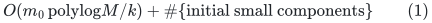
roots in each forest. The second term cannot be discarded from the
parent's storage or numerical occurrence accounting. Instead, initially
small components contribute only core loops and isolated roots to the
recursive graph. Those loops are served locally and the isolated roots
are not yet inserted as child input vertices.

This is a recursive-input construction, not a claim that all internal
root records have disappeared.

## 2. A whole-tree initialization for each small component

Fix one actual vertex <code class="math">r_C</code> in each small initial component <code class="math">C</code>.
Every forest in the source's logarithmic family uses this same root
within <code class="math">C</code>, although its weighted low-stretch spanning tree may differ.

For each weighted low-stretch call, compute its tree <code class="math">T_C</code> and
auxiliary ancestor hierarchy <code class="math">T_{H,C}</code> as in CKL+22. Use the root set
<code class="math">\{r_C\}</code>, so the initial maintained forest is the whole tree <code class="math">T_C</code>.
This common-root choice is supported by the constructive primitive:
the proof of CKL+22 Lemma B.9 starts with a tree having an arbitrarily
chosen root, preserves that root in <code class="math">T_{H,C}</code>, and forces the
minimum-depth node to be the root of each heavy-chain search tree.
Thus the singleton <code class="math">\{r_C\}</code> really is ancestor-closed in every
weighted call; it does not hide a separate logarithmic set of roots
inside each small component.
For an edgeless component this is its trivial one-vertex tree; no
replica or weight-normalization formula is applied.
No component-volume cut is necessary: at every later time a surviving
forest component remains a subset of <code class="math">C</code>, has at most <code class="math">k</code> vertices,
and is incident to at most <code class="math">k\Delta</code> current graph edges.

Here is the precise stability argument. The fixed stretch labels of
CKL+22 equation (56) have the form
<!-- math-display: bdaf382e3d73948d385a4b08
\widetilde{\mathrm{str}}(e)
    =2\sum_{j=0}^{h}
       \mathrm{str}_{F_T(B_j,\pi)}(e),
       \qquad h=O(\log^2|C|).
 \tag{2}
-->
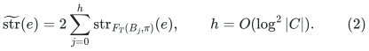
Their weighted-sum bound is proved before choosing the initial
ancestor-closed root set. The singleton hierarchy root is
ancestor-closed. On an inserted or deleted edge <code class="math">uv</code>, add the
hierarchy ancestors of <code class="math">u</code> and <code class="math">v</code> to the root set, as in the
source proof. Required extra forest cuts use the same closure rule.

The validity proof at the end of CKL+22 Appendix B.3 applies unchanged.
If <code class="math">u,v</code> remain in the same forest tree, their forest path is their
initial tree path and its stretch is bounded by (2). Otherwise each
current endpoint root agrees with its root in one of the hierarchy-level
forests used in (2). The two current root-leg lengths are therefore
bounded by the corresponding two summands. In either case the fixed
label dominates the current stretch.

Thus the whole-tree initialization preserves the source's fixed-label
and weighted-stretch guarantees, with the constant enlargements in
Section 2.1 below. Each endpoint promotion introduces
only a polylogarithmic number of roots/cuts. A new graph edge joins
vertices made roots before insertion and has stretch label one.
Forest edges are never inserted, so initial small trees never merge
even when the input graph's connected components merge.

There is also no hidden high-stretch initialization cut in a small
component. Use its **own** edge count <code class="math">e_C</code> in the weighted replica
normalization: with positive weights of total <code class="math">W_C</code>, create
<code class="math">\lceil e_C v_e/W_C\rceil</code> copies of edge <code class="math">e</code>. There are at most
<code class="math">2e_C&lt;2k</code> replica edges, and each physical edge has at least one
copy. CKL+22 equation (57) bounds the total unweighted fixed stretch
over these replicas by
<code class="math">O(e_C\gamma_{\rm LSST}\log^2(&#124;C&#124;+2))</code>. Every individual label
is therefore already <code class="math">O(k\gamma_{\rm LSST}\log^2 M)</code>, below a
compatible choice of the source's <code class="math">O(k\gamma_{\rm LSST}\log^4 M)</code>
high-stretch cutoff. That cutoff introduces no additional small
roots. Using a global edge count in the replica normalization would
not give this immediate conclusion.

Large initial components use the ordinary source initialization.
Their initial root and cut counts sum to
<code class="math">O(m_0\mathrm{polylog}M/k)</code>, because their number is also
<code class="math">O(m_0/k)</code>. Newly born input vertices start as singleton forest trees.

The weighted family construction may use one common global parameter
and sum componentwise bounds. For zero-weight edges, the usual
nonnegative-weight extension can be made explicit: if the total weight
in a component is <code class="math">W&gt;0</code>, add <code class="math">W/e_C</code> to every edge weight in that
component and absorb the resulting factor two in the average-stretch
constant. A component with <code class="math">W=0</code> has no path-preservation obligation
for that call; use uniform positive weights to choose its low-stretch
tree and fixed labels. This does not change the number or form of
forest updates.

There is no large rational denominator in this modification. In our
integer-length realization the original weights are integers
<code class="math">w_e=\mathrm{econg}(\widetilde{\mathcal P}_i,e)\ell_e</code>.
Here the count is the total number of **edge occurrences** in the
concatenated inventory walks, including repetitions. A concatenation
of shortest-path legs need not be simple; counting only whether a
walk contains an edge would not give the exact weighted-sum identity
used by path halving. Occurrence counting is obtained while explicitly
constructing the same inventory and changes none of its size bounds.
Use the equivalent positive integer weights
<code class="math">v_e=e_Cw_e+W</code>, whose total is <code class="math">2e_CW</code>, and compute the
replica counts by integer ceiling division. All these integers have
<code class="math">O(\log e_C+\log W)</code> bits. This is only a common rescaling of
<code class="math">w_e+W/e_C</code>, so both the weighted-stretch factor and the bound of
<code class="math">2e_C</code> replica edges are unchanged.

### 2.1. A finite-bit congestion ordering and the effective stretch constant

Integer replica weights alone do not settle every arithmetic operation
in CKL+22 Appendix B.3. Its Definition B.5 orders tree edges by
<!-- math-display: 281b52b0486d6823a010d377
c_f=\sum_{e:\,f\in T[e]}r_e/\ell_e ,
-->
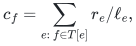
where <code class="math">r_e</code> is the replica multiplicity. Arbitrary integer lengths
can give these exact rational sums a large common denominator. We
replace only this ordering calculation; the input metric and all
tree-path lengths remain their original positive integers.

Put <code class="math">B=\lceil\log_2 L_{\max}\rceil</code> and
<!-- math-display: dadf2191e55838a73b6477b6
a_e=2^{-\lceil\log_2\ell_e\rceil},\qquad
 \widehat c_f=\sum_{e:\,f\in T[e]}r_ea_e .
 \tag{2a}
-->
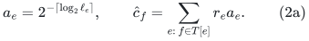
Then <code class="math">c_f/2\leq\widehat c_f\leq c_f</code>. Sort the tree edges by
<code class="math">\widehat c_f</code>, resolving ties by their fixed IDs, and keep this
total order <code class="math">\pi</code> throughout the forest lifetime. If <code class="math">f</code> is the
first edge of an adjacent-root path in this order, every edge <code class="math">g</code>
of that path satisfies <code class="math">c_f\leq2c_g</code>.

This gives the following direct variant of CKL+22 Lemma B.6:
<!-- math-display: 6e430b49aba98a47b4c6180f
\sum_{e\in E(G_v)}\mathrm{str}_{F_T(R,\pi),\ell}(e)
 \leq3\sum_{e\in E(G_v)}\mathrm{str}_{T,\ell}(e).
 \tag{2b}
-->
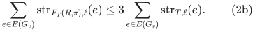
Indeed, the source's equation (55) bounds the left side by the
tree-stretch sum plus <code class="math">\sum_{f\in E_{\rm cut}}L_f c_f</code>, where
<code class="math">L_f</code> is the length of the adjacent-root path containing its
chosen cut edge <code class="math">f</code>. Those root-to-root paths are edge-disjoint
because <code class="math">R</code> is branch-free. On each such path <code class="math">c_f\leq2c_g</code>;
hence the extra sum is at most
<code class="math">2\sum_{g\in E(T)}\ell_gc_g</code>, which is at most twice the
tree-stretch sum. This is the only change to the average-stretch
proof: its constant three replaces the source's constant two.

The fixed-label domination proof does not need an exact congestion
order. Lemma B.9, items 3 and 4, applies to **any fixed total order**
<code class="math">\pi</code>. Thus the same ancestor hierarchy, equation (56), and the
last paragraph of the source's Lemma 6.5 proof still dominate every
later forest/root-leg stretch. The forest remains decremental.
Equation (57)'s total unweighted fixed-label bound increases by at
most <code class="math">3/2</code>. Increase the absolute constant in the high-stretch
cutoff by the same factor. Its Markov bound and subsequent ancestor
closure still introduce <code class="math">O(m/k)</code> roots in a large component.
For a small component the replica graph has at most <code class="math">2e_C&lt;2k</code>
edges, so every individual label is still
<code class="math">O(k\gamma_{\rm LSST}\log^2 M)</code>; the compatible enlarged
<code class="math">O(k\gamma_{\rm LSST}\log^4 M)</code> cutoff introduces no roots.

For explicit downstream constants, let <code class="math">\gamma_{\rm src}</code> be a
common upper bound for the source's **weighted fixed-label** average
stretch, including its hierarchy logarithms. The dyadic ordering is
covered conservatively by
<code class="math">\gamma_{\rm ord}=2\gamma_{\rm src}</code>. Positive-weight smoothing
then gives
<!-- math-display: 8561de92ddd994e487753d57
\sum_e w_e\widetilde{\mathrm{str}}(e)
 \leq \gamma_{\rm eff}\sum_e w_e,\qquad
 \gamma_{\rm eff}=2\gamma_{\rm ord}=4\gamma_{\rm src}.
 \tag{2c}
-->
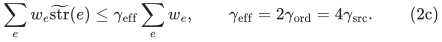
The KMPG future-path halving test must consequently use
<code class="math">2\gamma_{\rm eff}</code>, not the original <code class="math">2\gamma_{\rm src}</code>.
Equivalently, after naming the dyadic-order bound as the source
envelope, smoothing doubles that envelope and the test doubles it
once more. Markov's inequality now discards at least half of the
remaining total path-length weight in every round. Every later
path-preservation or distance-comparison constant uses this same
enlarged envelope. This changes neither its polylogarithmic order
nor any parameter exponent.

The ordering can be constructed with short integers. Multiply (2a)
by <code class="math">2^B</code>: each summand becomes
<code class="math">r_e2^{B-\lceil\log_2\ell_e\rceil}</code>, and the total over all
replicas has <code class="math">O(\log e_C+\log L_{\max})</code> bits. One LCA query
per physical edge, equal additions at its two endpoints and subtraction
of twice that amount at its LCA,
followed by a tree postorder sum, compute all tree-edge loads.
Sorting them takes <code class="math">O(e_C\log(e_C+2))</code> comparisons of these
integers. Formula (56) is subsequently stored as
<code class="math">\ell_e\widetilde{\mathrm{str}}(e) =2\sum_j(\ell_e+P_j)</code>, using only integer path lengths.
No least common multiple or exact reciprocal sum is formed. This
closes the normalization and Appendix B.3 ordering arithmetic;
the deterministic weighted low-stretch-tree construction remains
the named source primitive.

For the finite-bit original-edge tree interface in
[the AN adapter](an-weighted-finite-bit-adapter.md), the complete
integration is given in
[the polynomial-bit stable-forest lemma](polynomial-bit-stretch-stable-forest-integration.md).
Its fixed-polynomial dependence on the length bit count changes
only the effective stretch and fixed polynomial master factors.
The exported label remains the integer path sum above: its
<code class="math">O(\log^2 n)</code> summands are the hierarchy levels of ONE tree,
not the number of weighted halving calls. Temporary petal
coordinates are not exported as core lengths.

## 3. Logical pivots, balls, and direct terminal edges

For every small component set its initial logical center set to
exactly <code class="math">\{r_C\}</code>, with the root chosen in Section 2. Run the source
center construction on each large component, adding one actual local
pivot if it returns no center there. In large components these extra
roots and their ancestor closures cost only
<code class="math">O(m_0\mathrm{polylog}M/k)</code> in total.

Every vertex now has a genuine closest logical pivot. No distance to
a nonexistent pivot is queried. The logical pivot set may have
<!-- math-display: c524e09ae7330a0beaf04fbd
O(m_0\mathrm{polylog}M/k)
       +\#\{\text{initial small components}\}
 \tag{3}
-->
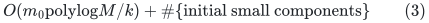
vertices initially. We do not claim the original <code class="math">n_0/k</code> bound
for this enlarged set.

An isolated input vertex born later immediately becomes its own
logical pivot and its own root in every forest. It does not acquire
a recursive child slot until a retained nonloop edge actually uses
that physical root.

Adding centers only shrinks strict balls and inverse clusters. The
source's local ball/cluster bounds therefore remain valid. A small
component's balls contain at most <code class="math">k</code> vertices in any event.
All logical pivots are roots in every maintained forest.

Before an input edge update, promote its endpoints into the logical
pivot set and into the forest root sets. The nearest-pivot distance
cannot increase: if an old shortest pivot path is broken, the first
newly promoted endpoint on that path is at least as close as the old
pivot. A strict-ball path contains no pivot. A shortest path to a pivot
cannot traverse a newly inserted edge, because its first endpoint is
already a pivot and all edge lengths are positive. Hence all finite
shortest local-ball paths and closest-pivot legs remain inside initial
components and use surviving initial edges. The generating middle edge
of a new ASZ path may cross two initial components; both its endpoints
are already pivots, so this case is exactly its label-one singleton
path. The source precomputation and monotonicity argument still applies.

There is a separate strict-ball convention to make explicit. At a
terminal <code class="math">v\in A</code>, the strict ball <code class="math">B(v,A)</code> is empty. In the
generating-path inventory use
<!-- math-display: 04e4d1777c2b7662ca463078
B^+(v,A)=B(v,A)\cup\{v\}.
 \tag{4}
-->
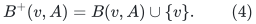
This adds at most one entry to a ball or inverse-cluster count.
In particular it includes each direct terminal-to-terminal edge.
Include all initial singleton edge paths in the future-path family
before its weighted-halving construction. This adds only
<code class="math">O(e_0)</code> paths. A later terminal-to-terminal OLD edge has actual
stretch one in every forest, but its fixed stored estimate need not
be one. The singleton-path preservation guarantee supplies a forest
whose stored estimate is at most the same <code class="math">\alpha</code> used for the
other inventory paths. A newly inserted edge, by contrast, has
stored estimate one in every forest because both endpoints were
promoted before its birth.

Store a singleton-path record for each direct edge and update its
terminal status when an endpoint is promoted. Enumerating the
incident edges of a promoted input vertex costs <code class="math">O(\Delta)</code>
local work. A fresh input edge has two terminal endpoints
immediately. These records do not synthesize extra core or child
edge lifetimes: the edge is already present in every applicable
source core graph. Initial inventory work is linear up to source
factors, and local work per endpoint promotion is absorbed in the
existing polynomial in <code class="math">k,\Delta</code>.

The local-cycle versus core-cycle comparison uses this enlarged
inventory. A cycle contained in a small neighborhood is still a
local candidate. When projected into a small initial whole-tree
component, its core contribution consists of real self-loops, which
are covered by the fundamental-cycle candidates below. No center-free
component or direct terminal edge is omitted from the comparison.

## 4. Constructive spanner conventions

The following conventions of the constructive spanner are used here.

**Positive metric calls and external alias gluing.**
Run the positive-length spanner construction on each core, using its
positive length buckets. The zero alias connections are separate
union/gluing records; they are not zero-length inputs to a primitive
whose interface requires positive lengths. Retain the gluing of
aliases of the same physical root explicitly.

If the per-core stretch is <code class="math">\rho</code>, each positive core edge <code class="math">e</code>
has a same-core replacement path of length at most <code class="math">\rho\ell_e</code>.
Replacing the positive edges of any core-sum walk, while keeping its
zero gluing steps, proves the same <code class="math">\rho</code> upper bound for that
walk. This edgewise bound is sufficient for the cycle decomposition
and its raw length charge. It does not assert that this particular
same-core route approximates a possibly shorter cross-core distance
between the edge's endpoints.

Apply the KMPG degree-feedback routine to the retained positive
edges in each core, exactly the core intersections used by its
Algorithms 2--4. The feedback proof uses the per-core sparsity
and native-split edit bounds; zero gluing edges are not part of that
degree test. There are <code class="math">\lambda=\mathrm{polylog}M</code> cores.
Summing their work and recourse and then identifying equal physical
roots multiplies the degree and edit bounds only by this source
factor, absorbed in <code class="math">R</code>. A new root alias changes only
<code class="math">\mathrm{polylog}M</code> external gluing records. Frozen-gauge
values on the gluing links are corrected to zero before their
contraction, as in the integration note.

Distinguish selected-edge recourse from demand-route congestion.
An unsparsified core vertex can have <code class="math">O(k\Delta)</code> incident demand
edges. Their embeddings may all meet that vertex, so we do not use
a <code class="math">k</code>-free bound on this congestion. Empty loop embeddings also
retain their base vertex for touched-incidence bookkeeping; their
contribution is bounded by the full registered core degree.
The corresponding <code class="math">k\,\mathrm{poly}(\Delta,A)</code> route and
incidence work is part of the local envelope <code class="math">W</code>. The bounds
required without a <code class="math">k</code> factor are the selected spanner's controlled
degree and its emitted child-edit count. Physical flat-forest
multiplicity is proved from the direct pools, independently of
demand-route congestion.

**Positive loop inputs remain registered, with empty embeddings.**
A positive self-loop is never selected as a distance-spanner edge.
Its distance embedding is the empty path. All input loop identities
and incidences remain registered in the native core-graph splitter.

The exact primary convention appears immediately before Definition A.1
in vdBCK+23 Appendix A.3: a core self-loop has an empty path embedding.
Its input identity is still retained. The empty **edge list** has its
base vertex <code class="math">v</code>; that vertex and the original endpoint incidences
remain indexed for the touched-vertex and native-split operations.

For static sparsification, remove positive loops from the metric
subproblem and give their registered IDs the empty embedding. Run the
static sparsifier on the remaining edges. This preserves every
distance, embedding-length, and congestion guarantee. It also prevents
a directly retained base set from containing a positive loop.

This convention is compatible with the actual dynamic reduction, not
just with a static metric. CKL+22 Section 5.1 maintains touched vertex
sets <code class="math">S_j</code>; a split touches both resulting vertices. Its repair
graph <code class="math">J</code> is formed on <code class="math">S_j</code>, and an affected input edge is
projected onto those touched vertices. An old loop that becomes a
nonloop is included because its endpoint was split, even though its
old path edge list was empty. For a single split of one vertex,
all such newly crossing loop IDs are projected between the two
touched split vertices. The routine may scan their incidences, but
sparsifies a repair graph whose vertex count depends on the touched
set, not on the number of crossing IDs.

vdBCK+23 Theorem 8.1 supplies the deterministic static repair, with
output size proportional to <code class="math">&#124;V(J)&#124;</code> times the declared source
factors. The paragraph introducing its Theorem 8.2 explicitly applies
the CKL+22 Section 5.1 reduction. Thus one native split may require
<code class="math">O(k\Delta)</code> local incidence work without generating that many
selected output edges. In KMPG's variant the corresponding split
is forwarded to the selected spanner; its later endpoint emulation
uses the selected graph's controlled degree.

We do not replace a native split by <code class="math">k</code> synthetic input-edge
insertions. Merely post-filtering an arbitrary black-box spanner
that had retained the old loops would not prove this bound.

Looplessness persists under the actual update sequence. Forests only
lose edges, so an existing nonloop core edge cannot become a loop.
Every newly inserted nonloop parent edge has distinct root endpoints
and is nonloop in every core. Genuine physical input loops use the
separate loop wrapper. An old core loop may become nonloop after a
native split, but it was never a selected spanner loop beforehand.
All static repairs use the same empty-loop convention. Therefore
the selected spanner does not accumulate positive loops between
initializations.

**Initialization respects initial connected blocks.**
There is a precise initialization interface in that same reduction.
CKL+22 Section 5.1 initializes only <code class="math">H_0,\Pi_0</code> by one static
sparsification; all <code class="math">H_j,\Pi_j</code> with <code class="math">j&gt;0</code> and all touched sets
start empty. For each initial block <code class="math">C</code>, use the deterministic
static sparsifier to obtain <code class="math">H_{0,C},\Pi_{0,C}</code>, with common
global upper bounds on its approximation parameters. Set
<!-- math-display: 7ec87deed6a1fbec27c3858d
H_0=\bigcup_C H_{0,C},\qquad
              \Pi_0=\bigcup_C\Pi_{0,C}.
-->
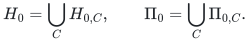
All paths remain within their initial blocks. The static size and
work bounds sum; vertex congestion and stretch take their maxima
over the disjoint blocks. The full static initialization contract
therefore holds, with the additional per-block bound
<!-- math-display: a856f708bb27815aff763543
|E(H_{0,C})|=\widetilde O(|V(C)|\gamma_\ell).
-->
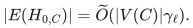

After initialization run **one** global updater. Its data are
<code class="math">H_j,\Pi_j,S_j</code>, not independently running dynamic instances that
would later need merging. CKL+22 Lemma 5.9 bounds initial sparsity
using only the <code class="math">H_0</code> static guarantee, and bounds each later repair
by the size of the touched set <code class="math">S_j</code>. Its proof does not require
one monolithic initial sparsifier call or recomputation of initial
connected components. Replacing that one call by the union above
therefore leaves the native-split recourse proof unchanged. Weighted
length buckets use the same convention separately in each bucket.

A block containing only aliases of one physical root has only zero
alias gluing links and positive loops. Keep its necessary external
zero connections and empty loop embeddings; it has no selected
positive nonloop edge in any positive-metric spanner call.
The local degree-control routine counts retained edges of the core,
not zero alias links. It therefore makes no extra initial forest cuts
in an untouched small whole-tree component.

The initialization sparsity argument for the large blocks consequently
uses only their own <code class="math">O(m_0\mathrm{polylog}M/k)</code> core roots.
An arbitrarily large collection of isolated small blocks cannot
subsidize extra selected edges or extra initial degree-control cuts
elsewhere.

These are constructive normalization requirements, rather than
consequences of the sentence that some sparse spanner exists.
They preserve all input identities needed by later splits and all
source embedding certificates. The source algorithms and their
native-split recourse remain named dependencies.

## 5. Local loops and the resident child graph

Maintain the source's local fundamental-cycle candidates, including
every real core loop, whether or not it is retained by a distance
spanner. For a parent edge <code class="math">e=(u,v)</code> whose endpoints lie in one
forest tree, its candidate is the simple cycle
<!-- math-display: 5905b823194c0497f45b5262
e+F[v,u].
 \tag{5}
-->
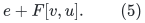
Use its actual signed gradient and literal path length. Common
root legs are canceled within this one forest before presenting
the certificate. The fixed stretch length dominates (5).
A real physical loop is its one-edge candidate.

Initially, every positive core edge of a small whole-tree component
is a loop. Thus no cycle information is lost when its root has no
recursive nonloop incidence. Subsequent root changes and edge updates
refresh the affected local candidates using the source's already
charged local work. One may also compute an exact cycle-ratio answer
on an initial small component in polynomial-in-<code class="math">k</code> local time,
but this is not needed for recursive activation.

Apply the frozen retained-edge gauge correction, contract the justified
zero alias connections, and classify every retained positive edge by
its **current physical root endpoints**.

- A nonloop edge is inserted into the recursive child with its stable
  ID and provenance.
- A real loop is served by its local closed-walk lift and is not
  inserted into the recursive nonloop graph.
- Zero alias links are handled by the justified contraction and are
  not positive child edges.

Insert a physical root as an actual child vertex only when it first
becomes an endpoint of a retained positive nonloop edge. Use a
dictionary from current physical-root identity to its child slot.
Once inserted, **keep that actual child slot until the parent
instance is rebuilt**, even if all its child edges are later deleted.
It is then a resident isolated input vertex, not private metadata.
This rule needs no DeleteVertex operation.

A root never inserted into the child has only a private activation
record, together with its parent forest/root data. This record is not
a child input vertex. On the first nonloop edge insertion, emit at
most two actual isolated-vertex insertions before the edge insertion.
A loop/nonloop transition of a retained edge is an exposed edge
retirement/replacement, not a silent endpoint rewrite.

## 6. Quantitative child size and update count

Let <code class="math">R\geq1</code> be the conservative source factor bounding retained
edge/endpoint changes and degree, including the logarithmic forest
family, gauge corrections, and zero-alias quotient bookkeeping.
Use the explicit degree/recourse caps in the integration note; their
slack absorbs fixed constants below.

At initialization, positive nonloop retained edges occur only in
the large-component portion. Its source construction has
<!-- math-display: 520a9aaaefd61d0e6261c05d
E_{\rm child}(0)+V_{\rm child}(0)
                   =O(m_0R/k).
 \tag{6}
-->
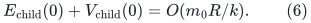
There are no actual child vertices for the untouched small-root
blocks.

Suppose <code class="math">t</code> parent edits have occurred. The source supplies at most
<code class="math">O(Rt)</code> emitted retained-edge and endpoint edits in that prefix.
The filter forwards at most constantly many edge edits per such
record. Every new actual child slot is charged to the first nonloop
edge insertion that uses it, and costs one isolated-vertex insertion.
Therefore
<!-- math-display: d268a63f5eac422d14241652
\begin{aligned}
 \#\text{child edits through }t&=O(Rt),\\
 |V_{\rm child}^{\rm resident}(t)|+|E_{\rm child}(t)|
               &=O(m_0R/k+Rt).
 \end{aligned}
 \tag{7}
-->
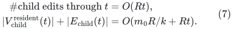
The first line excludes the separately charged initialization.
The second includes **all** resident isolated child slots.

No scan or activation of all vertices of a small component is
performed when it first interacts with another component. Its
core split may inspect <code class="math">O(k\Delta)</code> physical incidences locally,
as allowed by the source primitive, but only the source's bounded
retained-edge transcript reaches the child.

Use the period
<!-- math-display: 423bb4447cae6528c1d04165
Q=\left\lfloor {m_0\over4k\Delta}\right\rfloor
 \tag{8}
-->
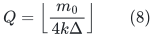
when <code class="math">m_0&gt;4k\Delta</code>, and use the explicit terminal cycle solver
otherwise. Since <code class="math">m_0\leq(1+\Delta/2)n_0</code>, (8) is at most the
source horizon <code class="math">n_0/k</code>. By (7), throughout the period the child
size is <code class="math">O(m_0R/k)</code>, including retained isolates.

At each recursive initialization and restart, define its local
<code class="math">m_i=n_i+e_i</code> using **all currently resident input slots and
edges**. Ordinary input updates can create only constantly many
new slots per elementary update, so the initial capacity with a
fixed safety factor bounds the period. A burst from the parent is
processed as its explicit sequence of child edits; a child may
restart within that sequence without an intervening numerical query.

Actual input slots are never excluded merely because they are
isolated. Private tombstones or activation records that were never
inserted may be excluded from <code class="math">n_i</code>, while their processing is
charged to parent initialization or explicit births. Complete parent
rebuilds discard the old child instance and create a new one; this
is the already charged restart operation, not an unsupported vertex
deletion API.

## 7. Root pools and numerical counters

The parent's direct-sum trees <code class="math">T_v</code> exist for its actual forest
roots, including roots that have no child slot. Root-only trees,
private unused index layers, and dormant assigned copies are all
included in the physical occurrence accounting.

With a common pool capacity <code class="math">C</code>, a physical parent vertex occurs
in at most one tree of each source forest and hence in at most
<code class="math">O(\lambda C)</code> exposed pool copies. There is no factor equal to
the number of small components. Late capacity doubling copies the
current entire forest family; its geometric sum is charged to the
instance initialization allowance.

The addition or release of a child occurrence changes its pool
assignment. It does not erase a surviving internal pool edge.
Dormant real edges stay exposed, stay on their physical coordinate
lists, and keep both their signed increments and their absolute
motion counters. A complete instance retirement transfers both
quantities before parent path or endpoint metadata is invalidated.
No path update, outer query, or coordinate refresh is serviced
during a partial retirement/rebuild transaction.

Thus keeping isolated child slots does not hide physical history,
and omitting a never-inserted child root does not suppress real
motion in the parent's separately exposed local forests or pools.

The fixed-slot matching client can retain all of its input vertex slots
until the whole instance is discarded. If a more general caller
explicitly retires an isolated parent vertex lifetime, handle that
case without requiring a child DeleteVertex operation. Since
<code class="math">F_i\subseteq G</code>, each <code class="math">F_i</code> component containing that parent
vertex is now a singleton. All real incident records have already
retired and transferred both counters. Suppress the remaining
<code class="math">O(\lambda C)</code> exported root-only/null records, while keeping the
actual isolated child slot and a slot-to-retired-parent tombstone
until child disposal. Test that status before dereferencing physical
metadata. A query wholly in that isolated null fiber is omitted;
an active path cannot enter and leave it because it has no nonnull
input incidence. Charge this work to the explicit parent-lifetime
retirement. It adds no factor <code class="math">k</code>, and prevents historical parent
lifetimes with the same next-level physical image from accumulating
exported occurrences.

## 8. Effect on the recursive bound and remaining imports

The wrapper adds <code class="math">m_0\mathrm{poly}(k,\Delta)</code> local
initialization work and <code class="math">\mathrm{poly}(k,\Delta)</code> local
update work within the existing envelope <code class="math">W</code>. Its child terms
remain
<!-- math-display: 1fa14d972e0bdcc7074919b5
I_{\rm child}=O(m_0R\,W/k),\qquad
       R\,T_{\rm child}.
 \tag{9}
-->
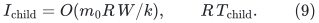
In particular it does **not** replace <code class="math">R\,T_{\rm child}</code> by
<code class="math">kR\,T_{\rm child}</code>.

The fixed-depth degree, recourse, and pool recurrences are unchanged
after absorbing constants and logarithmic factors into their
declared caps. The exact source statements concerning initial
<code class="math">O(m/k)</code> roots and <code class="math">&#124;A&#124;\leq n/k</code> are used only on the large
component portion; equations (1) and (3) state the full parent
bounds. Equations (6)--(7), rather than an impossible total-root
claim, provide recursive shrink.

The remaining imported fast-time facts are the constructive weighted
low-stretch routine, the path-based dynamic spanner with native
splits and the conventions in Section 4, and the local maintenance
bounds already listed in the distance integration. This note does
not claim that a final matching verifier can replace any of those
time guarantees.
