# General maximum matching through a constant-depth distance backend

**Research theorem assembly, 24 October 2026.** This note gives an
alternative numerical route for the persistent-carrier matching
construction. It replaces the use of the unrestricted general-cycle
reduction in the 2023 incremental-graphs paper by constructive
distance-sparsifier primitives whose interfaces explicitly allow an
arbitrary intermediate maximum degree. The matching theorem remains a
research assembly with the named dependencies below; no implementation
or external verification is claimed.

The distance route here includes the
[disconnected-component wrapper](disconnected-component-backend-wrapper.md)
as part of its construction. In particular, this note does not apply a
literal <code class="math">O(m/k)</code> initial forest-root or pivot count to arbitrary
disconnected graphs. Small initial components have their own logical
roots and pivots; their initially loop-only core data stay local, and
recursive vertices are activated only by retained nonloop edges. This
wrapper is required for the theorem below, including inputs with
isolated vertices.

The detailed supporting notes are:

* [Constant-depth distance-oracle backend](constant-depth-distance-oracle-backend.md):
  local work, rebuilding, degree and size recurrences.
* [Raw-cycle lifting](distance-oracle-raw-lift.md):
  the ASZ dichotomy, cycle normalization, loop treatment and raw length.
* [Disconnected-component wrapper](disconnected-component-backend-wrapper.md):
  common local roots and pivots, constructive empty-loop handling,
  resident child vertices, and the update count without a factor <code class="math">k</code>.

The retained-edge gradient correction, direct vertex-pool count,
executable caps and arithmetic details are given in this note itself.

The matching side is
[persistent-carrier general matching](../../problems/general-matching/proof.md),
with the representation in
[persistent integral-ledger carriers](persistent-integral-ledger-carrier.md).
The final program and its acceptance wrapper are stated in
[uniform general maximum matching](../../problems/general-matching/proof.md) and
[uniformization by an optimality check](deterministic-uniformization-by-optimality-check.md).
This note supplies a second numerical dependency chain for those results.

The shared [numerical lifetime and loop interface](numerical-backend-lifetime-and-loops.md)
specifies the callbacks for both numerical routes. In particular, all
dormant exposed copies remain in physical-coordinate sweeps; retirements
transfer both signed and absolute counters before old metadata expires;
and refreshes wait until each complete lift transaction settles. Its
positive-length loop decomposition supplies an independent exact heap
wrapper whenever an invoked primitive is stated only for loopless inputs.

## 1. The alternative numerical theorem

Let <code class="math">M</code> be a power-of-two nominal size bound. Consider a fully dynamic
undirected multigraph with fixed physical vertex slots, maximum degree
three, and at most <code class="math">M</code> current vertices and edges. Give each edge a
reference orientation, a positive integral length <code class="math">\ell_e</code>, and an
integral gradient <code class="math">g_e</code>. For a fixed parameter <code class="math">a</code>, their magnitudes
are bounded by <code class="math">M^{O(a)}</code>. Individual loops and parallel edge identities
are retained. A change of price or gradient is an edge deletion followed
by insertion of its replacement.

For the current graph define
<!-- math-display: 549fc947ff01b93446713e80
{\rm OPT}
 =\max_{\substack{z\ne0\\z\text{ a circulation}}}
       \frac{|g^{\mathsf T}z|}{\sum_e\ell_e|z_e|},
-->
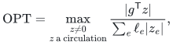
with value zero if there is no circulation with nonzero gradient.

**Alternative backend theorem.** Fix a sufficiently small positive
rational <code class="math">\eta</code>. Subject to the constructive local primitives specified
in Section 2, used through the disconnected-component wrapper just
specified, there is a deterministic implementation with:

1. initialization <code class="math">M^{1+20\eta+o_{a,\eta}(1)}</code>;
2. amortized edit and query cost <code class="math">M^{20\eta+o_{a,\eta}(1)}</code>;
3. an explicitly maintained forest of occurrences, each vertex mapped to
   a physical slot and each nonnull edge mapped to a current physical
   edge with its endpoint correspondence;
4. occurrence multiplicity and representation-edit factors
   <code class="math">M^{O(\vartheta)+o_{a,\eta}(1)}</code>, where
   <code class="math">0&lt;\vartheta&lt;\eta/1000</code> is fixed below;
5. a query answer consisting of at most
   <code class="math">M^{\eta+O(\vartheta)+o_{a,\eta}(1)}</code> oriented physical edges and
   forest paths specified by endpoints.

The answer has a circulation <code class="math">c</code> as its signed physical projection.
If <code class="math">{\rm OPT}&gt;0</code>, its literal physical traversal length <code class="math">V</code> is positive
and
<!-- math-display: 87cb618c68d7e21e1758475c
\frac{|g^{\mathsf T}c|}{V}
 \ \ge\
 M^{-\eta-O(\vartheta)-o_{a,\eta}(1)}\,{\rm OPT}.                 \tag{1}
-->
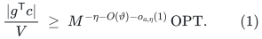
The length <code class="math">V</code> counts repeated traversals separately, before
cancellation. Retained occurrences have fixed images throughout their
lifetimes. Removal records precede invalidation of the old images or
physical edge data. A transaction may retire old records and create
their replacements without allowing an intervening path query.

The coefficient 20 is a conservative envelope for the fixed-depth
construction below. A larger fixed absolute envelope would give the
same conclusion after a smaller fixed choice of <code class="math">\eta</code>. The bounds
are eventual bounds for each fixed parameter and apply to adaptive
clients and the polynomial lifespans used by the OAI engine.

The three properties that matter together are the literal-length
certificate, stable physical images, and explicit representation edits.
A numerical approximation to a minimum-ratio value alone would not
supply this interface.

## 2. Exact primary-source scope

We use the following two primary sources.

**[KMPG]** Rasmus Kyng, Simon Meierhans and Maximilian Probst Gutenberg,
*A Dynamic Shortest Paths Toolbox: Low-Congestion Vertex Sparsifiers and
Their Applications*, arXiv:2311.06402v1, STOC 2024.
<https://arxiv.org/abs/2311.06402v1>.

**[DO26]** Rasmus Kyng, Simon Meierhans, Maximilian Probst Gutenberg and
Aurelio Sulser, *A Simpler and Faster Min-Cost Flow Solver via Min-Ratio
Cycles from Distance Oracles*, arXiv:2609.23852v1, 20 September 2026.
<https://arxiv.org/abs/2609.23852v1>.

The required interfaces are these.

| Primitive | Scope and use |
|---|---|
| KMPG Theorem 3.1 | Dynamic multigraph of any specified maximum degree <code class="math">\Delta</code>, with edge insertions/deletions and isolated-vertex edits; explicit sparsifier and update transcript, with disconnected initial pivots handled by the wrapper |
| KMPG Lemma 3.5 | Arbitrary-<code class="math">\Delta</code> decremental forest construction, persistent physical roots, and components incident to at most <code class="math">k\Delta</code> edges; small-component initialization and its fixed stretch labels are supplied by the wrapper |
| KMPG Algorithms 2–4, Claims 3.17–3.18 | Degree control by cutting parent forest edges and promoting actual physical vertices; explicit retained-edge changes |
| KMPG Theorem 3.7 and DO26 Lemma 4.1 | Constructive deterministic spanners with the specified update types, explicit routes and their maintenance bounds |
| KMPG Lemma 3.21 and Algorithm 5 | Flat-forest lifting through copies of actual parent forest components, with fixed vertex images and exposed edits |
| DO26 Lemma 3.23 and the Section 3 dichotomies | Local fundamental-cycle extraction and the alternative of a local candidate or a useful child circulation |

The wrapper also imports the constructive initialization and native
vertex-split handling of the spanner routines used by KMPG. It retains
every logical core-loop input ID, assigns its empty route with its base
vertex, and never selects positive loops into the retained spanner.
Thus a split that exposes many old loops remains one native split;
it is not translated into one recursive insertion per exposed input
edge. Componentwise static initialization is followed by a single
global dynamic updater. Its quantitative child bound is
<code class="math">O(m_iR_i/k+R_it)</code>, counting every actually resident isolated child
slot after <code class="math">t</code> parent edits. These are constructive interface
conditions, rather than consequences of sparsity alone.

In particular, DO26 Lemma 4.1 is stated for arbitrary <code class="math">\Delta</code>.
With a fixed internal spanner parameter <code class="math">K_{\rm sp}</code>, its conservative
degree and recourse factor has the form
<!-- math-display: 8e9a2ef194fceb5971e1e88b
R=\Delta^2 A,\qquad
 A=M^{4/K_{\rm sp}+o(1)}.                                      \tag{2}
-->
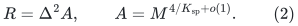
Its horizon is <code class="math">n/k</code>, where <code class="math">n</code> is the current instance's initial
vertex count. The later degree-three restriction in DO26's final
hierarchy theorems is a restriction on their root application; it is
not a restriction on this local interface.

We use the squared-degree dependence in (2). KMPG's displayed Theorem
3.1 has a sharper linear-degree dependence, whereas its vertex-split
emulation proof near page 29 contains a squared-degree expression.
Constant depth makes the weaker expression sufficient. We do not
derive the source's full-depth subpolynomial theorem from a
squared-degree recurrence.

KMPG's degree control differs in a useful way from unrestricted
degree splitting. Its extra roots are actual vertices of the parent
graph. After contracting the zero links between aliases, its child
vertex set is a subset of the parent physical vertex set. Forest
lifting therefore uses actual parent components. It does not identify
arbitrarily many disconnected binary-tree fibers with one physical
vertex.

Consequently this route does not require reconstructing the
arbitrary-degree flat-forest claim of Theorem 3.3 in
[arXiv:2311.18295](https://arxiv.org/abs/2311.18295v1).
That theorem remains an alternative stated dependency of the 2023
route. Here its role is replaced by the specific distance, forest and
spanner constructions above.

## 3. Direct vertex pools, including isolated occurrences

The flat lift can be described without converting edge congestion
into vertex congestion.

Let <code class="math">F_1,\ldots,F_\lambda</code> be the current core forests in a parent
graph, with <code class="math">\lambda=M^{o(1)}</code>. For a physical root <code class="math">v</code>, let <code class="math">T_v</code>
be the direct sum of all trees rooted at <code class="math">v</code> among these forests:
identify their root vertices and keep their other vertices separate.
This is KMPG Definition 3.22.

Suppose the maintained child forest has at most <code class="math">C</code> simultaneous
vertex occurrences with any one child image, **counting isolated
occurrences**. Prepare copies
<!-- math-display: c1cf0a2f2e7ecc89a7062519
T_{v,1},\ldots,T_{v,C}
-->
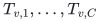
for each root. Assign each child occurrence with image <code class="math">v</code> a distinct
copy index. A child forest edge is realized by its central parent
edge between the appropriate attachment vertices in its two assigned
copies. Contracting every pool tree to its root recovers the child
forest, so the resulting graph is a forest.

A true null child-forest edge has two occurrences with the same child
image and no central parent-edge provenance. Realize it by a null edge
between their assigned pool roots. The roots have the same physical
image, and both its physical gradient and raw charge are zero. This
case is distinct from a real core loop, whose nonzero candidate is
handled in Section 5. The contraction argument and occurrence count
are unchanged.

**Pool bound.** A physical parent vertex <code class="math">u</code> belongs to at most one
tree of each <code class="math">F_i</code>. Hence it occurs in at most <code class="math">\lambda</code> of the
direct-sum trees, counted with their constituent-tree identities.
The pool construction therefore has at most <code class="math">\lambda C</code> occurrences
of <code class="math">u</code>. Projected child edges use existing attachment vertices and
do not increase this count. This argument also counts root-only trees,
isolated child occurrences and dormant reserved copies.

One may add <code class="math">\lambda</code> disjoint copies of the current level forests
to represent that level's local fundamental-cycle candidates. Thus
the direct per-level vertex bound is
<!-- math-display: 9e05599adcc484d8e666d0bc
O(\lambda(C+1)).                       \tag{3}
-->
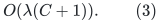
We retain the looser <code class="math">R^4</code> envelope below to cover all record changes
and auxiliary copies uniformly.

The bound is on the family of tree copies, not on the number of child
edges incident to an occurrence. In particular, no multiplication by
the degree of an original unsplit vertex is hidden in (3).

### Dynamic maintenance

KMPG's forests are decremental during an instance. Their cuts split
existing pool copies. Newly promoted roots keep their physical identity;
root identification in a direct sum redirects at most the parent
degree times a polylogarithmic number of incident edges per copy.
Projected child edges whose endpoints or provenance change are retired
and replaced. These operations are part of the exposed sparsifier and
forest transcript.

Before a cut, root identification, or retirement invalidates an old
edge representation, flush its pending signed increment and its
accumulated absolute motion. They are separate quantities. No query is
allowed in the middle of this transaction. The new representation starts
with its own lifetime identifier.

Use deletion-first ordering also for root identifications. Collect the
source's root/split updates and the child's forest-change logs, cut the
affected old projected attachments while their old provenance is still
available, and only then cut or identify the pool-tree roots. A detached
region newly assigned to another root has no surviving old attachment
that would close a cycle through a different pool. Install the final
child attachments, including true null root-to-root edges, after the
new same-index root pools are settled. Unchanged attachments outside
the affected regions remain. Temporary child records born and removed
inside the transaction receive no parent path update and can be
reconciled from their logs. The source's changed-edge/root inventories
and bounded root incidences pay for these operations; no scan of an
unaffected component is required.

Releasing a pool slot does not erase its surviving internal edge
counters. It makes the slot dormant. Reusing it adds new motion to
those counters; a complete instance retirement eventually flushes them.
Only the physical projection of each new increment must be a
circulation. Previously accumulated values need not form a circulation
in the current occurrence forest. This is the value convention of
OAI Section 5.

### An executable pool allocation rule

The implementation need not guess a hidden constant in <code class="math">C</code>.
Within one level instance, use a **common capacity for all roots**,
initially one. Count actual simultaneous child occurrences at each
image. When the common capacity is insufficient, double it and create
the newly indexed copies of the entire current forest family.
Keep all existing and dormant copies with their counters.

Common indices matter: when a cut promotes a new root in another
forest <code class="math">F_i</code>, the already existing copies can be split and joined
to the same-index root pools. No mismatch of different per-root
capacities requires rebuilding a large component at that event.

If the largest observed child multiplicity in the instance is
<code class="math">C_{\max}</code>, capacity never exceeds <code class="math">2\max\{1,C_{\max}\}</code>.
The total number of newly allocated index layers over all doublings
is at most this quantity. With an instance size capacity <code class="math">m</code>, all
late pool construction costs
<!-- math-display: 6254d85e336d502b7f3b0da2
O(m\lambda(C_{\max}+1))
-->
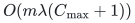
up to the already charged bookkeeping factors. This is an amortized
initialization allowance for that instance, even if a doubling occurs
late in its period. It is not a constant-time claim for the individual
child vertex birth that triggers a doubling. The bound is included
in the initialization and restart charges in Section 7.

## 4. Frozen gauges and retained-edge correction

Fix a potential <code class="math">p_i</code> at the birth of each core forest <code class="math">F_i</code> so
that, for every surviving forest edge <code class="math">e=(u,v)</code>,
<!-- math-display: 8d7c02923eaceacf0d83956e
g(e)+p_i(u)-p_i(v)=0.
-->
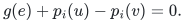
The potential remains fixed. An input edge whose gradient changes
is deleted and reinserted; affected endpoints become roots. Surviving
forest edges therefore preserve this identity.

For a positive core edge originating from <code class="math">e=(u,v)</code>, store the
frozen value
<!-- math-display: 7388066d642371484e36b331
g_i(e)=g(e)+p_i(u)-p_i(v).
-->
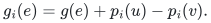
The zero links between different aliases of a physical root carry
the corresponding potential differences. Their physical images are
empty, but their stored gradients need not yet be zero. A complete
circulation nevertheless has exactly its physical gradient because
the potential terms telescope.

Use positive-length metric calls on each core, and keep zero alias
connections as separate external gluing records. The union of the
positive-core spanners and those records routes every core-sum walk
with the same edgewise stretch bound. KMPG's degree feedback operates
on retained core intersections; summing its guarantees over the
polylogarithmic number of cores is absorbed by the declared caps.
The [disconnected-component wrapper](disconnected-component-backend-wrapper.md),
Section 4, gives the complete convention, including native loop splits.
No zero-length edge is passed to a positive-length spanner primitive.

The printed demand-embedding vertex-congestion bound is not used as
a degree-free occurrence estimate. An unsparsified core can have
<code class="math">O(k\Delta)</code> parallel demands at one root. Conservatively charge
their route/incidence maintenance inside the local polynomial
envelope <code class="math">W</code>; only selected-edge degree and emitted child recourse
need to avoid a <code class="math">k</code> factor. The direct root pools give physical
vertex multiplicity independently of that demand congestion.

Keep the frozen core labels inside those positive metric calls.
Only on the retained spanner edges, immediately before external
zero-alias contraction,
apply the following correction. If
<!-- math-display: 207d3d80f4feeca2b496dfd3
a=r_i(u),\qquad b=r_i(v)
-->
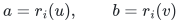
are the current physical roots, set
<!-- math-display: 8813530037871f314d16e82c
h_e=g_i(e)-p_i(a)+p_i(b).                                \tag{4}
-->
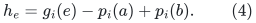
This is the exact gradient of the parent walk
<!-- math-display: 2c0e0c787a95bde78a8fdf8b
F_i[a,u]+e+F_i[v,b].
-->
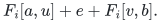
It is a single potential change on the uncontracted spanner, using
<code class="math">p_i(a)</code> on the alias <code class="math">(a,i)</code>. It makes every zero alias link have
zero gradient as well as zero length. Those links may now be
contracted; the recursive graph has positive edge lengths.

The correction is constant work per already exposed retained-edge
lifetime. Preserve the core-copy index, original parent edge ID,
and both physical root IDs as provenance. An unchanged record cannot
silently change (4): roots persist, potentials are frozen, and a
changed endpoint or originating edge is an exposed replacement.
Changing provenance counts as a replacement even if the two endpoint
labels happen to coincide. A rebuild retires the old instance.

Only retained degree-controlled spanner edges are corrected. This
does not scan all incidences of an unsparsified core vertex and does
not add a factor <code class="math">k</code> to child update recourse. Distances, lengths and
the spanner's own update transcript are unchanged by this gradient
correction.

### Positive integral lengths and bounded arithmetic

The stable stretch labels need not be treated as unrelated rational
numbers with a common denominator. The constructive low-stretch
routine supplies a direct integral realization.

KMPG Lemma 3.5 invokes the dynamic low-stretch decomposition of
Chen, Kyng, Liu, Peng, Probst Gutenberg and Sachdeva,
[arXiv:2203.00671v2](https://arxiv.org/pdf/2203.00671), Lemma 6.5.
Its Appendix B.3, equation (56), constructs the initial stable estimate
as twice a sum of <code class="math">h=O(\log^2 n)</code> forest stretches. By its
Definition 6.4, each summand has the form
<!-- math-display: 82ac45860ddcdf2547614924
{\rm str}_{F_j}(e)=1+P_j/\ell_e,
-->
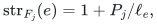
where <code class="math">P_j</code> is the length of one simple forest path or of two
root paths. With integral parent lengths,
<!-- math-display: 774daf2b1b662e7989eea977
\ell_e\widetilde{\rm str}(e)
             =2\sum_{j=1}^{h}(\ell_e+P_j)                       \tag{4a}
-->
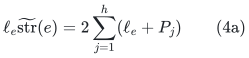
is an integer. An inserted edge receives stretch estimate one.
These labels stay fixed for their edge lifetimes. Construct them
using the integer expression (4a), rather than multiplying separately
stored rational approximations.

If all parent lengths are at most <code class="math">L_i</code>, each <code class="math">P_j</code> is at most
<code class="math">2n_iL_i</code>. Thus the conservative next-level bound is
<!-- math-display: b2095b75186616398c2c964c
L_{i+1}\leq O(n_i\log^2(n_i+2))\,L_i.
 \tag{4b}
-->
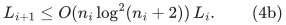
Retained spanner edges keep their core lengths; zero alias edges
are removed by the justified gauge correction and contraction.
Therefore every edge passed to the recursive solver has a positive
integer length. Bound (4b), at fixed depth with
<code class="math">n_i\leq M^{O(1)}</code>, gives <code class="math">O_{a,D}(\log M)</code> bits. Frozen
potentials and corrected gradients are sums and differences of
integral gradients on forest paths and have the same polynomial-bit
property. This argument does not require the sharper <code class="math">nL</code> wording
of KMPG Claim 3.15.

For an implementation exposing a different exact rational
overestimate <code class="math">w_e\geq1</code>, a separate local interface is also valid:
after the source spanner has selected its retained edges, pass
<code class="math">\lceil w_e\rceil</code> to the child. The source metric and its
maintenance transcript stay unchanged; a child's stored length
dominates the same physical lift and is at most <code class="math">2w_e</code>.
A comparison circulation consequently loses at most a factor two
at this one level. In this variant replace the per-level quality
constant <code class="math">40</code> below by <code class="math">80</code>; the fixed-depth exponents are
unchanged. The ceiling is computed from the edge's own exact
bounded-bit representation on its already charged birth or
replacement. No product of denominators across edges is formed.
The primary implementation here uses (4a), so this rounding
alternative is not needed for its arithmetic claim.

## 5. Raw cycle normalization and lifting

There are two elementary positive-edge lifts.

If the roots of <code class="math">u</code> and <code class="math">v</code> are distinct, the core edge lifts to
the two root legs and the central parent edge. Its raw parent length
is at most its stored core length by the stretch-overestimate
definition in KMPG Definitions 3.4 and 3.6.

If both endpoints have the same root, the edge is a core self-loop.
Its parent circulation is
<!-- math-display: 1ab089c56a711e76ee09bd2d
e+F_i[v,u],                         \tag{5}
-->
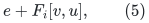
using the simple forest path. The common portions of the two root
legs are removed locally inside that one forest. Keeping both
uncancelled root legs would not satisfy the stored loop-length
bound. A forest edge itself gives zero in (5); a physical loop gives
its one-edge circulation. Nonzero loop candidates are retained even
when the distance spanner omits loops.

### Raw length of a lifted forest path

In the pool construction, a simple lifted path traverses exactly the
central edges of the corresponding child forest path. Within a pool,
the path from its incoming attachment to its outgoing attachment
is no longer than their two paths to the common root. Charge those
two legs to the two incident child edges. Summing proves
<!-- math-display: ee837776f9aa7c016822c5aa
\text{raw parent traversal length}
       \ \le\ \text{sum of child stored edge lengths}.           \tag{6}
-->
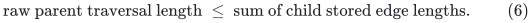
All occurrences of a physical edge are counted separately in this
argument. No cancellation of different physical images is needed.
This is the useful direction of KMPG Lemma 3.21's path inequality.
We use this construction-level proof in place of the oppositely
printed inequality in DO26 Lemma 5.4.

### Normalize while the candidate is explicit

The candidate at the selected hierarchy level has a short explicit
edge list. First coalesce its signed edge-ID vector, then decompose
the resulting circulation into sign-compatible simple cycles. Select
the cycle with the largest absolute gradient-to-length ratio,
reversing orientation when needed. Its ratio is at least the
candidate's net ratio and its abstract raw length equals its norm.
A direct quadratic-time decomposition in the explicit list length
is already within the local work bound.

Zero-link components have zero gradient after (4) and are ignored.
This operation is performed on the short abstract candidate. It
does not assume that a long implicit physical circulation can be
cycle-decomposed cheaply.

A nonloop hierarchy edge contributes two paths in lifted level
forests and its central lower-level edge. Descending only the central
edge gives at most <code class="math">2D+1</code> path or physical-edge pieces per abstract
edge. The loop lift (5) satisfies the same bound. Induction using
(6) yields a computable denominator <code class="math">U</code> with
<!-- math-display: 3bbf50b34ec82417a2ac53de
V\le U,\qquad
             g_{\rm physical}^{\mathsf T}c
                =g_{\rm abstract}^{\mathsf T}z.                 \tag{7}
-->
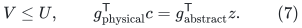
The equality follows from the retained-edge correction and
telescoping of potentials on complete cycles. Equation (7) is the
raw certificate used in (1).

### The approximation loss is charged once locally

The ASZ/forest dichotomy and the explicit spanner-route dichotomy
say that a useful circulation is found either in a local ball, in a
fundamental forest cycle, in a spanner correction, or in the child.
One level loses at most <code class="math">40\alpha\rho</code>, where <code class="math">\alpha</code> is a
forest-stretch factor and <code class="math">\rho</code> is the spanner stretch. Both are
<code class="math">M^{o(1)}</code> for fixed parameters.

Follow the child alternative until a local candidate is selected.
Only there apply the crude minimum-spanning-forest fundamental-cycle
extraction of DO26 Lemma 3.23. The local graph has at most
<code class="math">\widetilde O(k\Delta^3)</code> vertices; the terminal graph will have at
most <code class="math">4k\Delta</code> active records. Hence
<!-- math-display: 92f350a4d49b3c4fe77f64af
Q_{\rm ratio}
 \ \le\
 (40\alpha\rho)^D
       \widetilde O\!\left(k\max_i\Delta_i^3\right).              \tag{8}
-->
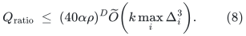
There is one local extraction factor. It is not raised to the
hierarchy depth. The direct ASZ decomposition and the treatment of
truncated final segments are given in the raw-lift note.

## 6. Computable fixed-depth parameters and guards

All source primitives are fixed finite algorithms. Their absolute
implementation constants are fixed once. The parameter family does
not receive per-input or per-<code class="math">a</code> advice, asymptotic cutoff tables,
or the constants denoted <code class="math">C_a</code> in running-time bounds.

For the matching branch choose the literal constant
<code class="math">C_\star=10^6</code>, set <code class="math">a=1000+t</code> for branch index <code class="math">t\ge1</code>, and
compute
<!-- math-display: 3a2c1a736f27e318060d68e1
\eta=\frac1{C_\star a},\qquad
 D=2C_\star a+2,\qquad
 K_{\rm sp}=C_\star a\,2^{4D}.                                  \tag{9}
-->
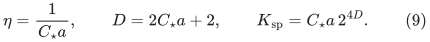
For <code class="math">M=2^u</code>, use
<!-- math-display: 998a4c872bbfd930fab79a3b
k=2^{\lceil u/(C_\star a)\rceil}.              \tag{10}
-->
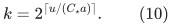
This differs from <code class="math">M^\eta</code> by at most a factor of two.

For a completely numeric degree and recourse budget, compute
<!-- math-display: ad9d22498290d1a5df0ac4d9
A_{\rm cap}=2^{\lceil16u/K_{\rm sp}\rceil},\quad
 \widehat\Delta_0=4,\quad
 \widehat\Delta_{i+1}
     =A_{\rm cap}\widehat\Delta_i^2.                             \tag{11}
-->
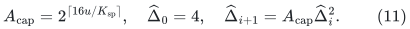
Use <code class="math">\widehat\Delta_i</code> as the specified maximum-degree parameter
at level <code class="math">i</code>. Suspend the branch if an emitted child degree exceeds
the next budget. For recourse, count all emitted child edits AFTER
initialization and check the cumulative count through local time <code class="math">t</code>
against <code class="math">4t\widehat\Delta_{i+1}</code>. Do not reject a single large
batch merely because it exceeds
<code class="math">\widehat\Delta_{i+1}</code>: DO26 Lemma 4.1(3) supplies a prefix-total
bound, which permits amortized bursts. The extra exponent in
<code class="math">A_{\rm cap}</code> absorbs the <code class="math">M^{4/K_{\rm sp}+o(1)}</code> factor and its
fixed constants for every sufficiently large input at fixed <code class="math">a</code>.
A child-size check with budget
<code class="math">\lceil8m_i\widehat\Delta_{i+1}/k\rceil</code> is handled the same way.

A convenient explicit prerequisite for invoking a nonterminal
source instance is
<!-- math-display: 543aeb99bdf6da6d78ddf46d
K_{\rm sp}^{\,7}\le\lfloor\log_2 m_i\rfloor.
-->
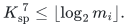
It is stronger than needed eventually and puts the parameter into
the source's <code class="math">o(\log^{1/6}m_i/\log\log m_i)</code> range. Failure suspends
this branch. These checks are not used to turn an unsupported
numerical result into a LOW certificate.

Here <code class="math">m_i=n_i+e_i</code> counts every actual resident recursive input
vertex slot and edge, **including retained isolated vertices**.
Only private activation records that have never been inserted, or
metadata of a completely retired instance, are excluded. The
[disconnected-component wrapper](disconnected-component-backend-wrapper.md)
specifies how small-component roots are activated without inserting
all their physical vertices into the child; its size bound includes
every child slot retained after losing its last edge. If
<!-- math-display: aebe217635c03ef0851adaa4
m_i\le4k\widehat\Delta_i,
-->
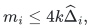
use the terminal explicit cycle computation. Otherwise restart
the local instance after
<!-- math-display: a7ca1d307d9e6805cac4afb5
Q_i=\left\lfloor
                          \frac{m_i}{4k\widehat\Delta_i}
                       \right\rfloor                           \tag{12}
-->
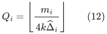
parent edits. Since
<code class="math">m_i\le(1+\widehat\Delta_i/2)n_i</code>, this period is at most <code class="math">n_i/k</code>.
Thus it respects the actual DO26 horizon. An initial capacity and a
constant safety margin cover all vertex and edge births during the
period.

For analysis put
<!-- math-display: 9b06b53df49ab2ec72d573cf
\vartheta=\frac{2^{D+8}}{K_{\rm sp}}.
-->
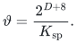
The larger constant here accommodates the explicit caps (11);
it is still less than <code class="math">\eta/1000</code>. At every fixed <code class="math">a</code>, <code class="math">D</code> is
constant. Writing <code class="math">d_i=\log_M\widehat\Delta_i</code> gives
<!-- math-display: 49805a82401fc26a24f92e9d
d_{i+1}\le 2d_i+16/K_{\rm sp}+O(1/\log M).
-->
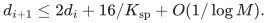
Consequently, uniformly through these at most <code class="math">D</code> levels,
<!-- math-display: 03390efc4951315cf772deaf
\widehat\Delta_i\le M^{\vartheta+o(1)},\qquad
 \prod_{j<i}\widehat\Delta_{j+1}
       \le M^{\vartheta+o(1)}.                                 \tag{13}
-->
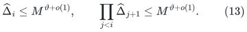
This follows by summing the geometric series in <code class="math">2^i</code>.
The fixed but enormous factor <code class="math">2^D</code> is a constant for this
branch, not an input-dependent exponent.

Child size is at most <code class="math">O(m_i\widehat\Delta_{i+1}/k)</code>. Hence
<!-- math-display: dc70b4bcaa37d2feb1e0abe2
m_i\le M^{1-i\eta+\vartheta+o(1)}.
-->
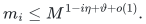
The stopping rule must apply before depth <code class="math">D</code>.
All prerequisite checks above eventually pass at a fixed branch:
every nonterminal graph has size at least <code class="math">k</code>, which tends to
infinity as a fixed power of <code class="math">M</code>.

## 7. Complete work and representation recurrences

For this section write <code class="math">R_i=\widehat\Delta_{i+1}</code>, interpreted as an
amortized/prefix-total child recourse factor. A sufficiently
loose common local-work envelope is
<!-- math-display: 5a1f73ca5d5389924c4a227c
W=M^{10\eta+40\vartheta+o(1)}.               \tag{14}
-->
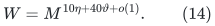
The source's local initialization is bounded by
<code class="math">\widetilde O(mk^4+m\Delta^2+m\gamma_\ell)</code>; its update cost is
<code class="math">\widetilde O(k^4+\Delta^2 A\gamma_\ell^{O(K_{\rm sp}^2)}k^2)</code>.
Because <code class="math">K_{\rm sp}</code> is fixed, the factors involving
<code class="math">\gamma_\ell</code> have exponent <code class="math">o(1)</code>.

Even a direct implementation of the additional local candidate
lists fits (14). DO26's shattering parameter is
<code class="math">\widetilde O(k\Delta^2)</code>. Local neighborhoods have at most
<code class="math">\widetilde O(k\Delta^3)</code> vertices and
<code class="math">\widetilde O(k\Delta^4)</code> edges. An endpoint edit affects at most
<code class="math">\widetilde O(k\Delta^3)</code> such neighborhoods. Recomputing their
minimum-spanning-forest candidate lists, writing explicit cycles
when necessary, is bounded by a fixed polynomial such as
<code class="math">\widetilde O(k^3\Delta^{10})</code>. The envelope
<code class="math">k^{10}(\Delta A)^{40}M^{o(1)}</code> also absorbs exposed forest cuts,
spanner-route records, selected-candidate decomposition and pool
bookkeeping.

Let <code class="math">I_i</code> denote the initialization allowance, including the
geometric pool construction charged to this instance, and let <code class="math">T_i</code>
be amortized cost per parent edit. The size decrease gives
<!-- math-display: 6bf3932da02b68f423b1a8d1
I_i\le O(m_iW)+I_{i+1}=O(m_iW).
-->
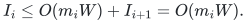
The restart period (12) charges the current routine's own
initialization at <code class="math">O(k\widehat\Delta_iW)</code> per parent edit.
Reinitializing its child costs
<!-- math-display: 5a6312de89bf8a781ca4c7de
O\!\left(\frac{k\widehat\Delta_i}{m_i}\right)
     I_{i+1}
       \le O(\widehat\Delta_iR_iW).
-->
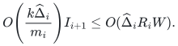
Retiring old instances and flushing their representations are
included in these terms. Therefore
<!-- math-display: f4decd1fafb348bd459c9700
T_i\le O\!\left(
      (1+k\widehat\Delta_i+\widehat\Delta_iR_i)W\right)
       +R_iT_{i+1}.                                           \tag{15}
-->
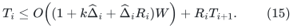
In particular there is no factor <code class="math">k</code> multiplying the recursive
update term. The current routine's restart cost is present; it is
not charged only to the child.

For an explicit occurrence cap <code class="math">C_i</code>, including dormant and
isolated records, and a cap <code class="math">E_i</code> on non-rebuilding representation
edits per level-<code class="math">i</code> input edit, safe recurrences are
<!-- math-display: 94f8c980c989f8e06abbfcb5
\begin{split}
 C_i&\le R_i^4(C_{i+1}+\mathrm{polylog}M)M^{o(1)},\\
 E_i&\le R_iE_{i+1}
           +R_i^4(C_{i+1}+1)M^{o(1)}.
\end{split}
\tag{16}
-->
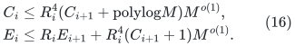
Equation (3) is the sharper vertex-pool count; (16) also covers
root identifications, all parent cuts, auxiliary level forests and
fixed-index pool management. At the terminal level, candidate
spanning trees are private computation. Return their cycles as
explicit edge lists instead of adding those private trees to the
maintained flat representation. Thus <code class="math">C_{\rm base},E_{\rm base}=O(1)</code>.

Equations (13)–(16) give <code class="math">C_i,E_i=M^{O(\vartheta)+o(1)}</code>.
The descendant occurrence factor is included in <code class="math">W</code>. A complete
rebuild births or retires <code class="math">O(m_iC_i)</code> records, included in its
initialization allowance, so no uncharged recursive forest copy is
being created.

Solving (15) yields
<!-- math-display: 094d833c61bd4c803f6aaeda
T_0\le M^{11\eta+O(\vartheta)+o(1)}
      \le M^{20\eta+o(1)}.
-->
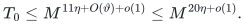
Initialization is at most <code class="math">M^{1+20\eta+o(1)}</code>. The same relaxed
bound covers a query and its compact candidate processing.
Equation (8) gives quality loss and answer-piece exponent
<code class="math">\eta+O(\vartheta)+o(1)</code>, proving the numerical theorem.

## 8. Arithmetic and the OAI client

At each child step, stored positive edge lengths grow by at most
a polynomial in the parent size. There are only <code class="math">D</code> levels.
Gradients and frozen potentials are sums and differences of
polynomially many parent entries. Thus all hierarchy arithmetic has
<code class="math">O_{a,D}(\log M)</code> bits for this fixed branch. Exact integer or
scaled-integer arithmetic suffices, with charged multiword
operations when a quantity does not fit one physical word.
Comparing two ratio certificates uses cross multiplication.

Keep distinct physical edge identities and their reference
orientations throughout the lift. An image vertex pair alone is
insufficient in a multigraph. Null edges have both zero physical
gradient and zero physical raw charge after the correction in
Section 4.

The source engine in OAI Section 5 requires
<!-- math-display: 6a3a4dabfac989a44b80fd2b
S^{1/a}\le M\le S^2,
-->
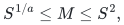
physical prices of magnitude at most <code class="math">M^{1200a}</code>, occurrence
multiplicity at most <code class="math">M^{10/a}/4</code>, and relative raw quality at
least <code class="math">M^{-10/a}</code>. Use its existing computable choice of rounded
physical <code class="math">M</code>, not historical persistent-memory allocation.
For (9), both the occurrence exponent and the loss exponent above
are strictly smaller than <code class="math">10/a</code>. For all sufficiently large
inputs at fixed <code class="math">a</code>, their constants and <code class="math">o(1)</code> terms fit the
source's margins. All work and answer-piece counts have exponent
<code class="math">O(1/a)+o_a(1)</code>.

Install the stable occurrence callbacks before the priced engine
updates its physical metadata. Exact signed path additions,
absolute-motion additions, point values and refresh thresholds
then use the same deterministic augmented-forest machinery as the
source engine. Pure representation changes cause no primal motion.
The source proof of priced logarithmic progress applies because
its denominator is precisely the literal traversal bounded in (7).

This replaces the stochastic flat-cycle construction used by the
source. It does not change the deterministic objective progress,
register-error, local-projection or matching-state lemmas. The
source numerical guards remain; failure to establish a prerequisite
suspends a branch and does not certify LOW.

The OAI primary source is
[Almost-Linear-Time Maximum-Cardinality Matching in Sparse General
Graphs, September 2026](https://github.com/openai/math/tree/main/preprints/Almost-Linear-Time-Maximum-Cardinality-Matching-in-Sparse-General-Graphs-September-24-2026),
especially Sections 3–5 and the finite-word implementation in
Section 9. Its status as model-produced, unformalized research is
not changed by this alternative backend.

## 9. Composition with persistent carriers

The actual integral ledgers below the top level are represented by
persistent transportation forests. Whole valid sparse edit batches
are applied before cycle cancellation. Each newly positive
off-carrier incidence needs one signed tree-path pivot; only one
zero edge must be cut from that cycle and the other zero carrier
edges may remain. Row sums and column sums are unchanged.

At a settled bottom ledger, root each carrier tree at a bin. Each
row has degree two or three. Keep both incidences of a degree-two
row, and the two child incidences of a degree-three row. The
resulting selected forest has one edge per row and each component
has weight below <code class="math">2L</code>. Its canonical assignment is obtained by
assigning each row a selected child. Local tight-set search and a
successful pair exposure therefore need only their charged local
records, and the latter changes at most two selected trees.

The matching-side transaction freezes its pre-event assignment
version until all projection and peel repairs have settled. Its
source projection batches, actual-ledger normalization, canonical
assignment queries and physical materialization are unchanged by
the choice of numerical backend.

For a subcubic phase of order <code class="math">N</code>, the source parameters are
<!-- math-display: 893923beef984b88c03a924c
C_{\rm match}=a+1,\qquad
 L=\left\lceil\frac{10000C_{\rm match}N}{K}\right\rceil,\qquad
 g_*=\max\!\left\{1,\left\lfloor\frac{K}{100C_{\rm match}}\right\rfloor\right\}.
-->
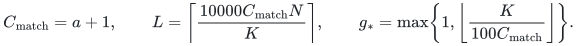
The deterministic structural accounting gives
<!-- math-display: f1398c385478f141c5f67dca
\#\text{expansions}+\sum\text{contraction arities}=O_a(N),
 \qquad \sum\text{peeled weights}=O_a(N),\qquad
 Lg_*=O_a(N).
-->
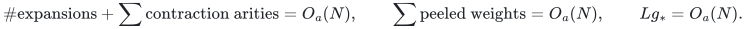
Hence all successful pair actions cost
<code class="math">O_a(N\mathrm{polylog}N)</code>, and output-sensitive tight
searches and carrier updates have the same near-linear structural
accounting. The alternative backend supplies the numerical bound.
One phase consequently takes
<!-- math-display: 44a83812ab82a23e71d578f3
N^{1+O(1/a)+o_a(1)}.                  \tag{17}
-->
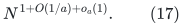
The coefficient in <code class="math">O(1/a)</code> is absolute. This is the eventual
fixed-branch statement needed by the matching theorem.

The reduction to subcubic instances is exact for arbitrary maximum
matching, without a perfect-matching promise. After cleaning the
input, let it have <code class="math">r</code> nonisolated vertices and <code class="math">m_s</code> edges.
Replacing a degree-<code class="math">d</code> vertex by an odd path with <code class="math">2d-1</code> vertices
gives
<!-- math-display: 735bf0e81d99171c25984ecf
N=4m_s-r,\qquad A_{\rm off}=2m_s-r,\qquad
                  \nu(J)=A_{\rm off}+\nu(G).
-->
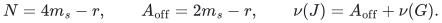
Any supplied matching lifts with exactly this offset. A maximum
matching of <code class="math">J</code> decodes to one of <code class="math">G</code>. The direct optimum-gap
driver in [the general-matching reduction](general-graph-gap-reduction.md)
uses the source phase as a bound on remaining improvement. Its
success and LOW alternatives reduce the maintained gap bound in
<code class="math">O_a(\log(r+2))</code> phases. Odd order, disconnected components,
dense inputs and nonexistence of a perfect matching require no
additional promise.

Thus for every fixed <code class="math">\epsilon&gt;0</code>, a sufficiently large fixed
branch gives
<!-- math-display: 11cd1e65fd738e74bd692cb5
O(n+m)+O_\epsilon((m_s+1)^{1+\epsilon}).             \tag{18}
-->
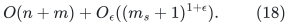
The exact matching-size kernel in
[matching-size kernel corollary](matching-size-kernel-corollary.md)
can be applied before the same computation, replacing <code class="math">m_s</code>
in the second term by <code class="math">\min\{m_s,\nu(G)^2\}</code>.

## 10. One uniform program

The construction above is one finite parameterized program.
Equations (9)–(12) are ordinary integer computations. Observed
pool growth, emitted degree/recourse checks and physical-size
guards are executable. An asymptotic threshold is never requested
as input. A finite exceptional branch may suspend or take a long
time; a proposed matching is not accepted on the strength of its
internal LOW conclusions alone.

Perform cleanup once in <code class="math">O(n+m)</code> time: discard loops, merge
parallel copies while retaining an original edge ID, remove
isolates and compactly relabel. The nonempty compact graph has
size <code class="math">q=r+m_s=\Theta(m_s)</code>. Share it read-only among all branches.
The optional exact kernel can also be computed once.

Branch zero is a classical deterministic polynomial-time exact
matching algorithm. Branch <code class="math">t\ge1</code> uses <code class="math">a=1000+t</code> and the
parameters above. Validate every proposed matching, then run one
deterministic general-graph augmenting-path search from it. Accept
exactly when no augmenting path exists. This takes
<code class="math">O(q\alpha(q))</code>; a primary explicit interface is Part I,
Figure 3, Sections 2.3 and 4 of
[Mehlhorn–Nobahari, arXiv:2603.22909v2](https://arxiv.org/pdf/2603.22909v2).

At round <code class="math">j</code>, give each unfinished branch <code class="math">t\le j</code> up to
<code class="math">2^{j-t}</code> elementary physical-machine instructions. Verification
is charged inside that branch's allowance. Invalid proposals are
rejected, and a suspended branch is inactive. A fixed branch
needing <code class="math">T_t(q)</code> instructions, including its verifier, is
completed by total work
<!-- math-display: cab65cc0f5b07e1f08a8e757
O(2^t(T_t(q)+1)\mathrm{polylog}(q+2)).
-->
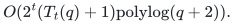
All long arithmetic, initialization loops, allocations and source
calls are interruptible. Logical large integers use digit arrays;
logical memory uses dictionaries of touched cells. The classical
fallback completes in polynomial total work, bounding actual
allocated memory by a fixed polynomial. One physical word-size
constant suffices for actual addresses and counters, independently
of the varying branch parameters.

For each fixed <code class="math">t</code>, the additional simulation and verification
costs preserve (17). Given any fixed positive <code class="math">\epsilon</code>, choose
one sufficiently large fixed branch in the analysis. Its
<code class="math">O(1/a)</code>, its eventual <code class="math">o_a(1)</code>, constants and logarithmic
overheads fit within <code class="math">\epsilon</code>. The same program therefore has
the common worst-case envelope
<!-- math-display: 23983f575ced9092c5005233
O(n+m)+(m_s+1)^{1+o(1)},                     \tag{19}
-->
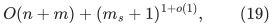
or
<!-- math-display: 827776be7e5e91bacc5d7ebb
O(n+m)+(\min\{m_s,\nu(G)^2\}+1)^{1+o(1)}
-->
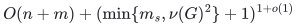
with the exact kernel. The accepted compact edge IDs are mapped
back once. Raw isolates and duplicate edge occurrences are not
rescanned by the portfolio.

Final verification makes every accepted output exact. The improved
running time still requires the complete eventual fast-branch
proof: the OAI deterministic client, the persistent-carrier and
local structural constructions, and the constructive KMPG/DO26
primitives used here. If one of these dependencies fails, the
verifier preserves output correctness but does not preserve the
improved time bound. The benefit of this alternative is a precise
degree-scoped numerical route, not a replacement of those
dependencies by an unqualified black-box claim.
