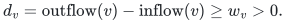
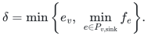
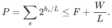

# Exact demand trimming in a supplied directed flow

<!-- review-status:start -->
**Ready for review.** Complete coordinatewise subflow construction, selected directed forest, cycle cancellation, source excess removal and near-linear operation ledger. Includes sink-outgoing preprocessing, native arc identities and finite-bit arithmetic.

**Dependencies and scope.** The deterministic dynamic-forest interface is a named published data-structure dependency. A supplied feasible flow and strictly positive nonsink targets are part of the input model.

The [verification note](verify/README.md) identifies executable coverage. This status does not claim external peer review or proof-assistant verification.
<!-- review-status:end -->

**Result.** A supplied feasible flow can be trimmed to exact positive nonsink demands in deterministic near-linear arithmetic work, without increasing any arc flow. The construction supports loops, parallel records, and opposite directed records, preserves integral values, and needs no maximum-flow computation.

**Theorem (exact-demand subflow).** Let a directed graph have <code class="math">n</code> vertices, <code class="math">m</code> arc records, designated sinks, and nonnegative supplied flow <code class="math">f</code>. Suppose every nonsink has divergence at least its prescribed positive target <code class="math">w_v</code>. After discarding any outgoing sink flows as described below, one can construct <code class="math">0 ≤ f′ ≤ f</code> with exact divergence <code class="math">w_v</code> at every nonsink in <code class="math">O((n+m) polylog(n+m+2))</code> exact arithmetic operations. No sink inflow target is imposed. Output consists of the flow on the original arc records; isolated vertices and zero records are included in the input scan.

The proof is complete below. Its data-structure dependency is the standard deterministic dynamic-forest interface: Alstrup, Holm, de Lichtenberg, and Thorup, [*Maintaining Information in Fully-Dynamic Trees with Top Trees*](https://arxiv.org/abs/cs/0310065), Section 2 and the path-query applications. Path minima, lazy path additions, and extraction of a minimizing edge use constant-size cluster summaries; repeated extraction is charged to the edges removed. No unproved graph-optimization primitive is assumed.

This is an independent supporting result restored from an early checkpoint. The current [four-fifths maximum-matching theorem](../../problems/general-matching/proof.md) does not call it. Its two static applications are [confluent rounding](static-confluent-rounding-and-tail-bounds.md) and local rounding of a chosen region. A proof of this subflow theorem alone makes no dynamic matching-time claim.

## 1. Input and target

Let a directed graph have nonnegative arc flow `f`. Its designated sinks
have no outgoing arcs. At every nonsink `v`, its current divergence is

<!-- math-display: a22f13a8352409fe037e39e7
d_v=\mathrm{outflow}(v)-\mathrm{inflow}(v)\ge w_v>0.
-->

The task is to produce `0<=f'<=f` with divergence exactly `w_v` at each
nonsink, allowing the amounts consumed by sinks to decrease. Self-loops
and distinct parallel/antiparallel arcs are permitted. Integral input
data must remain integral.

If the supplied representation initially has outgoing arcs from a
designated sink, including sink-to-sink arcs, first set ALL such flows
to zero and discard those arcs. At a nonsink this can only remove
incoming flow, so its divergence increases and remains at least its
target. Recompute these divergences and excesses. There is no prescribed
divergence target at sinks, so this preprocessing is valid and takes
linear work. In the row/bin applications sinks already have no outgoing
arcs: only assigned bins in the active region supply row arcs.

The construction uses `O((n+m) polylog n)` exact arithmetic operations.
It need not remove every directed cycle from the final support.

## 2. Selected directed forest

Maintain a subset `T` of positive-flow arcs that forms an undirected
forest, directed toward each component's root. Every vertex has at most
one selected outgoing arc. Initially the forest is empty.

A nonsink root always has a positive outgoing arc: its divergence is
strictly positive throughout. That arc cannot already be its selected
outgoing arc, since the root has none.

When extending a component root `r`, choose any positive outgoing arc
`e=(r,u)`.

* If `r,u` lie in different selected trees, link them with `e`. The
  former root tree now points into the other tree.
* If they lie in the same selected tree, `e` followed by the selected
  path `u` to `r` is a directed cycle. Subtract the minimum flow on that
  cycle, delete all zero-flow arcs, and insert `e` into the selected
  forest if it remains positive. At least one old selected cycle edge
  was then cut, so this insertion creates no undirected cycle.

For a self-loop, subtract its whole flow and delete it immediately.
All changes are monotone decreases in actual flow and preserve every
vertex divergence during cycle cancellation.

## 3. Remove each excess supply

For every nonsink `v`, let its remaining excess be `e_v=d_v-w_v`.
While `e_v>0`, extend the root of `v`'s selected tree by the preceding
rule until that tree reaches a designated sink. The selected path from
`v` to that sink is now directed and has positive flow.

Subtract

<!-- math-display: 4a97c94f4a24a775d6f56c34
\delta=\min\left\{e_v,\ \min_{e\in P_{v,\mathrm{sink}}}f_e\right\}.
-->

from every arc of the path, and reduce `e_v` by `delta`. Delete every
zero-flow arc. This decreases the divergence only at `v`, by exactly
`delta`; all intermediate divergences are unchanged. Therefore every
nonsink divergence remains at least its positive target. In particular,
the root-extension rule never gets stuck before reaching a sink.

When all excesses vanish, the resulting flow has the required target
divergences and is coordinatewise bounded by the input flow.

## 4. Amortized work and arithmetic

Use a link-cut or top-tree forest supporting path minimum, path
subtraction, link/cut, and enumeration of zero minima. After a path update, expose the affected path and collect every zero edge identifier before cutting any of them. The zero search therefore never assumes that the original path is still connected after its first cut. Each cycle
cancellation permanently deletes at least one original arc. Every
source-to-sink subtraction either deletes an arc or exhausts one
source's excess. Hence there are `O(m+n)` such substantive operations.

A selected link decreases the number of forest components. Components
increase only after cuts of permanently deleted arcs. Thus the number
of selected links is also `O(m+n)`, including links of surviving
candidate edges after cycle cancellation. Outgoing adjacency lists can
discard zero arcs permanently; no positive edge is reintroduced.

All dynamic-tree operations have logarithmic overhead. The result is
`O((m+n) polylog n)` arithmetic work. The path updates use only subtraction, minimum, and comparisons, so they preserve integrality and never increase an arc flow. Computing divergences and excesses also uses sums. If integral arc values and targets initially have at most <code class="math">b</code> bits, these sums use <code class="math">O(b+log(m+2))</code> bits; the theorem counts arithmetic operations and charges their actual bit cost. The same conclusion applies after clearing a supplied common denominator. Arbitrary rational input must charge the resulting denominator and sum bit lengths. Arc identities distinguish an antiparallel two-edge cycle from
the forbidden use of one directed arc backward; this construction uses
only genuine directed arcs.

## 5. Consequences for row/bin guide flows

In the settled bottom ledger, assign each row's allocations as outgoing
flow from its assigned bin. Its supply is `L-incoming(v)>=w_v`.
Remove self-loops and apply the construction with target `w_v`.
Every arc only decreases, so nonsink node congestion remains at most
`L`. Free bins are sinks with their own fixed demands `w_v`; their
total load also remains at most `L`.

Let `W=sum_v w_v`. The total sink load after trimming is exactly `W`.
For `F` free sinks the initial confluent-rounding potential is consequently

<!-- math-display: ff22cdc77db00cafd22ee4f0
P=\sum_s2^{b_s/L}\le F+\frac WL.
-->

using `2^x<=1+x` for `0<=x<=1`. This improves the generic upper bound
`2F` when the original guide flow had substantial artificial supply.

The same argument works on a dirty region `Q`: retain only arcs of
rows assigned to `Q`, and make outside neighbors sink anchors.
Restricted supplies are still at least `w_v`. The graph has
`O(|Q|)` arcs because row degree is at most three. Exact dirty weights
can therefore be routed to anchors in `O(|Q| polylog N)` work,
replacing the otherwise sufficient static maximum-flow call in the
local warm-start lemma.

Different anchor bins of the same unchanged exterior core may then be
identified as one sink for confluent rounding. Keep each incoming arc's original
head as the attachment witness. Its heavy core demand affects the
subsequent potential, but not the correctness or time of trimming.

## Finite executable evidence

The [independent static-allocation checker](verify/check_static_allocations.py)
recomputes original input invariants and the output contract on small integer
instances. Its [evidence note](verify/README.md#independent-flow-and-transportation-checks)
states the exact domains and counts. These explicit polynomial routines do
not implement or certify the near-linear dynamic-tree runtime.

## Source and restoration record

These results were already present in the 24 October 2026 uniform checkpoint. This page restores their full arguments in a semantic location; it does not claim that they were discovered during the repository reorganization. The original UTF-8 bytes were recovered and checked against the archive inventory. See the [checkpoint restoration record](../../provenance/checkpoint-restoration.md).

| Original note | SHA-256 of recovered source |
|---|---|
| `exact_demand_flow_trimming.md` | `67dbfd2b73210201b639da1f7f1fa325d8c6ed8b112ebecfe02c0b44ef84fbcd` |
