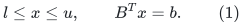
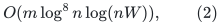
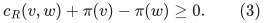
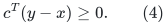
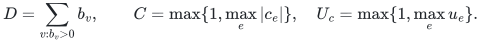
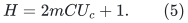
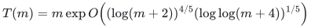
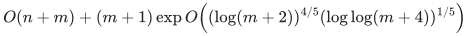

# Exact acceptance and general-flow reductions

**Transfer companion, 25 October 2026.** This note gives an unconditional
output check for a candidate exact minimum-cost circulation and explains
the reductions to general demands, lower bounds, and maximum flow. The
check is near-linear for polynomially bounded integral costs. It therefore
preserves the proposed `4/5` overhead exponent while permitting the same
fixed-constant portfolio strategy used by the matching construction.

## 1. Near-linear optimality verification

Let `G=(V,E)` be a directed multigraph with integral costs `c`, integral
lower and upper bounds `l <= u`, and integral divergence demand `b`.
A candidate output is a completely explicit vector `x in Z^E` indexed
by the original input arc lifetimes.

First check in one scan that

<!-- math-display: 6bebfa623386d1d2629eb4b1
l\le x\le u,\qquad B^Tx=b.               \tag{1}
-->

Build its residual graph `R_x`. It has a forward arc of cost `c_e`
when `x_e<u_e`, and a reverse arc of cost `-c_e` when `x_e>l_e`.
Parallel original arc IDs remain distinct. Loops obey the same rule.
Add a fresh vertex `s_0` with a zero-cost arc to every relevant original
vertex, so all residual vertices are reachable.

Apply the deterministic negative-weight shortest-path algorithm of
Haeupler, Jiang and Saranurak,
[arXiv:2511.08551v1, Theorem 1.1](https://arxiv.org/html/2511.08551v1).
Their problem definition includes finding a negative cycle when one
exists. The displayed running time is

<!-- math-display: a8f436a73ef27563bbfa103b
O(m\log^8 n\log(nW)),                \tag{2}
-->

for integer weights in `[-W,W]`; adding the zero-cost source changes
the graph size only linearly. A later improvement by Duong,
[arXiv:2609.05590v2](https://arxiv.org/abs/2609.05590), is not needed
for this construction.

If the algorithm detects a negative cycle, reject the candidate. If
it supplies finite distances `pi`, explicitly verify every residual
inequality

<!-- math-display: 293fefef45b2e535608c0269
c_{R}(v,w)+\pi(v)-\pi(w)\ge0.              \tag{3}
-->

Accept only if (1) and (3) pass. The final scan is an exact integer
check, not an acceptance of an internal asymptotic resource bound.
Residual shortest paths can be chosen simple, so their distance
labels have `O(log(nW+2))` bits. All relevant arithmetic is therefore
within ordinary fixed-polynomial bit cost.

To prove soundness, let `y` be any other feasible original flow.
Represent `y-x` as a nonnegative residual circulation by using the
forward residual direction when `y_e>x_e` and the reverse direction
when `y_e<x_e`. Its total reduced cost is nonnegative by (3), while
the potential terms telescope because its divergence is zero. Thus

<!-- math-display: c534987981e1aed4011eab1c
c^T(y-x)\ge0.                  \tag{4}
-->

The accepted candidate is exactly optimal. This proof is independent
of how the candidate was computed. A correct optimum has no residual
negative cycle, so the cited algorithm returns a valid potential and
the check accepts it.

For graphs with many isolated vertices, scan all input vertex/demand
records once, rejecting a nonzero demand at an isolated vertex. Keep
only the active vertex inventory in the residual call. Its size is
`O(m)`, while the one-time input work is `O(n+m)`.

## 2. Uniform fixed-constant portfolios

A candidate branch may use an enumerated tuple of fixed constants for
the structural caps. It may run internal threshold decisions, including
LOW, as part of its own binary search. Those decisions are not returned
to the user or trusted by another branch.

When a branch proposes an explicit optimal circulation, run Section 1's
verification INSIDE that branch's charged instruction budget. Only an
accepted flow is eligible to stop the portfolio. A branch with inadequate
quality constants may choose wrong thresholds or return a suboptimal
flow, but it cannot pass (1)--(3).

Use the same finite-instruction interleaving convention as in the
matching portfolio: branch `j` receives an input-independent positive
instruction share, with a fixed classical exact min-cost-flow algorithm
receiving a separate positive share. The classical branch ensures
termination on every finite input. The favorable fixed branch receives
a constant fraction depending only on its fixed index, so its
asymptotic running time changes by only a constant factor. The
near-linear verification cost is included in that running time.

This argument requires no access to a hidden asymptotic threshold and
no advice depending on the input size. It also makes clear why checking
only primal feasibility would be insufficient for a minimum-cost-flow
portfolio.

The verifier establishes accepted-output correctness; it does not
prove the fast branch's time bound. The raw-cycle and numerical-client
proofs remain necessary for that bound.

## 3. From demands to a feasible circulation problem

First eliminate integral lower bounds by writing `f=l+x`. The new
capacities are `u-l`, the new divergence demand is `b-B^T l`, and
the objective changes by the known constant `c^T l`. Inconsistent
bounds are detected immediately. Zero-capacity arcs are retained only
as fixed output records.

It remains to solve a problem with `0 <= f_e <= u_e` and `B^T f=b`.
Use the convention that positive `b_v` means required net outflow.
If `sum_v b_v != 0`, declare infeasibility. Let

<!-- math-display: ca115c4cf9fc2591d7a91597
D=\sum_{v:b_v>0}b_v,
 \qquad C=\max\{1,\max_e|c_e|\},\quad
 U_c=\max\{1,\max_e u_e\}.
-->

Introduce vertices `sigma,tau`, arcs `sigma -> v` of capacity `b_v`
for positive demands, and arcs `v -> tau` of capacity `-b_v` for
negative demands. These arcs have cost zero. Add `tau -> sigma`
with capacity `D` and cost `-H`, where

<!-- math-display: d2355f794d472dd6c23f45bc
H=2mCU_c+1.                    \tag{5}
-->

Original arcs keep their original costs. Zero circulation is a
feasible starting point. The auxiliary graph has linear size after
the isolated-demand check. All auxiliary data are polynomially
bounded when the input data are.

For an integral auxiliary circulation let `a` be its return-arc flow.
Its cost is `c^T f-Ha`, with `c^T f in [-mCU_c,mCU_c]`. Increasing
`a` by one improves the objective by more than the possible difference
between these two extremes. Therefore an optimal integral auxiliary
circulation first maximizes `a`.

If some original feasible demand flow exists, the auxiliary circulation
with `a=D` exists; integral feasibility follows by standard cycle
rounding with integral divergence and bounds. Conversely, `a=D`
forces every source and sink demand arc to be saturated and leaves an
original flow of divergence `b`.

Consequently, after obtaining and independently verifying an optimum
auxiliary circulation:

* if `a<D`, the original demand problem is infeasible;
* if `a=D`, its original coordinates form a minimum-cost feasible flow,
  because the auxiliary reward is the same constant `-HD` on all such
  flows.

When `D=0`, no auxiliary arcs are needed. The original zero-demand
circulation problem already has a feasible zero flow.

An infeasibility conclusion in this reduction is backed by a verified
auxiliary optimum, rather than by an unchecked LOW from a guessed
parameter branch.

## 4. Maximum flow and a cut

For directed `s-t` maximum flow with nonnegative integral capacities,
give all original arcs cost zero and add `t -> s` of cost `-1` and
capacity at least the sum of all input capacities. An optimal bounded
circulation maximizes this return flow. Restricting it to original
arcs gives an exact maximum flow.

To output a minimum cut, search from `s` in the residual graph of
that maximum flow. The reachable side is an exact minimum cut by
flow conservation and the absence of a residual `s-t` path. The
search and cut scan take linear time. Original parallel IDs and
antiparallel arcs remain separate throughout.

## 5. Quantitative consequence

Suppose the moving-pad client and the prior raw-cycle construction
produce a favorable-branch circulation solver with

<!-- math-display: 9e0e02c2fdebe2bd9436c79a
T(m)=m\exp O\!\left((\log(m+2))^{4/5}
                       (\log\log(m+4))^{1/5}\right)
-->

for polynomially bounded integral capacities and costs. Binary search
over the integral cost interval adds only `O(log(mCU_c+2))` calls.
The verification, reductions, explicit output, and exact rounding
above preserve the same exponent. The resulting proposed bound is

<!-- math-display: be7768b5bf379ed4d5389993
O(n+m)+(m+1)\exp O\!\left((\log(m+2))^{4/5}
                       (\log\log(m+4))^{1/5}\right)
-->

for arbitrary directed general graphs, including parallel arcs,
disconnected inputs, integral demands, and lower bounds.

For input magnitudes beyond the polynomially bounded regime, one must
state an additional dependence on their bit length or invoke and charge
an explicit cost/capacity-scaling reduction. This note does not hide
that issue inside the symbol `m`.
