# An explicit balance wrapper for virtual-expander success

**Correctness refinement, 24 October 2026.** This note supplies the
complete balance interface used by the sequential virtual hierarchy.
Every weak success, including a spectral leaf reached after earlier
cuts, must cover at least a <code class="math">1-\beta</code> fraction of its CURRENT
input host. The fixed choice is <code class="math">\beta=1/1000</code>.

This replaces reliance on a leftover bound not stated by the former
three-quarter-coverage weak leaf. The correction changes only fixed
thresholds and a fixed number of calls. It changes neither the
quantitative routing tradeoff nor the <code class="math">4/5</code> composition's exponent.
Previously delivered checkpoints are not overwritten.

## 1. Required weak interface

For every actual induced host <code class="math">F</code> on <code class="math">N\geq1</code> vertices, and a
requested cut threshold <code class="math">\psi_{\rm w}&gt;0</code>, the weak procedure returns
one of the following:

* a nonempty cut <code class="math">S</code> with
  <!-- math-display: 1b47c24ba58328eb15e7d42c
  \beta N\leq |S|\leq N/2,\qquad
          |\partial_F S|\leq\psi_{\rm w}|S|;
     \tag{1}
  -->
  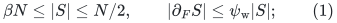
* a terminal set <code class="math">X\subseteq V(F)</code>, with
  <!-- math-display: 5db454cb71b6e159cda76871
  |X|\geq(1-\beta)N,
     \tag{2}
  -->
  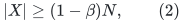
  an explicit virtual expander with vertex set exactly <code class="math">X</code>, and
  its explicit embedding into <code class="math">F</code>.

A returned cut may first be complemented inside <code class="math">F</code> to make it
the smaller side. Its balance and boundary certificate must refer
to this CURRENT host, rather than an earlier host before deletions.
For a singleton the success alternative is allowed with its
vacuous expansion convention.

The expander's quantitative guarantee depends on the current host
degree and requested threshold exactly as in the hierarchy's weak
construction. The wrapper below never composes two success
embeddings.

## 2. The spectral weak leaf has this interface

Start with an actual leaf host of <code class="math">N</code> vertices. Give each vertex
mass one, and set <code class="math">\Delta=\max\{1,\max_v\deg_F(v)\}</code>.
Apply the exact spectral cut-or-certificate primitive of
[virtual-expander-hierarchy-reconstruction.md](virtual-expander-hierarchy-reconstruction.md),
Section 1, with a fixed parameter
<!-- math-display: d9f4b247a82d66d56de925d5
\eta\leq\psi_{\rm w}/4.
 \tag{3}
-->
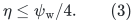
As before, a returned cut has at most half of the current remaining
mass and boundary at most <code class="math">\eta</code> times its mass. Remove it and
repeat, but stop as soon as the removed union <code class="math">C</code> has
<!-- math-display: 88415d294633f5ad77eeeeca
|C|\geq\beta N,
 \tag{4}
-->
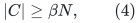
rather than waiting for <code class="math">N/4</code>.

The boundary of <code class="math">C</code> in the ORIGINAL leaf host is at most
<code class="math">\eta&#124;C&#124;</code>. To see this, sum the cut boundaries in the successive
induced hosts. An edge joining two removed pieces may be counted
earlier, but no such edge remains in the final boundary. Every
edge of the final boundary is counted at the removal of its endpoint.

Immediately before the last removal, <code class="math">&#124;C&#124;&lt;\beta N</code>. The last
piece has at most half of the remaining host, so at the first
crossing of (4),
<!-- math-display: 0261fd467538475e6eb4c285
\beta N\leq |C|<
                       \frac{1+\beta}{2}N.
 \tag{5}
-->
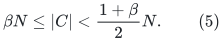
If necessary, return its complement. Since <code class="math">\beta&lt;1/3</code>, the
smaller side still has at least <code class="math">\beta N</code> vertices. Complementing
increases boundary divided by side size by at most
<!-- math-display: 2fa45655f566f63ba5eb7b74
\frac{1+\beta}{1-\beta}<2.
 \tag{6}
-->
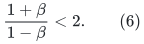
Together with (3), this proves the weak cut alternative (1), with
fixed slack.

If the spectral procedure certifies the remaining graph first,
then <code class="math">&#124;C&#124;&lt;\beta N</code>. The remaining induced graph therefore
supplies (2) with its identity embedding. Its sparsity is at least
<code class="math">\eta^2/(16\Delta)</code>, with the same positive maximum-degree bound
<code class="math">\Delta</code> as the spectral lemma. The change from stopping mass
<code class="math">N/4</code> to <code class="math">\beta N</code> does not change this certificate.

At most <code class="math">N-1</code> nonempty removals occur. Each spectral test has
fixed polynomial arithmetic and bit work in the actual leaf size,
so the leaf remains within the declared polynomial
<code class="math">k_{\rm route},\log n,\log\psi_{\rm w}^{-1}</code> preprocessing bound.
It is never padded to its leaf threshold.

## 3. Internal weak successes already have the same coverage

Use the PRIMARY exact covering routine in the virtual hierarchy.
Before the coarse merge, every uncovered vertex is in its actual
small cut <code class="math">C_1</code>. After removing the coarse blocks in <code class="math">C_2</code>,
the final terminal set is their retained union <code class="math">X</code>. Therefore
<!-- math-display: f40c4a6c3f25131016d78816
V(F)\setminus X
                                     \subseteq C_1\cup C_2.
 \tag{7}
-->
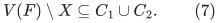
The weak routine returns a cut-only answer whenever
<code class="math">&#124;C_1\cup C_2&#124;\geq\beta N</code>. Every successful internal call thus
has
<!-- math-display: fe3a9586299a3457c9d550ff
|V(F)\setminus X|<\beta N,
 \tag{8}
-->
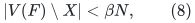
which proves (2). It is harmless if <code class="math">C_1</code> overlaps <code class="math">X</code>;
only the containment (7) is used.

The already proved actual-boundary sum pays for a returned union.
If that union is larger than <code class="math">N/2</code>, its complementary side remains
of fixed positive size and the fixed threshold slack pays for
complementation. Thus both internal calls and the corrected
spectral leaves meet the SAME weak interface.

The optional historical variant with a tiny leftover <code class="math">B</code> is
unnecessary here. This wrapper uses only the exact-covering
construction, so no separate bound on such a <code class="math">B</code> is assumed.

## 4. Strong balance with one retained success

Let the original host be <code class="math">G</code> on <code class="math">N_0</code> vertices, with requested
cut threshold <code class="math">\psi&gt;0</code>. Set
<!-- math-display: daf37bd85206d9e616cdacd9
\psi_{\rm w}=\psi/2.
 \tag{9}
-->
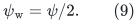
Initialize <code class="math">C=\varnothing</code>. While <code class="math">&#124;C&#124;&lt;N_0/4</code>, run the weak
routine on the ACTUAL induced host
<!-- math-display: b52035c6666af7cb6de987ce
F=G[V(G)\setminus C].
 \tag{10}
-->
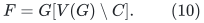

If it returns a weak cut <code class="math">S</code>, add <code class="math">S</code> to <code class="math">C</code> and discard
every candidate success hierarchy from that call. If it returns
a success, retain only this ONE successful hierarchy and return
that virtual graph and its embedding into <code class="math">G</code>. The embedding
already lies in (10), which is a subgraph of <code class="math">G</code>; no geometric
composition is needed.

### A cut exit is balanced

Consider the first time <code class="math">&#124;C&#124;\geq N_0/4</code>. Before the final
addition write <code class="math">c=&#124;C_{\rm old}&#124;&lt;N_0/4</code>. By (1) the added
piece has at most <code class="math">(N_0-c)/2</code> vertices. Hence
<!-- math-display: ff1cf0b77d883cfac525f3dc
N_0/4\leq |C|
                  \leq c+(N_0-c)/2
                  <5N_0/8.
 \tag{11}
-->
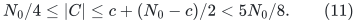
If <code class="math">C</code> exceeds half of <code class="math">G</code>, complement it. The returned
smaller side then has cardinality in
<!-- math-display: 5032c6533f1c85b79542e5bf
[N_0/4,N_0/2].
 \tag{12}
-->
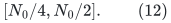

The pieces added to <code class="math">C</code> are disjoint. Summing their boundaries
in the CURRENT induced hosts yields
<!-- math-display: 6d82b940ffe1e8ddd3f74293
|\partial_G C|
                          \leq\psi_{\rm w}|C|.
 \tag{13}
-->
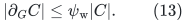
This argument does not require their boundaries in the original
host to be small individually. Edges to previously removed pieces
are already internal to the growing union and cause no additional
final boundary.

If complementation is needed, (11) gives
<!-- math-display: 0b04df453dc610a78e925b9d
\frac{|C|}{N_0-|C|}<\frac53.
 \tag{14}
-->
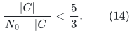
Equations (9), (13), and (14) show that the returned balanced cut
has sparsity at most <code class="math">5\psi/6&lt;\psi</code>.

### A success exit covers at least two thirds

Before a success, the remaining host has
<!-- math-display: 9aaad3903e84ee6140195311
|V(F)|>3N_0/4.
-->
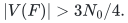
By the SAME weak coverage guarantee (2), valid at leaves as well
as internal nodes,
<!-- math-display: 1c37c511cef47d810172e6b6
|X|\geq(1-\beta)|V(F)|
               >(1-\beta)\frac{3N_0}{4}
               >\frac{2N_0}{3}.
 \tag{15}
-->
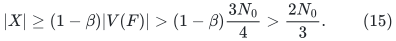
Thus every strong call returns either the balanced cut (12) or a
virtual expander on at least <code class="math">2N_0/3</code> vertices, exactly as
required by the continuing cut-matching game.

### The number of weak calls is fixed

Before a cut exit, the active host has more than <code class="math">3N_0/4</code>
vertices, so every added weak cut has size at least
<code class="math">3\beta N_0/4</code>. Therefore at most <code class="math">O(1/\beta)</code> calls occur.
Since <code class="math">\beta=1/1000</code> is a fixed constant, this changes only a
fixed factor in work. It does not add a factor depending on
<code class="math">p</code>, <code class="math">k_{\rm route}</code>, or the hierarchy depth to any geometric
embedding. Failed candidate hierarchies are not retained.

If the original graph is a promised expander and <code class="math">\psi</code> is
strictly below its sparsity, the primary hierarchy's actual-cut
arguments force the first weak call to have no nonempty removed
cut and to cover the entire original host. The exact-root-coverage
claim is therefore preserved as well.

### Exact coverage at a promised-expander root

Here is the complete argument for the last assertion; it does not
infer exact coverage merely from the weak success guarantee (2).
Suppose the ORIGINAL root host <code class="math">G</code> satisfies
<code class="math">\Psi(G)\geq\sigma&gt;0</code>, and every actual-host cutoff in its weak
construction is strictly below <code class="math">\sigma</code>. The spectral parameter
<code class="math">\eta</code>, covering cutoff, and fresh matching cutoffs are fixed
smaller multiples of the requested root threshold, so this condition
is explicit.

First consider a root that is a spectral leaf. Its FIRST proposed
removed set is a nonempty cut of <code class="math">G</code> with sparsity at most
<code class="math">\eta&lt;\sigma</code>, which is impossible. The primitive therefore
certifies the whole original root host. Later residual-host tests
are never reached, and the output is <code class="math">X=V(G)</code>.

At an internal root, every matching request is made on the FULL,
unchanged root host. The exact short-path packing lemma restores
all temporarily removed path-incident edges before publishing its
cut certificate; their boundary contribution has already been
paid by the terminal-count inequality in that lemma. Thus even
an arbitrarily small failure cut has its OWN true-host sparsity
certificate below <code class="math">\sigma</code>, with no additive error term.
No such failure cut exists, so no root block fails and the
accumulated root failure cut is empty. Recursive cuts inside a
block's ABSTRACT matching graph may still occur. They are not
cuts of <code class="math">G</code> and are not removed root vertices.

The successful good sets cover at least two thirds of the root
vertices. Run the exact covering matching on the FULL <code class="math">G</code>, as
specified in the fresh-cut adapter. Its possible failure cut also
has its own true-host sparsity certificate below <code class="math">\sigma</code>.
It is therefore impossible, and every vertex outside the good
sets receives a distinct partner inside them. Consequently the
enlarged blocks <code class="math">U_i^*</code> partition <code class="math">V(G)</code> exactly:
<!-- math-display: 2314ae73603747faba394103
V'=V(G),\qquad C_1=\varnothing.
 \tag{16}
-->
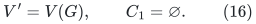
This uses the PRIMARY exact covering routine; no optional
leftover set <code class="math">B</code> is permitted in this argument.

Now inspect the FIRST proposed coarse removal. Before it, no
coarse block has been removed, and (16) is a full partition.
For every coarse subset <code class="math">\mathcal I</code>, its mass is
<code class="math">\left&#124;\bigcup_{i\in\mathcal I}U_i^*\right&#124;</code>, and its coarse
boundary is EXACTLY the boundary of this same vertex set in
<code class="math">G</code>. Internal edges of a block do not cross either cut.
Hence the coarse graph has mass sparsity at least <code class="math">\sigma</code>.
A returned smaller-side coarse cut of mass sparsity at most
<code class="math">\eta&lt;\sigma</code> is impossible. There is no first coarse
removal, and therefore
<!-- math-display: d91bf0e2ca0aae7ad45b84ec
C_2=\varnothing.
 \tag{17}
-->
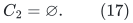
The terms involving <code class="math">\partial C_1</code> and optional
<code class="math">\Delta&#124;B&#124;</code> in the general coarse-to-host accounting are
both zero here. One need not claim that an arbitrary coarse
cut AFTER earlier removals has its own sparse cut in <code class="math">G</code>;
the first-removal argument prevents reaching that situation.

The first weak call therefore succeeds on ALL original root
vertices. The strong wrapper performs no later induced-host
call, retains this single hierarchy, and returns <code class="math">X=V(G)</code>.
This proves exact root coverage while allowing ordinary subset
successes and genuine cuts at nonroot abstract calls.

## 5. Interaction with the entropy and work lemmas

For an abstract matching-graph cut player, choose <code class="math">\psi\leq1/8</code>.
The strong wrapper returns an actual cut of sparsity below that
threshold and balance in (12), or a successful virtual graph.
The corrected half-matching entropy lemma applies unchanged.
Each matching occurrence keeps its separate native edge ID.

The smaller weak threshold in (9) and the smaller leaf stopping
mass in (4) are absolute constant changes. The spectral
certificate, the nonroot inverse-expansion recurrence, the single
root embedding, the actual-size leaf test, and the full query
router retain their stated asymptotic bounds.

This note is a proof-level correction to a success-interface
boundary. It is not an implementation test or an external
verification claim.
