# Finite arithmetic for the Steiner-packing client, and the Li skeleton dependency

## Status and scope

This is an independent audit of two dependencies of the proposed
[gomory-hu-seven-eighths-dependency-audit.md](gomory-hu-seven-eighths-dependency-audit.md) application. It assumes an
explicit rooted multi-source forest satisfying the strong interface in
[separated-metric-forest-and-strong-sssp.md](separated-metric-forest-and-strong-sssp.md), with the rooted extraction
proved in [multisource-rooted-approximate-ball-forest.md](multisource-rooted-approximate-ball-forest.md).

The conclusions below concern finite arithmetic, update accounting, and
the skeleton construction. They do not replace the rooted-forest proof,
the bounded-degree adapter, or the complete Gomory--Hu reduction.

Write

<!-- math-display: 6507c89f6ea3db532114cb4b
U=\log N,\qquad h=\log\log N,\qquad
 E=\exp O(U^{7/8}h^{1/8}).
-->
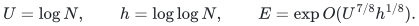

Here <code class="math">N</code> is a polynomial master bound on the original input size,
including the number of records in any one packing instance. A fixed
power of <code class="math">E</code> is absorbed into <code class="math">E</code>. The capacities in this section
are positive integers <code class="math">c_e\in[1,W]</code>, where <code class="math">W\leq N^{C}</code> for a
fixed constant. The accuracy parameter <code class="math">\eta</code> is a sufficiently small
**fixed rational constant**. This is sufficient for the Gomory--Hu
client, which only needs a fixed constant approximation to Steiner
connectivity. No variable-accuracy claim is made here.

The relevant public interfaces are Abboud et al.,
[arXiv:2507.20354v1](https://arxiv.org/html/2507.20354v1),
Algorithms 2--3, Claims 4.10 and 4.13, and Theorems 4.11, 4.22--4.23.
The finite-grid implementation below is a new derivation of the same
packing guarantee; it does not assume exact real exponentiation.

## 1. Common-grid packing values and exact loads

Let <code class="math">\kappa\leq E</code> be a fixed upper bound on the number of current
auxiliary-graph occurrences of any physical edge. Choose a power of two
<code class="math">\alpha</code> with

<!-- math-display: c21d091070f79651588690ca
8\kappa\leq\alpha<16\kappa.
-->
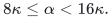

In outer iteration <code class="math">j</code>, the maintained terminal subtree projects to
a connected Steiner multigraph <code class="math">H_j</code>. Write <code class="math">k_{j,e}\leq\kappa</code>
for the multiplicity of physical edge <code class="math">e</code>, and use packing increment

<!-- math-display: 790d6e542a154a744ebc7b43
\Delta_j={\min_{e:k_{j,e}>0}c_e\over\alpha}.
             \tag{1}
-->
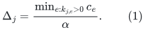

Every increment, pending value, and cumulative flushed load is therefore
an integer multiple of <code class="math">1/\alpha</code>. The conceptual full load is

<!-- math-display: 37b5bdb9488d7c4e17a42201
L_e=\sum_j k_{j,e}\Delta_j=a_e+b_e,
 \tag{2}
-->
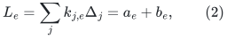

where <code class="math">a_e</code> is the load already flushed to its price and <code class="math">b_e</code> is
the sum still held on current occurrences. Before an occurrence is
retired its pending value is transferred to <code class="math">a_e</code>; the transfer must
occur before its mapping record disappears. A new occurrence starts
with pending value zero. These rules preserve (2) exactly.

Give every occurrence of <code class="math">e</code> threshold <code class="math">c_e/\alpha</code>. After all
threshold events have been settled,

<!-- math-display: 1cca5b86a2b37c774749cd33
0\leq b_e<{\kappa c_e\over\alpha}\leq c_e/8.
 \tag{3}
-->
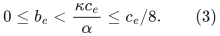

A whole outer iteration adds at most
<code class="math">\kappa\Delta_j\leq c_e/8</code> to any edge. Thus throughout its
subsequent settlement, including retirements,

<!-- math-display: 87c9399ef404a2edcdfcf59e
0\leq b_e\leq c_e/4.
              \tag{4}
-->
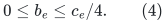

No packing increment is made in the middle of structural settlement.
This atomicity is needed both for (4) and for the capacity bound below.

## 2. Monotone dyadic prices with no accumulated error

Choose an integer

<!-- math-display: 16f573b20865eb4b8945875a
B\geq {10\log(2m)\over\eta\log 2},
 \qquad \delta=2^{-B}.
 \tag{5}
-->
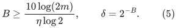

Since <code class="math">\eta</code> is fixed, <code class="math">B=O(U)</code>. Define conceptual prices

<!-- math-display: b70d642dd6183f6a927b86a1
q_e={\delta\over c_e}\exp(\eta a_e/c_e),
 \qquad
 Q_e={\delta\over c_e}\exp(\eta L_e/c_e).
 \tag{6}
-->
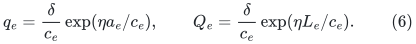

Only <code class="math">a_e</code>, not <code class="math">L_e</code>, has to be explicitly available during
the algorithm. The full price <code class="math">Q_e</code> is used for analysis.

Let <code class="math">\nu=\eta/1000</code>, and choose a common dyadic grid <code class="math">g</code> with

<!-- math-display: cf4e5a434d20faebb9b301b9
0<g\leq {\nu\delta\over4W}.
             \tag{7}
-->
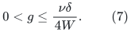

On each price refresh, compute a certified upper approximation to
<code class="math">q_e</code>, round upward to the grid, and ensure the resulting value
<code class="math">\widehat q_e</code> lies in <code class="math">[q_e,q_e+2g]</code>. Set

<!-- math-display: 439798c3913c044ac4e242ac
p_e\leftarrow\max\{p_e,\widehat q_e\}.
                  \tag{8}
-->
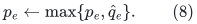

The previous price also lies below <code class="math">q_e+2g</code>, because the exact
<code class="math">q_e</code> is monotone. Consequently, at every settled or intermediate
price refresh,

<!-- math-display: eacc46a06bb18ac7fba4f17d
q_e\leq p_e\leq q_e+2g\leq(1+\nu)q_e.
       \tag{9}
-->
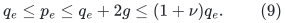

There is no multiplicative error per update. Recomputing from the exact
load <code class="math">a_e</code>, instead of multiplying the last rounded price, is the
essential step. Monotonicization in (8) does not accumulate error.

From (3)--(4),

<!-- math-display: 02740963908c40c874d0baa3
q_e\leq Q_e\leq e^{\eta/4}q_e,
 \qquad
 {Q_e\over e^{\eta/4}}\leq p_e\leq(1+\nu)Q_e.
 \tag{10}
-->
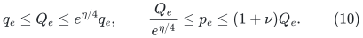

At the beginning of a settled outer iteration, the exponent
<code class="math">\eta/4</code> in the upper bound on <code class="math">Q_e/q_e</code> improves to
<code class="math">\eta/8</code>.

All tests use the exact dyadic sum

<!-- math-display: 3dfee9f2d9c2eab5dbb7e48a
D_p=\sum_e c_ep_e.
                         \tag{11}
-->
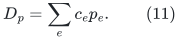

The outer loop continues while <code class="math">D_p&lt;1</code>. There is no floating-point
comparison with an uncertain stopping threshold.

## 3. Stopping, last-iteration overshoot, and feasible scaling

Let <code class="math">D_Q=\sum_e c_eQ_e</code>. At the start of the last outer iteration,
(3) and (9) imply <code class="math">D_Q\leq e^{\eta/8}D_p&lt;e^{\eta/8}</code>. The
iteration increases every exponent in (6) by at most <code class="math">\eta/8</code>.
Hence, at its end,

<!-- math-display: 8e1417c47a5b265d5b7eb781
{1\over1+\nu}\leq D_Q<e^{\eta/4}.
             \tag{12}
-->
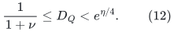

The lower bound follows from the final condition <code class="math">D_p\geq1</code> and
(9). Flushing changes <code class="math">a_e</code> and <code class="math">b_e</code> but leaves <code class="math">L_e</code>, and
therefore <code class="math">D_Q</code>, unchanged. It cannot create an additional overshoot.

For every physical edge,

<!-- math-display: 7c34ff68d2466e092bd8cf9b
\delta\exp(\eta L_e/c_e)=c_eQ_e\leq D_Q<e^{\eta/4},
-->
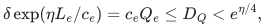

so

<!-- math-display: c7cb9e4c54eb02ed5d4846c2
{L_e\over c_e}<{B\log2+\eta/4\over\eta}.
                  \tag{13}
-->
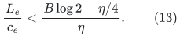

Compute once a rational number <code class="math">S</code> satisfying

<!-- math-display: ce842da011d1d8bba647e822
{B\log2+\eta\over\eta}
 \leq S\leq
 {B\log2+2\eta\over\eta}.
 \tag{14}
-->
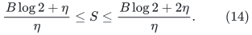

An upward dyadic approximation to <code class="math">\log2</code> with error at most
<code class="math">\eta/(2B)</code> suffices. Divide every packing value by <code class="math">S</code>. By
(13), the result is exactly capacity feasible. The scaling number has
<code class="math">O(U)</code> bits, and an interval algorithm for <code class="math">\log2</code> computes it
in <code class="math">\mathrm{poly}(U)</code> bit operations.

## 4. The packing value remains <code class="math">\lambda(U)/(4+O(\eta))</code>

Let <code class="math">P^*</code> denote the optimum fractional packing value of Steiner
trees; the standard packing/cut bound used by the public reduction is
<code class="math">P^*\geq\lambda(U)/2</code>. For every positive length vector <code class="math">z</code>,
averaging a feasible optimum packing gives

<!-- math-display: 52ccbb84085dc0a64ab150d8
\min_H z(H)\leq {\sum_e c_ez_e\over P^*}.
          \tag{15}
-->
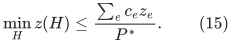

Assume the forest/MSF construction returns a
<code class="math">\gamma=2+O(\eta)</code> approximate Steiner multigraph under <code class="math">p</code>,
counting every occurrence separately. Any constant geometric rounding
loss used by its length-increase adapter is included in <code class="math">\gamma</code>.
By (10), the same multigraph is a

<!-- math-display: c6c8346bbfec597984da2786
\rho=\gamma(1+\nu)e^{\eta/8}=2+O(\eta)
                  \tag{16}
-->
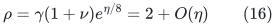

approximation under the full prices <code class="math">Q</code> at a settled iteration
start.

For <code class="math">x\in[0,\eta/8]</code>, <code class="math">e^x-1\leq e^{\eta/8}x</code>. Therefore

<!-- math-display: 290dfb45ff98420253c220fe
\begin{split}
 D_{Q,j+1}-D_{Q,j}
 &\leq \eta e^{\eta/8}\Delta_j
             \sum_e k_{j,e}Q_{j,e}\\
 &\leq {\eta e^{\eta/8}\rho\Delta_j\over P^*}\,D_{Q,j}.
\end{split}
\tag{17}
-->
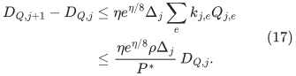

Starting from <code class="math">D_{Q,0}=m\delta</code>, iterating (17), and using (12)
at termination yields

<!-- math-display: f847f4cba19e7f0b15bf5d34
\sum_j\Delta_j\geq
 {P^*\over\eta e^{\eta/8}\rho}
 \bigl(B\log2-\log m-\log(1+\nu)\bigr).
 \tag{18}
-->
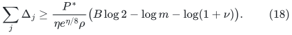

The choice (5) makes <code class="math">\log m/(B\log2)=O(\eta)</code>. Dividing
(18) by the rational scaling factor in (14) gives

<!-- math-display: d8656ffd73b120cf9b5bd20b
{\sum_j\Delta_j\over S}
       \geq {P^*\over\rho}(1-O(\eta))
       \geq {\lambda(U)\over4+O(\eta)}.
 \tag{19}
-->
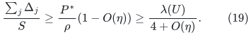

Taking a sufficiently small fixed rational <code class="math">\eta</code> gives the
<code class="math">4.1</code> packing/sparsifier factor used in the guide-tree reduction.
The inequalities have strict constant slack; exact transcendentals are
unnecessary.

## 5. Update counts, including retirement flushes

An outer iteration has a minimum-capacity witness edge <code class="math">e</code> whose
full normalized load <code class="math">L_e/c_e</code> increases by at least
<code class="math">1/\alpha</code>. Equation (13) bounds its final normalized load by
<code class="math">O(U)</code>. Charging each iteration to one deterministic witness gives

<!-- math-display: e099eef2b86ae1a6e23b6f59
T=O(m\alpha U).
                       \tag{20}
-->
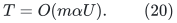

A threshold-triggered flush has pending load at least
<code class="math">c_e/\alpha</code>, and hence increases <code class="math">a_e/c_e</code> by at least
<code class="math">1/\alpha</code>. The same argument bounds these flushes by
<code class="math">O(m\alpha U)</code>. This proof does not require the rounded price
itself to increase by a visible multiplicative amount on every flush.

Retirement flushes may contain arbitrarily small pending loads. They
are charged instead to actual deletions of occurrence records in
<code class="math">A</code>. This charge is safe under the following architecture:

1. The strong forest receives only monotone **geometric level** changes
   in physical lengths. Each physical edge has <code class="math">O(U)</code> such changes.
2. Fine-grid updates of <code class="math">p_e</code> refresh its current auxiliary
   occurrences and the MSF keys, but do not by themselves submit a new
   structural forest update.
3. Changes to the MSF and its terminal subtree do not modify the
   underlying auxiliary graph <code class="math">A</code>. They only change the dynamic-tree
   and Euler-tour state.
4. Before deleting an <code class="math">A</code> occurrence, flush its value while its
   physical mapping is still present. Enqueue a geometric level change
   if and only if a new level has been crossed, and settle the resulting
   queue before the next packing increment.

The number of structural forest updates is thus bounded independently
of the number of retirement flushes. If its explicit recourse is
<code class="math">R\leq mE</code>, retirement flushes cost <code class="math">O(R)</code> refresh events.
Refreshing all current occurrences multiplies this by at most
<code class="math">\kappa\leq E</code>. Dynamic MSF, Steiner-subtree, and Euler-tour work
have only polylogarithmic additional overhead. This avoids a circular
argument in which a tiny retirement flush is assumed to pay for the
structural changes that caused it.

The auxiliary native-edge keys also depend on endpoint distance
estimates. Consequently, the rooted forest interface must supply an
explicit bounded inventory of **estimate changes**, not merely forest
edge changes. The public approximate-ball labels provide this inventory
when exposed as in the rooted multi-source note. With bounded or
polylogarithmic physical degree, each such change affects only a
polylogarithmic number of native-edge keys. Recomputing every descendant
distance after each forest edit would not satisfy the claimed bound.

## 6. Polynomial structural aspect ratio and bit complexity

Equations (9) and (12)--(13) imply, throughout the execution,

<!-- math-display: 43125ddcea71511bfaf1630c
\delta/W\leq p_e<2.
                      \tag{21}
-->
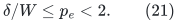

Every <code class="math">p_e</code> is a multiple of the common dyadic grid <code class="math">g</code>.
Therefore the integer lengths <code class="math">p_e/g</code> lie in

<!-- math-display: 45d6b30b4a033d752f311aac
[1,2/g]\subseteq[1,N^{C_1}],
                       \tag{22}
-->
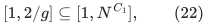

for a fixed constant <code class="math">C_1</code>. This is a bound on the actual
**structural aspect ratio**, not just on the number of bits used to
write an arbitrary rational length. It removes the need for a separate
optimal-Steiner-length epoch scheme in this fixed-accuracy application.

For geometric deletion copies, one may use exact integer levels: keep
all integers up to <code class="math">\lceil1/\eta\rceil</code>, and subsequently use
<code class="math">z_{i+1}=\lceil(1+\eta)z_i\rceil</code>. Above the initial range,
successive ratios are at most <code class="math">1+2\eta</code>, and there are <code class="math">O(U)</code>
levels. Each level value has <code class="math">O(U)</code> bits. Retire copies below the
current integer length; the smallest surviving copy is within a
<code class="math">1+O(\eta)</code> factor of that length.

This creates a polylogarithmic degree increase. The strong-forest
adapter must either explicitly allow that increase, paying the degree
factor at its bounded-degree uses, or supply a fixed port expansion.
It must not silently call a strict degree-three interface on the
parallel-copy graph. The degree/port lemma is audited separately from
the numerical argument here.

All exact loads have common denominator <code class="math">\alpha</code>; their numerators
are at most <code class="math">\alpha W\,O(U)</code>. The exponent <code class="math">\eta a_e/c_e</code>
is therefore a rational with <code class="math">O(U)</code> bits and magnitude <code class="math">O(U)</code>.
Certified evaluation of its exponential to absolute error <code class="math">g</code>
uses <code class="math">\mathrm{poly}(U)</code> bit operations, for example by range
reduction and interval Taylor arithmetic. The output accuracy needs
only <code class="math">\log(1/g)=O(U)</code> bits. This remains true for every refresh;
there is no growing product denominator.

## 7. The output sparsifier can be made an integer graph

Every Euler-tour accumulation used to extract the vertex sparsifier
is a sum of increments (1). Its raw edge weights are integer multiples
of <code class="math">1/(2\alpha)</code>. After feasible scaling by <code class="math">S</code>, a produced
edge has weight

<!-- math-display: a3647dffb7bc767d6632b4be
{z_e\over2\alpha S},
                           \qquad z_e\in\mathbb Z_{\geq0}.
                           \tag{23}
-->
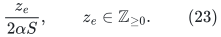

Discard zero weights. Rather than repeatedly rationalizing these
values, run the skeleton algorithm on the graph whose capacities are
the integers <code class="math">z_e</code>. This graph is exactly the produced vertex
sparsifier multiplied by the one common factor <code class="math">2\alpha S</code>.
All cut ratios, near-mincut sets, and guide-tree conclusions are
unchanged.

From (20), every <code class="math">z_e</code> is at most a polynomial in
<code class="math">T,\alpha,W</code>, and hence at most <code class="math">N^{C_2}</code> for a fixed
constant. The graph has <code class="math">mE</code> records. Thus the skeleton input has
polynomial integer weights relative to the master bound. No least
common multiple of many unrelated denominators is needed.

## 8. Li's corrected skeleton theorem and the near-mincut extension

The current primary source is Jason Li,
[arXiv:2106.05513v2](https://arxiv.org/html/2106.05513v2),
Theorem 1.5, Claim 3.6, Sections 3.4--3.5. Its accuracy dependence is
<code class="math">\varepsilon^{-7}</code>, replacing the older
<code class="math">\varepsilon^{-4}</code> quoted in the Gomory--Hu paper. Write

<!-- math-display: 9294b7d5da18c66c6b7ba851
F_5(N)=\exp O(U^{5/6}h^{O(1)}).
-->
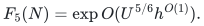

For a fixed constant <code class="math">c&gt;1</code>, the following adaptation is valid.
Multiply the unbalanced-cut parameter by a sufficiently large
constant depending on <code class="math">c</code>. The canonical-decomposition estimate
then covers every cut of weight at most <code class="math">c\lambda</code>, and the
sampling error plus the light lossy overlay gives relative error
<code class="math">\varepsilon</code> on these cuts. In the large-edge preprocessing,
clip at **<code class="math">c\widetilde\lambda</code>**, where
<code class="math">\widetilde\lambda\in[\lambda,3\lambda]</code>. This leaves all
cuts of weight at most <code class="math">c\lambda</code> unchanged, preserves the global
mincut, and increases the splitting inventory only by a constant.

The resulting unweighted multigraph <code class="math">H</code> has

<!-- math-display: c9cc3d3798cc72610dc51475
\begin{split}
 m_H&\leq m'\varepsilon^{-7}F_5(N),\\
 W_H&\geq \varepsilon^7\lambda/F_5(N),\\
 \lambda_H&\leq (1+\varepsilon)\lambda/W_H
          \leq O(\varepsilon^{-7}F_5(N)).
\end{split}
\tag{24}
-->
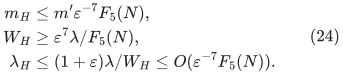

Here <code class="math">m'</code> is the vertex-sparsifier input inventory. Every cut has
<code class="math">W_H&#124;\partial_HS&#124;\geq(1-\varepsilon)\lambda</code>, and cuts of
weight at most <code class="math">c\lambda</code> satisfy the required upper bound.
The adjustment of the unbalanced parameter affects only fixed
constants in <code class="math">F_5</code>. In particular, the corrected
<code class="math">\varepsilon^{-7}</code> does not change the leading exponent at the
constant accuracy used by guide trees.

The original clipping threshold <code class="math">\widetilde\lambda</code> is
insufficient for this extension: it can change a cut of size between
<code class="math">\lambda</code> and <code class="math">c\lambda</code>. This is why the threshold change
above is an actual proof obligation.

## 9. Both skeleton size and tree-packing size are paid

The guide-tree construction uses <code class="math">\widetilde O(m_H\lambda_H)</code>
time. Substituting both bounds in (24) yields

<!-- math-display: 2c5621606f7cf26dfbbb7bd4
\widetilde O(m_H\lambda_H)
           \leq m'\varepsilon^{-14}F_5(N)^2
                    \mathrm{poly}(U).
       \tag{25}
-->
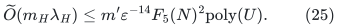

Thus one cannot count only the skeleton construction while treating
its unweighted mincut as a constant. Nevertheless, for fixed
<code class="math">\varepsilon</code>, (25) remains below the proposed strong-forest
envelope: every fixed <code class="math">U^{5/6}h^C</code> is
<code class="math">o(U^{7/8}h^{1/8})</code>. If <code class="math">m'\leq mE</code>, the whole
skeleton/tree-packing stage is <code class="math">mE</code>.

## 10. Audit conclusion

The numerical implementation and the corrected Li dependency preserve
the proposed <code class="math">7/8</code> envelope. The conclusion requires the explicit
interfaces listed above: atomic occurrence retirement, monotone
geometric structural updates, a bounded distance-label transcript, and
a valid bounded-degree or polylog-degree adapter. Under those
interfaces, neither exact real arithmetic, unbounded denominators,
hidden length aspect ratio, nor the skeleton's tree-packing inventory
introduces a larger exponent.
